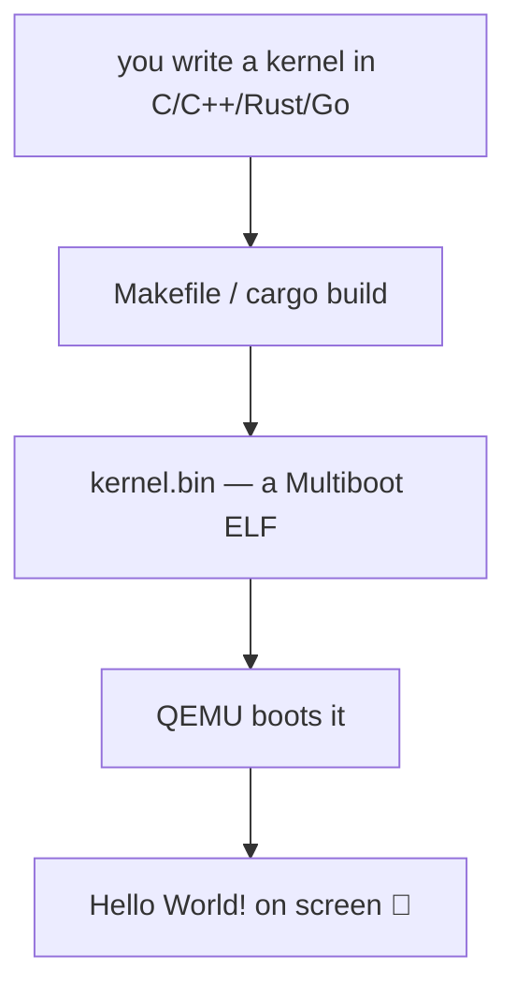

# Example_OS_Project

**A minimal bootable operating system that prints "Hello World!" — in C, C++, Rust, Go, and C#.**

This is the hands-on half of `OSDev_Learning_Hub`. The theory lives in
[`synthesized_tutorials/`](../synthesized_tutorials/) — this folder is where
you actually build and boot a real [kernel](../GLOSSARY/kernel.md "The core program that owns the machine and manages hardware") in [QEMU](https://www.qemu.org/).



## Quick start
```bash
# 1. verify your toolchain
./tools/check-env.sh

# 2. build everything buildable on this machine
./tools/build-all.sh        # or: make

# 3. boot a kernel
make run-c                  # C    kernel → QEMU
make run-cpp                # C++  kernel → QEMU
make run-rust               # Rust kernel → QEMU (needs nightly + bootimage)
```

## What you'll see
QEMU opens a window:

```
Hello World!
Welcome to your very own operating system (C edition).
```

## Structure
```
Example_OS_Project/
├── Makefile            # top-level build orchestrator
├── c/                  # C    kernel (boot.s, kernel.c, linker.ld)
├── cpp/                # C++  kernel (boot.s, kernel.c++, linker.ld)
├── rust/               # Rust kernel (src/main.rs, no_std, bootimage)
├── go/                 # Go   kernel (boot.s + kernel.go + terminal/)
├── csharp/             # C#   kernel (Kernel.cs, Cosmos-style)
├── build/              # build artifacts (gitignored)
├── docs/setup.md       # full setup + troubleshooting guide ← start here
├── iso/                # ISO generation scratch
└── tools/              # check-env.sh, build-all.sh
```

## Language status matrix
| Language | Bootable? | Verified in this hub | Manual step remaining |
|----------|-----------|----------------------|------------------------|
| **C**    | ✅ | ✅ **boots in [QEMU](../GLOSSARY/qemu.md "A free emulator you can boot your kernel in for testing"), prints "Hello World!"** (read back from VGA) | none |
| **C++**  | ✅ | ✅ **boots in QEMU, prints "Hello World!"** (read back from VGA) | none |
| **Rust** | ✅ | ✅ compiles as a `no_std` kernel | install nightly + `cargo bootimage`, then `make run` |
| **Go**   | ⚠️ | ✅ code vets/gofmt-clean | build `i686-elf-gccgo` [cross-compiler](../GLOSSARY/cross-compiler.md "A compiler that builds code for a different CPU/OS than the one it runs on"), then `make run-go` |
| **C#**   | ⚠️ | ✅ code is a valid [Cosmos](../GLOSSARY/cosmos.md "An open-source C# operating-system kit") kernel | install Cosmos + VS2022, then `dotnet build` |

> **Why Go and C# aren't fully bootable here:** Go needs a Go-enabled
> cross-compiler (`gccgo`), and C# needs the Cosmos OS framework — neither
> was installed on this machine. The code is complete and the exact steps
> are in each folder's `README.md`. Everything the machine *can* build has
> been built and verified.

---

**Read [`docs/setup.md`](docs/setup.md) first.** Then open the C kernel —
`c/boot.s` → `c/kernel.c` → `c/linker.ld` — every line is commented.


---

## Watch and learn

Curated YouTube videos matched to what this project does — booting a Multiboot kernel and printing "Hello World!" in QEMU.

<details class="video-embed">
<summary>▶ Watch: Write Your Own 64-bit Operating System Kernel #1 - Boot code and multiboot header</summary>
<iframe src="https://www.youtube-nocookie.com/embed/FkrpUaGThTQ" title="Write Your Own 64-bit Operating System Kernel #1 - Boot code and multiboot header" width="100%" height="400" style="border:0;border-radius:8px;" allow="accelerometer; autoplay; clipboard-write; encrypted-media; gyroscope; picture-in-picture; web-share" allowfullscreen></iframe>
<p class=video-caption>David Callanan's series start: boots a Multiboot2 64-bit kernel in QEMU, just like this project.</p>
</details>
<details class="video-embed">
<summary>▶ Watch: Write Your Own 64-bit Operating System Kernel #2 - Stack, long mode and printing using C code</summary>
<iframe src="https://www.youtube-nocookie.com/embed/wz9CZBeXR6U" title="Write Your Own 64-bit Operating System Kernel #2 - Stack, long mode and printing using C code" width="100%" height="400" style="border:0;border-radius:8px;" allow="accelerometer; autoplay; clipboard-write; encrypted-media; gyroscope; picture-in-picture; web-share" allowfullscreen></iframe>
<p class=video-caption>sets up the stack, long mode, and prints from C — the same path this kernel takes to print "Hello World!".</p>
</details>
<details class="video-embed">
<summary>▶ Watch: 1 - How to make an operating system from scratch</summary>
<iframe src="https://www.youtube-nocookie.com/embed/rr-9w2gITDM" title="1 - How to make an operating system from scratch" width="100%" height="400" style="border:0;border-radius:8px;" allow="accelerometer; autoplay; clipboard-write; encrypted-media; gyroscope; picture-in-picture; web-share" allowfullscreen></iframe>
<p class=video-caption>a beginner OSdev walkthrough that builds and boots a kernel with QEMU.</p>
</details>
<details class="video-embed">
<summary>▶ Watch: How does an OS boot? //Source Dive// 001</summary>
<iframe src="https://www.youtube-nocookie.com/embed/KkenLT8S9Hs" title="How does an OS boot? //Source Dive// 001" width="100%" height="400" style="border:0;border-radius:8px;" allow="accelerometer; autoplay; clipboard-write; encrypted-media; gyroscope; picture-in-picture; web-share" allowfullscreen></iframe>
<p class=video-caption>Low Byte Productions explains the boot process your Multiboot header rides on.</p>
</details>
<details class="video-embed">
<summary>▶ Watch: QEMU/KVM for absolute beginners</summary>
<iframe src="https://www.youtube-nocookie.com/embed/BgZHbCDFODk" title="QEMU/KVM for absolute beginners" width="100%" height="400" style="border:0;border-radius:8px;" allow="accelerometer; autoplay; clipboard-write; encrypted-media; gyroscope; picture-in-picture; web-share" allowfullscreen></iframe>
<p class=video-caption>how the emulator this project uses works and how to drive it.</p>
</details>
