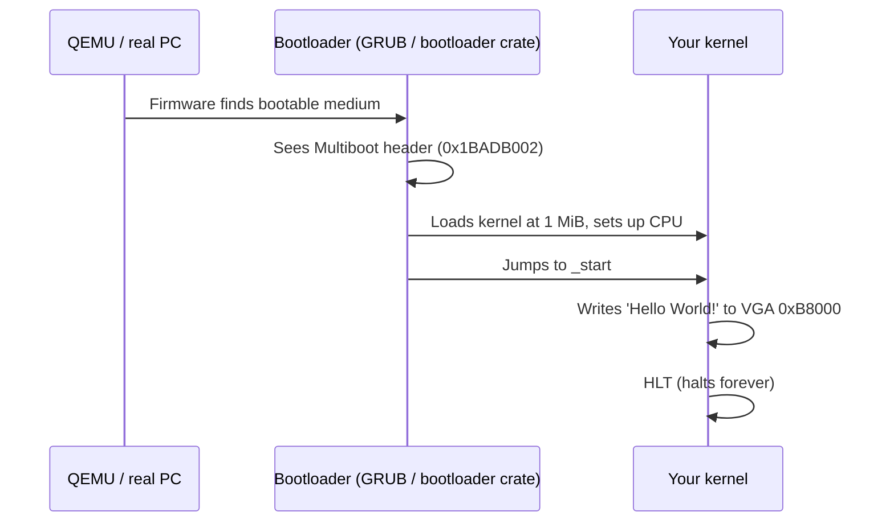

# Example_OS_Project — build & run guide

This folder contains a **minimal bootable operating system** that prints
**"Hello World!"** — implemented in **five languages**: C, C++, Rust, Go, and C#.
The goal is to prove your toolchain works by booting a real [kernel](../../GLOSSARY/kernel.md "The core program that owns the machine and manages hardware") in [QEMU](../../GLOSSARY/qemu.md "A free emulator you can boot your kernel in for testing").

## Table of contents
1. [What's here](#whats-here)
2. [Environment prerequisites](#environment-prerequisites)
3. [Build & run the C kernel (the reference)](#build--run-the-c-kernel-the-reference)
4. [Run the other languages](#run-the-other-languages)
5. [Project structure](#project-structure)
6. [How the boot works](#how-the-boot-works)
7. [Troubleshooting](#troubleshooting)

---

## What's here
| Language | Folder | Entry point | Boot method |
|----------|--------|-------------|-------------|
| C | `c/` | `kernel_main()` in `kernel.c` | [Multiboot](../../GLOSSARY/multiboot.md "The protocol that lets a bootloader load any kernel; magic 0x1BADB002") ([GRUB](../../GLOSSARY/grub.md "The free GNU bootloader that loads Multiboot kernels")/QEMU -kernel) |
| C++ | `cpp/` | `extern "C" kernel_main()` in `kernel.c++` | Multiboot |
| Rust | `rust/` | `_start()` in `src/main.rs` | `bootloader` crate + `bootimage` |
| Go | `go/` | `Main()` in `kernel.go` | Multiboot + [gccgo](../../GLOSSARY/gccgo.md "GCC's Go front-end, used to compile Go kernels bare-metal") |
| C# | `csharp/` | `Kernel.Run()` in `Kernel.cs` | [Cosmos](../../GLOSSARY/cosmos.md "An open-source C# operating-system kit") kit |

## Environment prerequisites
The C, C++, and Go kernels need a **32-bit Multiboot cross build**; Rust needs
a **bare-metal/nightly** Rust setup; C# needs Cosmos + Visual Studio.

| Tool | Needed by | How to get it |
|------|-----------|---------------|
| `as` (GNU assembler) | C/C++/Go | binutils (`sudo apt install binutils` / WSL has it) |
| `gcc` / `g++` (with `-m32`) | C / C++ | `sudo apt install gcc g++ gcc-multilib g++-multilib` |
| `ld` (GNU linker) | all | binutils |
| `make` | all | `sudo apt install make` |
| `qemu-system-x86_64` | running | `sudo apt install qemu-system-x86` |
| `nasm` (optional) | boot.s (if not using `as`) | `sudo apt install nasm` |
| `rustup` + nightly | Rust | `curl --proto '=https' --tlsv1.2 -sSf https://sh.rustup.rs \| sh` |
| `cargo bootimage` | Rust bootable image | `cargo install bootimage` + `rustup component add llvm-tools-preview` |
| gccgo cross `i686-elf-gccgo` | Go | see `go/README.md` (build from GCC source) |
| Cosmos DevKit + VS2022 | C# | see `csharp/README.md` |

> **Windows tip:** the easiest way to get `as`/`gcc`/`g++`/`ld`/`make`/`qemu`
> all at once is **WSL2 (Ubuntu)**. This hub was built and verified in WSL2.

---

## Build & run the C kernel (the reference)

From inside `Example_OS_Project`:

```bash
# build
make -C c

# boot it in QEMU
make run-c
```

QEMU opens a window showing:
```
Hello World!
Welcome to your very own operating system (C edition).
```

Everything in the C kernel is heavily commented — read `c/boot.s`,
`c/kernel.c`, and `c/linker.ld` in order.

## Run the other languages

```bash
make run-cpp     # C++ kernel (same Multiboot approach)
make run-rust    # Rust kernel (needs nightly + bootimage)
make run-go      # Go kernel   (needs i686-elf-gccgo)
make iso-c       # C kernel as a real bootable ISO (needs grub-mkrescue)
```

## Project structure
```
Example_OS_Project/
├── Makefile          # top-level build orchestrator
├── c/                # C    kernel (boot.s, kernel.c, linker.ld, Makefile)
├── cpp/              # C++  kernel (boot.s, kernel.c++, ...)
├── rust/             # Rust kernel (src/main.rs, Cargo.toml, .cargo config)
├── go/               # Go   kernel (boot.s, kernel.go, terminal/, linker.ld)
├── csharp/           # C#   kernel (Kernel.cs, ExampleOS.csproj)
├── build/            # (build artifacts)
├── docs/             # ← this guide + setup notes
├── iso/              # (ISO generation scratch)
└── tools/            # helper scripts
```

## How the boot works

See `../synthesized_tutorials/` for a full beginner guide that explains each
of these concepts ([bootloaders](../../GLOSSARY/bootloader.md "A small program that loads your kernel into memory and jumps to it"), [memory management](../../GLOSSARY/memory-management.md "How a kernel tracks used and free RAM and hands it out safely"), [interrupts](../../GLOSSARY/interrupt.md "A hardware signal that makes the CPU run a registered handler"), [VGA text mode](../../GLOSSARY/vga-text-mode.md "The 80x25 character display mode a minimal kernel writes to")).

## Troubleshooting
| Symptom | Fix |
|---------|-----|
| `as: command not found` | install binutils (`sudo apt install binutils`) |
| `gcc: cannot find crt1.o` / multilib error | install `gcc-multilib g++-multilib` |
| `qemu-system-i386: command not found` | install qemu (`sudo apt install qemu-system-x86`) |
| Rust `error: linker not found` | add `rust-lld` / use the `bootimage` flow; ensure `llvm-tools-preview` |
| GRUB "no multiboot header found" on real disk | use a cross-compiler (`i686-elf-gcc`); see OSDev wiki |
| QEMU shows nothing / black screen on **Windows PowerShell** | run QEMU from WSL or use `-nographic -serial stdio` |


## Watch and learn

Videos matched to building your toolchain and booting this kernel in QEMU.

<details class="video-embed">
<summary>▶ Watch: QEMU/KVM for absolute beginners</summary>
<iframe src="https://www.youtube-nocookie.com/embed/BgZHbCDFODk" title="QEMU/KVM for absolute beginners" width="100%" height="400" style="border:0;border-radius:8px;" allow="accelerometer; autoplay; clipboard-write; encrypted-media; gyroscope; picture-in-picture; web-share" allowfullscreen></iframe>
<p class=video-caption>learn what QEMU is and how to run a VM, the environment this project boots in.</p>
</details>
<details class="video-embed">
<summary>▶ Watch: QEMU: A proper guide!</summary>
<iframe src="https://www.youtube-nocookie.com/embed/AAfFewePE7c" title="QEMU: A proper guide!" width="100%" height="400" style="border:0;border-radius:8px;" allow="accelerometer; autoplay; clipboard-write; encrypted-media; gyroscope; picture-in-picture; web-share" allowfullscreen></iframe>
<p class=video-caption>a close look at QEMU launch options, useful for the `qemu-system-i386 -kernel kernel.bin` commands here.</p>
</details>
<details class="video-embed">
<summary>▶ Watch: Write Your Own 64-bit Operating System Kernel #1 - Boot code and multiboot header</summary>
<iframe src="https://www.youtube-nocookie.com/embed/FkrpUaGThTQ" title="Write Your Own 64-bit Operating System Kernel #1 - Boot code and multiboot header" width="100%" height="400" style="border:0;border-radius:8px;" allow="accelerometer; autoplay; clipboard-write; encrypted-media; gyroscope; picture-in-picture; web-share" allowfullscreen></iframe>
<p class=video-caption>shows assembling and booting a Multiboot kernel in QEMU exactly like `setup.md`.</p>
</details>
<details class="video-embed">
<summary>▶ Watch: 1 - How to make an operating system from scratch</summary>
<iframe src="https://www.youtube-nocookie.com/embed/rr-9w2gITDM" title="1 - How to make an operating system from scratch" width="100%" height="400" style="border:0;border-radius:8px;" allow="accelerometer; autoplay; clipboard-write; encrypted-media; gyroscope; picture-in-picture; web-share" allowfullscreen></iframe>
<p class=video-caption>a step-by-step environment/build/boot walkthrough matching the setup guide.</p>
</details>
<details class="video-embed">
<summary>▶ Watch: How does an OS boot? //Source Dive// 001</summary>
<iframe src="https://www.youtube-nocookie.com/embed/KkenLT8S9Hs" title="How does an OS boot? //Source Dive// 001" width="100%" height="400" style="border:0;border-radius:8px;" allow="accelerometer; autoplay; clipboard-write; encrypted-media; gyroscope; picture-in-picture; web-share" allowfullscreen></iframe>
<p class=video-caption>background on firmware, bootloader and kernel startup covered by this setup page.</p>
</details>
