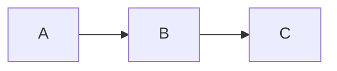

<!-- GLOSSARY PAGE TEMPLATE — copy this structure for every <slug>.md page.
     Replace every {{PLACEHOLDER}}. Do not rename the file; it must be <slug>.md. -->

# {{Term Name}}

> **[Back to glossary index](README.md)** · Category: {{category}}

{{ONE SENTENCE: what this term means, plain and simple.}}

## The short version
{{A 2-3 sentence plain-English summary — grounded in what the hub's tutorials actually teach.}}

## Detailed explanation
{{2-4 paragraphs of real detail. Draw the substance from the hub's own docs and tutorials
(e.g. synthesized_tutorials/concepts/*, path_*/ reference files). Add specifics:
register numbers, magic numbers, addresses, actual code — not vague prose.}}

{{OPTIONAL: a Mermaid diagram if it clarifies the concept. If you add one, make sure it is
valid Mermaid. Example:}}



{{Keep diagrams in their own ```mermaid code block.}}

## Why it matters here (OSDev_Learning_Hub)
{{How this term appears in our Example_OS_Project and tutorials — point to the real file(s),
e.g. `Example_OS_Project/c/boot.s` or `synthesized_tutorials/concepts/04-vga-text-mode.md`.}}

## Watch / listen
{{If a good free resource exists, add a real link. It is OK to note "no video yet — add one here"
if you cannot verify a URL. Prefer verifiable, well-known free sources:
OSDev Wiki (wiki.osdev.org), Wikipedia, the official docs. Do NOT invent URLs.}}

- [OSDev Wiki — {{related page}}](https://wiki.osdev.org/{{Page}}) — free, authoritative
- {{any other verified free link}}

## Related terms
{{Cross-links to other glossary pages, using RELATIVE paths so they work in the GLOSSARY dir:
[Multiboot](multiboot.md), [Bootloader](bootloader.md), etc.}}

- [{{Term A}}]({{slug-a}}.md)
- [{{Term B}}]({{slug-b}}.md)

---
*Grounded in the OSDev_Learning_Hub tutorials, the OSDev Wiki (free), and standard OS-dev references.*
