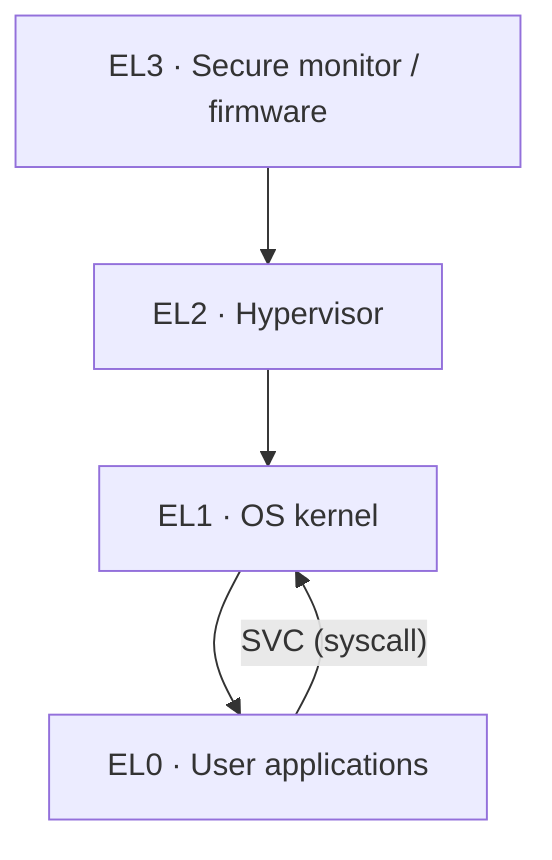

<!-- Glossary page — ARM. Grounded in OSDev_Learning_Hub docs, Arm Developer docs, and the OSDev Wiki. -->

# ARM

> **[Back to glossary index](README.md)** · Category: Architecture

ARM is a family of RISC instruction-set architectures — the 32-bit AArch32 and 64-bit AArch64 execution states — used in Raspberry Pi, smartphones, and virtually all embedded devices, and defined by Arm under license to silicon makers.

## The short version
Where x86 is one architecture from a handful of vendors all obeying the same "PC" shape, ARM is a *family* of related ISA variants implemented in countless System-on-Chips (SoCs) — the Arm company designs the ISA and cores, then licenses them to chipmakers who add their own peripherals. Two execution states matter today: **AArch32** (the classic 32-bit ARM/Thumb, what Raspberry Pi 1-2 and most MCUs use) and **AArch64** (the 64-bit state used by Raspberry Pi 3-5, modern phones, and Apple silicon). For bare-metal OS dev, the Raspberry Pi's documented, cheap hardware plus rich tutorials make ARM the most common non-x86 way to write a kernel from scratch.

## Detailed explanation
ARM is a **load-store** RISC architecture: only load and store instructions touch memory; everything else operates on registers. That differs from x86, where many instructions can read memory directly. Other notable differences from x86:

- **Register-intensive, orthogonal ISAs** — 16 (AArch32) or 31 (AArch64, `x0`–`x30`) general-purpose registers, with clear roles: R15/LR is the program counter in AArch32, X30 is the link register in AArch64.
- **Condition codes** — ARM famously lets most instructions be executed *conditionally* (EQ, NE, GT, …) based on the flags in the CPSR/PSTATE, cutting branch overhead; x86 only conditionally branches.
- **SIMD** — the **NEON** extension provides 128-bit SIMD vectors (128-bit registers in AArch64), used heavily for multimedia/DSP.
- **Memory model** — ARM has a weak memory model, so sharing data across cores requires explicit **memory barriers** (fences like `dmb`/`dsb`) and instructions with acquire/release semantics — crucial for writing correct SMP kernel spinlocks, unlike x86's stronger TSO model.

The execution-state privilege model is where ARM most contrasts with x86. AArch32 kept the older *processor modes* (User, FIQ, IRQ, Supervisor, Abort, Undefined, System) with banked registers, the way the OSDev Wiki describes syscalls pinning to the `SWI`/`SVC` vector. AArch64 replaced that with a clean **Exception level (EL)** hierarchy:

- **EL0** — user applications (lowest privilege; cannot touch system registers)
- **EL1** — the OS kernel (virtual memory via `TTBR0_EL1`/`TTBR1_EL1`, exception vector base `VBAR_EL1`)
- **EL2** — the hypervisor (virtualization, stage-2 translation)
- **EL3** — the secure monitor / firmware (highest privilege, TrustZone world switching)

The only way to move to a higher EL is to take an exception; the only way down is `ERET`. This is the direct ARM analogue of x86's protection rings (ring 0/3), but with a hardware-enforced 4-level hierarchy. On reset the CPU enters the **highest implemented EL** (often EL3, sometimes EL1), so bare-metal code must drop itself down to EL1 before running an OS.

## Why it matters here (OSDev_Learning_Hub)
- The hub's kernels target **x86** (`Example_OS_Project/{c,cpp,go,rust}`), so ARM is presented here as the closest & most popular alternative bare-metal target.
- The Raspberry Pi is the canonical ARM dev board: from Pi 1 (ARM1176, AArch32) through Pi 3/4/5 (Cortex-A53/A72, AArch64 with `raspi`/`virt` QEMU machines), its GPIO/MMIO peripheral model exercises the same [Memory-Mapped I/O](memory-mapped-io.md), [Interrupt](interrupt.md), and [Paging](paging.md) concepts the glossary covers — just with a different `MMIO_BASE` and vector table layout.
- Concepts map directly: ARM's vector table ⇄ the hub's [IDT](idt.md)/[ISR](isr.md); AArch64 EL1 ⇄ [Long Mode / ring 0](long-mode.md); the `SVC` syscall ⇄ [Syscall](syscall.md).

## Watch / listen
- [Arm Developer — Learning the Architecture: Exception model](https://developer.arm.com/architectures/learn-the-architecture/exception-model/single-page) — EL0–EL3, vector tables (free, authoritative)
- [Arm Developer — Introducing the A64 ISA (AArch64)](https://developer.arm.com/documentation/102374/) — the 64-bit instruction set (free)
- [OSDev Wiki — ARM Overview](https://wiki.osdev.org/ARM_Overview) — modes, registers, history (free)
- [OSDev Wiki — Raspberry Pi Bare Bones](https://wiki.osdev.org/Raspberry_Pi_Bare_Bones) — minimal AArch64 kernel tutorial (free)
- [s-matyukevich/raspberry-pi-os](https://github.com/s-matyukevich/raspberry-pi-os) — step-by-step RPi OS built against the Linux sources (free, GitHub)
- [QEMU — 'virt' generic ARM virtual platform](https://www.qemu.org/docs/master/system/arm/virt.html) — the standard QEMU machine for testing ARM kernels

## Related terms
- [Cross-Compiler](cross-compiler.md)
- [QEMU](qemu.md)
- [Kernel](kernel.md)
- [Interrupt](interrupt.md)
- [x86](x86.md)

---
*Grounded in the OSDev_Learning_Hub tutorials, Arm Developer documentation (free), the OSDev Wiki (free), and standard OS-dev references.*
