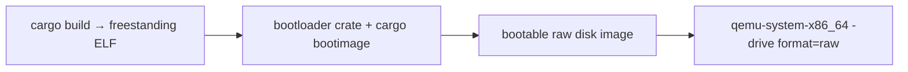

<!-- Glossary page — Rust bootloader crate. Grounded in OSDev_Learning_Hub docs. -->

# bootloader crate

> **[Back to glossary index](README.md)** · Category: Toolchain & build

The `bootloader` crate is a Rust library (from *Writing an OS in Rust*) that wraps your freestanding kernel ELF into a bootable disk image so QEMU or real hardware can boot it.

## The short version
Building a Rust kernel with `cargo build --target x86_64-unknown-none` gives you an ELF *kernel*, but an ELF alone doesn't boot — something has to load it into memory and jump to it first. The `bootloader` crate provides that "something": it bundles your kernel into a BIOS-bootable raw disk image. The downside is that this crate needs a **nightly** Rust toolchain, whereas the kernel itself builds fine on stable.

## Detailed explanation
The Rust kernel in `Example_OS_Project/rust/` is a `no_std` freestanding binary you can verify on stable:

```bash
rustup target add x86_64-unknown-none
cargo build --target x86_64-unknown-none
# ⟹ target/x86_64-unknown-none/debug/example_os_rust  (freestanding ELF)
```

That ELF is not yet bootable. Per the Rust README: *"To turn it into a BOOTABLE disk image (the 'make it actually boot' step) you need the `bootloader` crate, which requires a NIGHTLY toolchain and `cargo bootimage`."* The Rust Makefile documents it precisely: *"The bootloader crate bundles this kernel into a BIOS-bootable image that QEMU boots as a raw disk."*

So the bootable step is:
```bash
rustup toolchain install nightly --component rust-src llvm-tools
cargo +nightly install bootimage
cargo bootimage --target x86_64-unknown-none
qemu-system-x86_64 -drive format=raw,file=target/x86_64-unknown-none/debug/bootimage-example_os_rust.bin
```

Note this differs from C/C++/Go, which produce a Multiboot ELF booted directly with `qemu-system-i386 -kernel`. The bootloader crate instead produces a disk image booted with `-drive format=raw` — it acts like a bootloader would.



## Why it matters here (OSDev_Learning_Hub)
- `Example_OS_Project/rust/README.md` documents the stable-kernel / nightly-bootable split (Status: *"only the bootable-image assembly tool is nightly-only"*).
- `Example_OS_Project/rust/Makefile` — the `run` target runs `cargo bootimage --target $(TARGET)` then boots the `.bin` in QEMU.
- `Example_OS_Project/rust/Cargo.toml` notes the `bootloader` crate and `Cargo.lock` list current dependency versions.

## Watch / listen
- [Writing an OS in Rust — Bootimage and Booting in QEMU](https://os.phil-opp.com/minimal-rust-kernel/) — free, the authoritative series behind this kernel
- [OSDev Wiki — Rust Bare Bones](https://wiki.osdev.org/Rust_Bare_Bones) — free

## Related terms
- [bootimage](bootimage.md)
- [cargo](cargo.md)
- [rustup](rustup.md)
- [Kernel](kernel.md)
- [QEMU](qemu.md)

---
*Grounded in the OSDev_Learning_Hub tutorials, the OSDev Wiki (free), and standard OS-dev references.*
