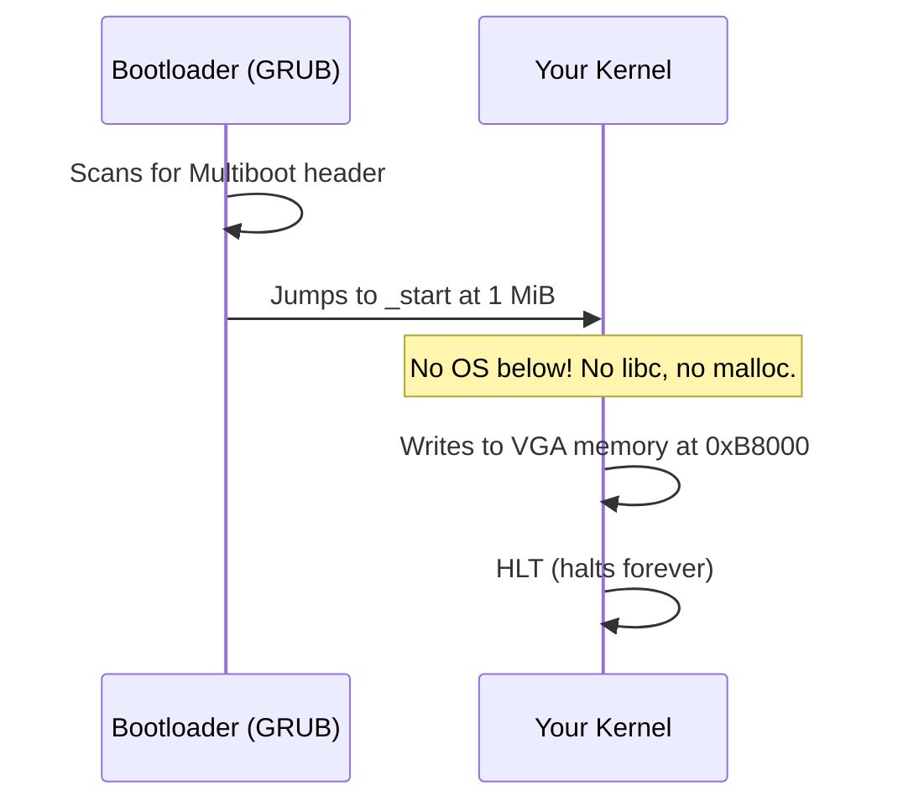

<!-- GLOSSARY PAGE — bootloader.md -->

# Bootloader

> **[Back to glossary index](README.md)** · Category: Boot & firmware

A **bootloader** is a small program that loads your kernel image from disk into memory, sets the CPU into a sane known state, and jumps to your kernel's entry point.

## The short version
A bootloader is not your kernel — it is the bridge between firmware and kernel. Its job is to set the CPU into a known state (32-bit protected mode, later 64-bit long mode), read your kernel image off the disk into RAM, and `jmp` to your kernel's entry point. On x86 that means speaking the **Multiboot protocol**: it scans the start of the kernel image for the magic header and, if found, loads the kernel at 1 MiB and jumps in. In this hub you do **not** write your own bootloader — you write the kernel and let GRUB, Limine, or the Rust `bootloader` crate do the booting.

## Detailed explanation
When firmware finishes its POST and scans the drives, it hands control to whatever bootloader it finds at the start of a bootable disk. From there the bootloader does everything needed to hand a "naked" CPU over to an OS kernel. The popular way to frame it is the handshake: the bootloader reads the disk, finds the kernel image, validates the 12-byte **Multiboot header** at its very start (magic `0x1BADB002`, flags, and checksum), loads the kernel at or above 1 MiB (`0x100000`), and finally jumps to the kernel's entry symbol — usually `_start`.

The division of labor is clean. The bootloader's job is: read the disk, set up the CPU mode, load the kernel at 1 MiB, and jump to `_start`. The kernel's job starts only after that jump: set up VGA or serial output, set up the GDT/IDT, manage memory, and handle interrupts. Everything before the jump belongs to the bootloader.

The critical relief for a beginner is that you are **not** writing a bootloader — you're writing the kernel. That's an enormous head start. The hub's guidance is to use GRUB (C/C++/Go) or the Rust `bootloader` crate and focus on the interesting part of building the OS itself. Real bootloader projects you'll meet include **GRUB** (GNU Grand Unified Bootloader) for the BIOS/Multiboot path and **Limine** or the Rust `bootloader` crate for the modern 64-bit/UEFI path.

## Why it matters here (OSDev_Learning_Hub)
In `synthesized_tutorials/concepts/01-bootloaders-and-multiboot.md` the bootloader is defined as "a tiny program that turns the raw hardware over to your kernel," and the whole even split — bootloader's job vs. kernel's job — is spelled out with the explicit advice to use GRUB rather than write one. `synthesized_tutorials/00-introduction/01-how-a-computer-boots.md` lists the bootloader's three duties (set CPU state, load the kernel, jump to the entry point) and notes the [Multiboot](multiboot.md) handshake it performs with [GRUB](grub.md) or [Limine](limine.md). In `Example_OS_Project`, the bootloader (GRUB) is what finds and runs the assembly in `Example_OS_Project/c/boot.s`. See also the [Entry Point](entry-point.md), [Multiboot](multiboot.md), and [Linker](linker.md) pages.

## Watch / listen
- [OSDev Wiki — Bare Bones](https://wiki.osdev.org/Bare_Bones) — free, authoritative walkthrough using GRUB
- [Wikipedia — Bootloader](https://en.wikipedia.org/wiki/Bootloader) — free overview

## Related terms
- [Multiboot](multiboot.md)
- [GRUB](grub.md)
- [Limine](limine.md)
- [Entry Point](entry-point.md)
- [Kernel](kernel.md)
- [ELF](elf.md)

---
*Grounded in the OSDev_Learning_Hub tutorials, the OSDev Wiki (free), and standard OS-dev references.*
