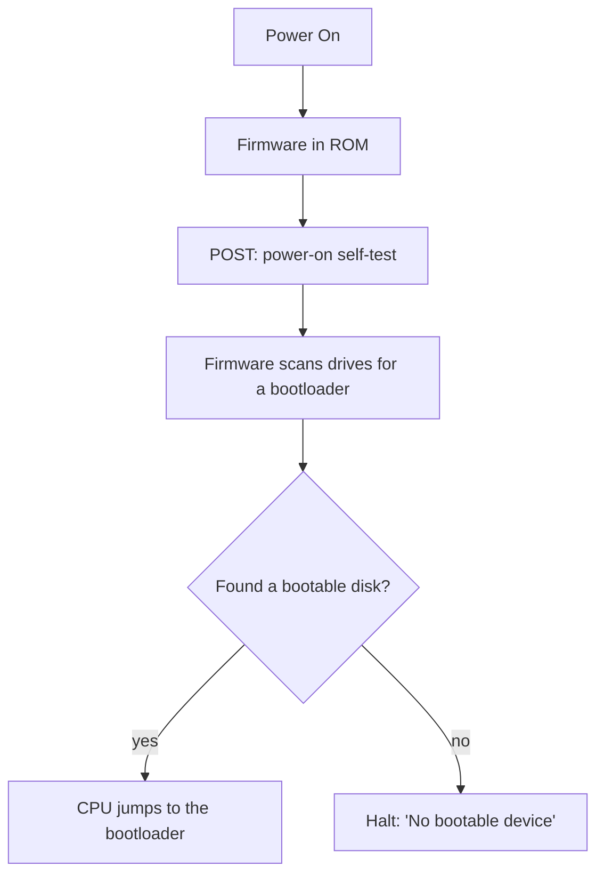

<!-- GLOSSARY PAGE — firmware.md -->

# Firmware

> **[Back to glossary index](README.md)** · Category: Boot & firmware

**Firmware** is software permanently stored on the motherboard (in ROM/flash) that runs first at power-on and is responsible for starting the machine and finding a bootloader.

## The short version
Firmware is the umbrella term for the platform software burned into hardware rather than stored on a disk. On an x86 PC the firmware takes one of two main forms: the older **BIOS** or the modern **UEFI**. It is the true first program — when you press the power button, the CPU starts executing firmware code out of the motherboard's ROM before any operating system, filesystem, or disk driver exists.

## Detailed explanation
The word "firmware" sits between "hardware" and "software": it is software, but it is fixed into the device (historically ROM, today typically flash that can be updated). On a PC the firmware's one essential job at boot is to initialize the hardware — run a power-on self-test (POST), set up memory, and make the basic devices available — and then find a **bootloader** to run. It scans the drives for something bootable and, when it finds one, the CPU jumps into that bootloader and the firmware's active role is over.

The CPU at power-on has no concept of operating systems, files, or disks. The machine follows a strict, ancient chain: power on → firmware in ROM → POST → firmware scans drives → finds bootable disk → CPU jumps to the bootloader → bootloader loads the kernel → kernel owns the machine. The firmware is step one of that chain and nothing runs before it.

There are two firmware worlds on x86, and they boot differently. The older **BIOS** firmware starts the CPU in 16-bit real mode and is simple and universally supported; even modern UEFI machines emulate it. The modern **UEFI** firmware is 64-bit native and boots the CPU straight into long mode, but is more complex. Both are firmware; both exist to hand the machine to a bootloader.

Because firmware (BIOS especially) uses the low region of memory for its own data structures, kernels are conventionally loaded at or above **1 MiB** (`0x100000`) so they don't overwrite firmware-owned areas.

## Why it matters here (OSDev_Learning_Hub)
In `synthesized_tutorials/00-introduction/01-how-a-computer-boots.md`, the hub states plainly: "Firmware is the true first program" — the BIOS (older) or UEFI (newer) software burned onto the motherboard whose one job on boot is to find a bootloader and run it. The [BIOS](bios.md) and [UEFI](uefi.md) glossary pages are the two concrete faces of firmware this hub builds its learning path on, and the boot chain it describes (firmware → [Bootloader](bootloader.md) → kernel at 1 MiB) is the scaffold for every `Example_OS_Project` kernel.

## Watch / listen
[- How Computers BOOT: From Startup to Viruses - Dave's Garage](https://www.youtube.com/watch?v=rmgla4yeCXw) — walks the firmware-to-OS boot chain
- [Wikipedia — Firmware](https://en.wikipedia.org/wiki/Firmware) — free, authoritative overview
- [OSDev Wiki — BIOS](https://wiki.osdev.org/BIOS) — free; covers the BIOS flavor of firmware
- [OSDev Wiki — UEFI](https://wiki.osdev.org/UEFI) — free; covers the UEFI flavor of firmware

## Related terms
- [BIOS](bios.md)
- [UEFI](uefi.md)
- [Bootloader](bootloader.md)
- [Multiboot](multiboot.md)

---
*Grounded in the OSDev_Learning_Hub tutorials, the OSDev Wiki (free), and standard OS-dev references.*
