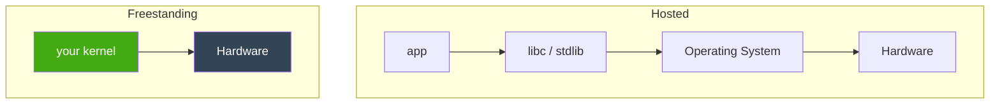

# Freestanding Environment

> **[Back to glossary index](README.md)** · Category: Kernel & runtime

A freestanding environment is one where your code assumes no operating system and no standard library exist underneath it — exactly the situation a kernel runs in.

## The short version
A normal program is **hosted**: it assumes an OS and a libc are there to call. A kernel is **freestanding**: it assumes *nothing*. OSDev_Learning_Hub shows how every language flips into freestanding mode — `gcc -ffreestanding` for C, `g++ -ffreestanding -fno-exceptions -fno-rtti` for C++, `#![no_std]` for Rust, and `gccgo -nostdlib` for Go.

## Detailed explanation
The toolchain chapter draws the distinction with two tiny C programs:

```c
// HOSTED C — assumes an OS with a running libc
#include <stdio.h>
int main(void) { printf("hi\n"); return 0; }

// FREESTANDING C — no stdio, no libc, no main return-to-OS
void kernel_main(void) {
    // write directly to VGA memory at 0xB8000
    unsigned short* vga = (unsigned short*)0xB8000;
    vga[0] = 0x0F48; // 'H' in white-on-black
}
```

The hosted program delegates to an OS that supplies `printf`, memory, and a `main` runtime. The freestanding kernel instead pokes hardware addresses like `0xB8000` directly, because there is no libc to translate for it. In a freestanding build the compiler is told not to link the standard library, so you lose `printf`, `malloc`, and the normal startup code — and you must provide your own entry symbol (`_start`) and (in Rust) your own `#[panic_handler]`.

The visual model from the toolchain chapter:



## Why it matters here (OSDev_Learning_Hub)
"Freestanding" is the concept that ties all five languages in this hub together. Every kernel in `Example_OS_Project/` is built freestanding, and the Rust walkthrough (`synthesized_tutorials/02-rust/README.md`) makes it explicit at the very top of `rust/src/main.rs`: `#![no_std]` says "do NOT link the standard library." The concept chapter that explains the whole idea is `synthesized_tutorials/00-introduction/02-your-toolchain.md`, which defines the compiler as "freestanding vs hosted."

## Watch / listen
[- Writing an OS in Rust - Part 1 - A Freestanding Rust Binary - Uncle Scientist](https://www.youtube.com/watch?v=rH5jnbJ3tL4) — building a Rust binary with no standard library
- [OSDev Wiki — Bare Bones (freestanding kernel)](https://wiki.osdev.org/Bare_Bones) — free, authoritative
- [Rust — The `no_std` environment (official docs)](https://doc.rust-lang.org/reference/names/crates.html) — free official docs
- [Wikipedia — Freestanding and hosted environments](https://en.wikipedia.org/wiki/Freestanding_and_hosted_environments) — free

## Related terms
- [Hosted](hosted.md)
- [Kernel](kernel.md)
- [`no_std`](no_std.md)
- [Linker](linker.md)
- [Entry Point](entry-point.md)

---
*Grounded in the OSDev_Learning_Hub tutorials, the OSDev Wiki (free), and standard OS-dev references.*
