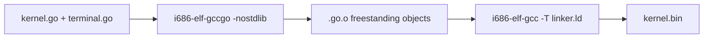

<!-- Glossary page — gccgo. Grounded in OSDev_Learning_Hub docs. -->

# gccgo

> **[Back to glossary index](README.md)** · Category: Toolchain & build

`gccgo` is the Go front-end of the GCC compiler — the only practical way to compile a Go kernel for bare metal in this hub.

## The short version
Standard Go (`go build`) links a full runtime — garbage collector, goroutines, the `runtime` package — that needs an operating system. Bare-metal Go therefore can't use it. Instead this hub builds a **Go-enabled cross-compiler** (`i686-elf-gccgo`) from GCC source, then compiles the Go kernel with `-nostdlib` and stub symbols to disable that runtime. `gccgo` is the "Go compiler" row in the hub's four-pillar table.

## Detailed explanation
The OSDev "Go Bare Bones" insight (documented in `Example_OS_Project/go/README.md`) is that standard Go links a runtime that assumes an OS. A freestanding kernel therefore uses `gccgo` with `-nostdlib` and *disables* that runtime, providing only the empty stub symbols the toolchain still expects.

Because `gccgo` must target bare metal, you build it as part of a full toolchain from GCC source, enabling the Go language:

```bash
# (prereqs: build-essential bison flex libgmp-dev libmpfr-dev libmpc-dev texinfo nasm)
export TARGET=i686-elf
../configure --target=$TARGET --prefix="$PREFIX" --disable-nls \
             --enable-languages=c,c++,go --without-headers
make -j$(nproc) all-gcc && make install-gcc
```

Then compile each Go package freestanding:
```bash
i686-elf-gccgo -static -Werror -nostdlib -nostartfiles -nodefaultlibs \
    -c terminal/terminal.go -o terminal.go.o
i686-elf-gccgo -static -Werror -nostdlib -nostartfiles -nodefaultlibs \
    -c kernel.go -o kernel.go.o
```
and link with `i686-elf-gcc -T linker.ld -o kernel.bin ... boot.o kernel.go.o terminal.go.o -lgcc`.

The Go `boot.s` additionally defines the two runtime stubs the linker expects from a freestanding Go build — `__go_register_gc_roots` and `__go_runtime_error` — as empty functions, so the build links cleanly.



## Why it matters here (OSDev_Learning_Hub)
- `Example_OS_Project/go/README.md` — the full `gccgo` build + cross-compiler assembly steps and the *"Why the cross-compiler is unavoidable"* section.
- `Example_OS_Project/go/boot.s` — defines the Go-runtime stub symbols for the freestanding link.
- `Example_OS_Project/go/go.mod`, `kernel.go`, and `terminal/terminal.go` — the Go source compiled by gccgo.

## Watch / listen
- [OSDev Wiki — Go Bare Bones](https://wiki.osdev.org/Go_Bare_Bones) — free, the authoritative source of the gccgo + stub approach
- [GCC — GCCGO documentation](https://gcc.gnu.org/onlinedocs/gccgo/) — free official docs

## Related terms
- [Cross-Compiler](cross-compiler.md)
- [Freestanding Environment](freestanding.md)
- [Managed IL](managed-il.md)
- [Linker](linker.md)
- [Kernel](kernel.md)

---
*Grounded in the OSDev_Learning_Hub tutorials, the OSDev Wiki (free), and standard OS-dev references.*
