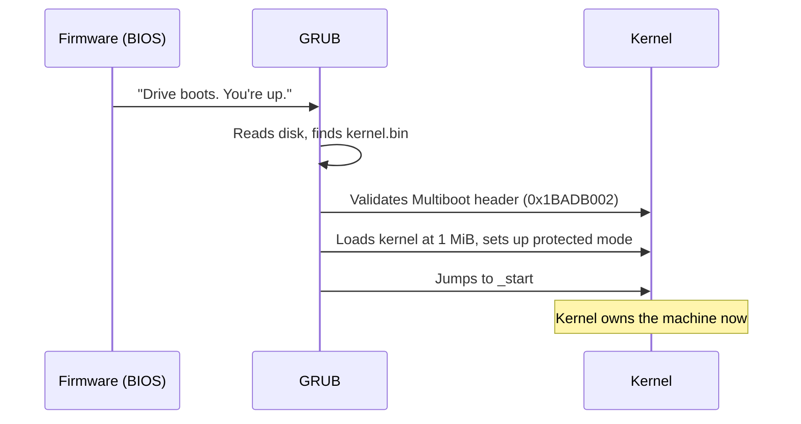

<!-- GLOSSARY PAGE — grub.md -->

# GRUB

> **[Back to glossary index](README.md)** · Category: Boot & firmware

**GRUB** (GNU Grand Unified Bootloader) is a free, standard bootloader that loads a Multiboot kernel at 1 MiB, sets up protected mode, and jumps to its entry point — the bootloader this hub's learning path is built on.

## The short version
GRUB is the GNU project's bootloader and the de facto standard for the BIOS + Multiboot learning path. It does the hard boot work for you: it scans for your kernel's Multiboot header, loads the kernel image into RAM at 1 MiB, puts the CPU into a known 32-bit protected-mode state, and jumps to `_start`. In the hub's terminology, "use GRUB (C/C++/Go) or the Rust `bootloader` crate" — because you write the kernel, not the bootloader.

## Detailed explanation
GRUB implements the Multiboot spec, which is what makes it so useful: it can boot *any* kernel that carries a valid Multiboot header, regardless of who wrote it. The header is the 12-byte structure at the start of the kernel image — magic `0x1BADB002`, flags (typically `ALIGN | MEMINFO`), and checksum — and GRUB validates it before loading. Once validated, GRUB loads the kernel at (or above) 1 MiB (`0x100000`) to avoid the low-memory region used by the BIOS and bootloader, and jumps to the kernel's entry point, `_start`.

From the kernel's point of view, GRUB hands it a known, sane environment: the CPU is already in 32-bit protected mode, the stack is whatever the kernel's own bootstrap sets up (GRUB does not provide a usable stack for high-level languages — the kernel's `boot.s` must set its own), and the loader has arranged the kernel image in memory per its linker script. GRUB also honors the `MEMINFO` flag by providing a memory map, which the kernel can read to write a memory manager.

The same Multiboot header that lets GRUB boot the kernel on **real hardware** also lets **QEMU** boot it for testing with `-kernel`. This one-line compatibility is why every "bare bones" tutorial — C, C++, Go — starts by writing the header in assembly: it unlocks both GRUB-on-real-machine and QEMU-in-the-lab with no extra work.

The division of labor is worth stating again: GRUB's job is to read the disk, set up CPU mode, load the kernel at 1 MiB, and jump to `_start`. Your kernel's job — VGA, GDT/IDT, memory, interrupts — starts only after that jump. GRUB is the recommended choice for the BIOS path in this hub.

## Why it matters here (OSDev_Learning_Hub)
GRUB is the central actor in the hub's canonical **BIOS + GRUB/Multiboot** learning path. `synthesized_tutorials/concepts/01-bootloaders-and-multiboot.md` recommends GRUB explicitly ("use GRUB (C/C++/Go)... and focus on the interesting part: the OS itself"), and `synthesized_tutorials/00-introduction/01-how-a-computer-boots.md` names GRUB as the bootloader in the BIOS path diagram. `Example_OS_Project/c/boot.s` is "the FIRST thing the bootloader (GRUB or QEMU `-kernel`) runs" — it emits the Multiboot header GRUB looks for. See [Multiboot](multiboot.md), [Bootloader](bootloader.md), [Protected Mode](protected-mode.md), and [QEMU](qemu.md).

## Watch / listen
- [OSDev Wiki — GRUB](https://wiki.osdev.org/GRUB) — free, authoritative
- [OSDev Wiki — Bare Bones](https://wiki.osdev.org/Bare_Bones) — free; the canonical GRUB + Multiboot tutorial
- [GNU GRUB manual](https://www.gnu.org/software/grub/manual/grub/grub.html) — free, official documentation

## Related terms
- [Bootloader](bootloader.md)
- [Multiboot](multiboot.md)
- [Limine](limine.md)
- [Protected Mode](protected-mode.md)
- [QEMU](qemu.md)

---
*Grounded in the OSDev_Learning_Hub tutorials, the OSDev Wiki (free), and standard OS-dev references.*
