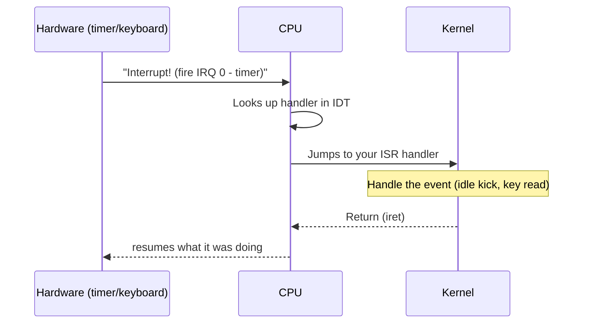

<!-- GLOSSARY PAGE TEMPLATE — copy this structure for every <slug>.md page.
     Replace every {{PLACEHOLDER}}. Do not rename the file; it must be <slug>.md. -->

# Hardware Interrupt

> **[Back to glossary index](README.md)** · Category: CPU & interrupts

A hardware interrupt is the CPU pausing whatever it is doing to run a registered handler whenever a piece of hardware (like a timer or keyboard) signals that an event has occurred.

## The short version
Your kernel can't poll the keyboard forever — instead the hardware *interrupts* the CPU, which halts its current work, looks up the right handler in the IDT, jumps to it, runs it, then returns (with `iret`). This is what lets a kernel react to a timer tick or a key press instead of busy-waiting.

## Detailed explanation
An interrupt is the hardware's way of yelling "something happened!" at the CPU. When it fires, the CPU stops whatever instruction it was executing, saves enough state to resume later, finds the handler for that interrupt number in the [IDT](idt.md), and jumps to it. The handler (an [ISR](isr.md)) does its job and then executes `iret` to hand control back to whatever was interrupted.

Interrupts come in three flavors. **Hardware interrupts (IRQs)** are raised by devices and routed through the [PIC / APIC](pic-apic.md) — for example the timer fires IRQ 0 and the keyboard fires IRQ 1. **CPU exceptions** are raised by the CPU itself when it hits a fault like a page fault (`#PF`, vector 14) or a general protection fault (`#GP`, vector 13). **Software interrupts** are triggered deliberately by an instruction such as `int` and are how [syscalls](syscall.md) are often made.

The [IDT](idt.md) maps every interrupt number (0–255) to its handler. In the example tutorial, the timer handler (`vector 32` after the PIC remap) is where a whole scheduling system would start. The `sti` / `cli` instructions enable and disable interrupts globally: the sample `boot.s` calls `cli` before halting so no further IRQs can interrupt the shutdown.

## Why it matters here (OSDev_Learning_Hub)
The very first kernel in `Example_OS_Project/c/kernel.c` prints "Hello World!" and halts forever — it can skip interrupts. You need them the moment you want a timer tick or keyboard input. The tutorial `synthesized_tutorials/concepts/03-interrupts-and-the-idt.md` explains the full setup, and `Example_OS_Project/c/boot.s` ends with `cli` / `hlt` to stop IRQs before parking the CPU.

## Watch / listen
[- Program, Interrupted - Computerphile](https://www.youtube.com/watch?v=54BrU82ANww) — how interrupts stop the CPU
[- Signals: Make Ctrl+C Do Anything You Want - Core Dumped](https://www.youtube.com/watch?v=m6WXrC9Mxzo) — interrupts and how the kernel delivers them
- [OSDev Wiki — Interrupts](https://wiki.osdev.org/Interrupts) — free, authoritative
- [OSDev Wiki — Interrupts in detail](https://wiki.osdev.org/Interrupts_in_detail) — free, authoritative

## Related terms
- [Interrupt Descriptor Table (IDT)](idt.md)
- [Interrupt Service Routine (ISR)](isr.md)
- [PIC / APIC](pic-apic.md)
- [`hlt` Instruction](hlt-instruction.md)
- [System Call](syscall.md)

---
*Grounded in the OSDev_Learning_Hub tutorials, the OSDev Wiki (free), and standard OS-dev references.*
