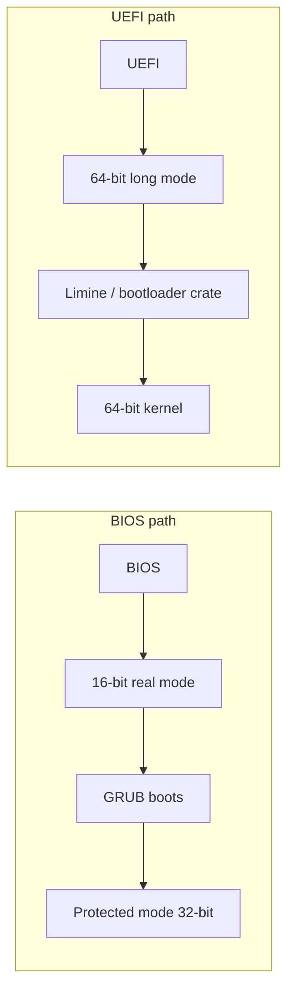

<!-- GLOSSARY PAGE — limine.md -->

# Limine

> **[Back to glossary index](README.md)** · Category: Boot & firmware

**Limine** is a modern bootloader that supports Multiboot 2 (`0xE85250D6`) and 64-bit kernels, used on the UEFI path where a kernel is booted straight into long mode.

## The short version
Limine is a contemporary bootloader for the modern UEFI-era world. Where the classic BIOS path relies on GRUB and 32-bit Multiboot v1, Limine supports **Multiboot 2** and boots 64-bit kernels natively — the bootloader the hub associates with the UEFI path into 64-bit long mode. Its protocol (also called the Limine boot protocol) is designed for 64-bit kernels and hands over a detailed boot information structure rather than the minimal Multiboot v1 handoff.

## Detailed explanation
Limine is a modern, actively developed bootloader aimed at 64-bit and UEFI-era OS development. Two things set it apart from the GRUB/Multiboot v1 world. First, it supports **Multiboot 2**, whose magic number is `0xE85250D6` instead of the classic v1 `0x1BADB002` — this is "what Limine and many 64-bit kernels use." Second, it boots directly into **long mode** on UEFI systems, skipping the real-mode → protected-mode ladder entirely, because UEFI firmware is already 64-bit native.

The hub's mental model places Limine squarely on the modern path:

In this picture, Limine is to the UEFI/64-bit world what GRUB is to the BIOS/32-bit world — the bootloader that receives the machine from firmware, validates and loads the kernel, and jumps to its entry point, but starting from 64-bit long mode rather than 16-bit real mode. For a project that targets modern 64-bit hardware, Limine (or the Rust `bootloader` crate) is the recommended building block instead of writing your own bootloader.

Because Limine targets 64-bit kernels and long mode, it pairs naturally with a 64-bit kernel compiled by a [Cross-Compiler](cross-compiler.md), linked by a [Linker](linker.md) script at the appropriate address, and tested in [QEMU](qemu.md). Its boot protocol is distinct from classic Multiboot v1, so a Limine kernel carries a Limine/Multiboot 2 header rather than the simple 12-byte v1 header in `boot.s`.

## Why it matters here (OSDev_Learning_Hub)
Limine appears in `synthesized_tutorials/concepts/01-bootloaders-and-multiboot.md` as the bootloader for the modern generation — the "Multiboot 2 (v2)" row (magic `0xE85250D6`) notes it is "what Limine and many 64-bit kernels use." `synthesized_tutorials/00-introduction/01-how-a-computer-boots.md` places Limine on the UEFI path ("UEFI → 64-bit long mode → Limine / bootloader crate → 64-bit kernel"). While the flagship `Example_OS_Project` kernels boot 32-bit via GRUB, a 64-bit build of this hub's ideas would use Limine to reach [Long Mode](long-mode.md). See also [UEFI](uefi.md), [Long Mode](long-mode.md), and [Multiboot](multiboot.md).

## Watch / listen
- [OSDev Wiki — Limine](https://wiki.osdev.org/Limine) — free, authoritative
- [Limine official website](https://limine-bootloader.org/) — free, official documentation
- [OSDev Wiki — Multiboot](https://wiki.osdev.org/Multiboot) — free; covers Multiboot 2 as used by Limine

## Related terms
- [GRUB](grub.md)
- [Bootloader](bootloader.md)
- [Multiboot](multiboot.md)
- [UEFI](uefi.md)
- [Long Mode](long-mode.md)

---
*Grounded in the OSDev_Learning_Hub tutorials, the OSDev Wiki (free), and standard OS-dev references.*
