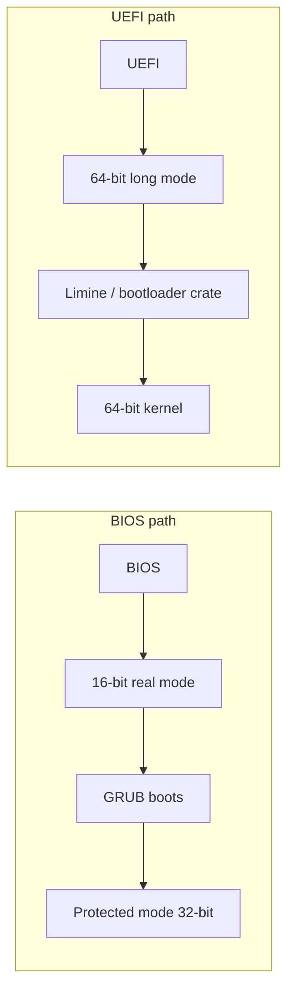

<!-- GLOSSARY PAGE — long-mode.md -->

# Long Mode

> **[Back to glossary index](README.md)** · Category: Boot & firmware

**Long mode** is the 64-bit CPU mode that modern kernels run in — the mode a UEFI machine boots straight into, giving a kernel 64-bit registers and 64-bit addressing.

## The short version
Long mode is the 64-bit execution mode of modern x86-64 CPUs. Where the BIOS path laboriously climbs through 16-bit real mode and 32-bit protected mode, the UEFI path boots the CPU **directly into 64-bit long mode**, so a 64-bit bootloader like Limine and a 64-bit kernel can run natively. For modern OS development, long mode is where you actually want to be: 64-bit registers, a flat 64-bit address space, and all the modern CPU features enabled.

## Detailed explanation
Long mode is the 64-bit successor to protected mode, introduced with the x86-64 (AMD64/EM64T) architecture. It broadens general-purpose registers to 64 bits, provides 64-bit virtual addressing, and enables modern features such as paging with 4-level (and later 5-level) page tables, NX (no-execute) bits, and larger flat address spaces. To enter long mode a CPU must first be in protected mode and then enable paging, because long mode requires the MMU — you cannot run 64-bit code without page tables active.

The boot path differs dramatically from the classic one. A BIOS system starts in 16-bit real mode and must be dragged up to 32-bit protected mode and then 64-bit long mode — a multi-stage transition. A **UEFI** system, by contrast, is 64-bit native: the firmware itself boots the CPU into long mode up front, so a 64-bit bootloader and kernel run directly. That is why the hub contrasts the two paths so sharply:

Not every kernel project targets long mode. The classic **Multiboot v1** protocol (`0x1BADB002`) is a 32-bit protocol — it loads kernels into protected mode, not long mode. To boot a 64-bit kernel you need either the 32-bit address-mapping dance of protected mode (used by the older 64-bit "Higher Half Bare Bones" approach) or a bootloader that speaks **Multiboot 2** (`0xE85250D6`) or UEFI natively, like **Limine** or the Rust `bootloader` crate. Modern 64-bit kernels effectively all end up in long mode.

## Why it matters here (OSDev_Learning_Hub)
The `synthesized_tutorials/00-introduction/01-how-a-computer-boots.md` chapter marks long mode as the destination of the UEFI path — "UEFI is modern and 64-bit native" booting into "64-bit long mode," then running a 64-bit kernel via [Limine](limine.md) or the Rust `bootloader` crate. It also lists long mode as a bootloader duty ("set the CPU into a sane, known state (32-bit protected mode, later 64-bit long mode)"). While the hub's simplest `Example_OS_Project` kernels run 32-bit via GRUB+Multiboot v1, long mode is the mode a fully modern 64-bit build of this hub's ideas would target. See also [Protected Mode](protected-mode.md), [UEFI](uefi.md), and [Limine](limine.md).

## Watch / listen
[- Writing an OS in Rust - Part 2 - A Minimal Rust Kernel - Uncle Scientist](https://www.youtube.com/watch?v=AYyybz3gm6A) — building and booting a 64-bit kernel
- [OSDev Wiki — Long Mode](https://wiki.osdev.org/Long_Mode) — free, authoritative
- [OSDev Wiki — Setting Up Long Mode](https://wiki.osdev.org/Setting_Up_Long_Mode) — free, step-by-step
- [Wikipedia — x86-64](https://en.wikipedia.org/wiki/X86-64) — free overview of the 64-bit extension

## Related terms
- [Real Mode](real-mode.md)
- [Protected Mode](protected-mode.md)
- [UEFI](uefi.md)
- [Limine](limine.md)
- [Kernel](kernel.md)

---
*Grounded in the OSDev_Learning_Hub tutorials, the OSDev Wiki (free), and standard OS-dev references.*
