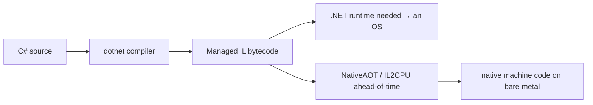

<!-- Glossary page — Managed IL. Grounded in OSDev_Learning_Hub docs. -->

# Managed IL

> **[Back to glossary index](README.md)** · Category: Toolchain & build

Managed Intermediate Language (IL / CIL) is the platform-neutral bytecode that C# compiles to, which needs a .NET runtime to execute — the reason a C# kernel is fundamentally different.

## The short version
When you write C#, the compiler doesn't emit machine code — it emits **IL**, a sort of abstract assembly language. A normal C# program's IL is executed by the .NET runtime (with a JIT and a garbage collector). This is precisely why a bare-metal C# kernel is hard: there's no OS to host that runtime. The hub uses this fact to explain why C# needs Cosmos/NativeAOT rather than a hand-rolled kernel like C, Rust, or Go.

## Detailed explanation
C# compiles to managed IL (also called CIL — Common Intermediate Language), which is architecture-independent. Executing it requires a *managed runtime*: the common language runtime (CLR) with a JIT compiler and a garbage collector. Compare the five languages in the hub's table:

| | C/C++ | Rust | Go | C# |
|---|---|---|---|---|
| Compiles to | native machine code | native machine code | native (via gccgo) | **managed IL** |
| Needs a runtime? | no (`-ffreestanding`) | no (`no_std`) | minimal (stubs) | **yes — GC + BCL** |

So while a C kernel writes to the VGA framebuffer directly (`unsigned short* vga = (unsigned short*)0xB8000;`), a beginner writing C# cannot easily do that — the IL hasn't become native code yet, and there's no runtime to run it on without an OS.

This is the crux of what `Example_OS_Project/csharp/Kernel.cs` calls the *"EDGE CASE EXPLANATION"*: *"C# compiles to managed IL and depends on a runtime (GC, JIT, BCL). There is NO practical way for a beginner to hand-write a bare-metal C# kernel from scratch the way you can in C/C++/Rust/Go."* The solution is to translate that IL ahead of time (NativeAOT / IL2CPU) so it can run on bare metal.

## Why it matters here (OSDev_Learning_Hub)
- `Example_OS_Project/csharp/README.md` — the comparison table rows for "managed IL" and "needs a runtime".
- `Example_OS_Project/csharp/Kernel.cs` — the edge-case explanation of why managed IL blocks a hand-rolled C# kernel.
- `Example_OS_Project/csharp/ExampleOS.csproj` — a C# project whose IL is processed by Cosmos.

## Watch / listen
[- Garbage Collection (Mark & Sweep) - Computerphile](https://www.youtube.com/watch?v=c32zXYAK7CI) — the GC runtime managed languages rely on
- [Microsoft Learn — Managed code and the .NET runtime](https://learn.microsoft.com/en-us/dotnet/standard/managed-code) — free, authoritative
- [Microsoft Learn — .NET Intermediate Language (IL)](https://learn.microsoft.com/en-us/dotnet/standard/managed-code) — free overview

## Related terms
- [nativeaot](nativeaot.md)
- [il2cpu](il2cpu.md)
- [cosmos](cosmos.md)
- [gccgo](gccgo.md)

---
*Grounded in the OSDev_Learning_Hub tutorials, the OSDev Wiki (free), and standard OS-dev references.*
