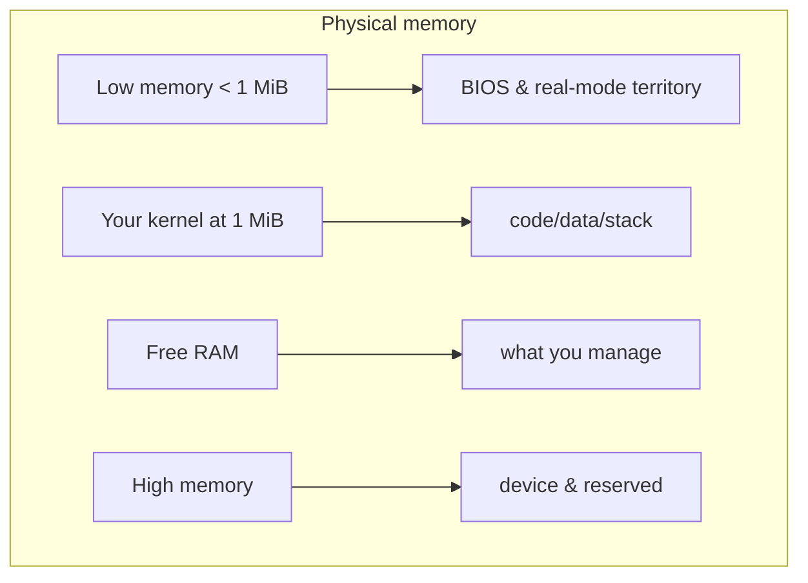

# Memory Management

> **[Back to glossary index](README.md)** · Category: Kernel & runtime

Memory management is how a kernel keeps track of what RAM exists, what's used, and what's free, and hands it out safely — because, unlike a normal program, there's no OS underneath to do it.

## The short version
Your very first kernel can ignore memory entirely (it just writes to the screen and halts). But the moment you want variables, stacks, or `malloc`, you must build a memory manager yourself. The hub's memory chapter walks from the *mental model* of physical memory up to the two big tools: a **frame allocator** (which tracks free physical pages) and **paging** (which translates virtual to physical addresses).

## Detailed explanation
The mental model from `synthesized_tutorials/concepts/02-memory-management.md` splits physical memory into regions: low memory below 1 MiB (BIOS and real-mode territory), your kernel loaded at 1 MiB, free RAM that you manage, and high memory that may be device-reserved.

Real memory is divided into **physical pages** (usually 4 KiB each). The simplest manager is a *frame allocator* that uses one bit per 4 KiB page — a **bitmap** of size `total_memory / 4096 / 8` bytes. The hub notes that this "is the whole idea behind a buddy allocator and every frame allocator you'll ever read about." On top of that come more complex schemes: paging page tables, heap allocation for the language runtime, and — in managed languages — a garbage collector. The memory-model comparison across the hub's languages:

| Language | Memory model | Bare-metal state |
|----------|--------------|------------------|
| C / C++ | Raw pointers, manual `malloc` replacement | Full control — you write the allocator |
| Rust | Ownership + raw pointers via `unsafe` | Also full control; borrow checker protects you |
| Go | GC runtime (goroutines, heap) | Runtime needs many stubs on bare metal |
| C# | GC runtime (managed heap) | Needs a whole framework (Cosmos) to bootstrap |

## Why it matters here (OSDev_Learning_Hub)
Memory management is the core subject of `synthesized_tutorials/concepts/02-memory-management.md` — the document this page is grounded in. The os01 book and the Phil Opp Rust series "both spend serious chapters here for exactly this reason." The practical follow-ons in this hub are the [frame allocator](frame-allocator.md), [paging](paging.md), and [heap allocation](heap-allocation.md) pages, and the language-specific difficulty of [garbage collection](garbage-collection.md) on bare metal (Go and C#) versus full control (C, C++, Rust).

## Watch / listen
[- The Most Successful Idea in Computer Science - Core Dumped](https://www.youtube.com/watch?v=LDhoD4IVElk) — how virtual memory and address spaces work
[- Stack vs Heap Memory in C++ - The Cherno](https://www.youtube.com/watch?v=wJ1L2nSIV1s) — the manual memory model kernels use
- [OSDev Wiki — Memory Management](https://wiki.osdev.org/Memory_management) — free, authoritative
- [OSDev Wiki — Memory Map (x86)](https://wiki.osdev.org/Memory_Map_%28x86%29) — free, authoritative
- [Blog "Writing an OS in Rust" — Memory management chapters](https://os.phil-opp.com/) — free

## Related terms
- [Frame Allocator](frame-allocator.md)
- [Paging](paging.md)
- [Heap Allocation](heap-allocation.md)
- [Physical vs Virtual Memory](physical-virtual-memory.md)
- [Garbage Collection](garbage-collection.md)

---
*Grounded in the OSDev_Learning_Hub tutorials, the OSDev Wiki (free), and standard OS-dev references.*
