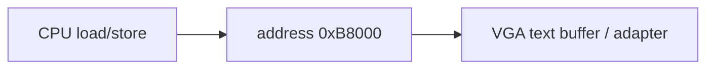

<!-- Glossary page — Memory-Mapped I/O. Grounded in OSDev_Learning_Hub docs. -->

# Memory-Mapped I/O

> **[Back to glossary index](README.md)** · Category: Hardware

Memory-mapped I/O (MMIO) is when hardware peripherals are controlled by reading from and writing to regular memory addresses, instead of using special I/O instructions.

## The short version
A freestanding kernel talks to hardware *directly* — and on x86 one of the main ways it does that is memory-mapped I/O. Peripherals like the VGA adapter are wired into the CPU's address space as if they were RAM. Writing a value to address `0xB8000` doesn't store to memory — it draws a character on the screen. This is the core of the hub's "Hello World": the kernel writes text to VGA memory by poking pointers at `0xB8000`.

## Detailed explanation
There are two ways CPUs do I/O:
- **Port-mapped I/O:** special instructions like `in`/`out` talk to numbered ports.
- **Memory-mapped I/O:** the peripheral appears as a region of the normal address space, so ordinary `mov`/store instructions control it.

The VGA text buffer is the canonical example in this hub. On x86 it sits at physical address `0xB8000`, arranged as 25 rows × 80 columns of 2-byte cells. A cell's low byte is the ASCII character and the high byte is its attribute (foreground/background color). The freestanding C kernel writes to it with a plain pointer store:

```c
void kernel_main(void) {
    unsigned short* vga = (unsigned short*)0xB8000;
    vga[0] = 0x0F48;   // 'H' (0x48) in white-on-black (attribute 0x0F)
}
```

Here `0x48` is the ASCII code for `'H'` and `0x0F` is the attribute nibble for white-on-black. Because this is *memory*-mapped, the C pointer arithmetic and stores work directly — no special I/O instruction needed. The Rust kernel does the same thing inside an `unsafe` block: a raw pointer write to `0xB8000` (confirmed in `rust/README.md`).



## Why it matters here (OSDev_Learning_Hub)
- `Example_OS_Project/c/kernel.c` — writes `unsigned short* vga = (unsigned short*)0xB8000;`.
- `Example_OS_Project/rust/README.md` — *"Writing to the screen: raw pointer write to 0xB8000 inside unsafe {}"*, and `rust/src/main.rs` does it in the VGA driver.
- `Example_OS_Project/tools/read_vga_text.py` — reads the VGA frame buffer back (QEMU's screen is memory-mapped).
- `synthesized_tutorials/00-introduction/02-your-toolchain.md` — the freestanding C example that writes `0x0F48` to `0xB8000`.

## Watch / listen
- [OSDev Wiki — Memory Mapped I/O](https://wiki.osdev.org/Memory_Mapped_IO) — free, authoritative
- [OSDev Wiki — Text UI](https://wiki.osdev.org/Text_UI) — free, the VGA text buffer details

## Related terms
- [VGA Text Mode](vga-text-mode.md)
- [Text Mode Cursor](text-mode-cursor.md)
- [x86](x86.md)
- [Kernel](kernel.md)

---
*Grounded in the OSDev_Learning_Hub tutorials, the OSDev Wiki (free), and standard OS-dev references.*
