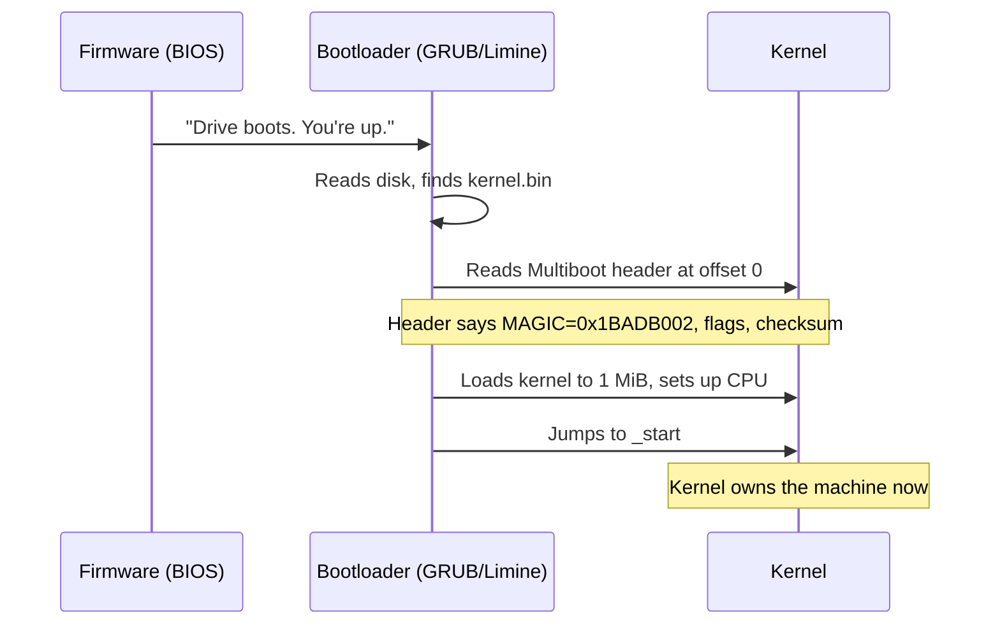

<!-- GLOSSARY PAGE — multiboot.md -->

# Multiboot

> **[Back to glossary index](README.md)** · Category: Boot & firmware

**Multiboot** is the protocol that lets a standard bootloader load any kernel that follows the rules — a kernel carries a fixed magic header at its very start so a bootloader can find it, validate it, and load it at 1 MiB.

## The short version
Multiboot is the "hello" handshake between a bootloader and a kernel. The spec says: *if you want a standard bootloader to load you, put a magic header at the very start of your kernel image.* A kernel that carries this header can be booted by GRUB on real hardware *and* by QEMU for testing. The magic number is `0x1BADB002`, and every "bare bones" tutorial in C, C++, or Go starts by writing this header in assembly.

## Detailed explanation
The Multiboot header is a fixed **12-byte structure** at the very start of the kernel image. The `Example_OS_Project` emits it in GNU assembler (AT&T syntax) like this:

```nasm
.set ALIGN,    1<<0              /* align loaded modules on page boundaries */
.set MEMINFO,  1<<1              /* provide memory map */
.set FLAGS,    ALIGN | MEMINFO   /* this is the Multiboot 'flag' field */
.set MAGIC,    0x1BADB002        /* 'magic number' lets bootloader find header */
.set CHECKSUM, -(MAGIC + FLAGS)  /* checksum of above, to prove we are multiboot */

.section .multiboot
.align 4
.long MAGIC
.long FLAGS
.long CHECKSUM
```

The three fields are:

| Field | Value | Why |
|-------|-------|-----|
| **Magic** | `0x1BADB002` | Bootloader's secret handshake |
| **Flags** | `ALIGN \| MEMINFO` (e.g. `0x3`) | "align modules" + "give me a memory map" |
| **Checksum** | `-(magic + flags)` | Validation: magic+flags+checksum must equal 0 |

Why does the `flags` bit requesting a **memory map** matter? Because when your kernel runs, it has no idea how much RAM exists. Multiboot can hand you a memory map so you can write a memory manager. The `MEMINFO` flag (bit 1) requests that map.

Why **1 MiB**? Below 1 MiB lives the "low memory" area full of things the bootloader and BIOS use. Kernels are conventionally loaded **at or above 1 MiB** (`0x100000`) to avoid stomping on that region. The linker script sets `ENTRY(_start)` and `. = 1M;` to match. Importantly, the `.multiboot` section must come **first** in the image so the header is at the very start for the bootloader to find.

There are three Multiboot generations:

| Name | Magic | Notes |
|------|-------|-------|
| **Multiboot (v1)** | `0x1BADB002` | What most Bare Bones tutorials use (32-bit) |
| **Multiboot 2 (v2)** | `0xE85250D6` | Modern; what Limine and many 64-bit kernels use |
| **Rust bootloader crate** | depends | Handles it for you, no assembly needed |



## Why it matters here (OSDev_Learning_Hub)
Multiboot is the protocol the whole hub's learning path is built on. The `synthesized_tutorials/concepts/01-bootloaders-and-multiboot.md` concept page is entirely about it, and `synthesized_tutorials/00-introduction/01-how-a-computer-boots.md` introduces the magic `0x1BADB002` handshake. In `Example_OS_Project/c/boot.s` the actual 12-byte Multiboot header (MAGIC `0x1BADB002`, FLAGS `ALIGN|MEMINFO`, CHECKSUM) is emitted at the top of the `.multiboot` section, and `Example_OS_Project/c/linker.ld` places that section first and loads the kernel at 1 MiB with `. = 1M;`. See also [Bootloader](bootloader.md), [GRUB](grub.md), [Limine](limine.md), and [Entry Point](entry-point.md).

## Watch / listen
[- How Computers BOOT: From Startup to Viruses - Dave's Garage](https://www.youtube.com/watch?v=rmgla4yeCXw) — how a bootloader takes over from firmware
- [OSDev Wiki — Multiboot](https://wiki.osdev.org/Multiboot) — free, authoritative
- [OSDev Wiki — Bare Bones](https://wiki.osdev.org/Bare_Bones) — free; the canonical Multiboot tutorial

## Related terms
- [Bootloader](bootloader.md)
- [GRUB](grub.md)
- [Limine](limine.md)
- [Entry Point](entry-point.md)
- [Protected Mode](protected-mode.md)
- [Linker](linker.md)

---
*Grounded in the OSDev_Learning_Hub tutorials, the OSDev Wiki (free), and standard OS-dev references.*
