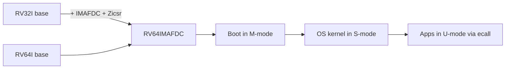

<!-- Glossary page — RISC-V. Grounded in OSDev_Learning_Hub docs and the ratified RISC-V specs. -->

# RISC-V

> **[Back to glossary index](README.md)** · Category: Architecture

RISC-V is an open, free, modular RISC instruction-set architecture (ISA) defined by the RISC-V International spec, with base integer ISAs (RV32/RV64/RV128) plus standard extensions such as I/M/A/F/D/C.

## The short version
RISC-V is a *"meta-ISA"*: instead of one fixed architecture like x86, it defines a tiny mandatory base (the integer instructions) and a menu of optional standard extensions you add to fit your use case. Because the ISA itself is free and openly specified — no licensing fees, no secret encodings — it has become the go-to target for hobby OS dev, education, FPGAs, and embedded boards. In this hub's world, that means you can target a RISC-V CPU with the same cross-compiler + QEMU workflow the x86 kernels use, just with `qemu-system-riscv64` instead of `qemu-system-i386`.

## Detailed explanation
A RISC-V *hart* (hardware thread) executes a **base integer ISA**, which every implementation must provide, plus zero or more **extensions**. The base comes in three address-width flavors:

- **RV32I / RV64I** — 32- and 64-bit integer base. RV64 widens the registers but keeps word (32-bit) arithmetic via W-variants, mirroring how x86_64 keeps 32-bit compat.
- **RV32E** — a reduced 16-register version of RV32I for tiny embedded cores.
- **RV128I** — a 128-bit base, still largely a placeholder in the spec.

The **standard extensions** you'll see named on a part string (e.g. `RV64IMAFDC`) are:
- **I** — integer (the base itself), **M** — integer multiply/divide, **A** — atomic instructions (load-reserved/store-conditional, essential for spinlocks and SMP), **F/D** — single/double-precision IEEE-754 floating point, **C** — the 16-bit *compressed* encoding for denser code, and **Zicsr** — the Control and Status Register (CSR) instructions used for interrupts, privilege, and per-hart timers.

The **privileged spec** (a separate volume) defines the privilege levels: **Machine (M)**, **Supervisor (S)**, and **User (U)** modes plus optional Hypervisor and Debug modes. M-mode is mandatory and has total access — that's where a bare-metal kernel or firmware starts. Adding U-mode (and optionally S-mode) gives you the classic OS split: a kernel at S-mode, applications at U-mode, system calls through the `ecall` instruction. CSR registers like `mstatus`, `mtvec` (trap vector), and `satp` (page-table base) are how an OS configures paging and interrupts — the RISC-V analogues of the x86 MSRs, IDT, and CR3.

Why it matters for hobby OS dev and bare metal:
- **No legal/royalty friction** — you can target it, document it, and ship it freely, unlike proprietary ISAs.
- **Simple to reason about** — a clean load-store RISC design with few addressing modes; often easier than x86's segmented/legacy baggage.
- **QEMU supports it well** — `qemu-system-riscv64` (and `riscv32`) emulate several boards. Unlike x86 you must pick a board with `-M`; the generic **`virt`** platform is the QEMU-native choice (no real hardware, PCI + virtio), and `sifive_u` emulates the SiFive HiFive Unleashed.
- **Real boards exist** — SiFive HiFive/Unleashed, StarFive VisionFive 2, Pine64 Star64, Microchip PolarFire Icicle, and cheap RV32 MCUs like the Kendryte K210.

## Why it matters here (OSDev_Learning_Hub)
- The hub currently builds kernels for the **x86** family (`Example_OS_Project/{c,cpp,go,rust}`), so RISC-V is shown here as a related, ISA-twin target: the same cross-compiler, linker-script, and QEMU loop applies, only the target triple and board flag change.
- RISC-V reuses the core OS-dev concepts this glossary explains — see [Interrupt](interrupt.md), [Paging](paging.md), [Syscall](syscall.md), [Cross-Compiler](cross-compiler.md) — mapping each to RISC-V primitives (CSRs like `mtvec`/`satp`, the `ecall` trap).

## Watch / listen
- [RISC-V Unprivileged ISA specification](https://docs.riscv.org/reference/isa/unpriv/intro.html) — free, authoritative (Volume I)
- [RISC-V Privileged Architecture specification](https://five-embeddev.com/riscv-priv-isa-manual/Priv-v1.12/priv-intro.html) — Volume II: M/S/U modes, CSRs (free HTML mirror of the spec)
- [RISC-V International](https://riscv.org/) — official site, ratification status, news
- [QEMU — RISC-V System emulator](https://www.qemu.org/docs/master/system/target-riscv.html) — building and booting RISC-V machines
- [OSDev Wiki — RISC-V](https://wiki.osdev.org/RISC-V) — free, authoritative for OS dev

## Related terms
- [Cross-Compiler](cross-compiler.md)
- [QEMU](qemu.md)
- [Kernel](kernel.md)
- [Interrupt](interrupt.md)
- [x86](x86.md)

---
*Grounded in the ratified RISC-V Volume I & II specifications (free), the OSDev Wiki (free), and standard OS-dev references.*
