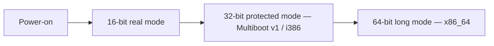

<!-- Glossary page — x86. Grounded in OSDev_Learning_Hub docs. -->

# x86

> **[Back to glossary index](README.md)** · Category: Hardware

x86 is the CPU architecture family — 32-bit (`i686`) and 64-bit (`x86_64`) — that every kernel in this hub targets.

## The short version
The whole hub builds kernels for the x86 family. The C, C++, and Go kernels target **32-bit x86** (`i686`) because Multiboot v1 runs in 32-bit protected mode, so they boot with `qemu-system-i386 -kernel`. The Rust kernel targets **64-bit** (`x86_64`), booting with `qemu-system-x86_64 -drive`. Understanding the architecture explains all the `-m32`, `-m elf_i386`, and `x86_64-unknown-none` flags you see.

## Detailed explanation
x86 CPUs boot in a well-defined progression of modes, and kernels live in specific ones:

- **Real mode (16-bit):** the mode the CPU starts in at power-on. The first instructions in `boot.s` deal with getting a stack and jumping to compiled code — the tutorial calls this the *"video-game-era reality: the CPU starts in 16-bit real mode with no stack."*
- **Protected mode (32-bit):** where **Multiboot v1** loads kernels. This is why the C/C++/Go kernels are 32-bit: the Makefiles pass `-m32` to the compiler and `-m elf_i386` to the linker, and you boot with `qemu-system-i386`.
- **Long mode (64-bit):** the modern mode. The Rust kernel's target triple is literally `x86_64-unknown-none`, and it boots on `qemu-system-x86_64`.

The architecture also dictates the *register and address conventions* the code uses. The bootstrap stack is set up with general-purpose registers (`movl $stack_top, %esp` — `esp`/`ebp` are the 32-bit stack/frame pointers), and the VGA text buffer lives at physical address `0xB8000`. The Multiboot header magic is `0x1BADB002`.

## Why it matters here (OSDev_Learning_Hub)
- `Example_OS_Project/c/Makefile` and `cpp/Makefile` — `-m32`, `ASFLAGS = --32`, `LDFLAGS = -m elf_i386`, and comments noting *"Multiboot v1 runs in 32-bit protected mode."*
- `Example_OS_Project/rust/Cargo.toml` and `rust-toolchain.toml` — the `x86_64-unknown-none` target triple.
- `Example_OS_Project/go/README.md` — builds `i686-elf-gccgo`, links `i686-elf-gcc`, boots `qemu-system-i386`.
- `synthesized_tutorials/00-introduction/02-your-toolchain.md` — the CPU-mode narrative in the assembler section.

## Watch / listen
[- Intro to x86 Assembly Language (Part 1)](https://www.youtube.com/watch?v=wLXIWKUWpSs) — x86 registers and instructions
[- you will never ask about pointers again after watching this video - Low Level Learning](https://www.youtube.com/watch?v=2ybLD6_2gKM) — x86 memory and pointers
- [OSDev Wiki — x86](https://wiki.osdev.org/X86) — free, authoritative
- [OSDev Wiki — CPU Registers x86](https://wiki.osdev.org/CPU_Registers_x86) — free reference

## Related terms
- [Kernel](kernel.md)
- [Memory-Mapped I/O](memory-mapped-io.md)
- [Multiboot](multiboot.md)
- [Cross-Compiler](cross-compiler.md)
- [QEMU](qemu.md)

---
*Grounded in the OSDev_Learning_Hub tutorials, the OSDev Wiki (free), and standard OS-dev references.*
