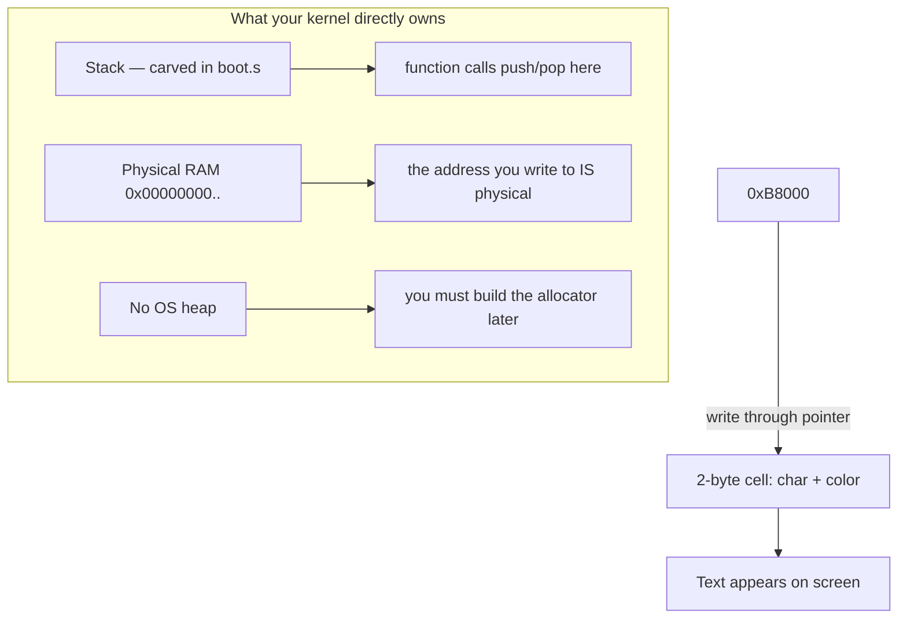

# Path A — C → Operating System Development (Beginner)

> **The reference language track of this hub.** Every other track (C++, Rust, Go, C#)
> is measured against C because C is the language the OS-dev world was *built on*:
> the VGA framebuffer, the [Multiboot](../GLOSSARY/multiboot.md "The protocol that lets a bootloader load any kernel; magic 0x1BADB002") header,
> the [linker](../GLOSSARY/linker.md "The tool that merges object files into one image at a chosen address") script, and `-ffreestanding`
> are all things you can understand *perfectly* in C before you see how each other language
> wraps them in its own safety rules or frameworks. Master this path and the rest of the hub
> becomes a study of *differences* rather than of brand-new ideas.

This page deep-expands the C track: it teaches you the *small, focused slice* of C a kernel
actually needs, shows you how memory really works when there is no OS underneath, then walks
you through booting a real "Hello World!" kernel in [QEMU](../GLOSSARY/qemu.md "A free emulator you can boot your kernel in for testing").
If you get stuck, the fully-commented reference lives in
[`Example_OS_Project/c/`](../Example_OS_Project/c/).

---

## Primary Resources

### 1. Operating Systems: From 0 to 1 — Doh Tu (tuhdo)
- **Where:** https://github.com/tuhdo/os01 | https://tuhdo.github.io/os01/
- **License:** Free (GitHub-distributed book)
- **Local copy:** [`Operating_Systems_From_0_to_1.pdf`](Operating_Systems_From_0_to_1.pdf)
- **Why chosen:** The single best free book that bootstraps a self-learner from *assembler + C* all the way to *linking/loading a bare-metal x86_64 kernel* in pure C — no standard library, no runtime. Famous, well-regarded (13k+ GitHub stars), text-heavy with diagrams.
- **What it teaches:** Linux dev environment + low-level tools, [x86](../GLOSSARY/x86.md "The CPU architecture family this hub targets") assembly in depth, [ELF](../GLOSSARY/elf.md "The executable format that lets a bootloader load your kernel"), program structure, debugging bare metal with **GDB + [QEMU](../GLOSSARY/qemu.md "A free emulator you can boot your kernel in for testing")**, linking/loading on x86_64 in pure C.

### 2. OSDev Wiki — Bare Bones (C)
- **Where:** https://wiki.osdev.org/Bare_Bones
- **License:** Open wiki (community-reviewed, CC/GFDL-style)
- **Local copy:** [`Bare_Bones_C.md`](Bare_Bones_C.md)
- **Why chosen:** The canonical, community-reviewed minimal-kernel tutorial for absolute beginners. 32-bit [x86](../GLOSSARY/x86.md "The CPU architecture family this hub targets") kernel booted by **[GRUB](../GLOSSARY/grub.md "A free, standard bootloader (GNU Grand Unified Bootloader)") + [Multiboot](../GLOSSARY/multiboot.md "The protocol that lets a bootloader load any kernel; magic 0x1BADB002")**, with the standard VGA text-mode driver. Uses GCC `-ffreestanding`.

## What you'll build in this path
A minimal kernel that prints **"Hello World!"** to the [VGA text framebuffer](../GLOSSARY/vga-framebuffer.md "The block of memory at 0xB8000 where the screen text lives") at `0xB8000`, booted by [GRUB](../GLOSSARY/grub.md "A free, standard bootloader (GNU Grand Unified Bootloader)")/[Multiboot](../GLOSSARY/multiboot.md "The protocol that lets a bootloader load any kernel; magic 0x1BADB002").

## Supporting material already in this hub
- Fully-commented minimal implementation → [`Example_OS_Project/c/`](../Example_OS_Project/c/)
- Synthesized consolidated beginner guide → [`synthesized_tutorials/01-c/`](../synthesized_tutorials/01-c/)
- Concepts (bootloaders, memory, interrupts, VGA) → [`synthesized_tutorials/concepts/`](../synthesized_tutorials/concepts/)

## Toolchain needed (see `Example_OS_Project/docs/setup.md`)
`gcc` (i686-elf cross for real targets; x86_64 native for QEMU test), `nasm`, `ld`, `make`, `qemu-system-x86_64`, `xorriso` (for ISO).

> **Windows tip:** the fastest way to get `gcc`, `as`, `ld`, `make`, and `qemu` all at once is
> **WSL2 (Ubuntu)**. This hub's `Example_OS_Project` was built and verified in WSL2.
> MinGW and Cygwin also work for the QEMU test path.

---

## Part 1 — The C you actually need (beginner fundamentals)

You do **not** need to be a C expert to write this kernel. You need a *small, focused* slice:
variables, pointers, arrays, strings (as `char*`), and loops. Everything else — the standard
library, `printf`, `malloc`, the preprocessor zoo — is either absent or trivially small here,
because a kernel is one of the rare places where the *whole* language collapses to almost nothing.

### 1.1 Hosted vs. freestanding: why this C is not "normal" C

The C that "Hello World" programs use assumes a **hosted** environment: an operating system
provides `printf`, `malloc`, `exit`, and the C runtime (`_start → main`) for you. Your kernel
is the **opposite**: it **is** the OS. There is no `libc` beneath it, no `printf`, no `malloc`,
no runtime that calls `main`. OS-dev calls this **freestanding** C — the whole language
*minus* the standard library.

[`freestanding`](../GLOSSARY/freestanding.md "Code compiled assuming no OS or standard library exists") is a real phrase from the C standard. The C standard only requires a
freestanding implementation to provide a handful of headers (`<float.h>`, `<limits.h>`,
`<stdarg.h>`, `<stddef.h>`, `<stdint.h>`, …) and leaves everything else to you. Our kernel
uses **none of the standard library at all** — it doesn't even `#include <stdio.h>`. It talks
to the screen by writing integers to a magic memory address.

```c
/* HOSTED C (what you already know): the OS hands you the console. */
#include <stdio.h>
int main(void) {                 /* the runtime calls THIS */
    printf("Hello\n");           /* libc talks to the OS, OS talks to screen */
    return 0;                    /* we return to the OS and it cleans up */
}

/* FREESTANDING C (what a kernel does): YOU are the OS. */
/* There is no printf. There is no main-calling runtime. No return value.
 * You reach the screen yourself. */
void kernel_main(void) {         /* boot.s calls THIS */
    write_a_character_to_the_screen('H');   /* you implement this */
    for (;;);                    /* never return — there's nowhere to go */
}
```

### 1.2 Types that survive without a runtime

`printf` needs formatting, memory-mapping, and a file handle — none of which exist here. But
C's *types* are pure hardware concepts, so they survive anything:

```c
#include <stdint.h>   /* freestanding-safe: defines fixed-width integer types */

uint8_t  byte  = 0x5A;   /* exactly 8 bits  — one byte, unsigned */
uint16_t cell  = 0x0F41; /* exactly 16 bits — one VGA cell! */
uint32_t addr  = 0xb8000;/* exactly 32 bits — a physical address in our mode */
uint64_t big   = 0;      /* exactly 64 bits — never touches 32-bit ABI here */
```

Why do we care about *exact* widths? On a hosted machine `int` is usually 32 bits and
`long` is 64 bits on Linux. On bare metal the story changes with the ABI you target. By using
`uint8_t`/`uint16_t`/`uint32_t` everywhere we make the code's meaning "this is one VGA cell"
rather than "this is whatever `int` happens to be". This precision is the backbone of all
systems programming.

### 1.3 A kernel entry point is just a function — with no caller

```c
/* Called by the tiny assembly stub in boot.s. It is NOT main() —
 * main() is called by the C runtime, which does not exist here. */
void kernel_main(void) {
    // ... print hello world ...
    for (;;) ;   /* a kernel never returns: there is no OS below to go back to */
}
```

Later when you add [interrupts](../GLOSSARY/interrupt.md "A hardware signal that makes the CPU run a registered handler") and a scheduler, this "never returns" rule becomes
the seed of the whole OS: the kernel *is* the thing that keeps running and dispatching work.

---

## Part 2 — Memory and pointers (systems context)

This is where the beginner-to-systems-programmer leap happens. If you only take one thing
from this page, take this: **a pointer is just a variable whose value is a memory address,
and the entire VGA trick is pointer work in disguise.**

### 2.1 Pointers as addresses

```c
int  a = 42;        /* 'a' lives at SOME address; we don't pick it */
int* p = &a;        /* p holds the address of a   ('&' = "address of") */
*p = 99;            /* dereference '*' = "go to that address and use it" */
```

The kernel's entire VGA trick is just this: `0xB8000` is a **fixed, agreed-upon memory
address**, and we make a pointer that points there, then write through it. There is nothing
more magical about it than `*p = 99` — the address just happens to be wired up to the video
hardware.

```c
/* The VGA framebuffer as a raw pointer to 16-bit cells. */
#define VGA_MEMORY ((unsigned short*)0xB8000)   /* a cast: number -> pointer */

VGA_MEMORY[0] = 0x0F48;   /* cell 0 = char 'H' (0x48) with color 0x0F */
```

### 2.2 The memory that a kernel owns

In application C, the OS gives you a clean fiction: a stack, a heap you call `malloc` on,
and a process that the OS cleaned up before you ever ran. A kernel owns *raw hardware memory*:

- The **[stack](../GLOSSARY/entry-point.md "The symbol (usually _start) the bootloader jumps to when your kernel starts")** is a region you carve out in assembly (boot.s reserves 16 KiB) because the CPU
  has no usable stack at power-on and C cannot declare "my stack is here" — the stack-pointer
  register is only settable from assembly.
- There is **no heap from the OS**. When a kernel needs dynamic memory, *it* becomes the
  allocator ([memory management](../GLOSSARY/memory-management.md "How a kernel tracks used and free RAM and hands it out safely")). Later chapters of this
  hub build a [frame allocator](../GLOSSARY/frame-allocator.md "The simplest memory manager that tracks which 4 KiB physical pages are free") and a [heap allocator](../GLOSSARY/heap-allocation.md "Dynamically allocating memory at runtime, which a kernel must implement itself").
- **[Physical vs. virtual memory](../GLOSSARY/physical-virtual-memory.md "Real RAM addresses vs the addresses your code sees after paging")** only becomes a distinction once you enable [paging](../GLOSSARY/paging.md "The CPU feature that translates virtual addresses to physical RAM via page tables"); Multiboot v1 boots you in 32-bit [protected mode](../GLOSSARY/protected-mode.md "The 32-bit CPU mode Multiboot v1 loads kernels into") with paging *disabled*, so for now the address you write *is* physical RAM.

### 2.3 Reading memory back (a superpower)

Because the framebuffer is an *address*, you can read from it too — this is how the project
verifies its own output:

```c
/* Read the character stored in cell (row, col) back out of the buffer. */
unsigned short read_cell(int row, int col) {
    unsigned short* cell = VGA_MEMORY + (row * 80 + col);
    return *cell;                    /* dereference: fetch what's stored */
}
/*   low byte  = character  (read_cell(0,0) & 0xFF)
 *   high byte = color      ((read_cell(0,0) >> 8) & 0xFF)  */
```

Being able to read hardware memory back is the same technique real kernel debuggers use — it
proves beyond doubt that your writes landed. The project's `tools/read_vga_text.py` does
exactly this against QEMU.



### 2.4 Strings as arrays of characters

A C string is literally just a `char*` pointing at a sequence of bytes terminated by a `0`.
There is no string *object*, no length header, no allocation — just memory and a sentinel.
This is why our `vga_write` loop is so short:

```c
static void vga_write(const char* s) {
    while (*s)         /* while the current byte is not '\0' */
        vga_putchar(*s++);   /* write it, then advance the pointer */
}
```

The phrase `*s++` is dense but worth dissecting once. It means: dereference `s` (get the byte
it points to), and *afterwards* advance `s` by one character. In array terms it is exactly
`for (int i = 0; s[i] != 0; i++) vga_putchar(s[i]);` — but written with a pointer.

The sentinel rule (`\0` ends the string) is a contract *you* must honour: if you ever forget
the trailing `0`, your `while(*s)` loop will walk off the end of the string into whatever
memory follows it, printing garbage until it finds a random zero. That is a classic and
spectacular bug.

```c
const char msg[] = "Hello";   /* compiler adds the \0: { 'H','e','l','l','o', 0 } */
const char* p    = "World";   /* a pointer to a string literal (read-only) */
/* p and msg are both char* — interchangeable in our kernel */
```

### 2.5 Hex, little-endian, and the VGA cell layout

The VGA framebuffer is a good place to internalize two ideas that matter everywhere in systems
programming: **hex** and **endianness**.

- **Hex** groups bytes into pairs: one byte `0x48` is the ASCII for `'H'`. A 16-bit cell
  `0x0F48` is two bytes: the color byte `0x0F` and the character byte `0x48`.
- **Little-endian** means the *low byte of a multi-byte value sits at the lower address*.
  So when we store the `uint16_t` value `0x0F48` at index 0, the byte at `0xB8000` is `0x48`
  (the character) and the byte at `0xB8001` is `0x0F` (the color). This is why
  `read_cell(...) & 0xFF` recovers the character and `(read_cell(...) >> 8) & 0xFF` recovers
  the color.

This mental model — "a number stored in memory has a byte order, and I choose the width"
— is the same one you'll need for [GDT](../GLOSSARY/gdt.md "A table describing memory segments the CPU uses in protected mode") and
[IDT](../GLOSSARY/idt.md "The kernel's table that tells the CPU where each interrupt handler lives") structures, port I/O, and
[memory-mapped I/O](../GLOSSARY/memory-mapped-io.md "Hardware that is controlled by writing to regular memory addresses") later.

```c
/* Visualizing the 2-byte VGA cell at 0xB8000 as a little-endian uint16. */
/* address  : 0xB8000   0xB8001
 * byte     :  0x48      0x0F     <- little-endian: low byte first
 * value    :             0x0F48  = char 'H' in the low byte, color in the high
 */
```

### 2.6 The preprocessor: how the kernel stays honest

The C preprocessor is what keeps this whole thing small. `#define` does pure text
substitution before the compiler ever sees your code:

```c
#define VGA_WIDTH  80                          /* text-substituted: any "VGA_WIDTH"
                                                  becomes 80 before compiling */
#define VGA_MEMORY ((unsigned short*)0xB8000)  /* a cast expression as a macro */
#define COLOR_GREEN 0x0A
```

There are no type checks on a macro — it's a find-and-replace of tokens. That is both a
convenience (no function-call overhead in the hot loop) and a hazard (a missing parenthesis
can silently change meaning). For our purposes macros are perfect: they declare the hardware
facts (the framebuffer address, the widths) in one place, so a beginner can change a color by
editing one line. This is exactly why the reference kernel defines `COLOR_WHITE_ON_BLACK`
once and uses it everywhere.

---

## Part 3 — Build your kernel in C (guided, step by step)

Everything below is grounded in the real, verified code in
[`Example_OS_Project/c/`](../Example_OS_Project/c/). The whole kernel is just **four small
files** that form one pipeline: `boot.s` gives the CPU a stack and calls C → `kernel.c` writes
the screen → `linker.ld` decides where it all sits → `Makefile` drives the toolchain.

### 3.1 `boot.s` — the Multiboot header and the stack

Every bare-metal C kernel needs a tiny assembly file to (a) declare the
[Multiboot](../GLOSSARY/multiboot.md "The protocol that lets a bootloader load any kernel; magic 0x1BADB002") header so a
[bootloader](../GLOSSARY/bootloader.md "A small program that loads your kernel into memory and jumps to it") recognizes it, and (b) give the CPU a stack (it has none when it boots).

```nasm
# Declare constants for the multiboot header.
.set ALIGN,    1<<0              # align loaded modules on page boundaries
.set MEMINFO,  1<<1              # provide memory map
.set FLAGS,    ALIGN | MEMINFO   # this is the Multiboot 'flag' field
.set MAGIC,    0x1BADB002        # 'magic number' lets bootloader find the header
.set CHECKSUM, -(MAGIC + FLAGS)  # checksum of above, to prove we are multiboot

.section .multiboot              # put this FIRST in the image
.align 4
.long MAGIC
.long FLAGS
.long CHECKSUM

# Provide our own stack (16 KiB).
.section .bootstrap_stack, "aw", @nobits
stack_bottom:
.skip 16384
stack_top:

.section .text
.global _start
.type _start, @function
_start:
    mov $stack_top, %esp         # set up the stack
    call kernel_main             # call the C entry point
    cli                          # clear the interrupt flag
1:  hlt                          # halt the CPU (should never return)
    jmp 1b
```

The three lines that matter most are the header itself. The bootloader scans the first bytes
of your image, finds `0x1BADB002`, and verifies `magic + flags + checksum == 0` — that is the
whole "handshake" that proves "I am a Multiboot kernel, load me."

Why does the CPU need a stack? Because the first C function you call will `push` return
addresses and local variables. If `esp` is garbage, the first `push` writes to an unknown
address and the machine [triple-faults](../GLOSSARY/hlt-instruction.md "The CPU instruction that parks the CPU until an interrupt wakes it") (resets). Giving the CPU a
well-defined stack region is the assembly file's most important job.

### 3.2 `kernel.c` — the VGA driver and the entry point

```c
/* kernel.c — condensed from Example_OS_Project/c/kernel.c */
#include <stdint.h>
#include <stddef.h>

#define VGA_WIDTH   80                       /* columns */
#define VGA_HEIGHT  25                       /* rows */
#define VGA_MEMORY  ((unsigned short*)0xB8000) /* the text framebuffer */
#define COLOR_WHITE_ON_BLACK  0x0F           /* fg=white, bg=black */

static int terminal_row = 0;
static int terminal_col = 0;

static void vga_putchar(char c) {
    if (c == '\n') {                         /* handle newline: wrap */
        terminal_col = 0;
        terminal_row++;
        if (terminal_row >= VGA_HEIGHT) terminal_row = 0;  /* naive scroll */
        return;
    }
    const unsigned int index = terminal_row * VGA_WIDTH + terminal_col;
    /* one cell = [color << 8] | character */
    VGA_MEMORY[index] = (unsigned short)((COLOR_WHITE_ON_BLACK << 8) | (unsigned char)c);
    terminal_col++;
    if (terminal_col >= VGA_WIDTH) {         /* wrap at end of line */
        terminal_col = 0;
        terminal_row++;
        if (terminal_row >= VGA_HEIGHT) terminal_row = 0;
    }
}

static void vga_write(const char* s) {       /* print a NUL-terminated string */
    while (*s) vga_putchar(*s++);
}

static void vga_clear(void) {                /* fill every cell with a blank */
    for (int y = 0; y < VGA_HEIGHT; y++)
        for (int x = 0; x < VGA_WIDTH; x++) {
            const unsigned int i = y * VGA_WIDTH + x;
            VGA_MEMORY[i] = (unsigned short)((COLOR_WHITE_ON_BLACK << 8) | ' ');
        }
    terminal_row = 0; terminal_col = 0;
}

void kernel_main(void) {                     /* called from _start in boot.s */
    vga_clear();
    vga_write("Hello World!\n");
    vga_write("Welcome to your very own operating system (C edition).\n");
    for (;;)                                 /* a kernel never returns */
        ;
}
```

Notice what the cell arithmetic means: `0x0F` (white on black) shifted left 8 bits lands in the
*high* byte of the 16-bit cell, and the ASCII character lands in the *low* byte. So
`'H'` (0x48) in white becomes the 16-bit value `0x0F48`.

### 3.3 `linker.ld` — where the kernel lives in memory

```ld
ENTRY(_start)                    # the symbol the bootloader jumps to

SECTIONS {
    . = 1M;                      # load the kernel at 1 MiB (the convention)

    .text BLOCK(4K) : ALIGN(4K) {
        *(.multiboot)            # Multiboot header must be the first bytes
        *(.text)
    }
    .rodata BLOCK(4K) : ALIGN(4K) { *(.rodata) }
    .data   BLOCK(4K) : ALIGN(4K) { *(.data) }
    .bss    BLOCK(4K) : ALIGN(4K) { *(COMMON) *(.bss) *(.bootstrap_stack) }
}
```

Three things to notice:
- **`. = 1M;`** — the location counter starts at 1 MiB. This is where
  [GRUB](../GLOSSARY/grub.md "A free, standard bootloader (GNU Grand Unified Bootloader)") conventionally loads Multiboot kernels; below that address the low memory is
  reserved for BIOS/firmware and hardware.
- **`*(.multiboot)` first** — the header must be the very first thing in the image or the
  bootloader won't find it.
- **`.bss` holds the stack** — the 16 KiB stack you reserved in boot.s lives here; `.bss` is
  zero-initialized and not stored on disk, so the stack costs almost nothing in file size.

### 3.4 Build & run

```bash
# Assemble bootstrap
as --32 boot.s -o boot.o                 # or: nasm -f elf32 boot.s -o boot.o
# Compile kernel as freestanding
gcc -c kernel.c -o kernel.o -ffreestanding -fno-pie -m32 -nostdlib -O2 -Wall -Wextra
# Link
ld -m elf_i386 -T linker.ld -o myos.bin -nostdlib boot.o kernel.o
# Test with QEMU
qemu-system-i386 -kernel myos.bin
```

Or simply `make -C Example_OS_Project/c && make run-c` from the project root.

### 3.5 What each compiler flag buys you

| Flag | Meaning | Why the kernel needs it |
|------|---------|-------------------------|
| `-ffreestanding` | don't assume the standard library exists | there is no libc here |
| `-fno-pie` | disable position-independent code | the kernel runs at a *fixed* 1 MiB address, no relocation |
| `-m32` | target 32-bit x86 | Multiboot v1 boots you into 32-bit protected mode |
| `-nostdlib` | don't link against libc | a kernel defines its own world |
| `-O2` | optimize | bare-metal code must be tight |
| `-Wall -Wextra` | warnings on | catch bugs before they become triple-faults |

### 3.6 Verifying it actually worked

```bash
# Is the binary a valid Multiboot v1 kernel? (exits 0 if yes)
grub-file --is-x86-multiboot myos.bin

# Boot it and confirm text is really in VRAM
qemu-system-i386 -kernel myos.bin -display none -monitor stdio &
# ... then use tools/read_vga_text.py to dump 0xB8000 and grep for "Hello World!"
```

```mermaid
sequenceDiagram
    participant Q as QEMU / real PC
    participant B as Bootloader (GRUB / QEMU -kernel)
    participant K as Your C kernel
    Q->>B: Firmware finds bootable medium
    B->>B: Sees Multiboot header (0x1BADB002)
    B->>K: Loads kernel at 1 MiB, sets up CPU
    B->>K: Jumps to _start
    K->>K: boot.s sets stack, calls kernel_main
    K->>K: kernel.c writes 'Hello World!' to VGA 0xB8000
    K->>K: for(;;) — never returns
```

---

## Part 4 — Pitfalls (what breaks the first time)

Everything below is condensed from real OSDev forum threads and beginner mistakes on the
exact files in this project.

1. **Wrong address / wrong width.** Writing `0xB8000` as a `char*` instead of `unsigned short*`
   makes each cell one byte instead of two, and your text comes out as garbage. Remember:
   **two bytes per cell**, and `-m32` so pointer arithmetic is 32-bit.
2. **Missing `-nostdlib`.** Without it, `gcc` may pull in `__main` or libc startup references
   and your binary bloats or fails to link. It must appear on **both** the `gcc` and `ld` lines.
3. **Multiboot header not first.** If `.multiboot` isn't at the very start, `grub-file
   --is-x86-multiboot` fails and nothing boots. The linker script's `*(.multiboot)` first line
   is what guarantees it.
4. **No stack.** If boot.s forgets `mov $stack_top, %esp`, the first function call writes to an
   unknown address → triple fault → QEMU resets (or shows nothing). The 16 KiB stack exists
   precisely to prevent this.
5. **Returning from `kernel_main`.** There is no caller. The `cli; hlt; jmp` loop after the
   `call` in boot.s exists to catch you if you try. Assert "never returns" with `for (;;)`.
6. **Printing before clearing the screen.** `vga_clear()` must run before any text, or you
   inherit garbage the bootloader left in the framebuffer.
7. **Using `printf` / `malloc` / `strlen`.** They live in libc. There is no libc. Your kernel's
   "Hello World" is hand-rolled character code, not `<stdio.h>`.

> **The deepest lesson:** a kernel can **build cleanly and still be dead on arrival.** The
> emulator, not the compiler, is your real judge. When in doubt, boot it.

---

## Part 5 — Next steps

| Concept | Where | Why it's next |
|---------|-------|---------------|
| Bootloaders & Multiboot | [`concepts/01-bootloaders-and-multiboot.md`](../synthesized_tutorials/concepts/01-bootloaders-and-multiboot.md) | what actually loaded your kernel |
| Memory management | [`concepts/02-memory-management.md`](../synthesized_tutorials/concepts/02-memory-management.md) | the 1 MiB layout, physical vs. virtual |
| Interrupts & the IDT | [`concepts/03-interrupts-and-the-idt.md`](../synthesized_tutorials/concepts/03-interrupts-and-the-idt.md) | replace `for(;;)` with an [IDT](../GLOSSARY/idt.md "The kernel's table that tells the CPU where each interrupt handler lives") + `hlt` loop |
| VGA text mode deep-dive | [`concepts/04-vga-text-mode.md`](../synthesized_tutorials/concepts/04-vga-text-mode.md) | colors, cursor, scrolling |
| The bigger OSDev landscape | [`concepts/05-the-hello-world-of-oses.md`](../synthesized_tutorials/concepts/05-the-hello-world-of-oses.md) | what a real kernel does after Hello World |
| The C chapter deep-dive | [`synthesized_tutorials/01-c/README.md`](../synthesized_tutorials/01-c/README.md) | a longer, read-along version of this page |

You've printed text to real hardware memory. The single most rewarding customization is to
**add a second color**: edit the constant to `0x0A` (bright green) for the "Welcome" line,
rebuild, and re-boot. You just wrote your first parameterized device driver.

---

## Watch and learn

Videos selected and verified for the C systems track — memory/pointers + booting a bare-metal
kernel in QEMU.

<details class="video-embed">
<summary>▶ Watch: CS50x 2025 - Lecture 4 - Memory</summary>
<iframe src="https://www.youtube-nocookie.com/embed/kcRdFGbzR1I" title="CS50x 2025 - Lecture 4 - Memory" width="100%" height="400" style="border:0;border-radius:8px;" allow="accelerometer; autoplay; clipboard-write; encrypted-media; gyroscope; picture-in-picture; web-share" allowfullscreen></iframe>
<p class=video-caption>David Malan's classic lecture on pointers, hexadecimal addresses, the stack and heap, and how C manipulates memory — the exact mental model behind poking 0xB8000.</p>
</details>
<details class="video-embed">
<summary>▶ Watch: C pointers explained</summary>
<iframe src="https://www.youtube-nocookie.com/embed/DplxIq0mc_Y" title="C pointers explained" width="100%" height="400" style="border:0;border-radius:8px;" allow="accelerometer; autoplay; clipboard-write; encrypted-media; gyroscope; picture-in-picture; web-share" allowfullscreen></iframe>
<p class=video-caption>A concise crash course on what a pointer is, `&` vs `*`, pointers as function arguments, and dereferencing — ideal for grounding the `unsigned short*` cast to the VGA framebuffer.</p>
</details>
<details class="video-embed">
<summary>▶ Watch: Pointers and dynamic memory - stack vs heap (Jacob Sorber)</summary>
<iframe src="https://www.youtube-nocookie.com/embed/_8-ht2AKyH4" title="Pointers and dynamic memory - stack vs heap" width="100%" height="400" style="border:0;border-radius:8px;" allow="accelerometer; autoplay; clipboard-write; encrypted-media; gyroscope; picture-in-picture; web-share" allowfullscreen></iframe>
<p class=video-caption>Where the stack and the heap live in a process's memory — the same hardware memory your kernel owns directly, minus any OS in the way.</p>
</details>
<details class="video-embed">
<summary>▶ Watch: Write Your Own 64-bit Operating System Kernel #1 - Boot code and multiboot header</summary>
<iframe src="https://www.youtube-nocookie.com/embed/FkrpUaGThTQ" title="Write Your Own 64-bit Operating System Kernel #1 - Boot code and multiboot header" width="100%" height="400" style="border:0;border-radius:8px;" allow="accelerometer; autoplay; clipboard-write; encrypted-media; gyroscope; picture-in-picture; web-share" allowfullscreen></iframe>
<p class=video-caption>Shows assembling and booting a Multiboot kernel in QEMU exactly like this path's boot.s flow.</p>
</details>
<details class="video-embed">
<summary>▶ Watch: How does an OS boot? //Source Dive// 001</summary>
<iframe src="https://www.youtube-nocookie.com/embed/KkenLT8S9Hs" title="How does an OS boot? //Source Dive// 001" width="100%" height="400" style="border:0;border-radius:8px;" allow="accelerometer; autoplay; clipboard-write; encrypted-media; gyroscope; picture-in-picture; web-share" allowfullscreen></iframe>
<p class=video-caption>Background on firmware, bootloader and kernel startup — the full chain your `-kernel` boot skips past.</p>
</details>

---

## Exercises & Projects

You built the C track's Hello World on top of a shared five-step recipe: assemble → compile →
link → load → boot. These exercises perturb that recipe one step at a time so the toolchain
and the boot become levers, not black boxes. **Prereq:** the full build loop from this page —
ideally `make -C Example_OS_Project/c` working end-to-end first.

### Graded exercises

**Easy**

- [ ] **E1. Rebuild the kernel closed-book** (~20–40 min). Close this page and the reference.
      Recreate `boot.s` (Multiboot header + stack + `call kernel_main`), `kernel.c` (VGA write +
      `for(;;)`), and `linker.ld` (ENTRY, `. = 1M`, `.multiboot` first) from memory. Build using
      the exact command sequence in Part 3.4. If you stall, peek at
      [`Example_OS_Project/c/`](../Example_OS_Project/c/) *only* for the toolchain flags, not the code.
- [ ] **E2. Explain the five-step recipe out loud** (~20 min). Write a short note (or gist)
      describing assemble → compile → link → boot, and jot the role of each flag (`-ffreestanding`,
      `-fno-pie`, `-m32`, `-nostdlib`). You should be able to say what each one stops the compiler
      from assuming.
- [ ] **E3. Change the banner to prove ownership** (~20 min). Edit the message to a unique string,
      rebuild, boot in QEMU, and confirm your string appears. This kills the "it's a template, not
      mine" feeling for good.

**Medium**

- [ ] **M1. Add a second color / attribute** (~1 hr). Extend beyond one color: print the banner in
      bright green on black (`0x0A`) and an "error" line in red on white (`0x1C`). Practice writing
      to the typed hardware pointer with a computed color-byte argument.
- [ ] **M2. Read the fault, don't guess** (~1 hr). Boot a deliberately broken kernel (e.g. remove
      the stack setup in `boot.s`) with `-d int,cpu_reset`, capture the fault output, fix it, and
      re-run. Write a one-line note describing what a missing-stack fault looks like in this emulator.
- [ ] **M3. Deterministic build + clean tree** (~45 min). `make clean && make`, hash `myos.bin`,
      rebuild, and confirm an identical hash. Then reproduce the build on a second machine/VM from the
      repo alone, proving your toolchain notes are complete.

**Hard**

- [ ] **H1. Port a concept back in** (~3 hr). Take this hello-world kernel and add one subsystem
      from the concept chapters: a PIT timer [ISR](../GLOSSARY/isr.md "The handler function run for a specific interrupt number")
      ([concepts/03](../synthesized_tutorials/concepts/03-interrupts-and-the-idt.md)) or a
      [frame allocator](../GLOSSARY/frame-allocator.md "The simplest memory manager that tracks which 4 KiB physical pages are free")
      ([concepts/02](../synthesized_tutorials/concepts/02-memory-management.md)). This proves the concepts are language-independent.
- [ ] **H2. Compare against Rust / C++ side-by-side** (~1.5 hr). Put your C kernel source next to
      [`Example_OS_Project/cpp/kernel.c++`](../Example_OS_Project/cpp/kernel.c++) and
      [`Example_OS_Project/rust/src/main.rs`](../Example_OS_Project/rust/src/main.rs). Annotate the
      same *logical steps* (stack, VGA write, loop) across the three. Where did each language impose
      ceremony? Where did it save you a line?

### ⭐ Mini-project — Rebuild the C kernel as your own from a clean directory

**Goal.** Rebuild, from a fresh directory (not by copying the reference file-for-file), a C
kernel that boots and prints your own banner — structured so you can grow it into a timer +
allocator later. **Estimated time:** 2–4 hr. **Prereq:** this page + the toolchain in
[`Example_OS_Project/docs/setup.md`](../Example_OS_Project/docs/setup.md).

1. **Scaffold from scratch.** `mkdir mycus && cd mycus`; write your own `boot.s`, `linker.ld`
   (`ENTRY(_start)`, base 1 MiB, `.multiboot` first), and `kernel.c`. Retype, don't copy-paste —
   the muscle memory is worth it.
2. **Bring the recipe back one step at a time.** Assemble only; compile only; then link; then
   boot in QEMU. Confirm each artifact exists and is well-formed before the next (`readelf -h`
   for ELF32 + entry, `grub-file --is-x86-multiboot` for validity).
3. **Verify the handshake.** Check the Multiboot magic is the first bytes (`xxd myos.bin | head`)
   and that `grub-file --is-x86-multiboot myos.bin` exits 0.
4. **Add a banner + clean exit.** Define a `BANNER` macro used in both the kernel and the message,
   and end `kernel_main` with an explicit `for(;;)`.
5. **Grow one subsystem.** Port the PIT timer ISR from
   [concepts/03](../synthesized_tutorials/concepts/03-interrupts-and-the-idt.md) so your kernel
   prints an uptime counter. Now it's no longer a hello-world — it's a kernel with a clock.
6. **Write `make` + `make run` targets.** Make a stranger able to build and boot it from a clone
   with two commands.
7. **Commit + reproduce.** Clone the tree fresh and build once more; your README must suffice for
   a stranger to boot it.

**Checklist**

- [ ] closed-book kernel rebuild succeeds without the page open
- [ ] self-chosen banner string boots and is visible in QEMU
- [ ] at least one distinct color/attribute customization verified on screen
- [ ] `make clean && make` reproduces an identical `myos.bin` hash
- [ ] a second machine/VM reproduces the build from the repo alone
- [ ] a chosen concept (timer or allocator) is ported and boots

---

*You've written your first OS kernel in C — the reference language every other language track
in this hub is measured against. Next time someone says "writing an OS is impossible," you know
better: it's four small files and one magic address away.*
