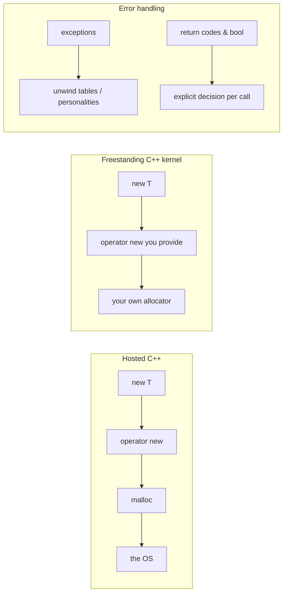

# Path C — C++ → Operating System Development (Beginner)

> A **free C++ OS-dev track** for when you already know a little C++. The core message of
> this path: **writing a kernel in C++ is easy — you just give `kernel_main` C linkage
> (`extern "C"`) and compile freestanding** (`-ffreestanding -fno-exceptions -fno-rtti`).
> Everything else about bare-metal Hello World (the VGA framebuffer, the Multiboot header,
> the linker script) is *exactly* the same as the C path — so if you haven't read
> [`path_c_os/README.md`](../path_c_os/README.md) yet, do that first. This page is written as
> "C++ *differences and depths* on top of C".

This page deep-expands the C++ track: the beginner C++ you actually need, how memory and
pointers look through a C++ lens with no runtime, then a guided build of the C++ kernel from
[`Example_OS_Project/cpp/`](../Example_OS_Project/cpp/).

---

## Primary Resource

### OSDev Wiki — Bare Bones (C++ variant)
- **Where:** https://wiki.osdev.org/Bare_Bones
- **License:** Open wiki (community-reviewed)
- **Local copy:** [`Bare_Bones_Cpp.md`](Bare_Bones_Cpp.md)
- **Why chosen:** The canonical free minimal-kernel tutorial, with an explicit C++ section. Writing a kernel in C++ is easy — you just give `kernel_main` [**C linkage**](../GLOSSARY/extern-c.md "C++ keyword giving a function C linkage so its name isn't mangled") (`extern "C"`) and compile with `-ffreestanding -fno-exceptions -fno-rtti`.
- **Key C++ specifics:**
  - `extern "C" void kernel_main()` — C linkage so the symbol name isn't mangled (the bootloader stub can call it).
  - Compile with `-ffreestanding -O2 -fno-exceptions -fno-rtti`.
  - Exceptions and RTTI are **not** available without runtime support — a great beginner lesson.

## What you'll build in this path
A minimal C++ kernel ([VGA text mode](../GLOSSARY/vga-text-mode.md "The 80x25 character display mode a minimal kernel writes to")) with an `extern "C"` entry point, booted by [GRUB](../GLOSSARY/grub.md "A free, standard bootloader (GNU Grand Unified Bootloader)")/[Multiboot](../GLOSSARY/multiboot.md "The protocol that lets a bootloader load any kernel; magic 0x1BADB002").

## Supporting material already in this hub
- Fully-commented minimal implementation → [`Example_OS_Project/cpp/`](../Example_OS_Project/cpp/)
- Synthesized consolidated beginner guide → [`synthesized_tutorials/03-cpp/`](../synthesized_tutorials/03-cpp/)
- Concepts (memory, interrupts, VGA) → [`synthesized_tutorials/concepts/`](../synthesized_tutorials/concepts/)

## Toolchain needed (see `Example_OS_Project/docs/setup.md`)
`g++` (i686-elf cross for real targets), `nasm`, `ld`, `make`, `qemu-system-x86_64`.

---

## Part 1 — The beginner C++ you need for a kernel

If you know a little C++, you already know 95% of what this path needs. A bare-metal C++
kernel deliberately uses a *tiny* subset of the language — mostly the parts that are C
with a nicer syntax. Let's be explicit about what we use and, just as importantly, what we
**don't**.

### 1.1 What we use, and what we must not

```cpp
// USE: built-in integer types, plain functions, loops, namespaces, constexpr.
namespace vga {
    constexpr unsigned short WIDTH  = 80;
    constexpr unsigned short HEIGHT = 25;
    constexpr unsigned short COLOR  = 0x0F;   // white on black
}

// DO NOT USE (without building a runtime first):
//   - exceptions            -> -fno-exceptions (no unwind tables / handlers)
//   - RTTI (dynamic_cast, typeid) -> -fno-rtti  (no type-info machinery)
//   - the STL containers    -> they pull in memory allocation + exceptions
//   - <iostream>            -> streams are a hosted-library concept
```

Why `constexpr`? It computes the value at compile time — so `vga::WIDTH` is just the number
80, with zero runtime cost and zero static-init machinery. That's exactly what we want on
bare metal where there is no runtime to run constructors.

### 1.2 The one essential trick: `extern "C"`

The CPU and the bootloader know nothing about C++. A C++ compiler "mangles" function names to
encode their parameter types — `kernel_main()` becomes something like `_Z11kernel_mainv`.
If your assembly stub calls `kernel_main`, it looks for the *exact* symbol `kernel_main`,
which won't exist because the compiler renamed it.

`extern "C"` tells the compiler: *give this function C linkage* — don't mangle its name.

```cpp
// WITHOUT extern "C": the compiler exports "_Z11kernel_mainv" — boot.s can't call it.
void kernel_main() { ... }

// WITH extern "C": the exported symbol is exactly "kernel_main".
extern "C" void kernel_main() { ... }
```

This is the single most important C++-specific lesson in the whole path, and it's what
[`extern C`](../GLOSSARY/extern-c.md "C++ keyword giving a function C linkage so its name isn't mangled") refers to. You can verify it yourself:

```bash
# Compile both versions and look at the exported symbols:
g++ -c man.cpp -o man.o -ffreestanding -fno-exceptions -fno-rtti -m32
nm man.o                 # watch the name "kernel_main" vs "_Z11kernel_mainv"
```

### 1.3 The freestanding C++ compile flags

```bash
i686-elf-g++ -c kernel.c++ -o kernel.o -ffreestanding -O2 -Wall -Wextra \
             -fno-exceptions -fno-rtti -fno-pie -m32 -nostdlib
```

The flags `-ffreestanding`, `-fno-pie`, `-m32`, `-nostdlib` mean the same as in the C path.
The two *new* ones are `-fno-exceptions` and `-fno-rtti` — both are required because C++
exceptions and RTTI need runtime support (unwind tables, type-info machinery, `__cxa_*`
functions) that does **not** exist on bare metal. Turning them off is not "dumbing down"
C++ — it's choosing the subset that can actually run.

---

## Part 2 — Memory and pointers through a C++ lens

### 2.1 References vs pointers on bare metal

C++ gives you *references* (`T&`) as well as pointers (`T*`). On bare metal they compile to
identical machine code — a reference is just a pointer that the compiler guarantees is
non-null and always dereferences for you. For the VGA framebuffer you still reach for a raw
pointer because the address is a literal you must cast:

```cpp
#define VGA_SCREEN ((unsigned short*)0xB8000)   // note: macro, not constexpr

// Writing through a raw pointer is exactly the same operation as in C:
unsigned short* cell = VGA_SCREEN + (row * WIDTH + col);
*cell = (unsigned short)((COLOR << 8) | (unsigned char)c);
```

Why a macro and not `constexpr`? `0xB8000` doesn't fit in `unsigned short`, and making a
typed pointer via `constexpr` + `reinterpret_cast` has restrictions on bare metal. A macro
like the C kernel is simplest and matches what the reference implementation does — see the
comment in [`Example_OS_Project/cpp/kernel.c++`](../Example_OS_Project/cpp/kernel.c++).

### 2.2 The VGA cell is a `uint16_t`, and C++ loves to say so

```cpp
// A VGA cell is exactly 16 bits: [char][color].
// In C++ we can give this shape a name with an enum/namespace of constants.
namespace vga {
    constexpr unsigned short WIDTH  = 80, HEIGHT = 25, COLOR = 0x0F;
    constexpr unsigned int   CELLS  = WIDTH * HEIGHT;   // 2000 cells
}

// Clear the whole screen: one loop of 2000 cells.
void clear() {
    unsigned short* cell = VGA_SCREEN;
    for (unsigned int i = 0; i < vga::CELLS; i++)
        cell[i] = static_cast<unsigned short>((vga::COLOR << 8) | ' ');
}
```

### 2.3 Why namespaces help a kernel stay organized

When a kernel grows past "Hello World" you get a VGA driver, a [GDT](../GLOSSARY/gdt.md "A table describing memory segments the CPU uses in protected mode"), an
[IDT](../GLOSSARY/idt.md "The kernel's table that tells the CPU where each interrupt handler lives"), an allocator, drivers. C++ namespaces let you group all of that without
name collisions and without a heavy OOP class hierarchy (which would invite RTTI). The
reference kernel puts everything VGA-related inside a `namespace vga { }` — minimal, clean,
zero runtime cost.

```cpp
namespace vga {
    int row = 0, col = 0;
    inline void putchar(char c) { /* ... */ }
    void write(const char* s)   { while (*s) putchar(*s++); }
    void clear()                { /* ... */ }
}
// Usage: vga::write("Hello World!\n");
```

### 2.4 `new`, `delete`, and the missing operator new/delete

In hosted C++, `new` is how you allocate: it calls `operator new`, which calls `malloc`,
which asks the OS. On bare metal **there is no OS**, so `new` won't link unless **you**
provide `operator new` and `operator delete` — and even then, *you* are the allocator behind
them.

```cpp
// You WILL need these if you ever call `new` in a kernel:
void* operator new(size_t size)          { return /* YOUR allocator's allocate(size) */; }
void* operator new[](size_t size)        { return operator new(size); }
void  operator delete(void* p) noexcept  { /* YOUR allocator's free(p) */ }
void  operator delete[](void* p) noexcept{ operator delete(p); }
```

Until you've built a [heap allocator](../GLOSSARY/heap-allocation.md "Dynamically allocating memory at runtime, which a kernel must implement itself"), *don't* use `new`.
That's why the reference Hello World kernel uses static buffers and the stack — no dynamic
allocation needed. This is the C++-flavoured version of the C lesson "a kernel must become its
own memory manager."

### 2.5 `constexpr` vs `const`: compile-time truths on bare metal

There is a subtle but important difference between `const` and `constexpr` that matters on
bare metal:

```cpp
const int WIDTH = 80;                 // "read-only value" — may or may not exist at runtime
constexpr int HEIGHT = 25;            // "compile-time constant" — guaranteed folded to 25
```

On a hosted machine both are often optimized to nothing, but on bare metal the guarantees
matter: `constexpr` values are **computed by the compiler before the program runs**, so they
touch neither a runtime constructor (which won't run) nor a mutable global. This is why a
kernel prefers `constexpr` for everything that can be one. You can even write `constexpr`
*functions* that compute values at compile time:

```cpp
// Computed entirely at compile time — zero runtime cost, zero globals.
constexpr int cell_index(int row, int col, int width) {
    return row * width + col;
}
// Usage: int i = cell_index(0, 5, VGA_WIDTH);  // -> 5, no function call emitted
```

### 2.6 Static local variables: lazy init that never happens

C++ lets you write `void f() { static int counter = 0; ... }`. On hosted C++, the `static`
local is initialized the first time `f()` runs. On bare metal, "initialized the first time the
function runs" requires guard machinery (a hidden bool + a check + a call to a constructor
routine) — exactly the kind of runtime support that may not exist. The reference kernel avoids
this by making its state (row/col) plain `namespace` globals:

```cpp
namespace vga {
    int row = 0;      // namespace-scope global: zero-initialized in .bss by the linker
    int col = 0;      // no lazy-init guard involved — safe on bare metal
}
```

Rule of thumb: on bare metal prefer **namespace-scope globals and `constexpr`** over `static`
locals inside functions, and avoid anything that needs "run this constructor the first time
this function is called".

### 2.7 Copying, return values, and no exceptions

Hosted C++ quietly relies on exceptions for all sorts of error paths (`std::bad_alloc` when
`new` fails, `std::vector` growing, etc.). With `-fno-exceptions`, those paths can't exist —
so a freestanding C++ kernel signals errors with return codes, `bool` results, or
plain values instead. This is a *feature* for a kernel: it forces you to decide
explicitly what each function returns when something goes wrong, rather than hoping an
exception unwinds a stack that may not even have exception tables.

```cpp
// No exceptions allowed: report failure through the return value.
// e.g. "return false if the character was out of range and not drawn."
bool putchar_at(int row, int col, char c) {
    if (row < 0 || row >= HEIGHT || col < 0 || col >= WIDTH) return false;
    unsigned short* cell = VGA_SCREEN + (row * WIDTH + col);
    *cell = (unsigned short)((COLOR << 8) | (unsigned char)c);
    return true;
}
```

Link-time rule of thumb: if you see a link error mentioning `__cxa_`, `__gxx_personality`,
`__gthread`, or `throw`, you have a stray hosted feature (exception, RTTI, or threading)
sneaking in. Grep your code and flags for it.



---

## Part 3 — Build your kernel in C++ (guided, step by step)

Everything below is grounded in the real, verified code in
[`Example_OS_Project/cpp/`](../Example_OS_Project/cpp/). Compared to C, the **boot.s** and
**linker.ld** files are identical — the only differences live in the kernel source and the
compile command.

### 3.1 `boot.s` — identical to C

The Multiboot header, the 16 KiB stack, and `call kernel_main` are unchanged. The only
difference is the symbol the assembly calls — and because of `extern "C"`, that symbol is
still named `kernel_main`.

```nasm
.set MAGIC,    0x1BADB002
.set ALIGN,    1<<0
.set MEMINFO,  1<<1
.set FLAGS,    ALIGN | MEMINFO
.set CHECKSUM, -(MAGIC + FLAGS)

.section .multiboot
.align 4
.long MAGIC
.long FLAGS
.long CHECKSUM

.section .bootstrap_stack, "aw", @nobits
stack_bottom:
.skip 16384
stack_top:

.section .text
.global _start
.type _start, @function
_start:
    mov $stack_top, %esp
    call kernel_main           # calls the extern "C" C++ entry point
    cli
1:  hlt
    jmp 1b
```

### 3.2 `kernel.c++` — the VGA driver, namespaced

```cpp
// kernel.c++ — condensed from Example_OS_Project/cpp/kernel.c++
#define VGA_SCREEN ((unsigned short*)0xB8000)

namespace vga {
    constexpr unsigned short WIDTH  = 80;
    constexpr unsigned short HEIGHT = 25;
    constexpr unsigned short COLOR  = 0x0F;   // white on black

    int row = 0;
    int col = 0;

    inline void putchar(char c) {
        if (c == '\n') { col = 0; row++; if (row >= HEIGHT) row = 0; return; }
        unsigned short* cell = VGA_SCREEN + (row * WIDTH + col);
        *cell = (unsigned short)((COLOR << 8) | (unsigned char)c);
        col++;
        if (col >= WIDTH) { col = 0; row++; if (row >= HEIGHT) row = 0; }
    }

    void write(const char* s) { while (*s) putchar(*s++); }

    void clear() {
        unsigned short* cell = VGA_SCREEN;
        for (int i = 0; i < WIDTH * HEIGHT; i++)
            cell[i] = (unsigned short)((COLOR << 8) | ' ');
        row = 0; col = 0;
    }
}

// extern "C" = C linkage so boot.s can call the exact symbol.
extern "C" void kernel_main() {
    vga::clear();
    vga::write("Hello World!\n");
    vga::write("Welcome to your very own operating system (C++ edition).\n");
    for (;;)   // a kernel never returns
        ;
}
```

Two things stand out vs. C: everything lives under `namespace vga { }`, and `constexpr`
replaces `#define` for the numeric constants. Both are zero-cost — they exist to help *you*,
not the machine.

### 3.3 `linker.ld` — identical to C

```ld
ENTRY(_start)
SECTIONS {
    . = 1M;
    .text BLOCK(4K) : ALIGN(4K) { *(.multiboot) *(.text) }
    .rodata BLOCK(4K) : ALIGN(4K) { *(.rodata) }
    .data   BLOCK(4K) : ALIGN(4K) { *(.data) }
    .bss    BLOCK(4K) : ALIGN(4K) { *(COMMON) *(.bss) *(.bootstrap_stack) }
}
```

> **A C++-specific gotcha the Bare Bones tutorial glosses over:** if your kernel uses any
> global object with a constructor (even something simple in a `.data` section), that
> constructor never runs, because nothing calls it on bare metal. The reference kernel
> deliberately uses only built-in types and `constexpr`, so there are no constructors to run.
> When you grow the kernel, the OSDev "Calling Global Constructors" technique wires up the
> `.init_array` — that's an advanced later step.

### 3.4 Build & run

```bash
# Assemble bootstrap
as --32 boot.s -o boot.o
# Compile kernel as freestanding C++
g++ -c kernel.c++ -o kernel.o -ffreestanding -fno-pie -m32 -nostdlib \
    -fno-exceptions -fno-rtti -O2 -Wall -Wextra
# Link
ld -m elf_i386 -T linker.ld -o myos.bin -nostdlib boot.o kernel.o
# Test with QEMU
qemu-system-i386 -kernel myos.bin
```

Or, from the project root: `make -C Example_OS_Project/cpp && make run-cpp`.

### 3.5 Verifying

```bash
grub-file --is-x86-multiboot myos.bin          # exits 0 => valid Multiboot v1
nm kernel.o | grep kernel_main                 # should show the plain, unmangled name
qemu-system-i386 -kernel myos.bin              # boots to your C++ Hello World
```

```mermaid
sequenceDiagram
    participant Q as QEMU
    participant B as Bootloader (GRUB)
    participant K as Your C++ kernel
    Q->>B: Firmware finds bootable medium
    B->>B: Sees Multiboot header 0x1BADB002
    B->>K: Loads at 1 MiB, jumps to _start
    K->>K: boot.s sets stack, calls kernel_main (extern "C")
    K->>K: vga::clear(); vga::write("Hello World!");
    K->>K: for(;;) — never returns
```

---

## Part 4 — Pitfalls (C++-specific)

The general pitfalls (Multiboot header not first, missing stack, returning from the kernel,
wrong cell width) are shared with the C path — re-read
[`path_c_os/README.md`](../path_c_os/README.md#part-4--pitfalls-what-breaks-the-first-time). The C++-specific ones:

1. **Forgetting `extern "C"`.** The single most common C++ kernel bug. The compiler mangles
   `kernel_main` to `_Z11kernel_mainv`, boot.s can't find it, and you get an "undefined
   reference" at link time (or a kernel that jumps nowhere). Verify with `nm kernel.o`.
2. **Leaving exceptions or RTTI on.** They need runtime support that doesn't exist; you get
   link errors about `__cxa_*`, `__gxx_personality_v0`, or `typeinfo`. Fix: always pass
   `-fno-exceptions -fno-rtti`.
3. **Using the STL or `<iostream>`.** These pull in memory allocation, exceptions, and
   hosted runtime machinery. The reference kernel uses only built-in types and zero standard
   headers on purpose.
4. **Calling `new` before you have an allocator.** `new` needs your `operator new`; until you
   provide one, it won't link. Until then, use the stack and static buffers.
5. **Global objects with constructors.** On bare metal nothing runs them. If you see a silent
   "my global was never initialized", that's why. Prefer `constexpr` and plain functions.
6. **DWARF/global gotchas.** Some bare-metal toolchains emit debug info that expects
   `__bss_start`-style symbols; if you hit odd link errors, read the OSDev C++ and Meaty
   Skeleton pages.

> **The C++ mindset on bare metal:** every "convenience" C++ gives you — exceptions, RTTI,
> `new`, constructors, the STL — costs a runtime that isn't there. Choosing the subset that
> *can* run is not losing power; it's understanding what each feature actually costs.

---

## Part 5 — Next steps

| Concept | Where | Why it's next |
|---------|-------|---------------|
| The C track (foundation) | [`path_c_os/README.md`](../path_c_os/README.md) | boot.s & linker.ld are identical — master these there |
| Memory management | [`concepts/02-memory-management.md`](../synthesized_tutorials/concepts/02-memory-management.md) | then provide `operator new` backed by your own allocator |
| Interrupts & the IDT | [`concepts/03-interrupts-and-the-idt.md`](../synthesized_tutorials/concepts/03-interrupts-and-the-idt.md) | replace `for(;;)` with an IDT + `hlt` loop |
| VGA text mode deep-dive | [`concepts/04-vga-text-mode.md`](../synthesized_tutorials/concepts/04-vga-text-mode.md) | colors, cursor, scrolling |
| The C++ chapter deep-dive | [`synthesized_tutorials/03-cpp/README.md`](../synthesized_tutorials/03-cpp/README.md) | a longer read-along version of this page |
| Calling global constructors (advanced) | OSDev wiki | when you outgrow `constexpr`-only globals |

The natural next challenge: add a **second color** to the C++ kernel by adding a
`COLOR_GREEN` constant to the `vga` namespace and printing the "Welcome" line in bright green.
Then go one step further and add a `vga::write_at(row, col, color, text)` helper — you've just
started building the structured VGA driver that later chapters grow into the full Writer type.

---

## Part 6 — A worked extension: a positioned, two-color banner

Let's put the C++ tools we discussed to work in one concrete, buildable example. This does
three "grown-up" things at once: adds a new constant to the `vga` namespace, saves/restores
the cursor, and prints in a chosen color — all still with zero runtime.

```cpp
namespace vga {
    constexpr unsigned short COLOR_WHITE = 0x0F;   // white on black
    constexpr unsigned short COLOR_GREEN  = 0x0A;   // bright green on black

    // Save the cursor, print a colored string starting at (r, 0), restore.
    void write_at(int r, unsigned short color, const char* s) {
        int saved_row = row, saved_col = col;
        row = r; col = 0;
        while (*s) {
            unsigned short* cell = VGA_SCREEN + (row * WIDTH + col);
            *cell = (unsigned short)((color << 8) | (unsigned char)*s);
            col++; s++;
            if (col >= WIDTH) { col = 0; row++; if (row >= HEIGHT) row = 0; }
        }
        row = saved_row; col = saved_col;
    }
}

extern "C" void kernel_main() {
    vga::clear();
    vga::write_at(2, vga::COLOR_WHITE, "Hello World!\n");
    vga::write_at(3, vga::COLOR_GREEN, "Welcome (C++ edition)");
    for (;;)
        ;
}
```

Notice what happened: we never called `new`, never used a constructor, never touched an
exception — and yet we've written a real, parameterized device driver. That is the essence of
freestanding C++: take the C-level control, and let namespaces, `constexpr`, and plain
functions make it pleasant to read, with no runtime cost.

> **Try it:** extend `write_at` to accept a *column* too, and print a triangle or a small
> bar chart to the text screen. You've just started down the path that eventually builds a
> full graphical [VGA](../GLOSSARY/vga-text-mode.md "The 80x25 character display mode a minimal kernel writes to") console.

---

## Watch and learn

Videos selected and verified for the C++ OS-dev track — the C++ kernel build in action plus
the boot fundamentals underneath it.

<details class="video-embed">
<summary>▶ Watch: Write Your Own 64-bit Operating System Kernel #1 - Boot code and multiboot header</summary>
<iframe src="https://www.youtube-nocookie.com/embed/FkrpUaGThTQ" title="Write Your Own 64-bit Operating System Kernel #1 - Boot code and multiboot header" width="100%" height="400" style="border:0;border-radius:8px;" allow="accelerometer; autoplay; clipboard-write; encrypted-media; gyroscope; picture-in-picture; web-share" allowfullscreen></iframe>
<p class=video-caption>The CodePulse (David Callanan) series, episode 1: assembling and booting a Multiboot kernel — identical boot.s flow to this path.</p>
</details>
<details class="video-embed">
<summary>▶ Watch: Write Your Own 64-bit Operating System Kernel #2 - Stack, long mode and printing using C code</summary>
<iframe src="https://www.youtube-nocookie.com/embed/wz9CZBeXR6U" title="Write Your Own 64-bit Operating System Kernel #2 - Stack, long mode and printing using C code" width="100%" height="400" style="border:0;border-radius:8px;" allow="accelerometer; autoplay; clipboard-write; encrypted-media; gyroscope; picture-in-picture; web-share" allowfullscreen></iframe>
<p class=video-caption>Episode 2: setting the stack, entering long mode, and printing from a kernel — the exact next steps after boot.s.</p>
</details>
<details class="video-embed">
<summary>▶ Watch: Write Your Own 64-bit Operating System Kernel #3 - Keyboard, interrupts, and ports</summary>
<iframe src="https://www.youtube-nocookie.com/embed/kl3K_kZMylA" title="Write Your Own 64-bit Operating System Kernel #3 - Keyboard, interrupts, and ports" width="100%" height="400" style="border:0;border-radius:8px;" allow="accelerometer; autoplay; clipboard-write; encrypted-media; gyroscope; picture-in-picture; web-share" allowfullscreen></iframe>
<p class=video-caption>Episode 3: port I/O, interrupts and keyboard input — the natural move from a static Hello World toward an interactive kernel.</p>
</details>
<details class="video-embed">
<summary>▶ Watch: Common Problems and Solutions (Operating System Kernel)</summary>
<iframe src="https://www.youtube-nocookie.com/embed/21R5UrkI7Rc" title="Common Problems and Solutions (Operating System Kernel)" width="100%" height="400" style="border:0;border-radius:8px;" allow="accelerometer; autoplay; clipboard-write; encrypted-media; gyroscope; picture-in-picture; web-share" allowfullscreen></iframe>
<p class=video-caption>CodePulse's troubleshooting episode — real fixes for the boot and linking problems beginners hit, mirroring this page's pitfalls.</p>
</details>
<details class="video-embed">
<summary>▶ Watch: 1 - How to make an operating system from scratch</summary>
<iframe src="https://www.youtube-nocookie.com/embed/rr-9w2gITDM" title="1 - How to make an operating system from scratch" width="100%" height="400" style="border:0;border-radius:8px;" allow="accelerometer; autoplay; clipboard-write; encrypted-media; gyroscope; picture-in-picture; web-share" allowfullscreen></iframe>
<p class=video-caption>A classic step-by-step environment/build/boot walkthrough matching this path's setup and run flow.</p>
</details>

---

## Exercises & Projects

You built the C++ track's Hello World on the same five-step recipe as C, with two new ideas
thrown in: C linkage and the no-exceptions/no-RTTI boundary. These exercises test both the
shared recipe and those two C++-specific lessons. **Prereq:** `make -C Example_OS_Project/cpp`
working end-to-end, and familiarity with the C track's build loop.

### Graded exercises

**Easy**

- [ ] **E1. Rebuild the C++ kernel closed-book** (~20–40 min). Close this page. Recreate
      `boot.s`, `kernel.c++`, and `linker.ld`. The boot.s + linker.ld should come out identical
      to the C path; the kernel must have `extern "C"` and the `-fno-exceptions -fno-rtti`
      flags. Build it and boot it in QEMU.
- [ ] **E2. Prove the mangling lesson** (~20 min). Compile `void kernel_main()` *without*
      `extern "C"` and run `nm kernel.o`; then add `extern "C"` and run `nm` again. Note the two
      exported symbol names. This is the single C++-specific fact you must never forget.
- [ ] **E3. Change the banner** (~20 min). Edit the message, rebuild, and confirm your string
      appears in QEMU. Try adding a green "Welcome" line by adding a `COLOR_GREEN` to the
      `vga` namespace.

**Medium**

- [ ] **M1. Add a positioned print helper** (~1 hr). Add `vga::write_at(int row, int col,
      unsigned short color, const char* text)` that saves the cursor, writes at the position,
      and restores. Use it to centre your banner. This grows the driver toward the structured
      Writer from later chapters.
- [ ] **M2. Read the fault, don't guess** (~1 hr). Boot a deliberately broken kernel (remove
      the stack setup in boot.s, or drop `-fno-exceptions` to force a link error) and observe
      what the toolchain/emulator reports before you fix it.
- [ ] **M3. Deterministic build** (~45 min). `make clean && make`, hash `myos.bin`, rebuild,
      and confirm the identical hash. Then reproduce on a second machine.

**Hard**

- [ ] **H1. Provide `operator new` + a minimal allocator** (~3 hr). Build a simple bump (arena)
      allocator and wire it into `operator new` / `operator delete`, then allocate a small
      `int*` on the heap of your kernel and print its value. This is the C++ way to learn what a
      [heap allocator](../GLOSSARY/heap-allocation.md "Dynamically allocating memory at runtime, which a kernel must implement itself") really is.
- [ ] **H2. Compare against C and Rust** (~1.5 hr). Put
      [`Example_OS_Project/cpp/kernel.c++`](../Example_OS_Project/cpp/kernel.c++) next to
      [`Example_OS_Project/c/kernel.c`](../Example_OS_Project/c/kernel.c) and the Rust `main.rs`.
      Annotate the same logical steps across all three. Where does C++ add ceremony or save a line
      compared to C?

### ⭐ Mini-project — Rebuild the C++ kernel as your own, with `new`

**Goal.** Rebuild the C++ kernel from a fresh directory, then give it a working `new`/`delete`
backed by a tiny bump allocator, so you genuinely understand what the language's allocation
needs in a world with no OS. **Estimated time:** 3–5 hr. **Prereq:** this page + the C track.

1. **Scaffold from scratch.** `mkdir mycppos && cd mycppos`; write your own `boot.s`,
   `linker.ld`, and `kernel.c++` with `extern "C" void kernel_main()` and the flags above.
2. **Bring the recipe back one step at a time.** Assemble only; compile only; link; boot.
   Verify `nm kernel.o` shows the unmangled `kernel_main` before you boot.
3. **Add a namespaced VGA driver.** Move `putchar`/`write`/`clear` into `namespace vga { }`
   with `constexpr` constants. Print a green + white banner.
4. **Provide `operator new`/`operator delete`.** Declare a tiny fixed array as a bump arena and
   hand addresses out of it; implement both operators (and the `new[]`/`delete[]` variants).
5. **Use it.** Allocate an `int` on the "heap" via `new`, set it, and print it to the screen.
   Confirm the value appears. Now you understand what `new` is made of.
6. **Make `make` + `make run` targets** so a stranger can build and boot it.
7. **Commit + reproduce.** Clone fresh, build once more, boot once more.

**Checklist**

- [ ] closed-book kernel rebuild succeeds without the page open
- [ ] `nm kernel.o` shows a plain `kernel_main` symbol (no mangling) before boot
- [ ] self-chosen banner + at least two colors visible in QEMU
- [ ] `new int` allocates from your arena and prints its value
- [ ] `make clean && make` reproduces an identical hash
- [ ] a second machine/VM reproduces the build and boots it

---

*You've written a C++ kernel — the low-level control of C with namespaces and `constexpr`
thrown in. The books and projects in the C++ curated list (thor-os, LemonOS, the OSDev C++
pages) are waiting when you want to go past Hello World.*
