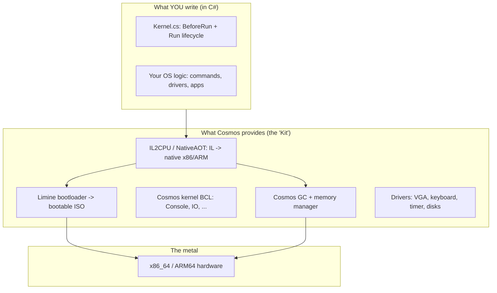
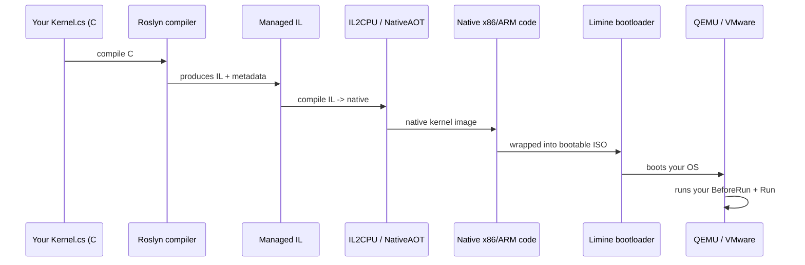

# Path C# — C# → Operating System Development (Beginner)

> ⚠️ **Important edge case (per project plan):** There is **no** complete free "from-scratch
> bare-metal" book that a beginner can realistically follow in C#. C# compiles to
> **[managed IL](../GLOSSARY/managed-il.md "The intermediate language C# compiles to, which needs a runtime")** and relies on a runtime; bringing it to bare metal requires a
> *massive* framework. So this path takes the realistic route: we keep the framework as the
> primary reference, provide a well-commented boilerplate, and explain **why** C# is
> different — because understanding *why* is the whole educational value of this track.

Every other path in this hub (C, C++, Rust, Go) shows you writing to `0xB8000` by hand. **C#
does not do that in practice.** C# code runs on a managed runtime ([.NET](../GLOSSARY/managed-il.md "The intermediate language C# compiles to, which needs a runtime")) that
provides a GC, a JIT/AOT compiler, reflection, and the Base Class Library — none of which
*exist* on bare metal until an enormous amount of machinery is built. The way a beginner (or
anyone) actually ships a C# OS is through **Cosmos**, an OS-construction kit that compiles
your C# down to a bootable ISO for you.

This page deep-expands the C# track: the beginner C# that makes sense in a kernel, why the
runtime makes hand-rolled bare metal impractical, then a guided build of the Cosmos-style
kernel from [`Example_OS_Project/csharp/`](../Example_OS_Project/csharp/).

---

## Primary Resource

### Cosmos OS — C# Open-Source Managed Operating System
- **Where:** https://www.gocosmos.org/ | https://github.com/CosmosOS/Cosmos
- **License:** Open source (BSD)
- **Local copy:** [`Cosmos/`](Cosmos/) (full source)
- **What it is:** An "Operating System **Kit**" (OS Legos). You author your kernel in modern C#; [Cosmos](../GLOSSARY/cosmos.md "An open-source C# operating-system kit") (via [NativeAOT](../GLOSSARY/nativeaot.md ".NET's ahead-of-time compiler that turns IL into native code") / [IL2CPU](../GLOSSARY/il2cpu.md "Cosmos's original IL-to-x86 compiler")) compiles it down to a bootable ISO loaded by the **[Limine](../GLOSSARY/limine.md "A modern bootloader supporting Multiboot 2 and 64-bit kernels")** bootloader. Supports x64 and ARM64. Includes its own GC, scheduler, drivers, network, filesystem.
- **Why it's the choice for C#:** It's the only practical free path to *shipping a C# OS*, even if you're not hand-writing a bootloader.

## What you'll build in this path
A **Cosmos-style** C# kernel template: `Kernel.cs` with `Kernel.BeforeRun()` / `Kernel.Run()` lifecycle methods that print to the console, plus the `.csproj` and instructions. Because a genuinely hand-rolled C# bare-metal "Hello World" isn't feasible for a beginner, we ship this boilerplate with extensive comments explaining the framework boundary.

## Supporting material already in this hub
- Well-commented Cosmos-style boilerplate → [`Example_OS_Project/csharp/`](../Example_OS_Project/csharp/)
- Synthesized consolidated beginner guide (C# chapter = *why C# is different*) → [`synthesized_tutorials/06-csharp/`](../synthesized_tutorials/06-csharp/)
- Concepts (bootloaders, memory, VGA) → [`synthesized_tutorials/concepts/`](../synthesized_tutorials/concepts/)

## Toolchain needed (see `Example_OS_Project/docs/setup.md`)
`.NET SDK` (present on the host), Cosmos DevKit, **Visual Studio 2022** (for the debugger — recommended), [QEMU](../GLOSSARY/qemu.md "A free emulator you can boot your kernel in for testing") or VMware for running.

---

## Part 1 — The beginner C# that matters (and the usual "Hello World" we must unlearn)

If you know a little C#, you're fine — but you must *unlearn* the assumption that the CLI
you normally run has an OS underneath it.

### 1.1 Hosted C# vs. kernel C#

```csharp
// HOSTED C# (what you know): the CLR provides the console.
using System;
Console.WriteLine("Hello");           // Console talks to the OS via the runtime
int[] xs = new int[10];               // new[] allocates GC-managed managed heap
// "Hello" prints because the OS gave the runtime a console.

// BARE-METAL C# (Cosmos-style): the *framework* provides the console.
public class Kernel : Cosmos.System.Kernel {
    protected override void Run() {            // your OS's "start"
        Console.WriteLine("Hello World!");     // Cosmos gives you Console on bare metal
        // ...
    }
}
```

Notice: it *looks* almost identical — and that's the point of Cosmos. But under the hood,
"`Console`" and "`new`" are now provided by Cosmos's kernel libraries compiled into a
bootable OS, not by a host OS. The syntax is the same; **the provider changed from "an OS"
to "a framework that is itself an OS."**

### 1.2 Why you can't just `g++ -ffreestanding` C# onto bare metal

The other four paths work because C, C++, Rust let you *opt out* of runtime features at
compile time (`-ffreestanding`, `-fno-rtti`, `no_std`). C# cannot do that so easily, for
structural reasons:

- **IL needs a runtime to execute.** C# compiles to Intermediate Language — a stack-machine
  bytecode. On a desktop, the JIT translates IL to native code *at runtime*, or NativeAOT
  does it ahead of time. Neither happens by itself on bare metal; something must do the
  translation, and that something is enormous.
- **The Base Class Library assumes the OS.** `System.IO`, `System.Net`, `Console` are all
  built on OS services (files, sockets, a console). On bare metal your kernel must reimplement
  those services — that's the BCL-as-OS problem.
- **A GC must manage memory.** [`new`](../GLOSSARY/garbage-collection.md "Automatic memory reclamation; required by managed runtimes like Go and C#") requires a garbage
  collector that scans and frees the heap. A GC needs a memory allocator (which needs to know
  physical RAM) and a way to run periodically (which needs a timer/scheduler).

This is why "hand-write a C# kernel like Bare Bones" is a *massive feature* rather than a
weekend project. Cosmos is the answer that invests that effort once so you don't have to.

### 1.3 The stack of a C# OS: what Cosmos does for you



You focus on the top layer; Cosmos handles everything below the line. That's the honest
division of labour for C# OS-dev: it's the freight train of OS-dev (fast to load, can't turn
around), but it gets you to *running C# on bare metal* that the other languages reach by
walking.

---

## Part 2 — Memory and pointers through a C# lens

C# is memory-safe by default (like Go and Rust), but you *can* open raw memory when you need
to — via `unsafe` blocks and pointer types. Understanding `unsafe` in C# is the closest
C# gets to the `0xB8000` lesson of the other paths, and it matters for writing driver code
*inside* Cosmos.

### 2.1 Value types, references, and the GC

```csharp
int       a = 5;        // value type stored directly (on stack or inline)
int[]     xs = new int[3];  // reference: xs holds a handle; the array lives on the GC heap
unsafe int* p = &a;     // C# pointer: like C's &, but only in an unsafe context
```

- **Value types** (`struct`, `int`, `char`, ...) live inline — no GC involvement.
- **Reference types** (`class`, arrays, `string`) live on the GC heap, so the collector must
  track them.
- Inside a kernel, the *fewer* GC-managed things you allocate, the more predictable your OS
  behaves (no GC pauses mid-driver for a beginner).

### 2.2 `unsafe`, `fixed`, and `stackalloc`: C#'s low-level toolkit

C#'s `unsafe` is the direct analogue of Rust's `unsafe` and Go's `unsafe.Pointer` — a
scoped, flagged window onto raw memory:

```csharp
unsafe
{
    // "fixed" pins a managed array so its address is stable while we poke it.
    int[] buf = new int[100];
    fixed (int* p = buf)
    {
        p[0] = 42;             // raw pointer indexing, like C
    }
    // stackalloc allocates on the STACK, not the GC heap — great for hot kernel buffers.
    int* scratch = stackalloc int[64];   // no GC pressure, fast
    scratch[7] = 99;
}
```

- `fixed` — needed because the GC can *move* objects in memory; pinning stops that so your
  pointer stays valid.
- `stackalloc` — C#'s answer to "give me a fast scratch buffer that isn't heap-managed" —
  the closest C# gets to C-style stack arrays, and a genuinely useful kernel idiom.

### 2.3 How Cosmos reaches the screen

Inside Cosmos you usually just use `Console`, but under the hood the framework does exactly
what C does: writes to the VGA text buffer. The conceptual chain is worth spelling out:

```csharp
// What Cosmos's Console ultimately drives (conceptually — the same 0xB8000 story):
//   - the VGA text framebuffer lives at 0xB8000 (see the C path)
//   - Cosmos's VGA driver writes 2-byte cells there: [character][color]
//   - Console is just a friendly wrapper on top of that driver
```

So the C path's lesson — "the screen is a memory-mapped buffer you write cells to" — is still
the truth; Cosmos just hides it behind `Console` so your C# stays clean. When you want *real*
control in Cosmos, you call its VGA/GUI APIs directly rather than poking addresses yourself.

### 2.4 The managed-heap warning

Because C# is GC-managed, a naive `while(true)` loop that allocates each iteration will
eventually trigger GC work that, in a kernel, could run at an inopportune time (during an
interrupt handler, say). A good Cosmos kernel minimises allocations in hot loops:

```csharp
// Avoid: allocating inside a tight loop
while (true)
{
    string data = GetExternalData();   // allocates every iteration
    Process(data);
}

// Prefer: reuse buffers
byte[] scratch = new byte[4096];       // allocate once, reuse
while (true)
{
    int n = ReadInto(scratch);         // fill the reused buffer
    Process(scratch, n);
}
```

This is the C# way of learning the C lesson "be careful with allocation near the metal" —
except the "metal" now includes your own kernel's GC.

### 2.5 `struct` vs `class`: value types are your kernel's friend

In C#, `struct` is a **value type** (stored inline, no GC heap) and `class` is a **reference
type** (lives on the GC heap, freed by the collector). In a kernel, the distinction is not
just performance — it's about *predictability*.

```csharp
struct ScreenCoord { public int Row, Col; }   // value type: stored inline, no GC
class  Widget       { public string Name; }    // reference type: on the GC heap

ScreenCoord a = new ScreenCoord();   // a lives on the stack / inline — no GC pressure
Widget     w = new Widget();         // w points to a heap object the GC must track
```

When you later build a pixel buffer or a device register map in C#, reach for `struct` first:
value types give you C-like layout and zero collection overhead, which is exactly what you
want near hardware. Combined with `stackalloc` (Part 2.2) and `unsafe`, they make up C#'s
"systems toolkit" inside the managed world.

### 2.6 `Span<T>`: safe, allocation-free access to memory

Modern C# has `Span<T>` — a `ref struct` that references a contiguous region of memory
(stack, unmanaged, or managed) with *no allocation* and *bounds checking by the runtime*.
It's the idiomatic bridge between C#'s safety and low-level performance:

```csharp
// Span over a stack buffer: no GC, bounds-checked access.
Span<byte> buffer = stackalloc byte[64];
for (int i = 0; i < 64; i++)
    buffer[i] = (byte)i;          // bounds are checked — safer than raw pointers

// Span over unmanaged memory (e.g. a memory-mapped device region):
unsafe
{
    byte* regs = (byte*)0xB8000;          // the VGA framebuffer, as a raw address
    Span<byte> screen = new Span<byte>(regs, 80 * 25 * 2);  // 2000 cells * 2 bytes
    screen[0] = (byte)'H';
    screen[1] = 0x0F;                     // color byte
}
```

`Span<T>` is the modern replacement for a lot of manual `unsafe` pointer code: it gives you
raw-memory reach with the runtime still checking your bounds. For a beginner it's the safest
way to start touching memory-mapped hardware like the VGA framebuffer, and it's worth knowing
before you dive into raw `unsafe` pointers.

---

## Part 3 — Build your Cosmos kernel in C# (guided, step by step)

Everything below is grounded in the verified boilerplate in
[`Example_OS_Project/csharp/`](../Example_OS_Project/csharp/).

### 3.1 The `Kernel.cs` lifecycle

Cosmos kernels subclass `Kernel` and override two lifecycle methods — `BeforeRun()` runs once
to set things up; `Run()` is your OS's main loop and never returns:

```csharp
// Kernel.cs — condensed from Example_OS_Project/csharp/Kernel.cs
using System;

public class Kernel : Cosmos.System.Kernel
{
    // Runs once before the main Run() loop.
    protected override void BeforeRun()
    {
        Console.WriteLine("Cosmos booted successfully. Let's go!");
    }

    // The main loop. In Cosmos this is effectively your OS's "start".
    protected override void Run()
    {
        Console.WriteLine("Hello World!");
        Console.WriteLine("Welcome to your very own operating system (C# edition).");

        // A trivial command loop so you have something interactive.
        while (true)
        {
            Console.Write("> ");
            string input = Console.ReadLine();
            if (input == "help")
                Console.WriteLine("Commands: help, hello, clear");
            else if (input == "hello")
                Console.WriteLine("Hello from your Cosmos OS!");
            else if (input == "clear")
                Console.Clear();
            else
                Console.WriteLine($"Unknown command: {input}");
        }
    }
}
```

Notice you get a genuinely interactive shell — `ReadLine`, `Console.Clear`, string
interpolation — things the C path can't give you for free. That's the payoff of the framework.

### 3.2 The `.csproj` and running it

Cosmos ships a Visual Studio project template, so you typically create a "Cosmos" project
from the template, drop in `Kernel.cs`, and press F5 (which runs it in a VM). The essence of
the project file:

```xml
<Project Sdk="Microsoft.NET.Sdk">
  <PropertyGroup>
    <TargetFramework>net8.0</TargetFramework>
    <OutputType>Exe</OutputType>
    <AllowUnsafeBlocks>true</AllowUnsafeBlocks><!-- enable unsafe for raw memory access -->
  </PropertyGroup>
  <ItemGroup>
    <!-- The Cosmos kit packages that give you Kernel, Console, drivers, etc. -->
    <PackageReference Include="Cosmos.Build" Version="x.y.z" />
    <PackageReference Include="Cosmos.Common" Version="x.y.z" />
  </ItemGroup>
</Project>
```

Then F5 (or the Cosmos "Run" command in VS) → Cosmos compiles your IL to native code
(via NativeAOT / IL2CPU), packages it into a bootable ISO with the
[Limine](../GLOSSARY/limine.md "A modern bootloader supporting Multiboot 2 and 64-bit kernels") bootloader, and boots it in a VM. The debugger works: you can set breakpoints in
your `Kernel.cs` and inspect state just like a normal C# app.

### 3.3 The build/boot pipeline



### 3.4 Verifying

```csharp
// In Kernel.cs, print a unique banner, then run the OS in a VM.
Console.WriteLine("MY-OS-V1 booted.");

// Expected: the VM console shows your banner, you type "help", and see the command list.
// Debugger: set a breakpoint in Run() — it should hit after boot, proving the framework
// handed control to your C# code.
```

---

## Part 4 — Pitfalls (C# / Cosmos-specific)

1. **Expecting hand-rolled `0xB8000` C# like the other paths.** That's not how C# OS-dev
   works. Use Cosmos; the "write to the framebuffer yourself" story belongs to C/C++/Rust/Go.
   If you try to raw-poke bare metal in C# without Cosmos, you'll discover the runtime isn't
   there — hard.
2. **Forgetting to install/configure Cosmos with the right VS version.** Cosmos has specific
   tooling requirements (the DevKit, correct .NET SDK). Follow
   [`C# Getting Started`](https://github.com/CosmosOS/Cosmos/wiki/Getting-Started) exactly or
   the build won't product a bootable image.
3. **Allocating in hot loops / interrupt paths.** GC pressure in a kernel can cause pauses at
   bad times. Reuse buffers (Part 2.4) and prefer `stackalloc` for scratch.
4. **Assuming `unsafe` makes it bare-metal.** `unsafe` gives you pointers inside the managed
   world — it doesn't give you a bootloader, a GC, or the BCL. Cosmos provides those; `unsafe`
   just lets you talk to devices/registers within it.
5. **Not reading `Kernel.cs` in the reference closely.** The reference boilerplate is heavily
   commented about the framework boundary — read those comments to understand *why* C# is
   different before you fight it.
6. **Reaching for the full .NET BCL surface.** Cosmos implements a subset of the BCL. APIs
   that need an OS (networking sockets, some file APIs) may be missing or stubbed; check what
   Cosmos provides before assuming it "just works" like desktop C#.

> **The C# mindset on bare metal:** C# is a fantastic language — and it ships with a runtime
> that *assumes an OS*. Rather than fight to remove that runtime (the C/Rust way), C# OS-dev
> embraces it and provides the runtime *as part of the OS* through Cosmos. The lesson is not
> "C# can't do OS dev"; it's "in C#, the runtime IS the OS you build."

---

## Part 5 — Next steps

| Concept | Where | Why it's next |
|---------|-------|---------------|
| The C path (foundation) | [`path_c_os/README.md`](../path_c_os/README.md) | learn what a framebuffer/boot actually *is* before C#'s abstractions hide it |
| The C# chapter deep-dive | [`synthesized_tutorials/06-csharp/README.md`](../synthesized_tutorials/06-csharp/README.md) | the full "why C# is different" argument |
| Cosmos Getting Started | https://github.com/CosmosOS/Cosmos/wiki/Getting-Started | the official first-boot walkthrough |
| Cosmos internals (IL2CPU/NativeAOT) | [`csharp/README.md`](../Example_OS_Project/csharp/README.md) + the Cosmos wiki | understand how your IL becomes native |
| VGA / GUI in Cosmos | [`concepts/04-vga-text-mode.md`](../synthesized_tutorials/concepts/04-vga-text-mode.md) + Cosmos graphics docs | grow from text console to graphics |
| Memory management | [`concepts/02-memory-management.md`](../synthesized_tutorials/concepts/02-memory-management.md) | the theory behind the GC you rely on |
| Compare with Go path | [`path_go_os/README.md`](../path_go_os/README.md) | Go also ships a runtime — great for contrast |

The most instructive next step: build your own **command-line calculator** in the `Run()`
loop — read a line, parse a number, do arithmetic, print the result. It exercises real input
parsing and output on *your* OS, with no framework magic except `Console`. Then try adding a
global `int Ticks` counter updated by a Cosmos timer, so your OS reports uptime — your first
piece of "kernel state."

---

## Part 6 — A worked extension: an interactive command shell

Let's turn the minimal `Run()` loop into a small, extensible shell — the same shape you'll
grow into a real console-based OS. It's all plain C#, so it's easy to read even if you're new
to the language.

### 6.1 A command-dispatch loop

A clean way to structure `Run()` is to keep the infinite loop but delegate every line to a
`HandleCommand` method that returns a response:

```csharp
using System;

public class Kernel : Cosmos.System.Kernel
{
    private int ticks = 0;                       // kernel state: uptime in ticks

    protected override void BeforeRun()
    {
        Console.WriteLine("Welcome to ExampleOS (C# edition). Type 'help' to begin.");
    }

    protected override void Run()
    {
        while (true)
        {
            Console.Write("> ");
            string line = Console.ReadLine();
            string response = HandleCommand(line);
            if (response.Length > 0)
                Console.WriteLine(response);
        }
    }

    private string HandleCommand(string line)
    {
        if (string.IsNullOrEmpty(line)) return "";
        string[] parts = line.Split(' ');
        switch (parts[0].ToLower())
        {
            case "help":
                return "Commands: help, hello, clear, tick, calc <a> <op> <b>, about";
            case "hello":
                return "Hello from your very own operating system!";
            case "clear":
                Console.Clear();
                return "";
            case "tick":
                return $"Uptime: {ticks} ticks";
            case "calc":
                return Calc(parts);
            case "about":
                return "ExampleOS — a Cosmos-based C# kernel built on OSDev_Learning_Hub.";
            default:
                return $"Unknown command: {line}";
        }
    }

    private string Calc(string[] parts)
    {
        if (parts.Length != 4) return "Usage: calc <a> <op> <b> (op = + - * /)";
        if (!int.TryParse(parts[1], out int a) || !int.TryParse(parts[3], out int b))
            return "calc: could not parse a number.";
        switch (parts[2])
        {
            case "+": return $"{a} + {b} = {a + b}";
            case "-": return $"{a} - {b} = {a - b}";
            case "*": return $"{a} * {b} = {a * b}";
            case "/":
                if (b == 0) return "calc: division by zero.";   // handle it explicitly
                return $"{a} / {b} = {a / b}";
            default: return "calc: unknown operator.";
        }
    }
}
```

### 6.2 Why this is the right shape for a C# OS

- **Kernel state lives in fields** (`ticks`) — instance state on your `Kernel`, which Cosmos
  keeps alive for the whole OS lifetime. This is your "kernel global" in C#.
- **Errors are handled explicitly** (division by zero, parse failures, unknown commands) —
  in a managed kernel this is safer than letting an exception cross a driver boundary.
- **`string[] parts = line.Split(' ')`** is illustrative: `Split` allocates, which is fine at
  the interactive prompt (low frequency). If you later build a hot path, you'd reuse a buffer
  per Part 2.4 — but for a shell, clarity wins.

### 6.3 Hooking a real timer into `ticks`

To make `tick` actually count, wire a Cosmos timer (or periodic ISR) to increment `ticks`:

```csharp
// Conceptually — Cosmos provides timer abstractions you can subscribe to:
// Core.Global.Timer += () => ticks++;
// Then the `tick` command reports real uptime, and you've got your first
// piece of kernel state driven by hardware rather than by your own loop.
```

This is the moment the framework starts paying for itself: you get a hardware timer feeding a
protected integer, and your shell just reads it — all in ordinary C#.

---

## Watch and learn

Videos selected and verified for the C# OS-dev track — the Cosmos construction kit in action,
plus the boot fundamentals that apply to any language.

<details class="video-embed">
<summary>▶ Watch: The Operating System Construction Kit: Cosmos! [Cosmos Quest #1]</summary>
<iframe src="https://www.youtube-nocookie.com/embed/Khff1xxyEHI" title="The Operating System Construction Kit: Cosmos! [Cosmos Quest #1]" width="100%" height="400" style="border:0;border-radius:8px;" allow="accelerometer; autoplay; clipboard-write; encrypted-media; gyroscope; picture-in-picture; web-share" allowfullscreen></iframe>
<p class=video-caption>Cosmos Quest #1: installing the kit, creating a Cosmos project in Visual Studio, and booting your first C# OS — exactly this path's workflow.</p>
</details>
<details class="video-embed">
<summary>▶ Watch: How does an OS boot? //Source Dive// 001</summary>
<iframe src="https://www.youtube-nocookie.com/embed/KkenLT8S9Hs" title="How does an OS boot? //Source Dive// 001" width="100%" height="400" style="border:0;border-radius:8px;" allow="accelerometer; autoplay; clipboard-write; encrypted-media; gyroscope; picture-in-picture; web-share" allowfullscreen></iframe>
<p class=video-caption>What firmware, bootloader and kernel startup actually do — the chain Limine + Cosmos automate for you.</p>
</details>
<details class="video-embed">
<summary>▶ Watch: 1 - How to make an operating system from scratch</summary>
<iframe src="https://www.youtube-nocookie.com/embed/rr-9w2gITDM" title="1 - How to make an operating system from scratch" width="100%" height="400" style="border:0;border-radius:8px;" allow="accelerometer; autoplay; clipboard-write; encrypted-media; gyroscope; picture-in-picture; web-share" allowfullscreen></iframe>
<p class=video-caption>A step-by-step build/boot walkthrough to ground your intuition before Cosmos abstracts the steps away.</p>
</details>
<details class="video-embed">
<summary>▶ Watch: Creating My Own Operating System</summary>
<iframe src="https://www.youtube-nocookie.com/embed/eys5TpLWdgQ" title="Creating My Own Operating System" width="100%" height="400" style="border:0;border-radius:8px;" allow="accelerometer; autoplay; clipboard-write; encrypted-media; gyroscope; picture-in-picture; web-share" allowfullscreen></iframe>
<p class=video-caption>A candid one-hour OS attempt — motivation for exactly how much machinery a real OS needs, which Cosmos supplies for C#.</p>
</details>
<details class="video-embed">
<summary>▶ Watch: QEMU/KVM for absolute beginners</summary>
<iframe src="https://www.youtube-nocookie.com/embed/BgZHbCDFODk" title="QEMU/KVM for absolute beginners" width="100%" height="400" style="border:0;border-radius:8px;" allow="accelerometer; autoplay; clipboard-write; encrypted-media; gyroscope; picture-in-picture; web-share" allowfullscreen></iframe>
<p class=video-caption>How to run a VM and inspect it — the environment Cosmos boots your C# OS into during development.</p>
</details>

---

## Exercises & Projects

The C# track is landing on a *framework*, not a hand-rolled kernel, so the exercises test
both reading the provided boilerplate and driving the framework's lifecycle. **Prereq:**
the Cosmos Getting-Started flow working — you can create a Cosmos project and boot the default
OS in a VM.

### Graded exercises

**Easy**

- [ ] **E1. Boot the reference kernel** (~30–60 min). Create a Cosmos project, drop in
      [`Example_OS_Project/csharp/Kernel.cs`](../Example_OS_Project/csharp/Kernel.cs), and boot it
      in a VM. Confirm "Hello World!" and the command loop (`help`, `hello`, `clear`) work.
- [ ] **E2. Explain the framework boundary** (~20 min). Write a note answering: *why can't you
      hand-write a C# bare-metal kernel the way the C path does?* Name the three structural
      reasons (IL needs a runtime, the BCL assumes an OS, the GC needs memory management).
- [ ] **E3. Personalise the banner + a new command** (~20 min). Change the boot message and add
      an `about` command that prints your name. Build and boot to confirm.

**Medium**

- [ ] **M1. Build a tiny calculator command** (~1.5 hr). In `Run()`, read `a`, an operator, and
      `b`; parse them; print the result. This exercises real parsing and output on your OS with
      `Console` as the only abstraction.
- [ ] **M2. Add an uptime counter** (~1–2 hr). Use a Cosmos timer to increment a `int Ticks`
      field, and print it from a `tick` command. This is your first piece of kernel state that
      the framework's scheduler drives.
- [ ] **M3. Debug with breakpoints** (~45 min). Set a breakpoint inside `Run()`, boot under the
      Cosmos debugger, and confirm it hits after boot. This proves you can *inspect* your kernel
      like a normal C# app.

**Hard**

- [ ] **H1. Unsafe device access in C#** (~3 hr). Inside Cosmos, use an `unsafe` block + a
      pointer to write directly to the VGA text buffer at `0xB8000` (or call Cosmos's own VGA
      API), bypassing `Console` for one line. Compare the codes to the C path. This is your C#-
      flavoured `0xB8000` lesson.
- [ ] **H2. Compare all five paths' "Hello World"** (~1.5 hr). Read
      [`Example_OS_Project/csharp/Kernel.cs`](../Example_OS_Project/csharp/Kernel.cs) next to C,
      C++, Rust, and Go. Annotate the *same logical goal* (print + loop forever) across all five.
      Where did the framework save you lines? Where did a hand-rolled kernel give more control?

### ⭐ Mini-project — Build a small interactive C# OS with a working calculator app

**Goal.** Turn the reference boilerplate into a *useful* minimal C# OS: a banner, a calculator
command, an uptime display, and your own command set. **Estimated time:** 3–5 hr. **Prereq:**
this page + Cosmos Getting-Started.

1. **Boot the boilerplate.** Get [`Example_OS_Project/csharp/Kernel.cs`](../Example_OS_Project/csharp/Kernel.cs) running in a VM with breakpoints working.
2. **Refactor `Run()`.** Turn the command loop into a clean `HandleCommand(string)` method that
   returns a response string — you'll grow it, so structure it early.
3. **Add a calculator.** Parse `calc <a> <op> <b>` and print the result (handle `+ - * /` and
   clear error messages).
4. **Add uptime.** A `ticks` counter incremented by a Cosmos timer; a `tick`/`time` command
   prints it.
5. **Add `unsafe` VGA (optional stretch).** Write one line directly through a pointer to
   `0xB8000` to prove you can touch the metal when you need to.
6. **Polish + build.** A clean boot banner, helpful help text, and a `clear`.
7. **Commit + reproduce.** A stranger should be able to create a Cosmos project, paste your
   `Kernel.cs`, and boot your OS.

**Checklist**

- [ ] reference boilerplate boots in a VM
- [ ] banner + `help` + `hello` + `clear` work
- [ ] `calc` command parses and prints correct results (including errors)
- [ ] uptime counter increments and displays
- [ ] (stretch) one raw-`unsafe` line reaches the VGA buffer directly
- [ ] the whole app reproduces from a fresh Cosmos project

---

*You've written a C# OS — through the only practical route C# offers, and you've learned the
deepest truth about managed languages: **the runtime is the OS you're building.** Now that you
understand why Cosmos exists, you can appreciate (and fix) what it hides, and read the other
four paths with the knowledge of what each language chooses to give you for free versus make
you build yourself.*
