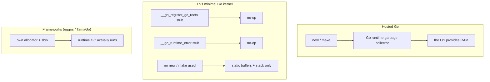

# Path Go — Go → Operating System Development (Beginner)

> ⚠️ **Be honest up front:** Go was **not designed for OS development.** A Go binary is
> normally a *whole runtime*: a garbage collector, a goroutine scheduler, a networking and
> memory system, all shipped with your program. On bare metal there is no host to provide
> those, so a Go kernel must either stub out the runtime bits it doesn't need or carry them
> itself. This makes the Go path the **hardest** of the five in practice (difficulty:
> Medium, per the OSDev wiki), even though Go's *syntax* is the friendliest. The reward for
> fighting through it is a genuine intuition for why "a language with a runtime" is
> fundamentally different from "a language that compiles to the metal" — which is the whole
> point of this track.

This page deep-expands the Go track: the beginner Go that survives bare metal, how memory and
pointers work when a GC is either stubbed out or must be reinvented, then a guided build of
the Go kernel from [`Example_OS_Project/go/`](../Example_OS_Project/go/). If you haven't done
the [C path](../path_c_os/README.md) first, please do — this track is explicitly built on top
of it (same `boot.s`, same `linker.ld`, same Multiboot recipe).

---

## Primary Resource

### OSDev Wiki — Go Bare Bones
- **Where:** https://wiki.osdev.org/Go_Bare_Bones
- **License:** Open wiki (community-reviewed)
- **Local copy:** [`Go_Bare_Bones.md`](Go_Bare_Bones.md)
- **Difficulty:** Medium (it's built on top of the C Bare Bones tutorial)
- **Why chosen:** The canonical free Go minimal-kernel tutorial. Uses an `i686-elf-gccgo` [cross-compiler](../GLOSSARY/cross-compiler.md "A compiler that builds code for a different CPU/OS than the one it runs on"). You implement Go-runtime stubs (e.g. `__go_register_gc_roots`, `__go_runtime_error`) as empty functions, then write `kernel.go` + `terminal.go` and link with a `linker.ld`.

### (Optional) Realistic frameworks for later
- **eggos** (https://github.com/alexflint/eggos) — a Go **unikernel** running on [x86](../GLOSSARY/x86.md "The CPU architecture family this hub targets") bare metal; an excellent advanced follow-up.
- **TamaGo** — the production framework for bare-metal Go.

## What you'll build in this path
A minimal Go kernel printing **"Hello, Kernel World!"** via the VGA text buffer, booted by [Multiboot](../GLOSSARY/multiboot.md "The protocol that lets a bootloader load any kernel; magic 0x1BADB002").

## Supporting material already in this hub
- Fully-commented minimal implementation → [`Example_OS_Project/go/`](../Example_OS_Project/go/)
- Synthesized consolidated beginner guide → [`synthesized_tutorials/05-go/`](../synthesized_tutorials/05-go/)
- Concepts (bootloaders, memory, VGA) → [`synthesized_tutorials/concepts/`](../synthesized_tutorials/concepts/)

## Toolchain needed (see `Example_OS_Project/docs/setup.md`)
`gccgo` (Go-enabled cross-compiler `i686-elf-gccgo` OR `x86_64-elf-gccgo`), `nasm`, `ld`, `make`, `qemu-system-x86_64`. Building the cross-compiler from source is the hard manual step.

---

## Part 1 — The beginner Go you can actually use on bare metal

Go's syntax is famously readable — `func`, `:=`, `struct`, `if`, `for` are all low-friction.
But almost every *convenient* Go feature leans on the runtime. Let's separate what survives
bare metal from what doesn't.

### 1.1 Hosted Go vs. bare-metal Go

```go
// HOSTED Go (what you know): the runtime does a LOT for you.
package main

import "fmt"

func main() {
    fmt.Println("Hello")     // fmt talks to the OS via the runtime
    s := make([]byte, 10)    // make allocates from the Go heap, GC-managed
    go worker()              // goroutine: needs the scheduler goroutine
}
```

```go
// BARE-METAL Go: the runtime is stubbed out or must be provided by YOU.
package kernel

import "example_os_go/terminal"

// Main is called by boot.s. It paints Hello World and then idles.
func Main() {
    terminal.Init()
    terminal.WriteString("Hello, Kernel World!\n")
    for {   // no scheduler to hand control to — we just spin
        // idle
    }
}
```

Notice what's *absent*: `fmt`, `make`/`new` (heap allocation), goroutines, `defer` over GC
boundaries. A minimal Go kernel is nearly all **plain loops, structs, and string writes** —
which are exactly the parts of Go that cost nothing at runtime.

### 1.2 The runtime stubs: what the Go runtime expects

The Go toolchain (here `gccgo`) emits references to runtime symbols even for simple programs.
On bare metal those functions don't exist — so the OSDev Go Bare Bones tutorial tells you to
provide them as **empty functions**. This is the single most "Go-specific" thing you'll do:

```nasm
# boot.s — the Go runtime stub symbols, implemented as empty functions:
.global __go_register_gc_roots
.type   __go_register_gc_roots, @function
__go_register_gc_roots:
    ret
.size   __go_register_gc_roots, . - __go_register_gc_roots

.global __go_runtime_error
.type   __go_runtime_error, @function
__go_runtime_error:
    ret
.size   __go_runtime_error, . - __go_runtime_error
```

Providing these stubs is the Go-track equivalent of `extern "C"` in C++ or `#[no_mangle]` in
Rust — it's the explicit "this language's runtime would do something here, but we're choosing
what that means on bare metal." **You're literally deciding that, for this minimal kernel,
Go's GC registration and runtime error handling are no-ops.**

### 1.3 Why Go needs a [GC](../GLOSSARY/garbage-collection.md "Automatic memory reclamation; required by managed runtimes like Go and C#") — and why that's a problem here

Go programs get memory-safe `new`/`make` for free because the runtime ships a **garbage
collector**: it tracks allocated objects and frees them when they're unreachable. On a hosted
machine, the OS gives the runtime RAM to manage. On bare metal, *you* are the OS — so a Go
kernel that wants to allocate must:

1. **Find some RAM** the kernel isn't using (a [frame allocator](../GLOSSARY/frame-allocator.md "The simplest memory manager that tracks which 4 KiB physical pages are free")),
2. **Hand it to the Go runtime**, and
3. **Have the GC actually run** (which needs scheduler/timer hooks).

A "Hello World" kernel sidesteps all of this by not allocating at all. The OSDev tutorial's
final note ("you'll need your own allocator (sbrk) before Go can do much") is exactly this:
**without an allocator, a Go kernel is stuck at Hello World.** That's the honest ceiling of
this path's minimal version, and the motivation for frameworks like TamaGo and eggos that
provide the runtime plumbing for you.



---

## Part 2 — Memory, pointers, and `unsafe` in Go (systems context)

### 2.1 Go has pointers — but not pointer arithmetic (in safe mode)

Go has `*T` pointers and `&`/`*`, just like C and C++. But in *safe* Go you cannot do
arbitrary pointer arithmetic like `ptr + index` — the runtime and compiler restrict that.
This is a problem for reaching a framebuffer at `0xB8000`, which is a *fixed address with
hand-computed offsets*. The idiomatic answer is the [`unsafe`](https://pkg.go.dev/unsafe)
package:

```go
// terminal.go — condensed from Example_OS_Project/go/terminal/terminal.go
const bufferAddr = uintptr(0xB8000)   // the VGA text framebuffer address

// On a real freestanding gccgo target you use unsafe.Pointer to poke bytes:
//   offset := uintptr(r*width + c) * 2
//   *(*byte)(unsafe.Pointer(bufferAddr + offset))     = char
//   *(*byte)(unsafe.Pointer(bufferAddr + offset + 1)) = color
```

The comment in the reference `terminal.go` marks **exactly where** those `unsafe` writes would
go. Go's `unsafe.Pointer` is conceptually the same as Rust's `unsafe` block for this purpose:
a narrowly-scoped, explicitly-flagged bridge to raw memory.

### 2.2 Slice vs. array: length you can trust

Where C strings are `char*` + a sentinel, Go has **slices**: `[]byte`, `[]uint16` — a view
with a length the runtime knows. The reference `terminal.WriteString` iterates bytes:

```go
// WriteString prints a string to the screen, byte by byte.
func WriteString(s string) {
    for i := 0; i < len(s); i++ {   // len(s) is known — no sentinel walking
        putChar(s[i])
    }
}
```

`writeCell` keeps geometry as a constant:

```go
const (
    width  = 80 // columns
    height = 25 // rows
)

func writeCell(r, c int, char byte, color byte) {
    // offset := uintptr(r*width + c) * 2
    // *(*byte)(unsafe.Pointer(bufferAddr + offset))     = char
    // *(*byte)(unsafe.Pointer(bufferAddr + offset + 1)) = color
}
```

### 2.3 The terminal package layout

Go's `package` system is part of what makes it pleasant. The reference splits things cleanly:

- `kernel.go` — `package kernel`, has `Main()`, imports the terminal package.
- `terminal/terminal.go` — `package terminal`, owns all VGA text-mode logic.

```go
// kernel.go — condensed from Example_OS_Project/go/kernel.go
package kernel

import "example_os_go/terminal"

// main is the Go kernel entry point, called from boot.s.
func Main() {
    terminal.Init()                                  // clears the screen
    terminal.WriteString("Hello, Kernel World!\n")
    terminal.WriteString("Welcome to your very own operating system (Go edition).\n")
    for {   // a Go kernel has no OS to return to — spin forever
        // idle
    }
}
```

This separation-by-package is the Go idiom and scales naturally as you add a `cpu`, `mem`, or
`dev` package later.

### 2.4 What you must NOT reach for (in the minimal kernel)

- **`fmt.Println`** — pushes a formatted write through the runtime's console abstractions.
  Use your own `terminal.WriteString`.
- **`new` / `make`** — heap allocation needs the GC + an allocator. Not available yet.
- **Goroutines and channels** — need the scheduler. Not available yet.
- **`os` / `net` / `io`** package — whole runtime-dominated worlds. Not available yet.

This is the "Go is not designed for this" reality, and naming it explicitly is the point.

---

## Part 3 — Build your kernel in Go (guided, step by step)

Everything below is grounded in [`Example_OS_Project/go/`](../Example_OS_Project/go/). The
recipe is: the **C-style** `boot.s` + `linker.ld` (identical to the C path), plus stubs for the
Go runtime, plus `terminal.go` + `kernel.go`.

### 3.1 `boot.s` — C-style bootstrap + Go runtime stubs

```nasm
.set MAGIC,    0x1BADB002
.set ALIGN,    1<<0
.set MEMINFO,  1<<1
.set FLAGS,    ALIGN | MEMINFO
.set CHECKSUM, -(MAGIC + FLAGS)

.section .multiboot
.align 4
.long MAGIC
.long FLAGS
.long CHECKSUM

.section .bootstrap_stack, "aw", @nobits
stack_bottom:
.skip 16384
stack_top:

.global _start
.type _start, @function
_start:
    mov $stack_top, %esp
    call main        # call the Go kernel's Main
    cli
1:  hlt
    jmp 1b

# --- Go runtime stubs the linker expects (empty: we choose them to be no-ops) ---
.global __go_register_gc_roots
.type   __go_register_gc_roots, @function
__go_register_gc_roots: ret
.size   __go_register_gc_roots, . - __go_register_gc_roots

.global __go_runtime_error
.type   __go_runtime_error, @function
__go_runtime_error: ret
.size   __go_runtime_error, . - __go_runtime_error
```

### 3.2 `terminal/terminal.go` — the VGA driver

```go
package terminal

const (
    width  = 80
    height = 25
    bufferAddr = uintptr(0xB8000)
    colorWhiteOnBlack = 0x0F
)

var ( row int; col int )

func Init() { clear(); row = 0; col = 0 }

func writeCell(r, c int, char byte, color byte) {
    // offset := uintptr(r*width + c) * 2
    // *(*byte)(unsafe.Pointer(bufferAddr + offset))     = char
    // *(*byte)(unsafe.Pointer(bufferAddr + offset + 1)) = color
}

func clear() {
    for r := 0; r < height; r++ {
        for c := 0; c < width; c++ { writeCell(r, c, ' ', colorWhiteOnBlack) }
    }
}

func putChar(ch byte) {
    if ch == '\n' { row++; col = 0; if row >= height { row = 0 }; return }
    writeCell(row, col, ch, colorWhiteOnBlack)
    col++
    if col >= width { col = 0; row++; if row >= height { row = 0 } }
}

func WriteString(s string) {
    for i := 0; i < len(s); i++ { putChar(s[i]) }
}
```

### 3.3 `kernel.go` — the entry point

```go
package kernel

import "example_os_go/terminal"

func Main() {
    terminal.Init()
    terminal.WriteString("Hello, Kernel World!\n")
    terminal.WriteString("Welcome to your very own operating system (Go edition).\n")
    for { /* idle */ }
}
```

### 3.4 The cross-compiler: the steepest step

The hard, manual part of the Go path is building a **Go-enabled cross-compiler** so GCC can
turn Go into bare-metal x86 assembly:

```bash
../gcc-x.y.z/configure --target=i686-elf --prefix="$PREFIX" \
    --disable-nls --enable-languages=c,c++,go --without-headers
# ... then make all-gcc, make install-gcc (see the OSDev tutorial)
```

This is *why* the path is rated Medium compared to C: C's cross-compiler is standard, but
building one with Go support enabled is fiddly. If you don't want to build it, this is exactly
where **TamaGo** (which can target ARM/AVR without a from-source build) or **eggos** becomes
attractive as a shortcut.

### 3.5 Build & run

```bash
# Assemble bootstrap (includes the Go runtime stubs)
i686-elf-as boot.s -o boot.o

# Compile Go kernel freestanding
i686-elf-gccgo -static -Werror -nostdlib -nostartfiles -nodefaultlibs -c kernel.go -o kernel.go.o
i686-elf-gccgo -static -Werror -nostdlib -nostartfiles -nodefaultlibs -c terminal/terminal.go -o terminal.go.o

# Link
i686-elf-gcc -T linker.ld -o myos.bin -ffreestanding -O2 -nostdlib \
    boot.o terminal.go.o kernel.go.o -lgcc

# Boot it
qemu-system-i386 -kernel myos.bin
```

The `linker.ld` is identical in shape to the C path (`. = 1M`, `.text`/`.rodata`/`.data`/`.bss`).

### 3.6 Verifying

```bash
grub-file --is-x86-multiboot myos.bin          # exits 0 => valid Multiboot v1
nm myos.bin | grep -E 'Main|__go_'             # see the Go main + runtime stubs
qemu-system-i386 -kernel myos.bin              # boots to "Hello, Kernel World!"
```

```mermaid
sequenceDiagram
    participant Q as QEMU
    participant B as Bootloader (GRUB)
    participant K as Your Go kernel
    Q->>B: Firmware finds bootable medium
    B->>B: Sees Multiboot header 0x1BADB002
    B->>K: Loads at 1 MiB, jumps to _start
    K->>K: boot.s sets stack, calls main
    K->>K: stubs: __go_register_gc_roots / __go_runtime_error = no-op
    K->>K: terminal.Init(); WriteString("Hello, Kernel World!")
    K->>K: for {} — idle forever
```

---

## Part 4 — Pitfalls (Go-specific)

The generic boot pitfalls are shared with C. The Go-specific ones:

1. **Not building the Go-enabled cross-compiler.** `i686-elf-gcc` gives you C but not Go.
   You specifically need `--enable-languages=c,c++,go` and a `gccgo` front-end, or the Go
   compile step fails with "language go not enabled".
2. **Forgetting the runtime stubs.** Without `__go_register_gc_roots` and
   `__go_runtime_error`, linking fails with undefined references. Provide the empty-function
   stubs in boot.s exactly as shown.
3. **Reaching for `fmt` / `make` / goroutines.** They need the runtime. In the minimal kernel
   you must write your own screen output and avoid heap allocation entirely. This is the
   single biggest "Go is not designed for OS dev" trap.
4. **Pointer arithmetic in safe Go.** You can't do `*(ptr + n)`; you must go through
   `unsafe.Pointer(uintptr(...))`. Keep these writes in one small, well-commented place (the
   `writeCell` function) like the reference does.
5. **Assuming your host `go` runs bare metal.** The host `go` toolchain targets your OS. On
   bare metal you need the cross `gccgo` path (or a framework that handles it). `go build`
   won't produce a Multiboot kernel by itself.
6. **The stub `writeCell` looks like it does nothing.** The reference leaves the `unsafe`
   writes commented because a pure path needs the gccgo target to compile them. When you test
   on a freestanding target, fill in the `unsafe.Pointer` writes — see
   [`Example_OS_Project/go/terminal/terminal.go`](../Example_OS_Project/go/terminal/terminal.go).

> **The Go mindset on bare metal:** Go gives you the friendliest syntax and a superb
> standard library — *all on top of a runtime that assumes an OS*. Stripping that down to
> bare metal is a lesson in what a runtime actually provides. If that frustrates you, that's
> fine — it's precisely the point, and it's why the C/C++/Rust paths exist.

---

## Part 5 — Next steps

| Concept | Where | Why it's next |
|---------|-------|---------------|
| The C track (foundation) | [`path_c_os/README.md`](../path_c_os/README.md) | boot.s & linker.ld are identical — master them there |
| Memory management | [`concepts/02-memory-management.md`](../synthesized_tutorials/concepts/02-memory-management.md) | before Go can allocate, you must own the RAM |
| A Go allocator (sbrk) | OSDev Go Bare Bones final note | the documented blocker for "Go can do more" |
| VGA text mode deep-dive | [`concepts/04-vga-text-mode.md`](../synthesized_tutorials/concepts/04-vga-text-mode.md) | grow `writeCell` into scrollback, colors, cursor |
| The Go chapter deep-dive | [`synthesized_tutorials/05-go/README.md`](../synthesized_tutorials/05-go/README.md) | a longer read-along version of this page |
| TamaGo / eggos frameworks | the curated Go list | production bare-metal Go that pre-solves the runtime |
| The Rust path (contrast) | [`path_rust_os/README.md`](../path_rust_os/README.md) | Rust solves memory safety *without* a runtime — a powerful contrast |

The most instructive next step is to **make `writeCell` actually write** (fill in the
`unsafe.Pointer` lines) and add a second color, so your kernel visibly does the raw memory
work that Go normally hides. Then try adding a simple uptime counter. When you hit the wall
where Go wants to allocate, you'll understand — viscerally — why a [GC](../GLOSSARY/garbage-collection.md "Automatic memory reclamation; required by managed runtimes like Go and C#") needs an OS, and what
frameworks like eggos provide.

---

## Part 6 — A worked extension: real VGA writes and a two-tone banner

Let's take `writeCell` from "commented idea" to "actual kernel behavior" and give the kernel
a coloured, positioned banner. This is the natural first real Go driver.

### 6.1 Filling in the `unsafe` write

The reference leaves the raw write commented because it needs a freestanding gccgo target to
compile. On that target, this is the real deal:

```go
package terminal

import "unsafe"

const (
    width  = 80
    height = 25
    bufferAddr = uintptr(0xB8000)
    colorWhiteOnBlack = 0x0F
    colorGreenOnBlack = 0x0A
)

func writeCell(r, c int, char byte, color byte) {
    offset := uintptr(r*width+c) * 2
    // A VGA text cell is 2 bytes: [character][color].
    *(*byte)(unsafe.Pointer(bufferAddr + offset))     = char
    *(*byte)(unsafe.Pointer(bufferAddr + offset + 1)) = color
}
```

Unpack the dense line `*(*byte)(unsafe.Pointer(bufferAddr + offset)) = char`:

1. `bufferAddr + offset` — the physical address of the cell's character byte.
2. `unsafe.Pointer(...)` — treat that integer address as a pointer.
3. `*(*byte)(...)` — re-interpret it as a `*byte` and dereference it.
4. `= char` — store the character byte.

That is the entire trick. Go hid it from you in hosted mode; on bare metal you open it with
`unsafe`.

### 6.2 A two-tone, positioned banner with methods

Go lets you attach methods to a type, which keeps the driver tidy:

```go
type cursor struct{ row, col int }

var cur cursor

func (k *cursor) writeByte(b byte) {
    if b == '\n' {
        k.col = 0; k.row++
        if k.row >= height { k.row = 0 }
        return
    }
    writeCell(k.row, k.col, b, colorWhiteOnBlack)
    k.col++
    if k.col >= width { k.col = 0; k.row++; if k.row >= height { k.row = 0 } }
}

// WriteColoredAt prints s in `color` starting at row r, restoring the cursor.
func WriteColoredAt(r int, color byte, s string) {
    saved := cur
    cur.row, cur.col = r, 0
    for i := 0; i < len(s); i++ {
        writeCell(cur.row, cur.col, s[i], color)
        cur.col++
        if cur.col >= width { cur.col = 0; cur.row++; if cur.row >= height { cur.row = 0 } }
    }
    cur = saved
}
```

Then the kernel entry point paints:

```go
func Main() {
    terminal.Init()
    terminal.WriteColoredAt(2, terminal.colorWhiteOnBlack, "Hello, Kernel World!")
    terminal.WriteColoredAt(3, terminal.colorGreenOnBlack, "Welcome (Go edition)")
    for { /* idle */ }
}
```

### 6.3 What a method receiver teaches you

Go methods (`func (k *cursor) ...`) are just functions with an implicit first argument — the
receiver. They cost nothing the runtime must manage (no vtable, no GC pressure for this
plain struct). That's a nice example of Go giving you ergonomic *structure* without dragging
in *runtime machinery* — exactly the slice of Go that survives bare metal. Structs, methods,
and `len()` over a string all run with zero runtime support.

---

## Watch and learn

Videos selected and verified for the Go OS-dev track — the "can you really write a kernel in
Go?" question, answered both ways.

<details class="video-embed">
<summary>▶ Watch: GopherCon 2025: An Operating System in Go - Patricio Whittingslow</summary>
<iframe src="https://www.youtube-nocookie.com/embed/SvsdVe1kgSU" title="GopherCon 2025: An Operating System in Go - Patricio Whittingslow" width="100%" height="400" style="border:0;border-radius:8px;" allow="accelerometer; autoplay; clipboard-write; encrypted-media; gyroscope; picture-in-picture; web-share" allowfullscreen></iframe>
<p class=video-caption>A 2025 conference talk on running an OS in Go — the modern, TinyGo-adjacent take on exactly what this path is about.</p>
</details>
<details class="video-embed">
<summary>▶ Watch: Golang UK 2017 - Can you write an OS Kernel in Go? (Achilleas Anagnostopoulos)</summary>
<iframe src="https://www.youtube-nocookie.com/embed/8T3VxGrrJwc" title="Golang UK 2017 - Can you write an OS Kernel in Go?" width="100%" height="400" style="border:0;border-radius:8px;" allow="accelerometer; autoplay; clipboard-write; encrypted-media; gyroscope; picture-in-picture; web-share" allowfullscreen></iframe>
<p class=video-caption>The classic talk that asks this path's exact question — and shows a real Go bare-metal kernel, runtime stubs and all.</p>
</details>
<details class="video-embed">
<summary>▶ Watch: How does an OS boot? //Source Dive// 001</summary>
<iframe src="https://www.youtube-nocookie.com/embed/KkenLT8S9Hs" title="How does an OS boot? //Source Dive// 001" width="100%" height="400" style="border:0;border-radius:8px;" allow="accelerometer; autoplay; clipboard-write; encrypted-media; gyroscope; picture-in-picture; web-share" allowfullscreen></iframe>
<p class=video-caption>Background on firmware, bootloader and kernel startup — the full chain your `-kernel` boot stands on.</p>
</details>
<details class="video-embed">
<summary>▶ Watch: Creating My Own Operating System</summary>
<iframe src="https://www.youtube-nocookie.com/embed/eys5TpLWdgQ" title="Creating My Own Operating System" width="100%" height="400" style="border:0;border-radius:8px;" allow="accelerometer; autoplay; clipboard-write; encrypted-media; gyroscope; picture-in-picture; web-share" allowfullscreen></iframe>
<p class=video-caption>A candid, one-hour attempt at an OS from scratch — motivates the struggle of bringing any high-level language to bare metal.</p>
</details>
<details class="video-embed">
<summary>▶ Watch: 1 - How to make an operating system from scratch</summary>
<iframe src="https://www.youtube-nocookie.com/embed/rr-9w2gITDM" title="1 - How to make an operating system from scratch" width="100%" height="400" style="border:0;border-radius:8px;" allow="accelerometer; autoplay; clipboard-write; encrypted-media; gyroscope; picture-in-picture; web-share" allowfullscreen></iframe>
<p class=video-caption>A step-by-step environment/build/boot walkthrough matching this path's setup and run flow.</p>
</details>

---

## Exercises & Projects

The Go track's Hello World works precisely because it *doesn't* use Go's runtime — so the
exercises drill the two things that make Go-on-bare-metal behave: the stubs, and knowing when
you're about to touch heap allocation. **Prereq:** the full build loop from this page (which
means an `i686-elf-gccgo` cross-compiler).

### Graded exercises

**Easy**

- [ ] **E1. Rebuild the Go kernel closed-book** (~30–50 min). Close this page. Recreate
      `boot.s` (Multiboot header + stack + `call main` + the two runtime stubs), `kernel.go`,
      and `terminal.go`. Build with the gccgo command sequence and boot it in QEMU.
- [ ] **E2. Explain why the stubs are there** (~20 min). Write a note answering: what do
      `__go_register_gc_roots` and `__go_runtime_error` do in hosted Go, and why is it safe to
      stub them as no-ops for this kernel? This is the Go-specific fact you must never forget.
- [ ] **E3. Change the banner** (~20 min). Edit the message, rebuild, and confirm your string
      appears. Then change the color constant in `terminal.go` from `0x0F` to `0x0A` (green) and
      rebuild — did the "color" change work? (It does if `writeCell` actually writes; if not,
      that's exactly the trap in pitfall 6.)

**Medium**

- [ ] **M1. Make `writeCell` write for real** (~1.5 hr). Fill in the `unsafe.Pointer` writes in
      `writeCell` so the kernel actually controls the framebuffer directly. Add a
      `WriteStringAt(row int, s string)` that positions output. Verify colors change.
- [ ] **M2. Read the failure, don't guess** (~1 hr). Remove one runtime stub from boot.s and
      observe the link error; then put it back. Boot a kernel without the stack setup and watch
      the triple-fault. Write a one-line note on each.
- [ ] **M3. Deterministic build** (~45 min). `make clean && make`, hash `myos.bin`, rebuild,
      and confirm the identical hash. Then reproduce on a second machine.

**Hard**

- [ ] **H1. Add a minimal tracker / uptime** (~3 hr). [CPUs and timers](../GLOSSARY/interrupt.md "A hardware signal that makes the CPU run a registered handler")
      via the PIT need port I/O and an [IDT](../GLOSSARY/idt.md "The kernel's table that tells the CPU where each interrupt handler lives") — significantly harder in Go than C.
      Either port the concept from [concepts/03](../synthesized_tutorials/concepts/03-interrupts-and-the-idt.md) or, more pragmatically, build a *simple busy-loop "uptime"*
      printed in your own VGA loop first.
- [ ] **H2. Compare against C and Rust** (~1.5 hr). Put
      [`Example_OS_Project/go/kernel.go`](../Example_OS_Project/go/kernel.go) next to the C and
      Rust kernels. Annotate the same logical steps. Where does Go's runtime assumption add
      ceremony (stubs, no allocation) compared to C, and where does its syntax save you lines?

### ⭐ Mini-project — Rebuild the Go kernel as your own with working VGA writes

**Goal.** Rebuild the Go kernel from a fresh directory, make its VGA driver *actually* poke
`0xB8000` through `unsafe`, and print a two-color banner. **Estimated time:** 3–5 hr.
**Prereq:** this page + the C track + an `i686-elf-gccgo`.

1. **Scaffold from scratch.** `mkdir mygoos && cd mygoos`; write your own `boot.s` (header +
   stack + runtime stubs), `linker.ld`, `kernel.go`, and `terminal/terminal.go`.
2. **Bring the recipe back one step at a time.** Assemble only; compile `terminal.go`; compile
   `kernel.go`; link; boot. Verify `nm myos.bin` shows `main` + the stubs before you boot.
3. **Fill in `writeCell`.** Implement the `unsafe.Pointer(uintptr(...))` writes so the kernel
   truly controls the framebuffer. Confirm "Hello, Kernel World!" appears from *your* code.
4. **Add a second color + a positioned line.** Add a `COLOR_GREEN` constant and a
   `WriteStringAt(row, ...)` so your banner is two-tone and placed.
5. **Resist allocation.** Keep `new`/`make`/`fmt` out of it. If you feel the urge, note *which*
   runtime piece you'd need (allocator + GC) rather than reaching for it.
6. **Make `make` + `make run` targets** so a stranger can build and boot it (cross-compiler
   instructions included).
7. **Commit + reproduce.** Clone fresh, build, and boot once more.

**Checklist**

- [ ] closed-book Go kernel rebuild succeeds without the page open
- [ ] `nm myos.bin` shows `main` and the two `__go_` stubs before boot
- [ ] self-chosen banner appears from *your* `writeCell` (not a commented stub)
- [ ] at least two colors / a positioned line are visible
- [ ] no `new`/`make`/`fmt` was used — you can explain *why* not
- [ ] a second machine/VM reproduces the build and boots it

---

*You've written a Go kernel — and learned, better than almost anyone who just skims Go, why a
runtime is simultaneously Go's superpower and its bare-metal burden. From here, TamaGo and
eggos are your realistic path to *doing more* than Hello World in Go.*
