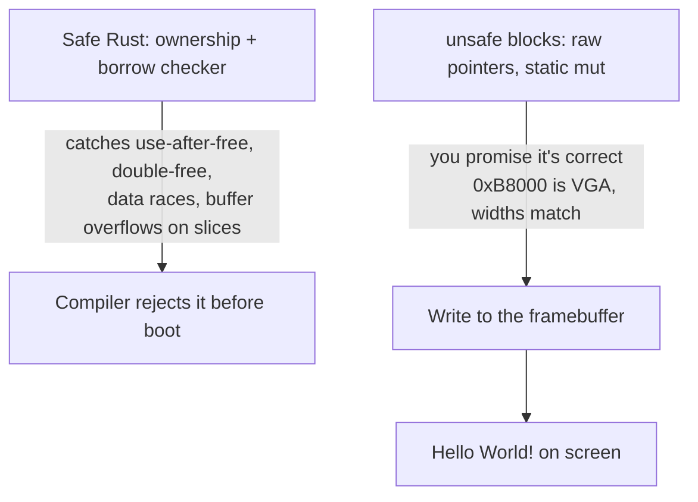
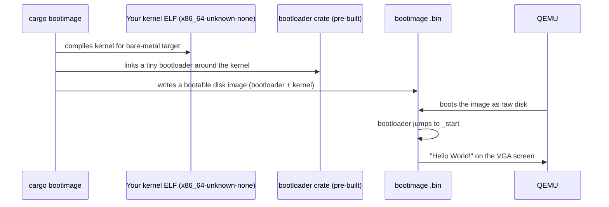

# Path B — Rust → Operating System Development (Beginner)

> The **most beginner-friendly, free Rust OS-dev track** we selected, and the most active
> language community for modern hobby OS-dev. This path follows Philipp Oppermann's
> *Writing an OS in Rust* (os.phil-opp.com), the canonical free series, and builds on the
> same five-step boot recipe as the C track — but where C says "here's a raw pointer, trust
> you", Rust says **"here's `unsafe`: I'll make exactly where you touch memory explicit and
> check everything else for you."** That difference is the whole personality of Rust OS-dev.

This page deep-expands the Rust track: the beginner Rust you need (`no_std`, ownership,
`unsafe`), how memory and pointers look through Rust's safety rules, then a guided build of
the Rust kernel from [`Example_OS_Project/rust/`](../Example_OS_Project/rust/). The good news:
Rust needs **no cross-compiler** — just a nightly toolchain plus the `bootimage` tool.

---

## Primary Resource

### Writing an OS in Rust — Philipp Oppermann (phil-opp)
- **Where:** https://os.phil-opp.com/ | https://github.com/phil-opp/blog_os
- **License:** Free; blog content CC-BY-NC, code Apache-2.0/MIT
- **Local copy:** [`blog_os/`](blog_os/) (full GitHub source, 144 markdown post sources under `blog/content/edition-2/`)
- **Why chosen:** *The* most famous free Rust OS-development series. Perfectly matches **Path B (Rust beginner → OS beginner)**. Text-heavy, diagram-rich, step-by-step. Covers `no_std` [freestanding](../GLOSSARY/freestanding.md "Code compiled assuming no OS or standard library exists") binaries, [panic handler](../GLOSSARY/panic-handler.md "The function that runs when a Rust kernel panics (no OS to report to)"), [bootloader](../GLOSSARY/bootloader.md "A small program that loads your kernel into memory and jumps to it") + `bootimage` boot, VGA text buffer, [interrupts](../GLOSSARY/interrupt.md "A hardware signal that makes the CPU run a registered handler"), [paging](../GLOSSARY/paging.md "Translates virtual addresses to physical RAM via page tables"), [heap allocation](../GLOSSARY/heap-allocation.md "Dynamically allocating memory at runtime; a kernel does it itself"), and more.

## What you'll build in this path
- A freestanding Rust binary (`#![no_std]`) with a custom panic handler
- A minimal x86_64 [kernel](../GLOSSARY/kernel.md "The core program that owns the machine and manages hardware") that prints to the VGA text buffer in [QEMU](../GLOSSARY/qemu.md "A free emulator you can boot your kernel in for testing")
- Booted using the `bootloader` crate + `bootimage` (no cross-compiler needed — just Rust nightly)

## Supporting material already in this hub
- Fully-commented minimal implementation → [`Example_OS_Project/rust/`](../Example_OS_Project/rust/)
- Synthesized consolidated beginner guide → [`synthesized_tutorials/02-rust/`](../synthesized_tutorials/02-rust/)
- Concepts (memory, interrupts, VGA) → [`synthesized_tutorials/concepts/`](../synthesized_tutorials/concepts/)

## Toolchain needed (see `Example_OS_Project/docs/setup.md`)
`rustup` (nightly channel), `cargo`, `cargo bootimage`, `llvm-tools-preview` component, `qemu-system-x86_64`.

---

## Part 1 — The beginner Rust you need for a kernel

Rust is *the* language where memory safety is enforced by the compiler, and a kernel is the
extreme test of that promise: there's no OS, no standard library, and you sometimes *must*
poke raw memory. So the beginner Rust you need is really three ideas working together:
**`no_std`** (no standard library), **ownership** (the memory-safety model), and **`unsafe`**
(the escape hatch where you do the raw stuff, explicitly).

### 1.1 `#![no_std]` and `#![no_main]`: the two attributes that change everything

```rust
#![no_std]   // do NOT link the standard library
#![no_main]  // do NOT use the normal Rust main() runtime

// main.rs — the two attributes at the top are the whole game:
//   no_std  : we cannot use Vec, String, println!, or anything from std.
//             We CAN use core (no allocation) — and later alloc, once we
//             provide an allocator.
//   no_main : there is no std main() wrapper; we must provide _start.
```

- [`no_std`](../GLOSSARY/no_std.md "A Rust attribute that disables the standard library to run on bare metal") means "don't bring the standard library". `std` assumes an OS (it does
  `malloc`, threads, files, networking). A kernel has none of those, so we drop it.
- What you *kept* is `core`, the allocation-free subset (iterators, `format_args!` with an
  explicit writer, trait machinery, atomics). `alloc` is available too — but only once *you*
  write an allocator and declare the global one.

### 1.2 The panic handler: what runs when `panic!` fires

On hosted Rust, a `panic!` prints through the standard library and unwinds. With no `std`,
there is no machinery for that — so **you must provide a panic handler**, and it must never
return (`-> !` means "this function never returns"):

```rust
use core::panic::PanicInfo;

#[panic_handler]
fn panic(_info: &PanicInfo) -> ! {
    // No OS to report to. Minimal kernel: halt forever.
    loop {
        unsafe { core::arch::asm!("hlt", options(nomem, nostack)) }
    }
}
```

If you forget this, you get a compile error: *"`#[panic_handler]` function required, but not
found"*. That error is Rust's way of saying "you told me there's no OS, so you must tell me
what a panic even means here."

### 1.3 The entry point: `#[no_mangle] extern "C" fn _start() -> !`

Where C uses `void kernel_main()` with C linkage, Rust uses a function decorated with three
things — and each is meaningful:

```rust
#[no_mangle]          // 1. don't mangle the symbol name (like C's extern "C" result)
pub extern "C" fn _start() -> ! {   // 2. C ABI so the bootloader/CPU calls it
                                    // 3. -> ! : never returns
    // ... print hello world ...
    loop {
        unsafe { core::arch::asm!("hlt", options(nomem, nostack)) }
    }
}
```

- `#[no_mangle]` keeps the symbol name exactly `_start` (Rust mangles by default, like C++).
- `extern "C"` uses the C calling convention — the one bare-metal entry points expect.
- `-> !` tells the compiler this function never returns, which is *literally true* for a
  kernel: there is nowhere to return to.

---

## Part 2 — Ownership, pointers, and `unsafe` (systems context)

This is the heart of the Rust track. Let's build the memory model up from the language's own
rules, then show how a kernel bumps against them.

### 2.1 Ownership: why Rust needs no garbage collector

Rust's safety model is **ownership**: every value has exactly one owner; when the owner goes
out of scope the value is freed (no GC needed). References (`&T`) let you borrow without
taking ownership, and the compiler enforces "you can't have a mutable and a shared reference
to the same thing at the same time". This *is* a memory manager, but one that runs at compile
time and costs nothing at runtime — which is why Rust is so attractive for kernels, where a
GC (see the [Go path](../path_go_os/README.md), [C# path](../path_csharp_os/README.md)) is a luxury you often can't afford.

```rust
fn main() {
    let s = String::from("hi");   // s owns the String's memory
    println!("{}", s);
}                                 // when main ends, s is freed automatically
// No free() call, no GC pass — the compiler inserted the cleanup.
```

### 2.2 But our kernel can't allocate a String — so what does ownership look like here?

Without `std`, we don't have `String` or `Vec` (they need an allocator). We *do* have slices,
arrays, and the same ownership rules applied to plain data:

```rust
// A borrowed, read-only string of bytes (no allocation — it's just a length + a pointer).
fn vga_write(s: &str) {          // s is a &str: a reference to a sequence of bytes
    for byte in s.bytes() {      // iterate the bytes
        // ... write one byte ...
    }
}
// The caller passes a string literal; vga_write borrows it, never owns it.
vga_write("Hello World!\n");     // fine — the literal has static lifetime
```

Key idea: a `&str` / `&[u8]` is a *fat pointer* — a pointer plus a length. That length is what
prevents the "walk off the end of a C string" bug from the C path: the compiler and the type
system both know exactly how many bytes there are.

### 2.3 The raw pointer and `unsafe`: writing to `0xB8000`

Here's where Rust meets the VGA framebuffer — and where the language's honesty shows. Writing
to a raw memory address is **not** something safe Rust can prove is valid, so you must put it
in an `unsafe` block. `unsafe` is not "dangerous code" — it's Rust saying *"I'm giving you a
way to talk to the machine directly; you're promising YOU know it's correct."*

```rust
const VGA_BUFFER: *mut u16 = 0xB8000 as *mut u16;   // a raw mutable pointer to 0xB8000

// Writing one VGA cell requires unsafe: the compiler cannot prove 0xB8000 is valid RAM.
unsafe {
    *VGA_BUFFER.add(index) = (COLOR_WHITE_ON_BLACK << 8) | c as u16;
}
```

Notice what we did *not* do: we did not dereference a null pointer, we did not read
uninitialized memory blindly, and we documented *why it's safe* ("0xB8000 is the valid,
always-mapped VGA text framebuffer") in a comment. That safety justification is the contract
of every `unsafe` block in a kernel.

### 2.4 `static mut` and the cursor: global mutable state

The kernel keeps a row/column cursor to know where the next character goes. In hosted Rust
you'd use a global, but in kernel Rust that global is `static mut` — and *any* access to it is
`unsafe`, because the compiler can't verify there are no data races (the kernel may later run
multiple CPUs).

```rust
static mut CURSOR_ROW: usize = 0;
static mut CURSOR_COL: usize = 0;

fn advance() {
    unsafe {
        CURSOR_COL += 1;                       // unsafe: touching a static mut
        if CURSOR_COL >= VGA_WIDTH {
            CURSOR_COL = 0;
            CURSOR_ROW = (CURSOR_ROW + 1) % VGA_HEIGHT;
        }
    }
}
```

> **Later, you'll replace this** with a proper `Mutex<Writer>` wrapped in a cell type from the
> `spin` or `x86_64` crates, so only *one* place in the kernel needs `unsafe`. That's the
> Rust-idiomatic kernel design: **contain the unsafe** in a tiny, well-commented surface and
> keep the rest safe. This is exactly how phil-opp's series builds its `Writer`.

### 2.5 The memory safety checklist for a Rust kernel

Rust gives you a lot, but the raw-address work is still on you. When you touch bare memory,
audit three things:

1. **Is the address real?** (For us: is `0xB8000` the VGA framebuffer? Yes — verified.)
2. **Is the width right?** (A VGA cell is `u16`, not `u8`; a page is 4 KiB, etc.)
3. **Is it in-bounds in my mental model?** (Rust guards slices/lengths; **you** guard raw
   addresses.)



---

## Part 3 — Build your kernel in Rust (guided, step by step)

The Rust kernel follows the same recipe as C but with a *different toolchain*: instead of
`boot.s` + a hand-written linker script + GRUB, you use the `bootloader` crate + `bootimage`
which bundle a tiny pre-built bootloader (a modern one that boots a Multiboot 2 payload)
around your kernel ELF. That removes the need for a cross-compiler.

The full, verified source is in [`Example_OS_Project/rust/`](../Example_OS_Project/rust/). Here
is the heart of it:

### 3.1 The whole `main.rs` (condensed from the reference)

```rust
#![no_std]          // no standard library
#![no_main]         // no main() runtime

use core::panic::PanicInfo;

const VGA_WIDTH: usize = 80;
const VGA_HEIGHT: usize = 25;
const VGA_BUFFER: *mut u16 = 0xB8000 as *mut u16;   // the framebuffer
const COLOR_WHITE_ON_BLACK: u16 = 0x0F;

static mut CURSOR_ROW: usize = 0;
static mut CURSOR_COL: usize = 0;

fn vga_putchar(c: u8) {
    if c == b'\n' {
        unsafe {
            CURSOR_COL = 0;
            CURSOR_ROW = (CURSOR_ROW + 1) % VGA_HEIGHT;
        }
        return;
    }
    let row = unsafe { CURSOR_ROW };
    let col = unsafe { CURSOR_COL };
    let index = row * VGA_WIDTH + col;
    unsafe {
        *VGA_BUFFER.add(index) = (COLOR_WHITE_ON_BLACK << 8) | c as u16;
    }
    unsafe {
        CURSOR_COL += 1;
        if CURSOR_COL >= VGA_WIDTH {
            CURSOR_COL = 0;
            CURSOR_ROW = (CURSOR_ROW + 1) % VGA_HEIGHT;
        }
    }
}

fn vga_write(s: &str) {
    for byte in s.bytes() {
        vga_putchar(byte);
    }
}

#[no_mangle]
pub extern "C" fn _start() -> ! {
    vga_write("Hello World!\n");
    vga_write("Welcome to your very own operating system (Rust edition).\n");
    loop {
        unsafe { core::arch::asm!("hlt", options(nomem, nostack)) }
    }
}

#[panic_handler]
fn panic(_info: &PanicInfo) -> ! {
    loop {
        unsafe { core::arch::asm!("hlt", options(nomem, nostack)) }
    }
}
```

Note the asymmetry with C: the panic handler exists because `panic!` has to do *something*
and there's no OS; the `hlt` in both `_start` and `panic` actually parks the CPU (lower power,
and later interrupt-woken) rather than C's busy `for(;;)` spin. Rust nudges you toward correct
idling even in a minimal kernel.

### 3.2 Build & run (no cross-compiler needed)

```bash
# One-time setup: nightly + the bootimage tool
rustup toolchain install nightly
rustup component add llvm-tools-preview
cargo install bootimage

# Build a bootable disk image from your kernel
#   (in the project dir with a rust-toolchain.toml pinning nightly)
cargo bootimage

# Boot it in QEMU
qemu-system-x86_64 -drive format=raw,file=target/x86_64-unknown-none/debug/bootimage-<name>.bin
```

Or from the project root: `make -C Example_OS_Project/rust run-rust` (see its README for the
exact commands). The `rust-toolchain.toml` in the reference pins the nightly channel for you;
the `.cargo/config.toml` sets the bare-metal target `x86_64-unknown-none`.

### 3.3 What `cargo bootimage` actually does



### 3.4 Verifying

```bash
# Check the kernel compiled for the right target (bare-metal, no OS)
file target/x86_64-unknown-none/debug/your_kernel   # shows "ELF 64-bit ... x86-64"
# Ensure no std leaked in
nm target/x86_64-unknown-none/debug/your_kernel | grep -i std   # should be empty/std-free
qemu-system-x86_64 -drive format=raw,file=...bootimage-....bin
```

---

## Part 4 — Pitfalls (Rust-specific)

The generic boot pitfalls (Multiboot/boot header, no stack) are mostly handled for you by the
`bootloader` crate — but Rust has its own sharp edges:

1. **Forgetting `#![no_std]` / `#![no_main]`.** If you miss one, the build either tries to
   link `std` (and fails, because there's no OS) or expects a `main()` that doesn't exist.
   The two attributes at the top are non-negotiable for a bare-metal kernel.
2. **Forgetting the `#[panic_handler]`.** Rust refuses to compile a `no_std` binary without
   one. This isn't a bug — it's Rust forcing you to decide what "a panic means" in a world
   with no runtime.
3. **Missing `#[no_mangle]` or `extern "C"` on `_start`.** The symbol gets mangled / the wrong
   ABI, and the bootloader can't find the entry point. Keep all three decorations.
4. **Touching `static mut` outside `unsafe`.** The compiler will reject it. This is annoying
   the first time and *freeing* forever after: it makes every global-state access visible.
5. **Using stabilized-only Rust features without a nightly toolchain.** The reference pins
   **nightly** via `rust-toolchain.toml`. If you're on stable, inline `asm!` and several
   `no_std` `alloc` details won't work. `rustup override set nightly` fixes it.
6. **The `bootimage` linker error (`rust-lld: error: undefined symbol` / "no memory region").**
   Usually means the target or `config.toml` is off — copy the reference `.cargo/config.toml`
   exactly, and ensure `llvm-tools-preview` is installed.
7. **Dereferencing a raw pointer you didn't validate.** Rust lets you do `unsafe { *ptr }` —
   but it's on *you* to be sure. Always ask the three questions from Part 2.5 before writing
   a new raw address.

> **The Rust mindset on bare metal:** Rust does not make the kernel trivially easy — it makes
> the *kinds* of memory mistakes that crash systems (use-after-free, data races, out-of-bounds)
> compile-time errors, and it concentrates the truly unsafe work in small, documented
> `unsafe` blocks. On bare metal you still carry the same hardware obligations as C — but the
> language has your back on the ordinary cases.

---

## Part 5 — Next steps (the phil-opp series roadmap)

`Writing an OS in Rust` grows this minimal kernel into a full paging, interrupt-driven OS.
The natural order, each mapping to a video below:

| Step | What you build | Concept glossary |
|------|----------------|------------------|
| 1. Freestanding binary | `_start`, panic handler | [`no_std`](../GLOSSARY/no_std.md "A Rust attribute that disables the standard library to run on bare metal"), [`panic-handler`](../GLOSSARY/panic-handler.md "The function that runs when a Rust kernel panics (no OS to report to)") |
| 2. Minimal kernel | VGA print | [`vga-text-mode`](../GLOSSARY/vga-text-mode.md "The 80x25 character display mode a minimal kernel writes to") |
| 3. VGA text mode | cursor, colors, formatting | [`vga-framebuffer`](../GLOSSARY/vga-framebuffer.md "The block of memory at 0xB8000 where the screen text lives") |
| 4. Testing | unit + integration tests in QEMU | [`qemu`](../GLOSSARY/qemu.md "A free emulator you can boot your kernel in for testing") |
| 5. CPU exceptions | [IDT](../GLOSSARY/idt.md "The kernel's table that tells the CPU where each interrupt handler lives"), ISRs, double faults | [`idt`](../GLOSSARY/idt.md "The kernel's table that tells the CPU where each interrupt handler lives"), [`isr`](../GLOSSARY/isr.md "The handler function run for a specific interrupt number") |
| 7. Hardware interrupts | PIC/APIC, timer, keyboard | [`pic-apic`](../GLOSSARY/pic-apic.md "Chips that route hardware interrupts (timer, keyboard) to the CPU") |
| 8–9. Paging | page tables, virtual memory | [`paging`](../GLOSSARY/paging.md "Translates virtual addresses to physical RAM via page tables"), [`physical-virtual-memory`](../GLOSSARY/physical-virtual-memory.md "Real RAM addresses vs the addresses your code sees after paging") |
| 10–11. Heap + allocators | `alloc` crate, bump/linked-list allocators | [`heap-allocation`](../GLOSSARY/heap-allocation.md "Dynamically allocating memory at runtime; a kernel does it itself"), [`frame-allocator`](../GLOSSARY/frame-allocator.md "The simplest memory manager that tracks which 4 KiB physical pages are free") |
| 12. Async/await | an executor, multitasking | [`syscall`](../GLOSSARY/syscall.md "The way user programs ask the kernel for services") |

Other Rust OS ecosystems and series (Raspberry Pi tutorials, rCore, Redox) are listed in
[`resources/curated/language-rust.md`](../resources/curated/language-rust.md).

---

## Part 6 — A worked extension: a `Writer` with colors and formatting

This is the refactor phil-opp's series does in Part 3, and it's the single most important
step from "a kernel that prints" to "a kernel with a *terminal driver*". We contain the
`unsafe` in one place and expose safe methods.

```rust
// A Writer owns the cursor + color; all raw-address writes live in one method.
const VGA_WIDTH: usize = 80;
const VGA_HEIGHT: usize = 25;
const VGA_BUFFER: *mut u16 = 0xB8000 as *mut u16;

#[derive(Clone, Copy)]
enum Color { Black = 0x0, Green = 0xA, White = 0xF, Red = 0x4 }

impl Color {
    fn as_byte(self) -> u8 { self as u8 }
}

struct ScreenChar { character: u8, color: u8 }

struct Writer {
    column_position: usize,
    row_position: usize,
    color: u8,
}

impl Writer {
    fn new() -> Self { Self { column_position: 0, row_position: 0, color: 0x0F } }

    fn set_color(&mut self, fg: Color, bg: Color) {
        self.color = (bg.as_byte() << 4) | fg.as_byte();
    }

    fn write_byte(&mut self, byte: u8) {
        if byte == b'\n' {
            self.column_position = 0;
            self.row_position = (self.row_position + 1) % VGA_HEIGHT;
            return;
        }
        let index = self.row_position * VGA_WIDTH + self.column_position;
        // SAFETY: 0xB8000 is the valid, always-mapped VGA text framebuffer; our
        // row*WIDTH+col index is guaranteed < 80*25 = 2000 cells by the wrap logic.
        unsafe {
            *VGA_BUFFER.add(index) = ((self.color as u16) << 8) | byte as u16;
        }
        self.column_position += 1;
        if self.column_position >= VGA_WIDTH {
            self.column_position = 0;
            self.row_position = (self.row_position + 1) % VGA_HEIGHT;
        }
    }

    fn write_str(&mut self, s: &str) {
        for byte in s.bytes() {
            self.write_byte(byte);
        }
    }
}

#[no_mangle]
pub extern "C" fn _start() -> ! {
    let mut w = Writer::new();
    w.set_color(Color::White, Color::Black);
    w.write_str("Hello World!\n");
    w.set_color(Color::Green, Color::Black);
    w.write_str("Welcome (Rust edition)");
    loop { unsafe { core::arch::asm!("hlt", options(nomem, nostack)) } }
}
```

### 6.1 Why this design matters

The crucial property: **the `unsafe` block is now confined to `write_byte`, and its safety
justification is written in a `// SAFETY:` comment right next to it.** Every other method —
`write_str`, `set_color`, `_start` — is safe Rust. When you audit this kernel, you only need
to look at *one* place. That is Rust OS-dev's core discipline: not "never use `unsafe`", but
"make the unsafe surface as small as possible and as obviously correct as possible".

### 6.2 Adding formatted output with `core::fmt`

Because `no_std` still gives you `core` (and `core::fmt`), you can make the `Writer` speak
`write!` with a small trait impl — no allocation required:

```rust
use core::fmt::{self, Write};

impl Write for Writer {           // impl core::fmt::Write for our Writer
    fn write_str(&mut self, s: &str) -> fmt::Result {
        self.write_str(s);
        Ok(())
    }
}

// Now you can do: write!(w, "x = {}, y = {}", 3, 7);
// ...which formats into a stack buffer and drives our write_byte — no String, no heap.
```

This is a big deal: it means formatted kernel output (great for debugging, uptime counters,
error hex dumps) needs no allocator and no standard library — just the trait Rust gives you in
`core`. Try it in the mini-project below.

---

## Watch and learn

Videos selected and verified to follow the *Writing an OS in Rust* series exactly — part
numbers match the roadmap above.

<details class="video-embed">
<summary>▶ Watch: Writing an OS in Rust - Part 2 - A Minimal Rust Kernel</summary>
<iframe src="https://www.youtube-nocookie.com/embed/AYyybz3gm6A" title="Writing an OS in Rust - Part 2 - A Minimal Rust Kernel" width="100%" height="400" style="border:0;border-radius:8px;" allow="accelerometer; autoplay; clipboard-write; encrypted-media; gyroscope; picture-in-picture; web-share" allowfullscreen></iframe>
<p class=video-caption>Uncle Scientist's video companion to the book, part 2: the minimal kernel you're building here — no_std, _start, and printing Hello World.</p>
</details>
<details class="video-embed">
<summary>▶ Watch: Writing an OS in Rust - Part 3 - VGA Text Mode</summary>
<iframe src="https://www.youtube-nocookie.com/embed/DA2zIAkE26Q" title="Writing an OS in Rust - Part 3 - VGA Text Mode" width="100%" height="400" style="border:0;border-radius:8px;" allow="accelerometer; autoplay; clipboard-write; encrypted-media; gyroscope; picture-in-picture; web-share" allowfullscreen></iframe>
<p class=video-caption>Part 3: turning the bare framebuffer writes into a structured Writer with a cursor and colors — the design the reference kernel starts toward.</p>
</details>
<details class="video-embed">
<summary>▶ Watch: Writing an OS in Rust - Part 5 - CPU Exceptions</summary>
<iframe src="https://www.youtube-nocookie.com/embed/TsoskgYAMf4" title="Writing an OS in Rust - Part 5 - CPU Exceptions" width="100%" height="400" style="border:0;border-radius:8px;" allow="accelerometer; autoplay; clipboard-write; encrypted-media; gyroscope; picture-in-picture; web-share" allowfullscreen></iframe>
<p class=video-caption>Part 5: building the IDT and handling CPU exceptions — the natural next step after a working Hello World kernel.</p>
</details>
<details class="video-embed">
<summary>▶ Watch: Writing an OS in Rust - Part 7 - Hardware Interrupts</summary>
<iframe src="https://www.youtube-nocookie.com/embed/BqroBP6BXeE" title="Writing an OS in Rust - Part 7 - Hardware Interrupts" width="100%" height="400" style="border:0;border-radius:8px;" allow="accelerometer; autoplay; clipboard-write; encrypted-media; gyroscope; picture-in-picture; web-share" allowfullscreen></iframe>
<p class=video-caption>Part 7: the PIT timer and keyboard through PIC/APIC — your kernel comes alive with real hardware input.</p>
</details>
<details class="video-embed">
<summary>▶ Watch: Writing an OS in Rust - Part 9 - Paging Implementation</summary>
<iframe src="https://www.youtube-nocookie.com/embed/80h0uQq1jO0" title="Writing an OS in Rust - Part 9 - Paging Implementation" width="100%" height="400" style="border:0;border-radius:8px;" allow="accelerometer; autoplay; clipboard-write; encrypted-media; gyroscope; picture-in-picture; web-share" allowfullscreen></iframe>
<p class=video-caption>Part 9: enabling and using paging / page tables — where virtual vs. physical memory becomes real.</p>
</details>

---

## Exercises & Projects

The Rust track's Hello World swaps the hand-rolled assembly boot for the `bootloader` crate +
`bootimage`, so these exercises focus on what's *different* in Rust: ownership, `unsafe`
containment, and growing the minimal kernel into phil-opp's roadmap. **Prereq:** the full
build loop from this page — ideally `make -C Example_OS_Project/rust run-rust` working.

### Graded exercises

**Easy**

- [ ] **E1. Rebuild the Rust kernel closed-book** (~20–40 min). Close this page and the
      reference. Recreate `main.rs` from memory: the two attributes, `_start` with all three
      decorations, the VGA write loop, and the `#[panic_handler]`. Build with `cargo bootimage`
      and boot it.
- [ ] **E2. Explain `no_std`, `no_main`, and `-> !`** (~20 min). Write a short note for each of
      the three decorating choices, saying what would break if each were removed. You should be
      able to explain *why* a kernel needs a `#[panic_handler]`.
- [ ] **E3. Change the banner** (~20 min). Edit the message, rebuild with `cargo bootimage`,
      boot in QEMU, and confirm your string appears. Then add a second line in a different "color"
      by changing the `COLOR_WHITE_ON_BLACK` constant's high byte to `0x0A` (green).

**Medium**

- [ ] **M1. Add a `Writer` with a cursor and colors** (~1.5 hr). Refactor the floating
      `static mut` cursor + `vga_putchar` into a small `Writer` struct holding the row/column,
      with `write_str` and a `set_color` method. This is the refactor phil-opp does in Part 3.
      Keep the `unsafe` minimal and documented.
- [ ] **M2. Replace the busy loop with a real panic message** (~1 hr). Change `vga_putchar` to
      print to the screen, then write a `panic` handler that prints the panic message before
      halting. `panic!("oops")` should show text, proving your handler works.
- [ ] **M3. Read the boot, don't guess** (~45 min). Run `file`, `nm`, and
      `qemu-system-x86_64 -d int,cpu_reset` against a deliberately broken build (drop
      `#[no_mangle]`, or use stable instead of nightly) and note what each tool reports before
      you fix it.

**Hard**

- [ ] **H1. Port an interrupt** (~3 hr). Follow the roadmap to add the PIT timer
      ([concepts/03](../synthesized_tutorials/concepts/03-interrupts-and-the-idt.md)) so your
      kernel prints a tick counter. This exercises the [IDT](../GLOSSARY/idt.md "The kernel's table that tells the CPU where each interrupt handler lives") and the `x86_64` crate's
      interrupt machinery in Rust.
- [ ] **H2. Compare against C and C++** (~1.5 hr). Put
      [`Example_OS_Project/rust/src/main.rs`](../Example_OS_Project/rust/src/main.rs) next to
      the C and C++ kernels. Annotate the same logical steps. Where does Rust make you be more
      explicit (`unsafe`, `static mut`) and where does it save you from C's footguns?

### ⭐ Mini-project — Rebuild the Rust kernel as your own, with a Writer and a panic message

**Goal.** Rebuild the Rust kernel from a fresh `cargo project --edition 2021` (nightly), grow
it into a small `Writer`, and make its panic handler actually print. **Estimated time:** 3–5 hr.
**Prereq:** this page + the project toolchain.

1. **Scaffold.** Create a `no_std`/`no_main` `main.rs` and `.cargo/config.toml` targeting
   `x86_64-unknown-none` (copy the reference's config — it's tiny). Pin nightly in
   `rust-toolchain.toml`.
2. **Minimal kernel.** Get `_start` printing "Hello World!" and halting.
3. **Refactor to a `Writer`.** Move the cursor + cell-writing into a `struct Writer { row,
   col, color }` with methods; keep the raw-address `unsafe` inside one private method.
   Add a `set_color` and make the banner two-tone.
4. **Panic prints.** Give `#[panic_handler]` access to a static/global writer (a `spin::Mutex`
   or a simple `unsafe` static) so a `panic!("...")` shows a red error line before halting.
5. **Boot & verify.** `cargo bootimage` + QEMU; confirm banner, colors, and a forced panic
   message all appear.
6. **Make a `make run` target** (and document the exact `cargo bootimage` + `qemu` commands)
   so a stranger can reproduce it.
7. **Commit + reproduce.** Clone fresh, build, boot, and force the panic — all from the repo
   alone.

**Checklist**

- [ ] closed-book minimal kernel rebuild succeeds without the page open
- [ ] self-chosen banner visible in QEMU
- [ ] `Writer` struct with at least two colors works
- [ ] a `panic!("...")` prints a message before halting
- [ ] the whole build is reproducible from `cargo bootimage` on a clean clone
- [ ] a forced double-fault / panic is caught or at least diagnosed without a hang-lock you
      can't explain

---

*You've written a Rust kernel — and learned the language's deepest idea by applying it to the
hardest possible problem. From here, phil-opp's series (and the videos above) will carry you
through interrupts, paging, and heap allocation.*
