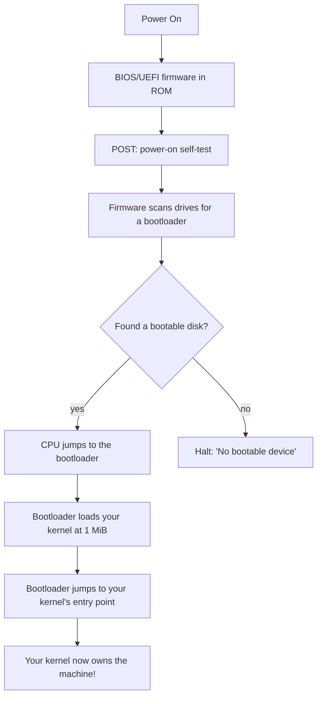
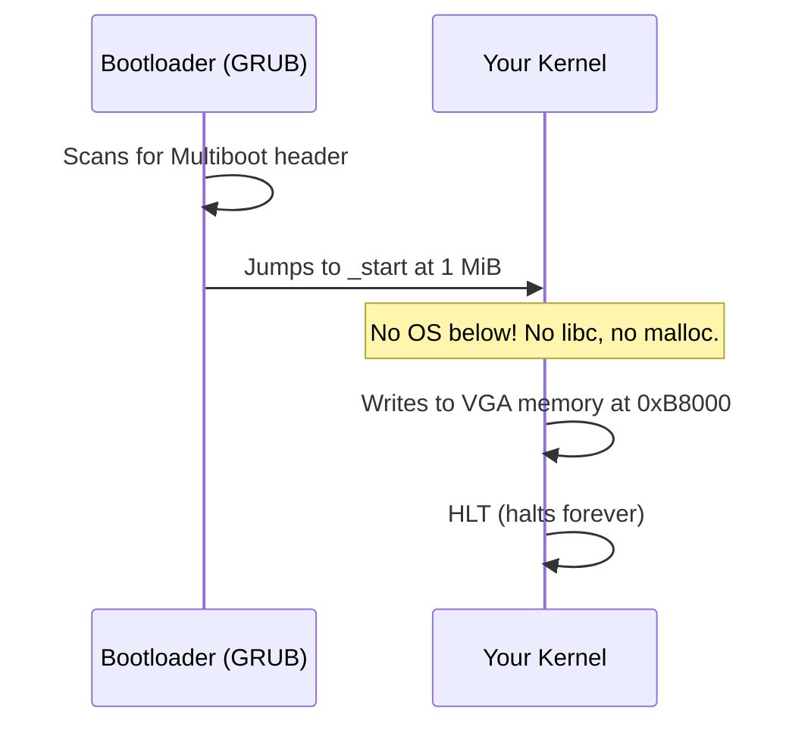
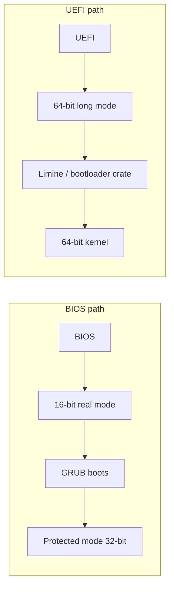
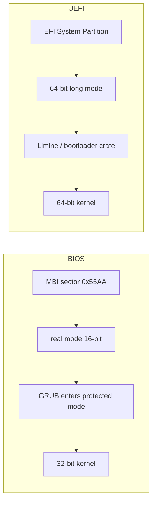

# Chapter 00 — How a Computer Boots

*Original content written for OSDev_Learning_Hub.*

Before you write a single line of kernel code, you need to know what your code is actually doing when the machine starts. This chapter strips the magic away.

---

## The story of a machine turning on

When you press the power button, the CPU doesn't know anything about operating systems, files, or disks yet. It follows a strict, ancient chain of events:



Let's unpack each step.

### 1. Firmware is the true first program
The **[BIOS](../../GLOSSARY/bios.md "The motherboard firmware that starts the machine and finds a bootloader")** (older) or **[UEFI](../../GLOSSARY/uefi.md "Modern firmware that boots into 64-bit long mode natively")** (newer) is software burned onto the motherboard, not stored on your disk. Its one job on boot: **find a [bootloader](../../GLOSSARY/bootloader.md "A small program that loads your kernel into memory and jumps to it") and run it**.

### 2. The bootloader is not your kernel
A **[bootloader](../../GLOSSARY/bootloader.md "A small program that loads your kernel into memory and jumps to it")** ([GRUB](../../GLOSSARY/grub.md "The free GNU bootloader that loads Multiboot kernels"), [Limine](../../GLOSSARY/limine.md "A modern bootloader supporting Multiboot 2 and 64-bit kernels"), or the Rust `bootloader` crate) is a small program whose job is to:
- set the CPU into a sane, known state (32-bit [protected mode](../../GLOSSARY/protected-mode.md "The 32-bit CPU mode Multiboot v1 kernels run in"), later 64-bit [long mode](../../GLOSSARY/long-mode.md "The 64-bit CPU mode modern kernels run in")),
- load your kernel image from disk into RAM,
- and `jmp` to your kernel's [entry point](../../GLOSSARY/entry-point.md "The symbol (usually _start) the bootloader jumps to").

You don't have to be a bootloader expert to write an OS — you just have to produce a kernel the bootloader can find. On [x86](../../GLOSSARY/x86.md "The CPU architecture family this hub targets") that means speaking the **Multiboot protocol**.

### 3. Multiboot — the "hello" handshake
The **Multiboot** spec says: *"If you want a standard bootloader to load you, put a magic header at the very start of your kernel image."*

```
0x1BADB002   <- "magic" number the bootloader looks for
```

A kernel that carries this header at its start can be booted by GRUB on real hardware *and* by [QEMU](../../GLOSSARY/qemu.md "A free emulator you can boot your kernel in for testing") for testing. Every "bare bones" tutorial — C, C++, Go — starts by writing this header in assembly.

### 4. Your kernel takes over
Once the bootloader jumps to `_start`, there is **no operating system underneath you anymore**. The `printf` you used in your first C program? Gone. `malloc`? Gone. Threads, files, network? None of it exists until **you** build it.

This is the single most surprising fact for a beginner: **a kernel is just a program that runs on raw hardware.**



---

## Two firmware worlds in one diagram



- **BIOS** is old, simple, and universally supported (even modern UEFI machines emulate it). It boots into a 16-bit mode first.
- **UEFI** is modern and 64-bit native, but more complex.

For learning, **BIOS + GRUB/Multiboot** (or the Rust `bootloader` crate) is the smoothest path. That's what this hub uses.

---

## Going deeper: the reset vector and where the CPU starts

Let's slow the film down and look at the real mechanics of each stage, because the details are where beginners get lost — and because each detail explains a quirk you'll run into in later chapters.

### The reset vector: the CPU is wired, not searching

When power stabilizes, the x86 CPU finds its very first instruction at a **fixed, hard-wired address**: `0xFFFF0` in the top of the first megabyte of address space. The BIOS firmware is mapped into that region, so the **reset vector** is literally "the address the CPU is born at." The CPU doesn't *search* for firmware — it is *wired* to start at `0xFFFF0`. Everything after that (POST, drive scanning) is just software the firmware runs from there.

This is your first hint at how fundamentally *fixed* and *predictable* low-level machines are. Your kernel, too, will depend on the bootloader jumping to a fixed entry point — usually the symbol `_start` at `0x100000` (1 MiB).

> **Memory-map checkpoint.** The first 1 MiB of address space is crowded with legacy things: the reset vector at the top (`0xFFFF0`), the [BIOS data area](https://wiki.osdev.org/Memory_Map_(x86)) in low memory, the VGA text buffer at `0xB8000`, and the real-mode interrupt vector table at `0x00000`. This is *why* kernels go to 1 MiB — everything below is taken.

### POST, then the hunt for boot code

The **Power-On Self-Test** checks RAM, CPU, and peripheral controllers. On old machines a single short beep meant "all good"; a pattern of beeps told you *which* component failed.

After POST, BIOS looks for a bootable device in its boot order (floppy → CD → USB → hard disk, or whatever you configured). On a legacy disk it reads the **first sector** (the [Master Boot Record / MBR](https://wiki.osdev.org/Master_Boot_Record)) — exactly 512 bytes — and checks the last two bytes: `0x55 0xAA`. That signature is what marks "this sector is bootable." No `0x55AA`? BIOS tries the next device.

```nasm
; A boot sector must end with 0x55 0xAA or the firmware won't run it.
; This is a 510-byte padding + the 2-byte signature:
times 510-($-$$) db 0   ; fill the rest of the 512-byte sector with zeros
dw 0xAA55                ; little-endian: 0x55 0xAA on disk
```

This tiny detail matters because the Rust `bootloader` crate, GRUB, and every boot-sector tutorial all eventually produce something that ends in `0x55AA` (or an equivalent EFI structure).

### Real mode, protected mode, long mode

16-bit [real mode](../../GLOSSARY/real-mode.md "The 16-bit CPU mode x86 starts in, with no memory protection") is how the CPU boots: a 20-bit address space (1 MiB max), no memory protection, and instructions that can reach only 64 KiB per segment. Your kernel wants much more than that. The x86 has a ladder of modes:

| Mode | Bits | Address space | Protected? | Who uses it |
|------|------|---------------|-----------|-------------|
| **Real mode** | 16 | 1 MiB (20-bit) | No | CPU on power-up; early bootloader |
| **Protected mode** | 32 | 4 GiB | Yes | BIOS/GRUB-era kernels (Multiboot v1) |
| **Long mode** | 64 | huge | Yes | Modern kernels (UEFI / Multiboot 2) |

The bootloader's job includes climbing this ladder: building a **GDT** that defines 32-bit segments, loading the segment registers, setting the protected-mode bit (CR0's PE bit), and — on a 64-bit path — setting up paging and entering long mode before handing off.

```nasm
; What a bootloader quietly does before your kernel runs (concept sketch).
; You usually never type this — but seeing it demystifies the handoff.
    cli                 ; no interrupts yet — no IDT
    ; (set up a GDT here, load it with lgdt, far-jump to reload CS)
    mov eax, CR0
    or  eax, 1          ; set the PE (protection enable) bit
    mov CR0, eax
    jmp 0x08:flush      ; far jump reloads CS from the GDT selector
flush:
    mov esp, stack_top  ; give the CPU a stack
    call kernel_main     ; finally reach your high-level kernel
```

You will almost never type this yourself for this hub — the bootloader does it. But understanding it explains *why* your entry point can assume 32-bit (or 64-bit) mode and a working flat memory model: the handoff contract guarantees it.

### ELF vs flat binary — what the bootloader actually loads

When GRUB loads your kernel, it doesn't just copy a raw file to 1 MiB. If your kernel is an **ELF** file (the default for `gcc` + `ld`), the bootloader *parses* the ELF program headers, loads each `PT_LOAD` segment to its declared virtual address, and jumps to the entry point stored in the ELF header. That means your linker script's section addresses (`. = 1M;`) are *honored* by the bootloader — which is why the linker script isn't decoration; it's a contract the bootloader reads and obeys.

The alternative is a **flat binary** (`.bin`), which is just a raw copy of the file's contents at 1 MiB with no headers. Flat binaries are simpler but force you to control layout entirely via the linker script. ELF is friendlier for reading symbols and debug info later, so this hub uses ELF kernels.

```bash
# Look at what the linker produced — this is what the bootloader will read
readelf -h myos.bin        # entry point, file type, machine
readelf -l myos.bin        # program headers: where each segment loads
objdump -d myos.bin        # disassembled instructions
```

If the entry point in `readelf -h` doesn't match your linker script's `ENTRY(_start)` — or the load addresses don't start at `0x100000` where you expect — the bootloader will jump somewhere meaningless and you'll get a triple fault.

---

## A worked first boot: the full naked flow

Let's put the whole story together with a genuinely minimal (non-Multiboot) boot sector, so you can see real mode → protected mode → print → halt with your own eyes. This is *not* what this hub's kernels do (they use GRUB/Multiboot), but it demonstrates every concept above in ~30 lines of assembly that you can actually assemble and boot:

```nasm
; boot.asm — a raw, real-mode boot sector you can boot as a floppy image
[org 0x7C00]            ; BIOS loads the boot sector at this address
    cli
    xor ax, ax
    mov ds, ax
    mov es, ax
    mov ss, ax
    mov sp, 0x7C00       ; set up a tiny stack

    mov si, msg
print_loop:
    lodsb                ; load [si] into al, advance si
    or  al, al
    jz  done
    mov ah, 0x0E         ; BIOS teletype output
    int 0x10             ; call the BIOS video service
    jmp print_loop
done:
    hlt
    jmp done

msg: db "Booted in real mode!", 0

times 510-($-$$) db 0
dw 0xAA55
```

```bash
nasm -f bin boot.asm -o boot.bin
qemu-system-i386 -fda boot.bin    # boot it as a floppy, in real mode
```

You'll see `Booted in real mode!` appear in QEMU. Notice what's *not* here: no GDT, no protected mode, no ELF, no Multiboot header. This is the absolute bottom rung — the boot sector the BIOS runs directly. Everything a modern kernel does is built upward from exactly this.

**Progression challenge:** take that boot sector and extend it one rung at a time:
1. First, print in **real mode** using `int 0x10` (above).
2. Then enter **protected mode**: set a GDT, set CR0's PE bit, far-jump, and print *directly to `0xB8000`* (no more BIOS calls — BIOS is gone once you leave real mode).
3. Finally, add the **Multiboot header** so GRUB (not your boot sector) loads your code at 1 MiB.

Each rung you climb removes one thing the bootloader used to do for you — which is exactly the territory the *next* chapters (toolchain, bootloaders, memory) cover.

---

## Mini-progression: watch the boot from the other side

Instead of only reading about the boot, you can *see* it in a debugger. Here's the mental progression that turns this chapter from "story" into "tool":

1. **Boot a dumb kernel in QEMU** (`qemu-system-i386 -kernel myos.bin`). The emulator is literally running the power-on → firmware → bootloader → kernel path on virtual hardware, in real time.
2. **Add `-d int,cpu_reset` (or use QEMU's `-monitor`) to dump exceptions and resets.** A *triple fault* (three consecutive faults before a handler exists) silently resets the machine — the classic way beginners discover they jumped somewhere wrong. QEMU can log exactly which fault fired and at what instruction.
3. **Use `-s -S` to pause the CPU at the first instruction and attach GDB.** Set a breakpoint on `_start`. When it hits, you've *watched the whole boot chain hand your kernel control*. This is the single most confidence-building exercise a beginner can do.

```bash
# Boot and freeze the CPU at the reset vector, waiting for a debugger
qemu-system-i386 -kernel myos.bin -s -S
# In another terminal:
gdb myos.bin
(gdb) target remote :1234
(gdb) break *0x100000    # your kernel's entry, where the bootloader jmps
(gdb) continue
# ...the CPU stops exactly at your kernel. The boot is done. You're in.
```

If you can do that, you *own* the boot story — you've watched it happen rather than just trusting it.

---

## A 30,000-foot boot timeline (keep this handy)

Here is the entire chain at a glance. Bookmark it; you will come back to it whenever a later chapter references "the bootloader did X for you."

| # | Stage | Who | What happens | Where code lives |
|---|-------|-----|--------------|------------------|
| 1 | Power-on reset | CPU | Wakes at the reset vector `0xFFFF0` | Wired into hardware |
| 2 | POST | BIOS/UEFI | Check RAM, CPU, controllers; beep on success/failure | ROM on motherboard |
| 3 | Boot-device scan | BIOS/UEFI | Read first sector (MBR), look for `0x55AA` signature | Disk, sector 0 |
| 4 | Launch bootloader | BIOS/UEFI | `jmp` to the boot sector / UEFI boot loader | On disk |
| 5 | Load your kernel | GRUB/Limine/`bootloader` crate | Parse ELF, load segments to linker-script addresses (1 MiB), maybe read a memory map | Your kernel file |
| 6 | Set CPU mode | Bootloader | Enter protected (and optionally long) mode, build the GDT, set up paging | Bootloader code |
| 7 | Hand off | Bootloader | `jmp` to `_start` (your entry point) | Your kernel |
| 8 | Take over | Your kernel | Set up a stack, init drivers, loop forever (`hlt`) | Your kernel |

Notice that steps 1–7 are *"the bootloader's problem,"* and step 8 onward is *your* problem. The moment your kernel gains control, nothing below it exists — that is the whole point of this chapter.

## Where does that privileged first code live? (address space tour)

An x86 CPU's address space at boot is *not* empty — it is full of fixed, legacy-mapped devices. This is worth a section because it explains several "magic numbers" you'll see forever:

| Address (approx) | What it holds |
|------------------|---------------|
| `0x00000`–`0x003FF` | The **Interrupt Vector Table (IVT)** — 256 real-mode ISR pointers |
| `0x00400`–`0x004FF` | **BIOS data area** (keyboard state, video mode, timers) |
| `0x7C00` | Where BIOS loads your boot sector |
| `0x9FC00`–`0x9FFFF` | **Extended BIOS Data Area (EBDA)** |
| `0xA0000`–`0xBFFFF` | Video RAM: `0xB8000` is the text-mode buffer you'll print to |
| `0xC0000`–`0xFFFFF` | ROM: option ROMs (video BIOS), and the system BIOS |
| `0xFFFF0` | The **reset vector** where the CPU starts |
| `0x100000`+ | Conventional RAM — **where your kernel loads** (1 MiB) |

This is *why* 1 MiB is special: the entire region below it is spoken for. Modern UEFI machines keep the same low-memory layout for compatibility, then place the kernel higher still.

## Real-mode segment:offset — what boot code is actually doing

When you see 16-bit code writing to memory, it usually uses *segment:offset* addressing: the physical address is `segment * 16 + offset`. So `0x7C00` as a boot-sector load point is often written `0x0000:0x7C00` or `0x07C0:0x0000` — two pairs that compute to the same physical address.

```nasm
; The same physical address reached two ways:
;   0x0000 * 16 + 0x7C00 = 0x07C00
;   0x07C0 * 16 + 0x0000 = 0x07C00
```

This is the 20-bit address space of real mode: `16` bits of segment shifted left 4 plus `16` bits of offset. That's the limit that motivates protected mode's flat 32-bit addresses — where your kernel can just write to `0xB8000` directly without juggling segments.

## A complete GRUB config (the disk side of the story)

Everything so far has been about *how* the bootloader loads your kernel. To close the loop on the real-world flow, here is the `grub.cfg` that tells GRUB *which* kernel to load and *how*:

```cfg
# menuentry on a GRUB disk / ISO
set timeout=5
menuentry "MyOS" {
    multiboot2 /boot/myos.bin   # or: multiboot /boot/myos.bin for v1
    boot
}
```

When you later build an ISO with `grub-mkrescue`, GRUB reads this file, finds `/boot/myos.bin`, validates its Multiboot header, loads its ELF segments, enters protected mode, and jumps to `_start`. The `multiboot`/`multiboot2` keyword is literally "load this with the Multiboot protocol" — the handshake from section 3, wired into a menu.

For **QEMU's `-kernel` shortcut**, you don't need grub.cfg at all — QEMU's built-in bootloader recognizes a Multiboot image and loads it directly. That's why the single command `qemu-system-i386 -kernel myos.bin` is enough for testing the kernel you'll write in chapter 02.

---

## Common pitfalls when you write your first kernel

These are the bugs nearly everyone hits the first time they get a bootable image. Knowing them now saves you a day of confusion later:

1. **The kernel triple-faults and QEMU window vanishes.** Almost always caused by a missing or misaligned stack (`mov esp, stack_top` before any `call`), or by jumping to an address that has no code / is the wrong CPU mode. Triple fault → reset → black flash. Use `-d int` to see it.
2. **"No multiboot header found" from GRUB.** Your `.multiboot` section must be *first* in the image, and the linker script must place it — if `objdump`/`readelf` doesn't show `0x1BADB002` at the start of `.text`, GRUB won't find it.
3. **The magic number checksum fails.** Remember the third `dd` is `-(magic + flags)`, not some arbitrary value. GRUB validates that `magic + flags + checksum == 0`.
4. **Printing to the screen shows garbage.** You wrote to the right address but paging/high-half mapping later shifts where `0xB8000` really is — or you forgot that each cell is *two* bytes (char + attribute).
5. **The kernel never "returns" — and that's correct.** If you write a C `main` that returns, the CPU runs off the end of your program into garbage. A kernel must `hlt` (halt) in an infinite loop. The bootloader isn't waiting to pick you up.

We'll revisit most of these in the concept chapters; the point here is that they all trace back to "the boot chain handed you a specific environment, and you must respect that handoff."

---

## FAQ — questions beginners actually ask

**Q: Do I need to write my own bootloader?**
A: No. This hub's kernels use GRUB (Multiboot) or the Rust `bootloader` crate. Writing one is a fun *later* milestone, but for learning the OS itself, bootloaders are a solved problem. Spend your early energy on the kernel.

**Q: Why 1 MiB and not 0?**
A: Everything from `0x00000` to just under `0x100000` is legacy: the IVT, the BIOS data area, the VGA text buffer at `0xB8000`, and the extended BIOS data area. Loading the kernel above 1 MiB avoids stomping on it.

**Q: What does "hand off control" really mean?**
A: It means a `jmp` (or `call`-like transfer) to your entry point. The bootloader sets whatever CPU state your kernel is *supposed* to inherit (per the Multiboot spec: a stack is *not* set up for you by default — you must provide it yourself!) and then the CPU starts executing *your* instructions. There's no magic gate; it's just a jump.

**Q: Why does QEMU sometimes reboot in a loop?**
A: That's the triple fault in action. Three faults with no handler → CPU reset → boot → fault → reset. It's the x86's oldest error signal and it tells you nothing pleasant, but `-d int` will narrate the faults.

**Q: BIOS or UEFI — which should I target first?**
A: BIOS + GRUB/Multiboot. It's simpler (no paging required, no EFI runtime services to talk to) and the emulation in QEMU is rock solid. Move to UEFI/Limine once 32-bit feels easy.

---

## Learning checkpoints

Check off each one before moving on. If you can't tick a box, re-read the relevant section above.

- [ ] **I can name the four stages** of the boot chain in order (firmware → POST → bootloader → kernel) and say what each one hands off to the next.
- [ ] **I know what the reset vector is** and why the CPU starts there instead of "looking for" code.
- [ ] **I can explain why kernels load at 1 MiB** (everything below is legacy territory: the VGA buffer, BIOS data, the IVT).
- [ ] **I know the Multiboot magic number** (`0x1BADB002`) and that the checksum must make `magic + flags + checksum == 0`.
- [ ] **I understand the difference** between BIOS (16→32-bit real→protected) and UEFI (64-bit native).
- [ ] **I can boot a raw boot sector in QEMU** as a floppy and see real-mode output on screen.
- [ ] **I can boot a "do nothing" kernel in QEMU** and stop it with GDB at its entry point.
- [ ] **I can diagnose a triple fault** by re-running QEMU with `-d int` and reading which exception fired.

If the checkpoints feel hard, that's normal — boot is the *least* friendly part of OS dev because there's no debugger underneath you. The reward is that after the boot chain, everything else (memory, interrupts, the screen) is comparatively well-lit.

---

## From this chapter to the next

Everything in the rest of the hub *presupposes* this chain. When chapter 02 hands you a linker script with `. = 1M;`, you'll know it's there so the bootloader loads you at the right place. When the concept chapters talk about writing to `0xB8000`, you'll know that address is *reachable* because the bootloader put you in a mode where it is. And when things fault, you'll know the machine is speaking its oldest language back to you.

**A single-page summary of this chapter** you can paste into your notes:
> The CPU boots at the wired reset vector; firmware (BIOS/UEFI) runs POST, finds a bootable sector (`0x55AA`), and runs a bootloader; the bootloader climbs from real mode into protected/long mode, loads your kernel (ELF) at 1 MiB per your linker script, and jumps to `_start`; from there there is no OS underneath you — you build it. Pitfalls: no stack → triple fault; Multiboot header not first → GRUB rejects it; checksum wrong → handshake fails; kernel "returns" → runs off into garbage.

---

## BIOS vs UEFI under the microscope

The two firmware worlds deserve more than a two-line contrast, because your *choice* of boot path changes real things about your kernel.

### BIOS (legacy)
- Boots into **16-bit real mode**; the bootloader must climb to protected/long mode itself.
- Finds boot code by reading the **MBR** and checking the `0x55AA` signature at sector 0.
- Offers BIOS services via `int` instructions (e.g. `int 0x10` for video, `int 0x13` for disk) — available only in real mode.
- Universally emulated by modern UEFI firmware ("CSM" / "Legacy Boot"), so it works everywhere.

### UEFI (modern)
- Boots directly into **64-bit long mode** with paging already enabled. A UEFI kernel is often just a **PE/COFF** executable (`.efi`) the firmware loads.
- Finds boot code in the **EFI System Partition (ESP)**, a FAT filesystem, looking for files like `EFI/BOOT/BOOTX64.EFI` — no `0x55AA` signature required.
- Provides **EFI runtime services** (set/get time, reset, variable storage) that some kernels keep using even after boot.
- More complex, but the *current* reality — most real PCs now boot UEFI.



**So which do you pick?** This hub starts with **BIOS + GRUB/Multiboot** because there's no paging requirement and no EFI runtime to negotiate — pure kernel logic. Once you're comfortable, Multiboot 2 + Limine (the Rust `bootloader` crate's path) is the natural step toward the 64-bit reality.

## What a memory map is, and why the bootloader gives you one

Your kernel has no idea how much RAM exists. It can't just `malloc` a gigabyte. The bootloader solves this by handing you a **memory map** — a list of (address, length, type) regions describing which physical memory is usable, reserved, or usable-but-with-a-caveat.

```c
// A Multiboot memory map entry (concept)
struct multiboot_mmap_entry {
    uint32_t size;        // size of this entry
    uint64_t addr;        // start address
    uint64_t len;         // length
    uint32_t type;        // 1 = available RAM, 2 = reserved, ...
} __attribute__((packed));
```

Without the right `flags` bit in the Multiboot header, the bootloader won't provide this map — and your future memory manager (a later concept chapter) will be flying blind. That's *why* the header's `MEMINFO` flag (value `0x1`) matters so much. Kernel code that later walks this map is the bridge between this chapter and the memory-management concept.

## Practice problems (with answers in your head)

1. **A QEMU window opens then instantly closes.** What is the most likely cause, and what QEMU flag would tell you for sure?
   *Answer: a triple fault (reset loop). Re-run with `-d int` and read the exception logged right before the reset.*
2. **GRUB says "Error: invalid magic number."** Where in the process did the handshake fail?
   *Answer: the kernel's Multiboot header. Either it isn't first in the image, or `magic + flags + checksum != 0`.*
3. **Your kernel boots on QEMU's `-kernel` but you cannot find your `grub.cfg` menuentry anywhere.** Why does it boot anyway?
   *Answer: QEMU's `-kernel` uses its built-in Multiboot loader, not your GRUB ISO. The ISO needs grub.cfg; the `-kernel` short cut does not.*
4. **You wrote a C `main()` that returns, and the CPU seems to "run forever."** What principle did you violate?
   *Answer: a kernel never returns. Without a `hlt` infinite loop, the CPU runs off the end of your program into garbage (eventually a fault).*

These aren't trivia — they are the four exact failure modes you'll meet in your first hour of real OS-dev work. If you can answer all four from memory, this chapter has done its job.

## Thinking in the kernel mindset

The biggest mental shift of this entire hub happens *here*, before you write any code: **as a kernel, you must assume nothing.** No OS, no libc, no files, no `main` returning to a caller. Every convenience you've ever taken for granted has to be built by you, and every bug you meet is entirely yours to diagnose with the most primitive tools.

That sounds intimidating. It's actually liberating: the machine is fully deterministic, fully documented, and fully yours. The boot chain is the doorway. Walk through it in this chapter, and everything that follows in this hub is just building rooms on the other side.

---

## Putting it together: the whole boot, end to end, in one small kernel

To make everything concrete, here is the complete "boot chain in miniature" — a Multiboot kernel whose *entire job* is to prove the chain worked. This is the exact shape of the kernel you'll build in later chapters, and reading it now ties every idea in this chapter to visible code.

### `boot.s` — the assembly that greets the bootloader

```nasm
; boot.s — Multiboot stub + entry point (this is what the bootloader jumps to)
section .multiboot
align 4
    dd 0x1BADB002          ; magic — the handshake GRUB checks
    dd 0x03                ; flags  — ALIGN(1) | MEMINFO(2) = request a memory map
    dd -(0x1BADB002 + 0x03); checksum — must make magic+flags+checksum == 0

section .bss
align 16
stack_bottom:
    resb 16384             ; 16 KiB of stack, reserved in BSS
stack_top:

section .text
global _start
_start:
    mov esp, stack_top     ; (1) give the CPU a stack BEFORE any call
    call kernel_main       ; (2) call the C entry point
    cli                    ; (3) no interrupts — we have no IDT yet
    hlt                    ;     halt forever
.loop:
    jmp .loop              ;     (in case an NMI wakes us)
```

The `mov esp, stack_top` line is the single most important instruction in boot code: **without a stack, the first `call` pushes to address 0 and your kernel triple-faults.** Every "kernel won't boot" mystery in the beginner world traces back to this line.

### `linker.ld` — where the bootloader is told to put it

```ld
ENTRY(_start)            /* must match the symbol in boot.s */
SECTIONS {
    . = 1M;              /* load the kernel at 1 MiB */
    .text : { *(.multiboot) *(.text) }   /* .multiboot FIRST! */
    .rodata : { *(.rodata) }
    .data  : { *(.data) }
    .bss   : { *(COMMON) *(.bss) }
}
```

Again, the order matters: `*(.multiboot)` must come first so `0x1BADB002` sits at the very start of the loaded image.

### `kernel.c` — the "Hello World" that proves you're in charge

```c
void kernel_main(void) {
    // The boot chain delivered us to a 32-bit machine with a working stack.
    // Write straight to VGA text memory: char + attribute per cell.
    volatile unsigned short* vga = (volatile unsigned short*)0xB8000;
    const char* msg = "Hello from kernel!";
    for (int i = 0; msg[i]; i++)
        vga[i] = (0x0F << 8) | (unsigned char)msg[i];  // white-on-black
    for (;;) __asm__("hlt");  // the kernel never returns
}
```

### Building and booting it

```bash
nasm -f elf32 boot.s -o boot.o
gcc -ffreestanding -c kernel.c -o kernel.o
ld -T linker.ld -o myos.bin boot.o kernel.o
qemu-system-i386 -kernel myos.bin
```

QEMU pops up a window showing `Hello from kernel!`. That text proves the entire chain worked: firmware → GRUB → Multiboot handshake → protected mode → load at 1 MiB → jump to `_start` → stack ready → C code running → raw hardware output. **You just watched the whole chapter execute.**

### Tracing it in the debugger (the capstone exercise)

```bash
qemu-system-i386 -kernel myos.bin -s -S &   # freeze at reset, wait for GDB
gdb myos.bin
(gdb) target remote :1234
(gdb) break _start          # stop when the bootloader hands off
(gdb) continue
(gdb) info registers        # see the CPU state the bootloader prepared for you
(gdb) stepi                 # single-step the very first kernel instruction
```

Watching `stepi` from `_start` is, honestly, the moment this chapter "lands." You are *at* the reset-vector-to-kernel journey's end, in a debugger, on real simulated hardware. Nothing in OS-dev is more satisfying than that first breakpoint.

---

## Check your understanding — quick self-quiz

Answer these in a sentence or two before moving on, then check the hints below:

1. What is the reset vector, and why is it a fixed address?
2. What exactly does the bootloader *do* that a kernel doesn't have to repeat?
3. Why must `*(.multiboot)` be first in the linker script?
4. What happens if you `call` before setting a stack pointer?
5. When does control stop being "firmware's" and become "yours"?

*(Hints: 1 — a hard-wired address the CPU starts at, `0xFFFF0`; 2 — loads the kernel, sets up protected/long mode, builds the GDT, jumps to `_start`; 3 — so `0x1BADB002` is at the front of the image where GRUB scans for it; 4 — a push goes to address 0 and you triple-fault; 5 — the instant the bootloader `jmp`s to `_start`, no OS below you.)*

If those are easy, you're ready to meet the toolchain in chapter 02 — because now that you know *what* has to happen, you're ready to learn *what tools make it happen*.

---

## Key terms to remember
| Term | Meaning |
|------|---------|
| **Firmware** | Software on the motherboard (BIOS/UEFI) that starts the machine |
| **POST** | Power-on self-test: firmware checking RAM/CPU/peripherals |
| **Reset vector** | The fixed address (`0xFFFF0`) the CPU starts executing at |
| **Real mode** | 16-bit mode (1 MiB) the CPU boots in, no protection |
| **Protected mode** | 32-bit mode with memory protection (Multiboot v1) |
| **Long mode** | 64-bit mode used by modern kernels |
| **MBR** | Master Boot Record: the 512-byte first sector, ends in `0x55AA` |
| **Bootloader** | Program that loads and jumps to your kernel |
| **Entry point** | The symbol (usually `_start`) the bootloader jumps to |
| **Multiboot** | The protocol a kernel uses so a bootloader can find & load it |
| **`0x1BADB002`** | The Multiboot magic number |
| **`0x55AA`** | The two-byte signature at the end of a bootable MBR sector |
| **1 MiB** | The conventional address where kernels are loaded |

> **Next:** [`02-your-toolchain.md`](02-your-toolchain.md) — the compiler, assembler, linker, and emulator you'll use.

## Watch and learn

<details class="video-embed">
<summary>▶ Watch: How Computers BOOT: From Startup to Viruses</summary>
<iframe src="https://www.youtube-nocookie.com/embed/rmgla4yeCXw" title="How Computers BOOT: From Startup to Viruses" width="100%" height="400" style="border:0;border-radius:8px;" allow="accelerometer; autoplay; clipboard-write; encrypted-media; gyroscope; picture-in-picture; web-share" allowfullscreen></iframe>
<p class=video-caption>Computerphile's walk through the entire boot sequence, from power-on reset to handing control to the OS.</p>
</details>
<details class="video-embed">
<summary>▶ Watch: What is Bootstrapping Anyway?</summary>
<iframe src="https://www.youtube-nocookie.com/embed/Pu7LvnxV6N0" title="What is Bootstrapping Anyway?" width="100%" height="400" style="border:0;border-radius:8px;" allow="accelerometer; autoplay; clipboard-write; encrypted-media; gyroscope; picture-in-picture; web-share" allowfullscreen></iframe>
<p class=video-caption>Matt Godbolt builds up the bootstrap chain to show where the very first code on a machine comes from.</p>
</details>
<details class="video-embed">
<summary>▶ Watch: OS development 101 - How to make a bootloader part 1 - Hello World</summary>
<iframe src="https://www.youtube-nocookie.com/embed/E_n0VtGSZQY" title="OS development 101 - How to make a bootloader part 1 - Hello World" width="100%" height="400" style="border:0;border-radius:8px;" allow="accelerometer; autoplay; clipboard-write; encrypted-media; gyroscope; picture-in-picture; web-share" allowfullscreen></iframe>
<p class=video-caption>Low Level Learning covers what happens at PC startup and real mode before writing bootable code.</p>
</details>
<details class="video-embed">
<summary>▶ Watch: BIOS and UEFI As Fast As Possible</summary>
<iframe src="https://www.youtube-nocookie.com/embed/zIYkol851dU" title="BIOS and UEFI As Fast As Possible" width="100%" height="400" style="border:0;border-radius:8px;" allow="accelerometer; autoplay; clipboard-write; encrypted-media; gyroscope; picture-in-picture; web-share" allowfullscreen></iframe>
<p class=video-caption>Techquickie contrasts the two firmware worlds this chapter diagrams — old BIOS vs modern UEFI — in a few minutes.</p>
</details>
<details class="video-embed">
<summary>▶ Watch: BIOS and UEFI Explained: How Your Computer Boots Up</summary>
<iframe src="https://www.youtube-nocookie.com/embed/DfnhkWsFjyY" title="BIOS and UEFI Explained: How Your Computer Boots Up" width="100%" height="400" style="border:0;border-radius:8px;" allow="accelerometer; autoplay; clipboard-write; encrypted-media; gyroscope; picture-in-picture; web-share" allowfullscreen></iframe>
<p class=video-caption>A friendly walkthrough of pressing power, POST, firmware finding a bootloader, and the handoff to the OS.</p>
</details>
<details class="video-embed">
<summary>▶ Watch: OS Development - Low-level Boot-Sector Programming (1/9)</summary>
<iframe src="https://www.youtube-nocookie.com/embed/YvZhgRO7hL4" title="OS Development: Low-level Boot-Sector Programming (1/9)" width="100%" height="400" style="border:0;border-radius:8px;" allow="accelerometer; autoplay; clipboard-write; encrypted-media; gyroscope; picture-in-picture; web-share" allowfullscreen></iframe>
<p class=video-caption>Shows the step *between* firmware and kernel: what a boot sector does before it hands control to your code.</p>
</details>
<details class="video-embed">
<summary>▶ Watch: Inside the CPU - Computerphile</summary>
<iframe src="https://www.youtube-nocookie.com/embed/IAkj32VPcUE" title="Inside the CPU - Computerphile" width="100%" height="400" style="border:0;border-radius:8px;" allow="accelerometer; autoplay; clipboard-write; encrypted-media; gyroscope; picture-in-picture; web-share" allowfullscreen></iframe>
<p class=video-caption>Dr Steve Bagley on the basic operations at the heart of the CPU — the machinery that executes the boot chain's very first instruction at the reset vector.</p>
</details>
<details class="video-embed">
<summary>▶ Watch: Write Your Own Operating System in 1 Hour</summary>
<iframe src="https://www.youtube-nocookie.com/embed/1rnA6wpF0o4" title="Write Your Own Operating System in 1 Hour" width="100%" height="400" style="border:0;border-radius:8px;" allow="accelerometer; autoplay; clipboard-write; encrypted-media; gyroscope; picture-in-picture; web-share" allowfullscreen></iframe>
<p class=video-caption>A live boot-to-hello-world build: GRUB loads the Multiboot kernel at 1 MiB and you watch the whole handoff this chapter describes, end to end.</p>
</details>

---

## Further reading

- [OSDev Wiki — Boot Sequence](https://wiki.osdev.org/Boot_Sequence) — POST, the master boot record, early environment, and kernel loading, all in detail.
- [OSDev Wiki — Expanded Main Page](https://wiki.osdev.org/Expanded_Main_Page) — the start of the wiki covering every stage after the machine turns on.
- [OSDev Wiki — Memory Map (x86)](https://wiki.osdev.org/Memory_Map_(x86)) — the full picture of the low 1 MiB your kernel avoids, plus the ISA/PCI hole above it.
- [OSDev Wiki — Protected Mode](https://wiki.osdev.org/Protected_Mode) — the 32-bit mode BIOS-era kernels enter after 16-bit real mode.
- [OSDev Wiki — Setting Up Long Mode](https://wiki.osdev.org/Setting_Up_Long_Mode) — reaching 64-bit mode, which modern UEFI boot paths require.
- [OSDev Wiki — Triple Fault](https://wiki.osdev.org/Triple_Fault) — what happens when a kernel faults with no handler: the silent reset that eats your first attempts.
- [OSDev Wiki — Multiboot](https://wiki.osdev.org/Multiboot) — the "hello" handshake your kernel uses so a bootloader can load it.
- [Nick Blundell — *Writing a Simple Operating System from Scratch* (PDF)](https://www.cs.bham.ac.uk/~exr/lectures/opsys/10_11/lectures/os-dev.pdf) — chapter one walks precisely this power-on-to-bootloader story in real mode.

---

## One mental model that helps

Think of the boot chain as a relay race with four handheld-off: **firmware →** (finds a bootable disk) **→ bootloader →** (loads your kernel at 1 MiB) **→ kernel →** (writes to `0xB8000`). Your job in every chapter of this hub is one leg of that relay: produce a kernel the bootloader can find. The "1 MiB" detail is just *where* the handoff happens — everything before it is the bootloader's problem, not yours.

And one more: **the boot chain is a shrinking of responsibility.** Firmware handles every device; the bootloader handles just getting *one* program into RAM; your kernel handles everything from then on. Each handoff hands you a *more specific* machine. By the time `_start` runs, the machine is exactly yours — which is both the scariest and the most liberating fact in OS development.

---

## 🧪 Exercises & Projects

Everything a computer does at power-on is one long handoff chain: firmware → bootloader →
kernel. These exercises build that mental relay race step by step, from reading the
firmware to trace-booting a tiny kernel. Prereq: the boot-chain walkthrough in this
chapter. Time estimates assume a machine with the toolchain installed.

### Graded exercises

**Easy**

- [ ] **E1. Tell the boot story from memory** (~15 min). Shut the page and walk someone (a
      rubber duck counts) through: power → firmware (BIOS/UEFI) → finds bootable disk →
      firmware loads the bootloader → bootloader loads your kernel at 1 MiB → kernel runs
      `_start`. Pause at each handoff and name *who* passes control *to whom*.
- [ ] **E2. Identify your own handoffs** (~30 min). Boot your C "Hello World" under QEMU
      with `-d int` and capture the first CPU interrupts/faults. Annotate which you expect
      (the early firmware ones) and spot the transition where your kernel's code begins
      executing.
- [ ] **E3. The 1 MiB handoff** (~20 min). Set a GDB break at `0x100000` (the load base) and
      confirm the kernel's first instruction is there. Re-derive *why* 1 MiB: cheap RAM
      above it, firmware reserved below it, your kernel parked at the conventional base.

**Medium**

- [ ] **M1. Rebuild the chain for UEFI** (~1.5 hr). The chapter centers BIOS+GRUB. Research
      (or trace) the UEFI path: the firmware hands control to an *.efi* boot entry, which
      loads the kernel. Boot your ISO in an UEFI-capable VM and record where the chain
      differs from BIOS. Two paragraphs: "same" and "different."
- [ ] **M2. Firmware → multiboot, mapped** (~1 hr). Draw a timeline with time spent in
      firmware, loader, and kernel (use QEMU timing or just estimate). Mark at what point
      your *code* is the one running. This makes the "shrinking responsibility" line from
      the chapter concrete.
- [ ] **M3. Boot a known kernel, stepped** (~1.5 hr). Use GDB to single-step from power-on
      (as far as your build supports) and note the interrupt-vector 0–31 traps your
      half-booted kernel has *not* installed handlers for. Count how many of the 32 there
      are. That's your shelf of "must hook before `sti`."

**Hard**

- [ ] **H1. The hand-rolled minimal bootloader** (~3 hr). Skip GRUB: write a tiny 512-byte
      MBR-style loader (in asm) that finds your kernel on a floppy image, loads it to
      1 MiB, and jumps. Boot `qemu-system-i386 -fda boot.img`. You will *feel* every line
      of the chapter's firmware→loader→kernel choreography.
- [ ] **H2. Boot-time benchmark** (~2 hr). Instrument the chain: print a character as early
      as your `_start` runs, use the PIT/RDTSC to timestamp your `_start` vs. your first
      `printf`, and measure how much of boot is spent before your code. Report the ratio.

### ⭐ Mini-project — "Boot chain" trace poster (comment + diagram)

**Goal.** Turn the boot chain into a **versioned, executable artifact**: a heavily
commented `boot.s` + a text-art diagram in a `docs/boot_chain.md` that a future contributor
can read in 60 seconds, plus a `make trace` target that boots with `-d int` and greps the
first kernel-owned line.

**Estimated time:** 1.5–3 hr. **Prereq:** a building hello-world kernel.

1. **Annotate `boot.s`.** Add a comment block above every stage: firmware handoff, stack
      setup, `.multiboot` header, `_start`. Reference the chapter's relay-race model
      inline.
2. **Write the diagram.** ASCII relay: `power → firmware → boot → kernel` with the
      *one* fact each stage contributes (firmware: finds disk; boot: loads @1 MiB; kernel:
      owns RAM). Keep both the C and asm kernels as the "before/after" column heads.
3. **Add `make trace`.** A target that runs `qemu -d int,cpu_reset` and pipes output
      through `grep -i` for the first kernel-owned fault/interrupt line. Save the expected
      output in `docs/` as the contract.
4. **Prove determinism.** Run `make trace` twice; the same line should mark kernel entry
      both times.
5. **Stretch (Hard):** after the diagram, actually *remove* one handoff (boot via direct
      `-kernel`) and re-annotate what the removed loader was doing for you.

**Checklist**

- [ ] every `boot.s` stage commented to the relay model
- [ ] `docs/boot_chain.md` diagram + narration present
- [ ] `make trace` boots and greps the kernel-entry line
- [ ] output is deterministic across two runs
- [ ] diagram and script committed with the kernel

