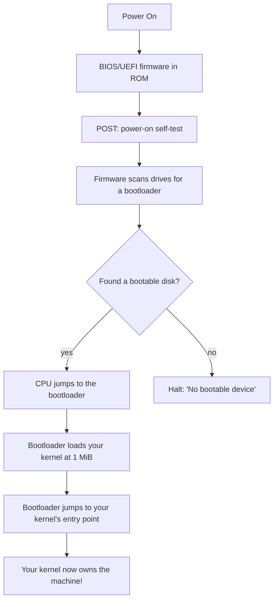
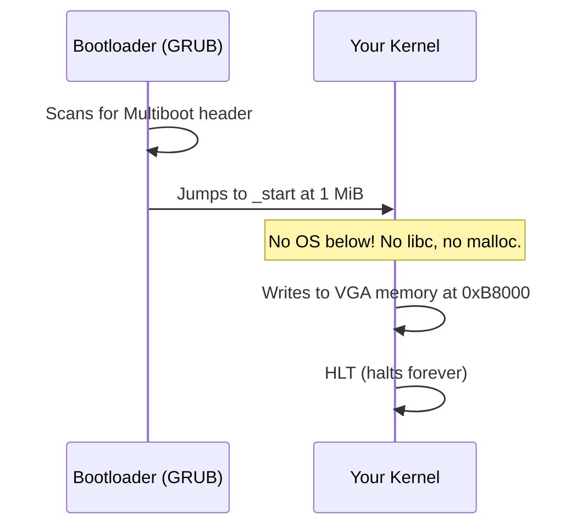
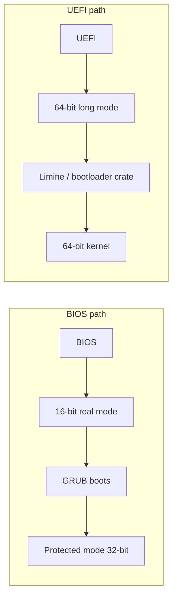

# Chapter 00 — How a Computer Boots

*Original content written for OSDev_Learning_Hub.*

Before you write a single line of kernel code, you need to know what your code is actually doing when the machine starts. This chapter strips the magic away.

---

## The story of a machine turning on

When you press the power button, the CPU doesn't know anything about operating systems, files, or disks yet. It follows a strict, ancient chain of events:



Let's unpack each step.

### 1. Firmware is the true first program
The **[BIOS](../../GLOSSARY/bios.md "The motherboard firmware that starts the machine and finds a bootloader")** (older) or **[UEFI](../../GLOSSARY/uefi.md "Modern firmware that boots into 64-bit long mode natively")** (newer) is software burned onto the motherboard, not stored on your disk. Its one job on boot: **find a [bootloader](../../GLOSSARY/bootloader.md "A small program that loads your kernel into memory and jumps to it") and run it**.

### 2. The bootloader is not your kernel
A **[bootloader](../../GLOSSARY/bootloader.md "A small program that loads your kernel into memory and jumps to it")** ([GRUB](../../GLOSSARY/grub.md "The free GNU bootloader that loads Multiboot kernels"), [Limine](../../GLOSSARY/limine.md "A modern bootloader supporting Multiboot 2 and 64-bit kernels"), or the Rust `bootloader` crate) is a small program whose job is to:
- set the CPU into a sane, known state (32-bit [protected mode](../../GLOSSARY/protected-mode.md "The 32-bit CPU mode Multiboot v1 kernels run in"), later 64-bit [long mode](../../GLOSSARY/long-mode.md "The 64-bit CPU mode modern kernels run in")),
- load your kernel image from disk into RAM,
- and `jmp` to your kernel's [entry point](../../GLOSSARY/entry-point.md "The symbol (usually _start) the bootloader jumps to").

You don't have to be a bootloader expert to write an OS — you just have to produce a kernel the bootloader can find. On [x86](../../GLOSSARY/x86.md "The CPU architecture family this hub targets") that means speaking the **Multiboot protocol**.

### 3. Multiboot — the "hello" handshake
The **Multiboot** spec says: *"If you want a standard bootloader to load you, put a magic header at the very start of your kernel image."*

```
0x1BADB002   <- "magic" number the bootloader looks for
```

A kernel that carries this header at its start can be booted by GRUB on real hardware *and* by [QEMU](../../GLOSSARY/qemu.md "A free emulator you can boot your kernel in for testing") for testing. Every "bare bones" tutorial — C, C++, Go — starts by writing this header in assembly.

### 4. Your kernel takes over
Once the bootloader jumps to `_start`, there is **no operating system underneath you anymore**. The `printf` you used in your first C program? Gone. `malloc`? Gone. Threads, files, network? None of it exists until **you** build it.

This is the single most surprising fact for a beginner: **a kernel is just a program that runs on raw hardware.**



---

## Two firmware worlds in one diagram



- **BIOS** is old, simple, and universally supported (even modern UEFI machines emulate it). It boots into a 16-bit mode first.
- **UEFI** is modern and 64-bit native, but more complex.

For learning, **BIOS + GRUB/Multiboot** (or the Rust `bootloader` crate) is the smoothest path. That's what this hub uses.

---

## Key terms to remember
| Term | Meaning |
|------|---------|
| **Firmware** | Software on the motherboard (BIOS/UEFI) that starts the machine |
| **Bootloader** | Program that loads and jumps to your kernel |
| **Entry point** | The symbol (usually `_start`) the bootloader jumps to |
| **Multiboot** | The protocol a kernel uses so a bootloader can find & load it |
| **`0x1BADB002`** | The Multiboot magic number |
| **1 MiB** | The conventional address where kernels are loaded |

> **Next:** [`02-your-toolchain.md`](02-your-toolchain.md) — the compiler, assembler, linker, and emulator you'll use.

## Watch and learn

<details class="video-embed">
<summary>▶ Watch: How Computers BOOT: From Startup to Viruses</summary>
<iframe src="https://www.youtube-nocookie.com/embed/rmgla4yeCXw" title="How Computers BOOT: From Startup to Viruses" width="100%" height="400" style="border:0;border-radius:8px;" allow="accelerometer; autoplay; clipboard-write; encrypted-media; gyroscope; picture-in-picture; web-share" allowfullscreen></iframe>
<p class=video-caption>Computerphile's walk through the entire boot sequence, from power-on reset to handing control to the OS.</p>
</details>
<details class="video-embed">
<summary>▶ Watch: What is Bootstrapping Anyway?</summary>
<iframe src="https://www.youtube-nocookie.com/embed/Pu7LvnxV6N0" title="What is Bootstrapping Anyway?" width="100%" height="400" style="border:0;border-radius:8px;" allow="accelerometer; autoplay; clipboard-write; encrypted-media; gyroscope; picture-in-picture; web-share" allowfullscreen></iframe>
<p class=video-caption>Matt Godbolt builds up the bootstrap chain to show where the very first code on a machine comes from.</p>
</details>
<details class="video-embed">
<summary>▶ Watch: OS development 101 - How to make a bootloader part 1 - Hello World</summary>
<iframe src="https://www.youtube-nocookie.com/embed/E_n0VtGSZQY" title="OS development 101 - How to make a bootloader part 1 - Hello World" width="100%" height="400" style="border:0;border-radius:8px;" allow="accelerometer; autoplay; clipboard-write; encrypted-media; gyroscope; picture-in-picture; web-share" allowfullscreen></iframe>
<p class=video-caption>Low Level Learning covers what happens at PC startup and real mode before writing bootable code.</p>
</details>
