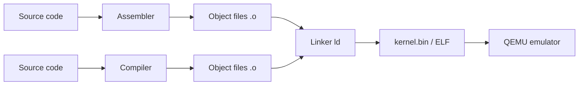
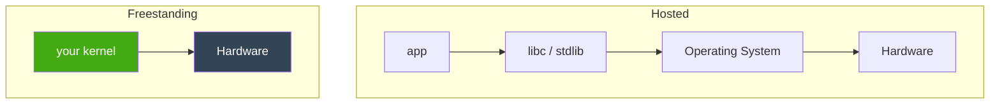

# Chapter 00 — Your Toolchain

*Original content written for OSDev_Learning_Hub.*

A kernel developer's life revolves around four tools. Understanding *why each one exists* will save you hours of confusion — these are the exact tools the Phase 1 books (os01, OSDev wiki) teach you to master.

---

## The four pillars



| Tool | What it does | Why you need it |
|------|--------------|-----------------|
| **[Assembler](../../GLOSSARY/assembler.md "Turns assembly language into machine-code object files")** (NASM / GNU `as`) | Turns `boot.s` assembly into machine-code object files | You write 30-50 lines of assembly for the boot entry + Multiboot header |
| **Compiler** (`gcc` / `g++` / `rustc` / `gccgo` / `dotnet`) | Turns high-level source into assembly/object files | Your kernel's real logic lives in a high-level language |
| **[Linker](../../GLOSSARY/linker.md "Merges object files into one image at a chosen address")** (`ld`) | Glues object files into one kernel image at a chosen address | You control *where* the kernel loads (1 MiB) via a **[linker script](../../GLOSSARY/linker.md "Merges object files into one image at a chosen address")** |
| **Emulator** ([QEMU](../../GLOSSARY/qemu.md "A free emulator you can boot your kernel in for testing")) | Runs your kernel like a real PC, but safely | You can't test on real hardware every minute; QEMU boots instantly |

---

## 1. The assembler — because the boot story is assembly

The CPU's very first steps are raw and simple, which is why the [entry point](../../GLOSSARY/entry-point.md "The symbol (usually _start) the bootloader jumps to") is written in **assembly** — even in the Rust and C++ tutorials. Assembly lets you:
- emit the Multiboot header bytes exactly,
- set up a stack pointer,
- call the high-level `_start`/`main` function.

You don't need to become an assembly wizard. You need *one* boilerplate file, and this hub gives it to you commented. Video-game-era reality: the CPU starts in **16-bit [real mode](../../GLOSSARY/real-mode.md "The 16-bit CPU mode x86 starts in, with no memory protection")** with no stack, so the very first instructions are about getting a stack and jumping to your compiled code.

## 2. The compiler — freestanding vs hosted

Here's the concept that ties *all five languages* together:

> A normal program is **[hosted](../../GLOSSARY/hosted.md "A normal program that assumes an OS and libc exist underneath")**: it assumes an OS + standard library exist. A kernel is **[freestanding](../../GLOSSARY/freestanding.md "Code compiled assuming no OS or standard library exists")**: it assumes *nothing*.

Compare:

```c
// HOSTED C — assumes an OS with a running libc
#include <stdio.h>
int main(void) { printf("hi\n"); return 0; }

// FREESTANDING C — no stdio, no libc, no main return-to-OS
void kernel_main(void) {
    // write directly to VGA memory at 0xB8000
    unsigned short* vga = (unsigned short*)0xB8000;
    vga[0] = 0x0F48; // 'H' in white-on-black
}
```

The same idea in every language:

| Language | Freestanding switch |
|----------|---------------------|
| C | `gcc -ffreestanding` |
| C++ | `g++ -ffreestanding -fno-exceptions -fno-rtti` |
| Rust | `#![no_std]` attribute |
| Go | `gccgo -nostdlib` (plus stub symbols) |
| C# | no direct equivalent — needs Cosmos/NativeAOT (see chapter 05) |



Your kernel talks to hardware **directly**. That's the whole point.

## 3. The linker — placing your kernel in memory

When your app `main()` returns, the OS cleans up. A kernel never returns, and it must be loaded at a *specific* address. You tell the linker where with a **linker script**:

```ld
ENTRY(_start)          /* entry point the bootloader jumps to */
SECTIONS {
    . = 1M;            /* load the kernel at 1 MiB */
    .text : { *(.multiboot) *(.text) }
    .rodata : { *(.rodata) }
    .data  : { *(.data) }
    .bss   : { *(COMMON) *(.bss) }
}
```

The `.multiboot` section must come first so the Magic Number is at the very front of the image.

## 4. QEMU — your safe test lab

```bash
qemu-system-i386 -kernel myos.bin     # 32-bit kernel
qemu-system-x86_64 -cdrom myos.iso    # boot an ISO
```

QEMU lets you boot your kernel *millions of times a day* without rebooting your PC. It's also scriptable, so your `Makefile` can build-and-boot in one command.

![Screenshot]: Add a screenshot here of QEMU showing a black window with "Hello World!" in white text.

---

## The command that puts it together (C)

```bash
nasm -f elf32 boot.s -o boot.o                 # assemble the boot stub
gcc -c kernel.c -o kernel.o -ffreestanding     # compile the C kernel
ld -T linker.ld -o myos.bin boot.o kernel.o    # link into one image
qemu-system-i386 -kernel myos.bin              # boot it!
```

That's the entire core loop. Everything else — Makefiles, ISO generation, [cross-compilers](../../GLOSSARY/cross-compiler.md "A compiler that builds code for a different CPU/OS than the one it runs on") — is polish on top of these four commands.

> **Next:** the shared concept chapters in [`../concepts/`](../concepts/).

## Watch and learn

<details class="video-embed">
<summary>▶ Watch: How C++ Works</summary>
<iframe src="https://www.youtube-nocookie.com/embed/SfGuIVzE_Os" title="How C++ Works" width="100%" height="400" style="border:0;border-radius:8px;" allow="accelerometer; autoplay; clipboard-write; encrypted-media; gyroscope; picture-in-picture; web-share" allowfullscreen></iframe>
<p class=video-caption>The Cherno explains how source files become an executable, covering the preprocessor, compiler, and linker roles.</p>
</details>
<details class="video-embed">
<summary>▶ Watch: How the C++ Compiler Works</summary>
<iframe src="https://www.youtube-nocookie.com/embed/3tIqpEmWMLI" title="How the C++ Compiler Works" width="100%" height="400" style="border:0;border-radius:8px;" allow="accelerometer; autoplay; clipboard-write; encrypted-media; gyroscope; picture-in-picture; web-share" allowfullscreen></iframe>
<p class=video-caption>A deep dive into compiling: preprocessing, tokenizing, the abstract syntax tree, and object files.</p>
</details>
<details class="video-embed">
<summary>▶ Watch: Machine Code Explained</summary>
<iframe src="https://www.youtube-nocookie.com/embed/8VsiYWW9r48" title="Machine Code Explained" width="100%" height="400" style="border:0;border-radius:8px;" allow="accelerometer; autoplay; clipboard-write; encrypted-media; gyroscope; picture-in-picture; web-share" allowfullscreen></iframe>
<p class=video-caption>Computerphile's Matt Godbolt takes you from machine code up, the language the CPU actually executes.</p>
</details>
<details class="video-embed">
<summary>▶ Watch: How CPUs Do Math(s)</summary>
<iframe src="https://www.youtube-nocookie.com/embed/nhXevKMm3JI" title="How CPUs Do Math(s)" width="100%" height="400" style="border:0;border-radius:8px;" allow="accelerometer; autoplay; clipboard-write; encrypted-media; gyroscope; picture-in-picture; web-share" allowfullscreen></iframe>
<p class=video-caption>Matt Godbolt shows how the CPU executes arithmetic at the gate level, tying together all the tools in your toolchain.</p>
</details>
<details class="video-embed">
<summary>▶ Watch: How the C++ Linker Works</summary>
<iframe src="https://www.youtube-nocookie.com/embed/H4s55GgAg0I" title="How the C++ Linker Works" width="100%" height="400" style="border:0;border-radius:8px;" allow="accelerometer; autoplay; clipboard-write; encrypted-media; gyroscope; picture-in-picture; web-share" allowfullscreen></iframe>
<p class=video-caption>The Cherno covers the third pillar of this chapter: how the linker merges object files into one binary and places your entry point — exactly what controls where your kernel loads.</p>
</details>

**More toolchain picks**
- ▶ [Machine Code Explained (Computerphile)](https://www.youtube-nocookie.com/embed/8VsiYWW9r48) — already above; the ground truth for what all four tools ultimately produce.
- The commands at the top of this chapter are all you need — [`Writing an OS in Rust — A Freestanding Rust Binary`](https://os.phil-opp.com/freestanding-rust-binary/) shows the same four pillars in a language without `-ffreestanding` style flags.

---

## Further reading

- [OSDev Wiki — GCC Cross-Compiler](https://wiki.osdev.org/GCC_Cross-Compiler) — the toolchain page par excellence; why you eventually want a compiler that targets your kernel's CPU, not your host.
- [OSDev Wiki — Bare Bones](https://wiki.osdev.org/Bare_Bones) — the full `nasm → gcc → ld → qemu` sequence applied to an actual kernel.
- [OSDev Wiki — Tutorials](https://wiki.osdev.org/Tutorials) — every environment/setup guide in one place, including toolchain prerequisites.
- [Writing an OS in Rust — A Freestanding Rust Binary](https://os.phil-opp.com/freestanding-rust-binary/) — what "freestanding" really means, with a concrete build.
- [nanobyte-dev/nanobyte_os (GitHub)](https://github.com/nanobyte-dev/nanobyte_os) — a real OS project whose build scripts download and compile their own GCC toolchain, as this chapter describes.

---

## Two traps beginners hit here

1. **A host GCC vs a cross-compiler.** On a 32-bit machine a host GCC usually just works; on 64-bit it can silently produce 64-bit objects that won't boot as a Multiboot kernel — use `-m32` / `-ffreestanding` today, and plan for a real [cross-compiler](https://wiki.osdev.org/GCC_Cross-Compiler) later.
2. **Ordering in the linker script.** The `.multiboot` section must be *first* in the output, or the magic number isn't at the front of the file and GRUB can't find your header. Reorder sections, and always re-check with `readelf`/`objdump` after linking.


---

## Deep dive: each pillar, in the order you'll actually use it

The four pillars are a *pipeline*: source → object files → one linked image → a running emulator. But you'll also use them in a particular rhythm while developing. Let's walk each one with the detail you need to actually drive it, not just recognize it.

### Pillar 1, in depth — the assembler and why 30 lines of it

Even in a Rust project, you will see an assembly stub. The reason is architectural, not stylistic: **the CPU boots into a state no high-level compiler understands** — no protected mode set up, no GDT, and crucially **no stack pointer**. A C function call assumes the caller pushed a return address onto a valid stack. Before you have a stack, the very first `call` lands on garbage and the machine faults.

So the bootstrap stub, in whatever language family you choose, always does these three things in assembly:

```nasm
; boot.s — the three things only assembly can guarantee happen first
section .multiboot      ; the Multiboot handshake (see concepts/01)
align 4
    dd 0x1BADB002
    dd 0x03
    dd -(0x1BADB002 + 0x03)

section .bss
align 16
stack_bottom: resb 16384
stack_top:

section .text
global _start
_start:
    mov esp, stack_top   ; 1. establish a stack
    extern kernel_main
    call kernel_main     ; 2. call the high-level kernel
    cli                  ; 3. finish: disable interrupts, halt
    hlt
```

NASM is the assembler this hub uses (`nasm -f elf32 boot.s -o boot.o`). It's beginner-friendly and produces the ELF object files your linker expects. You truly need only the handful of directives above: `section`, `align`, `dd`/`resb`, `global`, `extern`, `mov`/`call`/`cli`/`hlt`. That is the entire assembly surface a modern kernel writer needs for the bootstrap.

### Pillar 2, in depth — freestanding means "don't rescue me"

The single most confusing flag for newcomers is `-ffreestanding` (or `#![no_std]` in Rust). Here's what it really toggles:

- **Normal C** assumes a hosted environment: a libc with `printf`, `malloc`, a runtime `_start` that calls `main` and then `exit`s back to the OS.
- **Freestanding C** tells the compiler: *there is no libc, no OS, and `main` (or your kernel entry) will never return.* The compiler stops generating code that assumes those things — e.g. it keeps using `memcpy` builtins but won't link in a startup file.

```c
// hosted: the OS cleans up after main returns
#include <stdio.h>
int main(void){ printf("hi\n"); return 0; }

// freestanding: no stdio, no return-to-OS
void kernel_main(void){
    volatile unsigned short* vga = (unsigned short*)0xB8000;
    vga[0] = 0x0F48; // 'H'
}
```

A common beginner mistake: writing `printf` into a freestanding kernel. There is no `printf` in freestanding C — you either write directly to `0xB8000` or implement your own `printf`. That's precisely why the VGA concept chapter exists.

### Pillar 3, in depth — the linker is where the kernel gets its home

Your app's linker doesn't care *where* code lives. Your kernel's linker cares enormously: the bootloader will read those addresses. Two linker-script concepts are non-negotiable:

**`ENTRY(_start)`** names the symbol the bootloader should jump to. If boot.s exports `_start` but the linker script's `ENTRY` points elsewhere (or you forgot it), the ELF header's entry will be wrong and GRUB jumps into nothing.

**`. = 1M;`** sets the load address of the kernel's first section. As chapters 00 and concepts/01 explain, everything below 1 MiB is legacy territory. You place the kernel at 1 MiB so it doesn't stomp the IVT, the VGA buffer, or the BIOS data area.

```ld
ENTRY(_start)
SECTIONS {
    . = 1M;
    .text : { *(.multiboot) *(.text) }
    .rodata : { *(.rodata) }
    .data  : { *(.data) }
    .bss   : { *(COMMON) *(.bss) }
}
```

Notice the order inside `.text`: `*(.multiboot)` **first**. The bootloader scans the beginning of the image for the magic `0x1BADB002`; if a later section precedes it, the handshake fails.

### Pillar 4, in depth — why QEMU beats real hardware (for now)

Real hardware is unforgiving and slow to reboot. QEMU is fast, scriptable, and — most importantly — **inspectable**. Three QEMU capabilities you will lean on constantly:

| QEMU trick | Command | Why you'll use it |
|------------|---------|--------------------|
| Freeze at reset, attach a debugger | `-s -S` | Walk `_start` with GDB, step every kernel instruction |
| Dump exceptions/resets | `-d int,cpu_reset` | See the triple fault that's silently resetting you |
| Dump CPU registers at a crash | `-d cpu_reset -monitor stdio` | Read registers at the moment your kernel died |

```bash
# The daily dev loop that makes everything below possible
qemu-system-i386 -kernel myos.bin -s -S &   # boot, but pause at reset
gdb myos.bin                                # attach the debugger
(gdb) target remote :1234
(gdb) break _start
(gdb) continue
```

QEMU also *coexists* with your real machine: when something smells hardware-specific, you can later boot the same image in QEMU, on an old laptop in BIOS mode, or inside VirtualBox — without changing your toolchain.

---

## The cross-compiler question (deserve a section of their own)

In chapter 00 and concepts you'll hear "[cross-compilers](../../GLOSSARY/cross-compiler.md "A compiler that builds code for a different CPU/OS than the one it runs on")" mentioned. Here's the honest, beginner-sized version:

A **host GCC** builds executables for *your* OS and CPU. It quietly assumes a libc and OS target — which is wrong for a kernel. Two ways out:

1. **Today (quick):** use your host GCC with the right flags: `gcc -m32 -ffreestanding -nostdlib -fno-builtin -c kernel.c`. This works for the small 32-bit kernels this hub teaches, but it's fragile — the host compiler can slip in assumptions you didn't ask for.
2. **Later (proper):** build a dedicated cross-compiler (`i686-elf-gcc`) that targets a "bare" ELF environment with no OS assumptions baked in. This is the standard OS-dev practice and what the OSDev wiki's *GCC Cross-Compiler* page teaches.

```bash
# Outline of building a cross-compiler (the wiki gives the full recipe)
export PREFIX="$HOME/opt/cross"
export TARGET=i686-elf
export PATH="$PREFIX/bin:$PATH"
# ... configure & build binutils ...
# ... configure & build gcc with --target=$TARGET --without-headers ...
$TARGET-gcc -ffreestanding -c kernel.c -o kernel.o
```

You do **not** need a cross-compiler to start this hub. But when your kernel stops booting on 64-bit hosts because the 64-bit host GCC emitted 64-bit code, you'll know why people say "build a cross-compiler." Use `-m32` philosophy if nothing else.

---

## Common pitfalls in the toolchain

1. **64-bit objects no one asked for.** On a 64-bit Linux/macOS machine, plain `gcc -c kernel.c` emits 64-bit object files. A Multiboot *32-bit* kernel won't link or boot. Fix: `-m32 -ffreestanding`, or use a `i686` cross-compiler.
2. **`.multiboot` not first.** If it's not the first section in the output image, the magic number isn't at the front and GRUB rejects the kernel. Check with `readelf -S` / `objdump -h`.
3. **Missing `.rodata` in the linker script.** Your string literals ("Hello World!") live in `.rodata`. If the linker script omits `.rodata`, those strings silently don't land in the binary and you print garbage. This is *extremely* common.
4. **`ENTRY(_start)` mismatch.** `_start` in boot.s must match `ENTRY(_start)` in the linker script. A typo (`_Start`, `start`, `kernel_main`) produces a wrong entry point and a jump into the void.
5. **Using `-nostdlib` without `-ffreestanding`.** They're different. `-nostdlib` says "don't link the startup files"; `-ffreestanding` tells the compiler's *code generation* to stop assuming a host. Use both.
6. **Typing `_start` as `main`.** A kernel has no `main`; the entry is your own symbol. Naming it `main` only confuses both you and the linker.

---

## Learning checkpoints

- [ ] **I can name all four pillars** and say what each one consumes and produces (source → object → image → running machine).
- [ ] **I can write the `nasm → gcc → ld → qemu`** sequence from memory for a small C kernel.
- [ ] **I can explain `-ffreestanding`** to a friend, including why `printf` doesn't exist in a freestanding kernel.
- [ ] **I know why `_start` and `ENTRY(_start)`** must match, and why 1 MiB is the load address.
- [ ] **I can use QEMU's `-s -S`** to attach GDB and stop at `_start`.
- [ ] **I can verify with `readelf`** that the Multiboot magic sits at the start of the image.
- [ ] **I understand the difference** between a quick host-GCC + flags setup and a proper cross-compiler, and when each is right.

---

## Watch more

<details class="video-embed">
<summary>▶ Watch: How CPU Memory & Caches Work - Computerphile</summary>
<iframe src="https://www.youtube-nocookie.com/embed/SAk-6gVkio0" title="How CPU Memory & Caches Work - Computerphile" width="100%" height="400" style="border:0;border-radius:8px;" allow="accelerometer; autoplay; clipboard-write; encrypted-media; gyroscope; picture-in-picture; web-share" allowfullscreen></iframe>
<p class=video-caption>Matt Godbolt on the memory/cache hierarchy your compiled kernel ultimately runs against — grounding for why the linker places code at a specific address.</p>
</details>
<details class="video-embed">
<summary>▶ Watch: Inside the CPU - Computerphile</summary>
<iframe src="https://www.youtube-nocookie.com/embed/IAkj32VPcUE" title="Inside the CPU - Computerphile" width="100%" height="400" style="border:0;border-radius:8px;" allow="accelerometer; autoplay; clipboard-write; encrypted-media; gyroscope; picture-in-picture; web-share" allowfullscreen></iframe>
<p class=video-caption>The operations at the heart of the CPU that your assembler's instructions and your compiler's output both reduce to.</p>
</details>
<details class="video-embed">
<summary>▶ Watch: Write Your Own Operating System in 1 Hour</summary>
<iframe src="https://www.youtube-nocookie.com/embed/1rnA6wpF0o4" title="Write Your Own Operating System in 1 Hour" width="100%" height="400" style="border:0;border-radius:8px;" allow="accelerometer; autoplay; clipboard-write; encrypted-media; gyroscope; picture-in-picture; web-share" allowfullscreen></iframe>
<p class=video-caption>A live session driving the exact four commands of this chapter (assemble, compile, link, boot) to get a working kernel on screen.</p>
</details>

**Even more toolchain picks**
- ▶ [Machine Code Explained (Computerphile)](https://www.youtube-nocookie.com/embed/8VsiYWW9r48) — revisited: see the output your compiler and assembler actually produce.
- The full [OSDev wiki GCC Cross-Compiler](https://wiki.osdev.org/GCC_Cross-Compiler) page remains the definitive guide to the "proper" toolchain path.

## From this chapter to the next

You now hold the actual *tools*. Chapter 00 taught you what the machine does at boot; this chapter taught you which tool handles each piece (assembler for the entry stub, compiler for the kernel logic, linker for placement, QEMU for testing). The next door is the shared concept chapters — starting with bootloaders & Multiboot, which ties the *what* (boot) and the *how* (toolchain) together by showing you the exact header those four tools jointly produce.


---

## Automate it: the Makefile that turns four commands into one

Typing `nasm → gcc → ld → qemu` by hand gets old by the second kernel. A `Makefile` turns it back into one command. This is also precisely the shape of the `make run-c` style commands used throughout this hub's language walkthroughs.

```makefile
# Makefile — assemble, compile with freestanding flags, link, boot
C_SOURCES = kernel.c
ASM_SOURCES = boot.s

CFLAGS = -ffreestanding -nostdlib -fno-builtin -m32 -g
LDFLAGS = -T linker.ld -m elf_i386

kernel.bin: boot.o kernel.o
	ld $(LDFLAGS) -o $@ $^

boot.o: boot.s
	nasm -f elf32 $< -o $@

kernel.o: kernel.c
	gcc $(CFLAGS) -c $< -o $@

run: kernel.bin
	qemu-system-i386 -kernel $<

clean:
	rm -f *.o kernel.bin

.PHONY: run clean
```

Now the entire OS-dev workflow is:

```bash
make            # build the kernel image
make run        # boot it in QEMU
make clean      # start over
```

The three flags worth memorizing here are `-ffreestanding` (no libc assumptions), `-nostdlib` (don't link startup code), and `-m32` (stay 32-bit on a 64-bit host). Almost every kernel eyeball-ache in the beginner world is one of those three being wrong.

**A warning about `-m elf_i386`.** If you build on a modern 64-bit system, GNU `ld` may default to 64-bit ELF output. Passing `-m elf_i386` forces a 32-bit image — necessary unless you've moved to a `x86_64` target and linker script. Forgetting it produces a linker error like "file format not recognized," which is a hint it's about to save you from a subtly wrong binary.

## The object-file journey, with a microscope

Between writing `kernel.c` and seeing `Hello World!`, four separate file formats exist. Knowing them helps you read tool errors:

| Step | Command | Output | What it is |
|------|---------|--------|-----------|
| Preprocess + compile | `gcc -S kernel.c` | `kernel.s` | human-readable assembly |
| Assemble | `gcc -c kernel.c` | `kernel.o` | **relocatable** object (ELF `ET_REL`) |
| Link | `ld -T linker.ld ...` | `kernel.bin` | **executable** image (ELF `ET_EXEC` or flat) |
| Load | `qemu -kernel` | running kernel | bootloader parses the ELF segments |

The middle step matters most: an object file (`kernel.o`) is *relocatable* — its addresses are placeholders the linker will fill in. Only after `ld` (with your linker script) do you get a file with the *final* addresses the bootloader reads. That's why you check the final binary with `readelf`, not the object:

```bash
readelf -h kernel.bin    # confirms the entry point (_start) and ELF type
readelf -S kernel.bin    # confirms .multiboot is the FIRST section
objdump -d kernel.bin    # confirms the instructions are actually there
```

If `readelf -h` shows an entry point of `0x0` or the wrong symbol, your `ENTRY(_start)` is mismatched. If `.multiboot` isn't section #1, GRUB can't find the handshake. These two five-second checks catch the two most common toolchain failures before you ever boot.

## Hosted vs freestanding, the table you'll reference forever

The idea that ties all five languages together deserves a fuller comparison. Here's how "I assume an OS exists" vs "I assume nothing," spelled out for every tool in your chain:

| Concern | Hosted program | Freestanding kernel |
|---------|----------------|---------------------|
| Entry point | `_start` provided by a runtime → calls `main` | **you** define `_start` (in boot.s) |
| Return | `main` returns → runtime calls `exit` | never returns; ends in `hlt` |
| Standard library | libc linked in (printf, malloc, ...) | **none** — you write to `0xB8000` yourself |
| Static init | runtime runs `__libc_start_main` | you do your own (or skip it) |
| C++ | constructors via runtime | you must run `__cxa_atexit`/constructors yourself or disable RTTI/exceptions |
| Rust | `std` initializes | `#![no_std]`, `core` only, `unsafe` for raw pointers |
| Go | runtime bootstraps goroutine scheduler | runtime needs tons of stubs — one reason Go is harder bare-metal |
| C# | CLR/GC runtime required | needs Cosmos/NativeAOT to provide a runtime |

The takeaway repeated throughout this hub: **switching language changes the syntax and the build flags, but never the four pillars or the freestanding reality.** The pillar diagram from the top of this chapter holds for C, C++, Rust, Go, and C# alike.

## Reading a linker error (so they stop being scary)

Linker errors look cryptic but are almost always one of four things:

```
error: undefined reference to 'kernel_main'
```
You declared `extern kernel_main` in boot.s but never defined it (or spelled it differently, or the C file isn't linked). Check every translation unit is on the `ld` command line.

```
error: negative number "..." in link directive  /  "invalid character" in linker script
```
A typo in `linker.ld` — usually a stray character or unbalanced brace. The linker script is read line by line; the error names the location.

```
ld: file format not recognized; treating as linker script input
```
A 64/32-bit mismatch: an object file's format doesn't match the linker's target. Force `-m elf_i386` (or use matching `-m32` flags and object files).

```
error: section .bss will not fit in region? (custom) 
```
Your linker script's layout doesn't have room — often because `. = 1M;` and a too-small image or a region you forgot. For simple kernels, the canonical script in this chapter avoids region declarations entirely.

Ninety percent of the time, a linker error names the *exact* symbol or section that's wrong. Read the first line, don't panic, and check `ENTRY`, section order, and spelling.

## Toolchain troubleshooting flow (debug mind-map)

When the kernel boots but *something is off* — no output, garbage screen, instant reset — follow this order, using the tools you just learned:

1. **Did it link?** `readelf -h kernel.bin`: entry point correct? `.multiboot` first section?
2. **Did it load?** Boot with `qemu -d int,cpu_reset`: does the CPU fault immediately (missing stack / wrong mode) or reach `_start`?
3. **Is your C even running?** Temporarily make `kernel_main` write a solid colored block to `0xB8000` (fill 2000 cells). If you see color, the kernel runs but your print function is buggy. If you see nothing, the kernel isn't reaching your code at all.
4. **Is it a print bug or a memory bug?** Was `.rodata` included in the linker script? Your string literals may be missing from the image (pitfall #3 above).
5. **Attach GDB** (`-s -S` + `break _start` + `continue`). Step a few instructions and watch registers. The kernel either runs or it doesn't; the debugger tells you which in seconds.

This mind-map turns "my OS doesn't work" (terrifying) into a short checklist (totally manageable). Keep it — you'll use it in every chapter of this hub.

## A final note on Rust, Go, and C# specifics

Because this hub covers five languages, a few toolchain notes per language are worth flagging up front (each language walkthrough in `01-c/` → `05-csharp/` goes deeper):

- **Rust** uses the `bootloader` crate to avoid hand-writing `boot.s`. The freestanding switch is `#![no_std] #![no_main]` plus a custom panic handler. You still get the same four pillars — they're just wrapped in crates and a build script.
- **Go** (`gccgo`) needs `-nostdlib` and stub symbols, and its GC runtime wants a lot of bare-metal support. The `run-go` path in this hub shows the minimal dance.
- **C#** has no bare-metal equivalent without a framework: Cosmos provides its own runtime and boot path, so the "toolchain" is Visual Studio + a Cosmos project rather than `nasm → gcc → ld`. Same concepts, radically different plumbing.

**Rule of four pillars: no language escapes them.** The assembler, compiler, linker, and emulator are the four walls of the room every OS sits in.


---

## Worked example: the "missing .rodata" mystery you will hit

This is the single most common "my kernel prints garbage" bug, so it deserves a full walkthrough. Consider this tiny kernel:

```c
void kernel_main(void) {
    volatile unsigned short* vga = (unsigned short*)0xB8000;
    const char* msg = "Hello World!";
    for (int i = 0; msg[i]; i++)
        vga[i] = (0x0F << 8) | msg[i];
    for(;;);
}
```

Assuming every other tool is right, this **can still print garbage or nothing**, and the root cause is invisible from the C source alone. The string `"Hello World!"` is a string literal; the compiler places string literals in a **`.rodata`** (read-only data) section. Now look at a *minimal* linker script that omitted it:

```ld
ENTRY(_start)
SECTIONS {
    . = 1M;
    .text : { *(.multiboot) *(.text) }
    .data : { *(.data) }
    .bss  : { *(COMMON) *(.bss) }
}
```

`.rodata` is **not listed**, so its contents are not emitted into the final binary. The kernel's `_start` runs, `kernel_main` runs, `vga[i] = ...` reads bytes from where `.rodata` *should* be — but that memory is uninitialized garbage. Result: either nothing prints or you see random characters.

**The fix** is to include `.rodata` in the linker script (exactly what the canonical script at the top of this chapter shows):

```ld
    .rodata : { *(.rodata) }
```

Why do string literals live in a separate read-only section? So the OS/kernel can mark that memory read-only and catch accidental writes. But the *immediate* lesson is practical: **if your strings render as garbage, check that `.rodata` is in your linker script, then verify with `readelf -S` that it's present in the image.**

```bash
readelf -S kernel.bin | grep rodata   # if nothing prints, it's missing
```

This one checklist item has rescued countless first kernels. Put it in memory.

## Why "Hello World" is the honest first goal

There is a strong temptation to skip straight to a fancy UI or a filesystem. Resist it: writing "Hello World!" to `0xB8000` via the exact toolchain in this chapter is a *test of the entire stack*, not a toy. It proves:

1. the assembler produced a valid boot stub,
2. the compiler produced freestanding kernel code,
3. the linker placed everything correctly,
4. the bootloader recognized and loaded it, and
5. QEMU emulates enough of a PC to run it.

Each of those is a separate failure domain. If you can't get "Hello World!" onto the screen, you have no hope of debugging a filesystem — so the humble hello-world *is* the first milestone, not a detour. Everything after it (VGA drivers, interrupts, memory management, scheduling) layers new code on top of a proven-true toolchain.

This is exactly why the hub's structure is: chapter 00 (the machine) → chapter 02 (the tools) → shared concepts (bootloaders, memory, interrupts, VGA) → the "Hello World of OSes" recipe → then per-language walkthroughs. Each rung validates the rung below.

## When you outgrow `-kernel` and want a real disk

`qemu-system-i386 -kernel myos.bin` is the fastest test loop, but it only works because QEMU has a built-in Multiboot loader. Real machines and real GRUB need an actual disk/ISO. When you're ready, the toolchain extends to ISO-building:

```bash
# Put your kernel where GRUB can find it, then build a bootable ISO
mkdir -p iso/boot/grub
cp kernel.bin iso/boot/kernel.bin
cat > iso/boot/grub/grub.cfg <<'EOF'
menuentry "MyOS" {
    multiboot2 /boot/kernel.bin
    boot
}
EOF
grub-mkrescue -o myos.iso iso/
qemu-system-i386 -cdrom myos.iso
```

Now you're boots a *real* bootloader off a *real* (emulated) disc — the same path your kernel takes on actual hardware. The four pillars haven't changed; you've just added `grub-mkrescue` as the "package" step between `ld` and `qemu`. This is the same machinery the Rust `bootloader` crate and the other language build scripts automate.

## The four pillars in one mental image

Keep this in your head and the whole toolchain stops being four disjoint programs and becomes one pipeline:

```
kernel.c ──gcc -ffreestanding──► kernel.o ┐
                                          ├─ ld -T linker.ld ─► kernel.bin ─► qemu -kernel
boot.s  ──nasm -f elf32───────► boot.o  ─┘
```

- **Assembler** turns your 30 lines of bootstrap into an object file (`.o`).
- **Compiler** turns your kernel logic into another object file, without assuming an OS (`-ffreestanding`).
- **Linker** merges the objects into one image at a chosen address (1 MiB), honoring your `ENTRY(_start)` and section order.
- **Emulator** (QEMU) boots that image like a real PC, so you can test thousands of times a day.

Change the language and only the compiler and its flags change; the assembler, linker script, and QEMU stay structurally the same. That invariance is why every path in this hub feels familiar after you've done one.

## Learning checkpoint recap — the must-knows

If you only retain five things from this chapter, make them:

1. **Four tools, one pipeline:** source → `nasm`/`gcc` → objects → `ld` → image → `qemu`.
2. **Freestanding means "no OS below me":** `-ffreestanding -nostdlib -fno-builtin`, and no `printf`.
3. **The linker places your kernel:** `ENTRY(_start)`, `. = 1M`, and `.multiboot` first — then verify with `readelf`.
4. **QEMU is your debug lab:** `-s -S` + GDB, and `-d int` to read faults.
5. **Strings live in `.rodata`:** include it in the linker script or they vanish (garbage output).

Master those and you can follow — and adapt — every `nasm → gcc → ld → qemu` sequence in this hub and beyond.

---

## Quick reference: the commands you'll type every day

Pin this box somewhere. It is the distilled essence of the chapter — the four commands plus the three verification commands that keep you sane:

```bash
# BUILD (the core loop)
nasm -f elf32 boot.s -o boot.o
gcc -ffreestanding -nostdlib -fno-builtin -m32 -c kernel.c -o kernel.o
ld -T linker.ld -m elf_i386 -o kernel.bin boot.o kernel.o

# BOOT
qemu-system-i386 -kernel kernel.bin

# VERIFY (catch the two classic bugs before they bite)
readelf -h kernel.bin        # entry point should be _start's address, not 0x0
readelf -S kernel.bin        # .multiboot should be the FIRST section

# DEBUG (when the window flashes and dies)
qemu-system-i386 -kernel kernel.bin -d int,cpu_reset   # read the fault
qemu-system-i386 -kernel kernel.bin -s -S              # attach GDB, break _start
```

Keep this beside you, memorize the *why* behind each flag, and the toolchain stops being a source of confusion and becomes a set of levers you control. With the machine (chapter 00) and the tools (this chapter) in hand, you're ready for the shared concept chapters — starting with bootloaders & the Multiboot protocol, which shows you the exact header these four tools jointly produce.

---

## 🧪 Exercises & Projects

The toolchain is four pillars — cross-compiler, assembler, linker, and a harness
(QEMU) — and the chapter's whole point is that a *wrong pillar* gives you a *distinct*
symptom. These exercises train you to read those symptoms. Prereq: the four-pillars map
in this chapter. Time estimates assume you can already run the build loop.

### Graded exercises

**Easy**

- [ ] **E1. Verify all four pillars** (~20 min). Run a one-line check for each: `i686-elf-gcc
      --version`, `i686-elf-as --version`, `i686-elf-ld --version`, `qemu-system-i386
      --version`. Note which *host* toolchain you also have and why the freestanding cross
      ones exist separately.
- [ ] **E2. `-ffreestanding` explained to a friend** (~30 min). Write a two-sentence
      explanation, then prove it: build your kernel *without* `-ffreestanding` and watch
      the toolchain pull in host startup/crt code — record the first new symbol that
      appears in `readelf -s kernel.bin`.
- [ ] **E3. The daily-commands card** (~15 min). Write a one-line-per-command cheat card:
      BUILD (nameman/cross-compile + link), BOOT (QEMU), VERIFY (`readelf -S` — is
      `.multiboot` first?), DEBUG (`-d int` / `-s -S`). Keep it beside you; the chapter
      ships the same card.

**Medium**

- [ ] **M1. Architect a cross-compiler's flags** (~1 hr). Take your build's compile line and
      explain *each* flag (`-m32`, `-ffreestanding`, `-fno-builtin`, `-nostdlib`, `-mno-*`
      stack flags). Add the *minimum* set for 64-bit and re-link/reboot. Note which
      additions you can't skip.
- [ ] **M2. Debug with `-d int,cpu_reset`** (~1 hr). Boot a *broken* kernel (intentionally
      no IDT + `sti`) and read the fault in the `-d int,cpu_reset` output. Write a 3-line
      "how to read this" reference for the next person. This is the highest-leverage
      diagnostic you'll have before GDB earns its keep.
- [ ] **M3. Makefile refactor** (~1.5 hr). Turn your ad-hoc commands into a tiny Makefile
      with `run`, `debug`, `clean`, and `iso` targets + variables for `CC`, `AS`, `LD`,
      `QEMU`. Confirm `make clean && make run` reproduces a fresh boot each time.

**Hard**

- [ ] **H1. Build the cross-compiler from source** (~4+ hr). Follow a GCC + binutils
      build (`--target=i686-elf --disable-nls --without-headers`) long enough to
      understand each `configure` knob, and confirm `i686-elf-gcc -print-libgcc-file-name`
      resolves. This removes the "where did my toolchain come from" mystery permanently.
- [ ] **H2. Trace a bad section with LLD vs ld** (~2 hr). Build `kernel.bin` with GNU ld
      *and* with LLD (or two linkers) and diff `readelf -S` output. Make `.multiboot`
      non-first in one and show how each linker lays it out differently — and what the
      boot symptom is in each case.

### ⭐ Mini-project — Reproducible multi-target build harness

**Goal.** A small, committed harness that builds the hello-world kernel for **both i386
and x86_64**, verifies the `.multiboot` section is first + entry is `_start` on both,
and boots each — so toolchain breakage manifests as a failing check, not a confusing black
screen. This is the "tools as a controlled lever" idea turned into automation.

**Estimated time:** 2–4 hr. **Prereq:** the working C build loop.

1. **Parameterize the Makefile.** `ARCH ?= i686` selecting `$(ARCH)-elf-gcc` etc.; put per-
      arch flags in a small table (i386 `-m32`, x86_64 the long-mode flag set + 64-bit
      code model).
2. **Verification steps as targets.** `verify` runs `readelf -h` (entry = `_start`),
      `readelf -S` (`.multiboot` first), and `file kernel.bin` (correct ELF class). Fail
      the build if any check trips.
3. **Boot test.** `boottest` boots each `kernel.bin` under QEMU with a short timeout and
      greps the VGA dump (the hub's `tools/read_vga_text.py` can help) for your banner.
4. **Matrix target.** `make matrix ARCH=i686 && make matrix ARCH=x86_64` builds both and
      produces a tiny `report.txt` of pass/fail per arch.
5. **Break it on purpose.** Temporarily remove `-ffreestanding`; confirm `verify` fails
      loudly with a specific message — then fix and re-run to green.
6. **Commit.** Script + Makefile + a `README` of what each target is for.

**Checklist**

- [ ] `ARCH` selection switches compiler/linker/flags cleanly
- [ ] `verify` fails on entry/section-class violations, not just builds
- [ ] `boottest` boots each arch and greps the banner
- [ ] `make matrix` produces a pass/fail `report.txt` for both arches
- [ ] deliberate breakage trips a specific verify error

