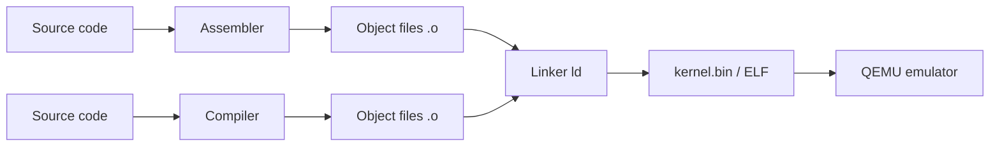
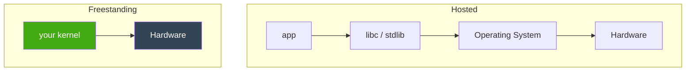

# Chapter 00 — Your Toolchain

*Original content written for OSDev_Learning_Hub.*

A kernel developer's life revolves around four tools. Understanding *why each one exists* will save you hours of confusion — these are the exact tools the Phase 1 books (os01, OSDev wiki) teach you to master.

---

## The four pillars



| Tool | What it does | Why you need it |
|------|--------------|-----------------|
| **[Assembler](../../GLOSSARY/assembler.md "Turns assembly language into machine-code object files")** (NASM / GNU `as`) | Turns `boot.s` assembly into machine-code object files | You write 30-50 lines of assembly for the boot entry + Multiboot header |
| **Compiler** (`gcc` / `g++` / `rustc` / `gccgo` / `dotnet`) | Turns high-level source into assembly/object files | Your kernel's real logic lives in a high-level language |
| **[Linker](../../GLOSSARY/linker.md "Merges object files into one image at a chosen address")** (`ld`) | Glues object files into one kernel image at a chosen address | You control *where* the kernel loads (1 MiB) via a **[linker script](../../GLOSSARY/linker.md "Merges object files into one image at a chosen address")** |
| **Emulator** ([QEMU](../../GLOSSARY/qemu.md "A free emulator you can boot your kernel in for testing")) | Runs your kernel like a real PC, but safely | You can't test on real hardware every minute; QEMU boots instantly |

---

## 1. The assembler — because the boot story is assembly

The CPU's very first steps are raw and simple, which is why the [entry point](../../GLOSSARY/entry-point.md "The symbol (usually _start) the bootloader jumps to") is written in **assembly** — even in the Rust and C++ tutorials. Assembly lets you:
- emit the Multiboot header bytes exactly,
- set up a stack pointer,
- call the high-level `_start`/`main` function.

You don't need to become an assembly wizard. You need *one* boilerplate file, and this hub gives it to you commented. Video-game-era reality: the CPU starts in **16-bit [real mode](../../GLOSSARY/real-mode.md "The 16-bit CPU mode x86 starts in, with no memory protection")** with no stack, so the very first instructions are about getting a stack and jumping to your compiled code.

## 2. The compiler — freestanding vs hosted

Here's the concept that ties *all five languages* together:

> A normal program is **[hosted](../../GLOSSARY/hosted.md "A normal program that assumes an OS and libc exist underneath")**: it assumes an OS + standard library exist. A kernel is **[freestanding](../../GLOSSARY/freestanding.md "Code compiled assuming no OS or standard library exists")**: it assumes *nothing*.

Compare:

```c
// HOSTED C — assumes an OS with a running libc
#include <stdio.h>
int main(void) { printf("hi\n"); return 0; }

// FREESTANDING C — no stdio, no libc, no main return-to-OS
void kernel_main(void) {
    // write directly to VGA memory at 0xB8000
    unsigned short* vga = (unsigned short*)0xB8000;
    vga[0] = 0x0F48; // 'H' in white-on-black
}
```

The same idea in every language:

| Language | Freestanding switch |
|----------|---------------------|
| C | `gcc -ffreestanding` |
| C++ | `g++ -ffreestanding -fno-exceptions -fno-rtti` |
| Rust | `#![no_std]` attribute |
| Go | `gccgo -nostdlib` (plus stub symbols) |
| C# | no direct equivalent — needs Cosmos/NativeAOT (see chapter 05) |



Your kernel talks to hardware **directly**. That's the whole point.

## 3. The linker — placing your kernel in memory

When your app `main()` returns, the OS cleans up. A kernel never returns, and it must be loaded at a *specific* address. You tell the linker where with a **linker script**:

```ld
ENTRY(_start)          /* entry point the bootloader jumps to */
SECTIONS {
    . = 1M;            /* load the kernel at 1 MiB */
    .text : { *(.multiboot) *(.text) }
    .rodata : { *(.rodata) }
    .data  : { *(.data) }
    .bss   : { *(COMMON) *(.bss) }
}
```

The `.multiboot` section must come first so the Magic Number is at the very front of the image.

## 4. QEMU — your safe test lab

```bash
qemu-system-i386 -kernel myos.bin     # 32-bit kernel
qemu-system-x86_64 -cdrom myos.iso    # boot an ISO
```

QEMU lets you boot your kernel *millions of times a day* without rebooting your PC. It's also scriptable, so your `Makefile` can build-and-boot in one command.

![Screenshot]: Add a screenshot here of QEMU showing a black window with "Hello World!" in white text.

---

## The command that puts it together (C)

```bash
nasm -f elf32 boot.s -o boot.o                 # assemble the boot stub
gcc -c kernel.c -o kernel.o -ffreestanding     # compile the C kernel
ld -T linker.ld -o myos.bin boot.o kernel.o    # link into one image
qemu-system-i386 -kernel myos.bin              # boot it!
```

That's the entire core loop. Everything else — Makefiles, ISO generation, [cross-compilers](../../GLOSSARY/cross-compiler.md "A compiler that builds code for a different CPU/OS than the one it runs on") — is polish on top of these four commands.

> **Next:** the shared concept chapters in [`../concepts/`](../concepts/).

## Watch and learn

<details class="video-embed">
<summary>▶ Watch: How C++ Works</summary>
<iframe src="https://www.youtube-nocookie.com/embed/SfGuIVzE_Os" title="How C++ Works" width="100%" height="400" style="border:0;border-radius:8px;" allow="accelerometer; autoplay; clipboard-write; encrypted-media; gyroscope; picture-in-picture; web-share" allowfullscreen></iframe>
<p class=video-caption>The Cherno explains how source files become an executable, covering the preprocessor, compiler, and linker roles.</p>
</details>
<details class="video-embed">
<summary>▶ Watch: How the C++ Compiler Works</summary>
<iframe src="https://www.youtube-nocookie.com/embed/3tIqpEmWMLI" title="How the C++ Compiler Works" width="100%" height="400" style="border:0;border-radius:8px;" allow="accelerometer; autoplay; clipboard-write; encrypted-media; gyroscope; picture-in-picture; web-share" allowfullscreen></iframe>
<p class=video-caption>A deep dive into compiling: preprocessing, tokenizing, the abstract syntax tree, and object files.</p>
</details>
<details class="video-embed">
<summary>▶ Watch: Machine Code Explained</summary>
<iframe src="https://www.youtube-nocookie.com/embed/8VsiYWW9r48" title="Machine Code Explained" width="100%" height="400" style="border:0;border-radius:8px;" allow="accelerometer; autoplay; clipboard-write; encrypted-media; gyroscope; picture-in-picture; web-share" allowfullscreen></iframe>
<p class=video-caption>Computerphile's Matt Godbolt takes you from machine code up, the language the CPU actually executes.</p>
</details>
<details class="video-embed">
<summary>▶ Watch: How CPUs Do Math(s)</summary>
<iframe src="https://www.youtube-nocookie.com/embed/nhXevKMm3JI" title="How CPUs Do Math(s)" width="100%" height="400" style="border:0;border-radius:8px;" allow="accelerometer; autoplay; clipboard-write; encrypted-media; gyroscope; picture-in-picture; web-share" allowfullscreen></iframe>
<p class=video-caption>Matt Godbolt shows how the CPU executes arithmetic at the gate level, tying together all the tools in your toolchain.</p>
</details>
<details class="video-embed">
<summary>▶ Watch: How the C++ Linker Works</summary>
<iframe src="https://www.youtube-nocookie.com/embed/H4s55GgAg0I" title="How the C++ Linker Works" width="100%" height="400" style="border:0;border-radius:8px;" allow="accelerometer; autoplay; clipboard-write; encrypted-media; gyroscope; picture-in-picture; web-share" allowfullscreen></iframe>
<p class=video-caption>The Cherno covers the third pillar of this chapter: how the linker merges object files into one binary and places your entry point — exactly what controls where your kernel loads.</p>
</details>

**More toolchain picks**
- ▶ [Machine Code Explained (Computerphile)](https://www.youtube-nocookie.com/embed/8VsiYWW9r48) — already above; the ground truth for what all four tools ultimately produce.
- The commands at the top of this chapter are all you need — [`Writing an OS in Rust — A Freestanding Rust Binary`](https://os.phil-opp.com/freestanding-rust-binary/) shows the same four pillars in a language without `-ffreestanding` style flags.

---

## Further reading

- [OSDev Wiki — GCC Cross-Compiler](https://wiki.osdev.org/GCC_Cross-Compiler) — the toolchain page par excellence; why you eventually want a compiler that targets your kernel's CPU, not your host.
- [OSDev Wiki — Bare Bones](https://wiki.osdev.org/Bare_Bones) — the full `nasm → gcc → ld → qemu` sequence applied to an actual kernel.
- [OSDev Wiki — Tutorials](https://wiki.osdev.org/Tutorials) — every environment/setup guide in one place, including toolchain prerequisites.
- [Writing an OS in Rust — A Freestanding Rust Binary](https://os.phil-opp.com/freestanding-rust-binary/) — what "freestanding" really means, with a concrete build.
- [nanobyte-dev/nanobyte_os (GitHub)](https://github.com/nanobyte-dev/nanobyte_os) — a real OS project whose build scripts download and compile their own GCC toolchain, as this chapter describes.

---

## Two traps beginners hit here

1. **A host GCC vs a cross-compiler.** On a 32-bit machine a host GCC usually just works; on 64-bit it can silently produce 64-bit objects that won't boot as a Multiboot kernel — use `-m32` / `-ffreestanding` today, and plan for a real [cross-compiler](https://wiki.osdev.org/GCC_Cross-Compiler) later.
2. **Ordering in the linker script.** The `.multiboot` section must be *first* in the output, or the magic number isn't at the front of the file and GRUB can't find your header. Reorder sections, and always re-check with `readelf`/`objdump` after linking.
