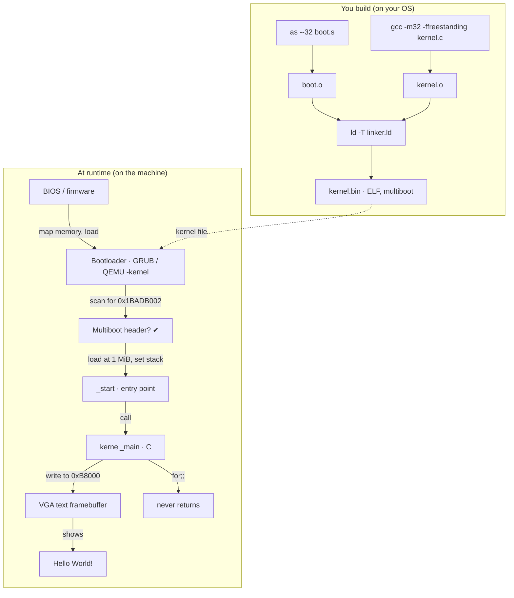

# Chapter 01 — Building "Hello World!" in C

*Original content written for OSDev_Learning_Hub — walks through the real,
verified code in `Example_OS_Project/c/`.*

> **Read this first.** This is the *reference* language track of the hub. Every
> other language chapter (Rust, C++, Go, C#) is measured against C, because C
> is the language the OSDev world was built on: the VGA framebuffer, the
> Multiboot header, the linker script, and `-ffreestanding` are all things you
> can understand *perfectly* in C before you learn how each other language
> wraps them in its own safety rules or frameworks. Master this chapter and the
> next four become a study of *differences* rather than of brand-new ideas.

---

## Part A — C fundamentals for a systems programmer

You don't need to be a C expert to write this kernel. You need a *small,
focused* slice of C: variables, pointers, arrays, strings (as `char*`), and
loops. Everything else — the standard library, `printf`, `malloc`, the
preprocessor zoo — is either absent or trivially small here, because a kernel
is one of the few places where the *whole* language collapses to almost nothing.

### A.1 — Hosted vs. freestanding: why this C is not "normal" C

The C that "Hello World" programs use assumes a **hosted** environment:
an operating system provides `printf`, `malloc`, `exit`, and the C *runtime*
(`_start → main`) for you. Your kernel is the **opposite**: it **is** the OS.
There is no `libc` beneath it, no `printf`, no `malloc`, no runtime that calls
`main`. The OSDev world calls this **freestanding** C — the whole language
minus the standard library.

[`freestanding`](../../GLOSSARY/freestanding.md "Code compiled assuming no OS or standard library exists")
is a real phrase from the C standard. The C standard itself only requires a
freestanding implementation to provide a handful of headers
(`<float.h>`, `<limits.h>`, `<stdarg.h>`, `<stddef.h>`, `<stdint.h>`, …) and
leaves everything else up to you. Our kernel uses **none of the standard
library at all** — it doesn't even `#include <stdio.h>`. It talks to the screen
by writing integers to a magic memory address.

That's the single most important mindset shift in OS dev:

```c
/* HOSTED C (what you already know): the OS hands you the console. */
#include <stdio.h>
int main(void) {                 /* the runtime calls THIS */
    printf("Hello\n");           /* libc talks to the OS, OS talks to screen */
    return 0;                    /* we return to the OS and it cleans up */
}

/* FREESTANDING C (what a kernel does): YOU are the OS. */
/* There is no printf. There is no main-calling runtime. No return value.
 * You reach the screen yourself. */
void kernel_main(void) {         /* boot.s calls THIS */
    write_a_character_to_the_screen('H');   /* you implement this */
    for (;;);                    /* never return — there's nowhere to go */
}
```

### A.2 — The beginner toolbox: pointers and memory addresses

A **pointer** is just a variable whose value is a **memory address**. Every
byte of RAM has an address — a number that locates it. In 32-bit protected
mode (where Multiboot v1 kernels run) an address is a 32-bit number.

```c
int  a = 42;        /* 'a' lives at SOME address; we don't pick it */
int* p = &a;        /* p holds the address of a  ('&' = "address of") */
*p = 99;            /* dereference '*' = "go to that address and use it" */
```

The kernel's entire VGA trick is just pointer work in disguise: `0xB8000` is a
**fixed, agreed-upon memory address**, and we make a pointer that points there,
then write through it. There is nothing more magical about it than `*p = 99` —
the address just happens to be wired up to the video hardware.

```c
/* The VGA framebuffer as a raw pointer to 16-bit cells. */
#define VGA_MEMORY ((unsigned short*)0xB8000)   /* a cast: number -> pointer */

VGA_MEMORY[0] = 0x0F48;   /* cell 0 = char 'H' (0x48) with color 0x0F */
```

That one line is the seed of the whole kernel. Understand *why* it works and
you understand direct hardware I/O:

```
  0xB8000          the address where the VGA card maps its text screen
     |                    (beginning of an 80 x 25 grid of 2-byte cells)
     v
   index 0:  [0x0F] [0x48]     color byte  |  character byte
   index 1:  [0x0F] [0x65]        |                'e'
   index 2:  [0x0F] [0x6C]        |                'l'
   ...
   Offsets 0x0000..0x0F9E  text cells,  Offsets 0x0FA0..   color/border
```

### A.3 — Exercise: read one cell back

Because the framebuffer is an *address*, you can not only write to it, you can
**read** from it — which is exactly how this project verified its own output.
Try annotating this yourself:

```c
/* Read the character stored in cell (row, col) back out of the buffer. */
unsigned short read_cell(int row, int col) {
    unsigned short* cell = VGA_MEMORY + (row * 80 + col);
    return *cell;                    /* dereference: fetch what's stored */
}
/* The low byte is the character, the high byte the color:
 *   char  = read_cell(0,0) & 0xFF
 *   color = (read_cell(0,0) >> 8) & 0xFF   */
```

The project's `tools/read_vga_text.py` does precisely this read-back over QEMU
to prove "Hello World!" actually landed on the screen.

### A.4 — Memory layout: stack, heap, and the "magic" fixed addresses

Application C you've seen distinguishes the **stack** (function call frames,
fast, automatic) from the **heap** (`malloc`/`free`, slow, manual). A kernel
lives *outside* both of those stories. The CPU boots into a world where the
low part of memory is owned by BIOS/firmware, and the conventional place to
load a kernel is at **1 MiB**. Below that is off-limits reserved hardware.

```
  0x00000000 ┌─────────────────────┐
             │ BIOS / low memory   │  reserved, do not use
  0x0009FFFF ├─────────────────────┤
             │ VGA TEXT FRAMEBUFFER│  ← 0xB8000 (our pal)
  0x000B8000 ├─────────────────────┤
             │ VGA graphics / BIOS │
  0x000FFFFF ├─────────────────────┤
  0x00100000 │ KERNEL (loaded at  1 │  ← your kernel.bin lands HERE
             │ MiB = 0x100000)      │
             └──────────────────────┘
```

This is why the linker script in Step 4 says `. = 1M;` and why the VGA address
is a bare number: the kernel's memory map is **hardware reality**, not
something the OS decides. See
[`physical-virtual-memory`](../../GLOSSARY/physical-virtual-memory.md "Physical RAM addresses vs. the virtual addresses your code sees")
for where this gets more complex later.

---

## Part B — The four files, explained deeply

The whole C kernel is four tiny files (plus a Makefile). Read them together —
they form one pipeline: `boot.s` gives the CPU a stack and calls C→ `kernel.c`
writes the screen→ `linker.ld` decides where it all sits→ `Makefile` drives the
toolchain.

## Step 1 — `boot.s` (the Multiboot bootstrap)

Every C bare-metal kernel needs a tiny assembly file to (a) declare the
[Multiboot](../../GLOSSARY/multiboot.md "The protocol that lets a bootloader load any kernel; magic 0x1BADB002") header so a [bootloader](../../GLOSSARY/bootloader.md "A small program that loads your kernel into memory and jumps to it") recognizes it, and (b) give the CPU a
stack (it has none when it boots). Full file: `c/boot.s`.

Let's read the whole thing, because it's short enough to fully understand.

```nasm
/* ---- Multiboot header ----------------------------------------------- */
.set ALIGN,    1<<0              /* align loaded modules on page boundaries */
.set MEMINFO,  1<<1              /* provide memory map */
.set FLAGS,    ALIGN | MEMINFO   /* this is the Multiboot 'flag' field */
.set MAGIC,    0x1BADB002        /* 'magic number' lets bootloader find header */
.set CHECKSUM, -(MAGIC + FLAGS)  /* checksum of above, to prove we are multiboot */

.section .multiboot              /* put this FIRST in the image */
.align 4
.long MAGIC
.long FLAGS
.long CHECKSUM

/* ---- Bootstrap stack ------------------------------------------------ */
.section .bootstrap_stack, "aw", @nobits
stack_bottom:
.skip 16384                      /* 16 KiB of uninitialized stack */
stack_top:

/* ---- Kernel entry point -------------------------------------------- */
.section .text
.global _start
.type _start, @function
_start:
    movl $stack_top, %esp        /* point the stack at the top of our 16 KiB */
    movl $stack_top, %ebp        /* set the frame pointer too (for debugging) */
    call kernel_main              /* jump into the C kernel */
    cli                          /* clear the interrupt flag */
    hlt                          /* halt the CPU */
.Lhang:
    jmp .Lhang                   /* if kernel_main somehow returns: loop */
```

The three lines that matter most:

```nasm
.long 0x1BADB002          ; magic: bootloader's handshake
.long 0x03                ; flags: align + memory-map
.long -(0x1BADB002 + 0x03); checksum: magic+flags+checksum must = 0
```

Why the checksum? The bootloader scans the first bytes of the image, finds the
magic `0x1BADB002`, and verifies that `magic + flags + checksum == 0`. That
`0x03` is `ALIGN | MEMINFO`: "please align my modules on page boundaries" plus
"hand me a memory map" — services your kernel will use in later chapters.

Then it does the two things C can't do itself:

```nasm
movl $stack_top, %esp      ; point the stack at our 16 KiB
call kernel_main            ; jump into the C kernel
```

**Why does the CPU need a stack?** Because the first C function you call may
push arguments and return addresses onto the stack (`call` pushes the return
address, C functions push locals). If `esp` is garbage, the first `push` writes
to an unknown address and the machine triple-faults. Giving the CPU a
well-defined stack region is the assembly file's most important job — C can
never declare "my stack is here" because the stack pointer is a *register* only
assembly can set.

### Why the kernel never returns

Look at the tail of `boot.s`:

```nasm
    call kernel_main
    cli
    hlt
.Lhang:
    jmp .Lhang
```

If `kernel_main` actually *returned*, `call` would pop a return address off the
stack and jump there — but there is **no caller below the kernel**. So `boot.s`
defends against it: after the `call`, it disables interrupts (`cli`), halts
(`hlt`), and if somehow woken, loops forever (`.Lhang`). This is the assembly
expression of "a kernel never returns."

## Step 2 — `kernel.c` (the VGA driver + entry point)

The heart. It writes directly to the VGA text framebuffer at `0xB8000`. Let's
read the actual `c/kernel.c` in full, with commentary:

```c
/* ---- VGA text-mode constants --------------------------------------- */
#define VGA_WIDTH   80            /* columns */
#define VGA_HEIGHT  25            /* rows */
#define VGA_MEMORY  ((unsigned short*)0xB8000)   /* the text framebuffer */

/* The color byte: low nibble = foreground, high nibble = background. */
#define COLOR_WHITE_ON_BLACK  0x0F

/* ---- Simple terminal state ----------------------------------------- */
static int terminal_row = 0;
static int terminal_col = 0;

/* Write ONE character to the VGA framebuffer at the current cursor. */
static void vga_putchar(char c)
{
    if (c == '\n') {             /* handle newline: wrap to next row */
        terminal_col = 0;
        terminal_row++;
        if (terminal_row >= VGA_HEIGHT)
            terminal_row = 0;    /* naive scroll: wrap to top */
        return;
    }

    const unsigned int index = terminal_row * VGA_WIDTH + terminal_col;
    /* cell = (color << 8) | character */
    VGA_MEMORY[index] = (unsigned short)((COLOR_WHITE_ON_BLACK << 8) | (unsigned char)c);

    terminal_col++;
    if (terminal_col >= VGA_WIDTH) {   /* wrap at end of line */
        terminal_col = 0;
        terminal_row++;
        if (terminal_row >= VGA_HEIGHT)
            terminal_row = 0;
    }
}
```

A VGA cell is `[color<<8 | char]` — the color byte's low nibble is the
foreground, the high nibble the background. Let's unpack the packed arithmetic:

```c
/* Example: print 'H' (ASCII 0x48) in white (0xF) on black (0x0). */
COLOR_WHITE_ON_BLACK << 8      // 0x0F << 8  =  0x0F00   (color in high byte)
        | (unsigned char)c     //         | 0x48        =  0x0F48
/* 0x0F48 stored at B8000+2*index  →  'H' on a white-foreground black-bg cell */
```

The two `static` functions `vga_write` and `vga_clear` are thin loops over
`vga_putchar`:

```c
/* Print a NUL-terminated string to the screen. */
static void vga_write(const char* s)
{
    while (*s)                  /* while the current char is not '\0' */
        vga_putchar(*s++);      /* write it, then advance the pointer */
}

/* Clear the whole screen by filling every cell with a blank space. */
static void vga_clear(void)
{
    for (int y = 0; y < VGA_HEIGHT; y++)
        for (int x = 0; x < VGA_WIDTH; x++) {
            const unsigned int index = y * VGA_WIDTH + x;
            VGA_MEMORY[index] = (unsigned short)((COLOR_WHITE_ON_BLACK << 8) | ' ');
        }
    terminal_row = 0;
    terminal_col = 0;
}
```

And the entry point — small, honest, infinite:

```c
/* Called by boot.s (`call kernel_main`). Note: even though this is C,
 * it is NOT main() — there is no runtime, no libc, no OS to return to. */
void kernel_main(void)
{
    vga_clear();
    vga_write("Hello World!\n");
    vga_write("Welcome to your very own operating system (C edition).\n");

    for (;;)                    /* A kernel never returns. */
        /* spin */;
}
```

Notice the `for (;;) /* spin */;` at the end. This is C's answer to the
assembly `.Lhang` loop: once our text is on screen, there is nothing left to do
and no OS to go back to, so we busy-spin forever. A "real" kernel would park
the CPU with the `hlt` instruction (see
[`hlt-instruction`](../../GLOSSARY/hlt-instruction.md "An x86 instruction that parks the CPU until an interrupt")) between interrupts instead of burning power
spinning — we'll get there.

## Step 3 — `linker.ld` (where the kernel lives in memory)

Tells `ld` to load the kernel at **1 MiB** and put the `.multiboot` section
first:

```ld
ENTRY(_start)        /* bootloader jumps here */
SECTIONS {
    . = 1M;          /* load at 1 MiB, the convention */
    .text BLOCK(4K) : ALIGN(4K) { *(.multiboot) *(.text) }
    .rodata BLOCK(4K) : ALIGN(4K) { *(.rodata) }
    .data   BLOCK(4K) : ALIGN(4K) { *(.data) }
    .bss    BLOCK(4K) : ALIGN(4K) { *(COMMON) *(.bss) *(.bootstrap_stack) }
}
```

Three things to notice:

- **`. = 1M;`** — the location counter starts at 1 MiB. Every symbol in the
  binary gets addresses ≥ 1 MiB, matching where the bootloader puts us in
  memory (see [`linker`](../../GLOSSARY/linker.md "The tool that assigns addresses to code and data and resolves cross-file references")).
- **`*(.multiboot)` first** — the Multiboot header must be at the very start
  of the image so the bootloader can find it. Putting it first in `.text` does
  exactly that.
- **`.bss` holds the stack** — `*(.bootstrap_stack)` pulls in the 16 KiB
  `stack_bottom`/`stack_top` you reserved in `boot.s`. BSS is zero-initialized
  and not stored on disk, so a 16 KiB stack costs the image almost nothing.

`ENTRY(_start)` is the symbol the bootloader's `jmp` will land on — the
[`entry-point`](../../GLOSSARY/entry-point.md "The symbol (usually _start) the bootloader jumps to") for the whole kernel.

## Step 4 — build & run

```bash
make           # or the explicit commands:
as --32 boot.s -o boot.o
gcc -c kernel.c -o kernel.o -ffreestanding -fno-pie -m32 -nostdlib -O2
ld -m elf_i386 -T linker.ld -o kernel.bin boot.o kernel.o -nostdlib

make run-c     # boots kernel.bin in QEMU
```

### What each compiler flag buys you

The C kernel's `CFLAGS` are the same flags the whole OSDev world lives on:

| Flag | Meaning | Why the kernel needs it |
|------|---------|--------------------------|
| `-ffreestanding` | don't assume the standard library exists | there is no libc here |
| `-fno-pie` | disable position-independent executable code | the kernel runs at a *fixed* address (1 MiB), no relocation |
| `-m32` | target 32-bit x86 | Multiboot v1 kernels boot into 32-bit protected mode |
| `-nostdlib` | don't link against libc | a kernel defines its own world |
| `-O2` | optimize | bare-metal code must be tight; no JIT help |
| `-Wall -Wextra` | warnings on | catching bugs before they become triple-faults |

Why `-m32`? Multiboot v1 (the protocol this kernel uses) boots the CPU into
**32-bit protected mode**. The kernels later switch to **long mode**
(64-bit) — see [`protected-mode`](../../GLOSSARY/protected-mode.md "The 32-bit CPU mode where Multiboot v1 kernels boot") and
[`long-mode`](../../GLOSSARY/long-mode.md "The 64-bit CPU mode a modern kernel switches into").

### `make run-c` in QEMU

```bash
make run-c     # = qemu-system-i386 -kernel kernel.bin
```

[`QEMU`](../../GLOSSARY/qemu.md "A free emulator you can boot your kernel in for testing") is a CPU emulator: it faithfully runs your x86 kernel without
risking real hardware. `-kernel` asks QEMU's built-in bootloader to load a
Multiboot kernel directly — a fast path that skips the disk-image step.

## Verification we actually ran

```bash
grub-file --is-x86-multiboot c/kernel.bin   # ✅ VALID Multiboot v1 kernel
# then booted in QEMU and read the VGA buffer at 0xB8000:
#   Hello World!
#   Welcome to your very own operating system (C edition).
```

---

## Part C — The bigger picture: a Mermaid tour and pitfalls

### C.1 — How the whole boot pipeline fits together



### C.2 — Pitfalls the OSDev community warns about

Every pitfall below is one beginners hit on the *exact* files in this project:

1. **Wrong address / wrong mode.** Writing `0xB8000` as a `char*` instead of
   `unsigned short*` makes each cell one byte instead of two and your text
   comes out as garbage. Remember: **two bytes per cell**, and use `-m32`
   because 64-bit pointers would make the arithmetic different.

2. **Missing `-nostdlib`.** Without it, `gcc` may pull in `__main` or libc
   startup references, and your kernel.bin gets bloated or fails to link. The
   `-ffreestanding -fno-pie -m32 -nostdlib` combo is non-negotiable.

3. **Multiboot header not first.** If `.multiboot` isn't at the very start,
   `grub-file --is-x86-multiboot` fails and nothing boots. The linker script's
   `*(.multiboot)` first line is what guarantees it.

4. **No stack.** If `boot.s` forgets `movl $stack_top, %esp`, the first C
   function call writes to an unknown address → triple fault → QEMU resets (or
   shows nothing). The 16 KiB stack in `boot.s` exists precisely to prevent this.

5. **A kernel that "returns".** If you write `return;` at the end of
   `kernel_main`, control falls into the `.Lhang` loop (harmless here) — but
   the *concept* is wrong. Kernels never return; assert that with `for (;;)`.

6. **Reading uninitialized cursor cells.** `vga_clear()` runs *before* any
   text so the screen starts clean. If you skip it, you inherit whatever
   garbage the bootloader left in the framebuffer.

### C.3 — Next steps from this exact kernel

You've printed text to real hardware memory. The natural path forward:

| Concept | Link | Comes after |
|---------|------|-------------|
| Bootloaders & Multiboot | [concepts/01](../concepts/01-bootloaders-and-multiboot.md) | what actually loaded your `kernel.bin` |
| Memory management | [concepts/02](../concepts/02-memory-management.md) | the 1 MiB layout, physical vs. virtual |
| Interrupts & the IDT | [concepts/03](../concepts/03-interrupts-and-the-idt.md) | replace `for (;;)` spin with `hlt` + interrupt handlers |
| VGA text mode deep-dive | [concepts/04](../concepts/04-vga-text-mode.md) | colors, cursor, scrolling |
| The bigger OSDev landscape | [concepts/05](../concepts/05-the-hello-world-of-oses.md) | what a real kernel does after Hello World |

Practically, the single most rewarding next step is to **add a second color**:
edit `COLOR_WHITE_ON_BLACK` and the `0x0F` constant to print your "Welcome"
line in green (`0x0A`) instead of white, rebuild with `make`, and re-run. You
just wrote your first hardware driver customization.

---

## Part D — A guided, full-buffer build: from blank file to booting kernel

So far the walkthrough has been *read-along*. This section makes you *build*.
Follow it with a real terminal and the `Example_OS_Project/c/` tree open. By
the end you'll have created the kernel from scratch, not just read about it.

### D.1 — Scaffold the four files

Create a directory and the four files. Start with the assembly bootstrap so
you have something with a visible, inspectable `_start`:

```bash
mkdir -p mycus && cd mycus
touch boot.s kernel.c linker.ld Makefile
```

Copy the contents from `Example_OS_Project/c/` for each — or better, *type*
them. Typing `boot.s` by hand forces you to confront each `movl`, each
`.long`, each section directive. It takes two minutes and the muscle memory is
worth far more than the copy-paste.

### D.2 — Assemble and resolve every error yourself

Now the fun part — build it in the *deliberately broken* order so you see the
toolchain's errors before they're fixed:

```bash
# The full, correct pipeline (run this first):
as --32 boot.s -o boot.o
gcc -c kernel.c -o kernel.o -ffreestanding -fno-pie -m32 -nostdlib -O2 -Wall -Wextra
ld -m elf_i386 -T linker.ld -o kernel.bin boot.o kernel.o -nostdlib
```

Now make a successful build fail **on purpose**, one change at a time, and
watch what the toolchain says:

| Experiment | What you'll see | Lesson |
|-----------|-----------------|--------|
| Drop `-m32` from the gcc line | `ld` errors about an `i386:x86-64` vs `i386` mismatch, or a `.bss` size error | 64-bit pointers ≠ 32-bit layout |
| Drop `--32` from `as` | assembler complains about instructions like `.long` at wrong width | every stage must agree on the target |
| Remove `-nostdlib` from `ld` | `undefined reference to __libc_start_main` or implicit `libc` pulls | don't let the host toolchain sneak in |
| Forget `-ffreestanding` | warnings about implicit `printf`, or the compiler assumes a `main()` calling convention | the compiler must not assume hosted C |
| Delete the stack setup lines in `boot.s` | binary still assembles — but **won't boot** (triple-fault, QEMU reset) | link-time validity ≠ runtime validity |

That last row is the most important lesson in OS dev: a kernel can **build
cleanly and still be dead on arrival**. The emulator, not the compiler, is your
real judge.

### D.3 — Boot it and confirm with your own eyes

```bash
make run-c                 # or: qemu-system-i386 -kernel kernel.bin
```

A QEMU window opens showing:

```
Hello World!
Welcome to your very own operating system (C edition).
```

Now prove it's really in memory, not just in the emulator's window. Quit QEMU
and read the framebuffer back with the project's own tooling:

```bash
# Boot again in the background, dump the VGA text buffer, and grep it:
qemu-system-i386 -kernel kernel.bin -display none -monitor stdio &
# … then use tools/read_vga_text.py / read_vga_text.py against the emulated
# 0xB8000 to confirm the two lines are actually present in VRAM.
```

Being able to *read hardware memory back* is a superpower: it's the same
technique real kernel debuggers use, and it verifies beyond doubt that your
writes landed.

### D.4 — Your first customization: a second color and a cursor line

Desktop kernels are monochrome by default because the demo kernel is — but the
framebuffer supports 16 background × 16 foreground colors. Extend `kernel.c`:

```c
/* Two color constants (low nibble = foreground, high = background). */
#define COLOR_WHITE_ON_BLACK  0x0F   /* white on black — already there */
#define COLOR_GREEN_ON_BLACK  0x0A   /* 0x0 = bg black, 0xA = bright green */

/* A tiny helper that prints colored text at a given row. */
static void vga_write_at_row(int row, int color, const char* s)
{
    /* Save the cursor, jump to the row, switch color, print, restore. */
    int saved_row = terminal_row, saved_col = terminal_col;
    terminal_row = row; terminal_col = 0;
    /* … for each char: VGA_MEMORY[index] = (color << 8) | (unsigned char)c … */
    terminal_row = saved_row; terminal_col = saved_col;
}
```

Rebuild and boot; your kernel now has a green welcome line. Congratulations —
you just wrote a parameterized device driver for a real piece of hardware.

### D.5 — The "what could break" review

Before moving to step E, run this mental checklist against your built
`kernel.bin`:

- [ ] `grub-file --is-x86-multiboot kernel.bin` exits 0 (valid Multiboot v1).
- [ ] The multiboot header is the *first* bytes: `xxd kernel.bin | head -2`
      shows `02 b0 ad 1b` (little-endian `0x1BADB002`).
- [ ] The binary is 32-bit ELF: `readelf -h kernel.bin` shows `Class: ELF32`,
      `Machine: Intel 80386`.
- [ ] It assembles, compiles, and links with **zero warnings**.
- [ ] It boots in QEMU and the framebuffer read-back matches the two strings.

---

## Part E — Warnings, pitfalls, and pro tips (cheat sheet)

Everything below is condensed from real OSDev forum threads and common
beginner mistakes on the exact files in this project.

### The four things that "just don't work" the first time

```
1. Printing to VGA from real mode.  Multiboot v1 hands you PROTECTED mode.
   VGA text mode lives at 0xB8000 in protected mode. If you try to print from
   a 16-bit real-mode bootloader you're talking to a different address space.

2. Using printf/malloc/strlen.  They live in libc. There is no libc. Your
   kernel's "Hello World" is hand-rolled character code, not <stdio.h>.

3. Returning from kernel_main.  There is no caller. The assembler loop after
   the call exists to catch you if you try.

4. Relying on a stack you didn't set.  boot.s does it because C can't.
   Forget it and the first function call corrupts whatever memory esp points
   at.
```

### The three biggest "gotcha" flags

- **`-nostdlib`** must appear *both* on the `gcc` line and the `ld` line.
  Missing it on either side lets the host surprising you.
- **`-m32`** on the compiler and **`--32`** on the assembler and **`-m
  elf_i386`** on the linker must all three match. Mismatch = link failures or
  broken pointers.
- **`-fno-pie`** matters because a PIE kernel expects runtime relocation; a
  bare-metal one runs at a fixed 1 MiB address immediately.

### When things build but boot to a black screen

1. Did `vga_clear()` run before writing? (Your text may be hidden under boot
   garbage.)
2. Is the multiboot header first? (Bootloader may silently reject.)
3. Is the stack actually set? (Triple-fault → QEMU shows nothing or resets.)
4. Are you running 32-bit mode? (Long-mode kernels have a different debug
   ritual.)

The single best debugging move is `-display none` plus a serial or monitor
dump so you can log what happens *before* the screen is ready — the project's
`tools/analyze_screendump.py` and `boot-test.sh` exist exactly for this.

---

## Bridge to OS concepts

> **Bridge to OS concepts:** you just touched three core OS ideas —
> **[bootloaders](../../GLOSSARY/bootloader.md "A small program that loads your kernel into memory and jumps to it")/[Multiboot](../../GLOSSARY/multiboot.md "The protocol that lets a bootloader load any kernel; magic 0x1BADB002")** (concepts/01), **memory layout** via the linker
> script (concepts/02), and **direct hardware I/O** through the
> [VGA framebuffer](../../GLOSSARY/vga-framebuffer.md "The memory at 0xB8000 where screen text is written") (concepts/04).

---

## Watch and learn

Let these video courses anchor the pointer and memory model this chapter relies
on. All are real and verifiable on YouTube.

<details class="video-embed">
<summary>▶ Watch: CS50x 2025 - Lecture 4 - Memory</summary>
<iframe src="https://www.youtube-nocookie.com/embed/kcRdFGbzR1I" title="CS50x 2025 - Lecture 4 - Memory" width="100%" height="400" style="border:0;border-radius:8px;" allow="accelerometer; autoplay; clipboard-write; encrypted-media; gyroscope; picture-in-picture; web-share" allowfullscreen></iframe>
<p class=video-caption>David Malan's classic lecture on pointers, hexadecimal addresses, the stack and heap, and how C manipulates memory — the exact mental model behind poking `0xB8000` and reading a VGA cell back.</p>
</details>
<details class="video-embed">
<summary>▶ Watch: CS50x 2026 - Section 4 - Memory</summary>
<iframe src="https://www.youtube-nocookie.com/embed/Gjf0L3mkVtY" title="CS50x 2026 - Section 4 - Memory" width="100%" height="400" style="border:0;border-radius:8px;" allow="accelerometer; autoplay; clipboard-write; encrypted-media; gyroscope; picture-in-picture; web-share" allowfullscreen></iframe>
<p class=video-caption>A refreshed, hands-on walkthrough of C pointers, dynamic memory allocation, and files, reinforcing the pointer syntax your kernel's `vga_putchar` and `VGA_MEMORY` indexing rely on.</p>
</details>
<details class="video-embed">
<summary>▶ Watch: C pointers explained</summary>
<iframe src="https://www.youtube-nocookie.com/embed/DplxIq0mc_Y" title="C pointers explained" width="100%" height="400" style="border:0;border-radius:8px;" allow="accelerometer; autoplay; clipboard-write; encrypted-media; gyroscope; picture-in-picture; web-share" allowfullscreen></iframe>
<p class=video-caption>A concise crash course on what a pointer is, `&` vs `*`, pointers as function arguments, and dereferencing — ideal for grounding the `unsigned short*` cast to the VGA framebuffer.</p>
</details>
<details class="video-embed">
<summary>▶ Watch: Pointers and dynamic memory — stack vs. heap (Jacob Sorber)</summary>
<iframe src="https://www.youtube-nocookie.com/embed/_8-ht2AKyH4" title="Pointers and dynamic memory - stack vs heap (Jacob Sorber)" width="100%" height="400" style="border:0;border-radius:8px;" allow="accelerometer; autoplay; clipboard-write; encrypted-media; gyroscope; picture-in-picture; web-share" allowfullscreen></iframe>
<p class=video-caption>Jacob Sorber's clear picture of where the stack and the heap live in a process's memory — the same hardware memory your kernel owns directly, minus any OS in the way.</p>
</details>
<details class="video-embed">
<summary>▶ Watch: Dynamic memory allocation in C — malloc calloc realloc free</summary>
<iframe src="https://www.youtube-nocookie.com/embed/xDVC3wKjS64" title="Dynamic memory allocation in C - malloc calloc realloc free" width="100%" height="400" style="border:0;border-radius:8px;" allow="accelerometer; autoplay; clipboard-write; encrypted-media; gyroscope; picture-in-picture; web-share" allowfullscreen></iframe>
<p class=video-caption>How C manages heap memory with the allocation functions you *don't* have in a kernel — which makes it crystal clear why a freestanding OS has to build its own allocator later.</p>
</details>
<details class="video-embed">
<summary>▶ Watch: Understanding the C runtime memory model</summary>
<iframe src="https://www.youtube-nocookie.com/embed/3F3lp_F2YpQ" title="Understanding the C runtime memory model" width="100%" height="400" style="border:0;border-radius:8px;" allow="accelerometer; autoplay; clipboard-write; encrypted-media; gyroscope; picture-in-picture; web-share" allowfullscreen></iframe>
<p class=video-caption>Where a compiled C program's code, globals, stack and heap actually sit in memory — the model a bare-metal kernel *replicates* by hand with nothing underneath.</p>
</details>

> **Self-check before moving on:** close this page and re-derive from memory
> (1) why the kernel loads at 1 MiB, (2) why a VGA cell is two bytes, (3) why
> `boot.s` must set the stack pointer, and (4) why `for (;;)` ends every
> kernel entry point. If you can explain all four, you're ready for the Rust,
> C++, Go, and C# chapters — which will now read as *variations* on these
> four answers.

---

## 🧪 Exercises & Projects

You built the C track's Hello World on top of the shared five-step recipe. These exercises perturb that recipe one step at a time so the toolchain and boot become levers, not black boxes. Prereq: the C build loop from this README.

### Graded exercises

**Easy**

- [ ] **E1. Rebuild the kernel from scratch, closed-book** (~20–40 min). Close this page
      and the reference. Recreate `C`'s boot + kernel skeleton from memory:
      assembly that sets the stack and calls into the kernel, the kernel's VGA write, and
      the infinite loop. Build using the chapter's exact command sequence. If you stall,
      peek at [`Example_OS_Project`](../../Example_OS_Project/) only for the *toolchain
      flags*, not the code — then re-close it.
- [ ] **E2. Reproduce the five-step recipe in your words** (~20 min). Write (comments or a
      gist) the five steps — assemble, compile, link, ISO, boot — *in this language's*
      syntax. Note the one tool/flag that made this track different from C.
- [ ] **E3. Change the banner to prove ownership** (~20 min). Edit the kernel's message to
      a unique string, rebuild, boot in QEMU, and confirm your string in the output.
      This kills the "it's a template, not mine" feeling for good.

**Medium**

- [ ] **M1. Add a second color/attr** (~1 hr). Extend the VGA write beyond one
      color: print your banner in *bright green on black* and an error line in red on
      white. Practice the `C` way of writing to a typed hardware pointer
      (whichever layer your track uses).
- [ ] **M2. Read the fault, don't guess** (~1 hr). Boot with `-d int,cpu_reset` and a
      deliberately broken kernel (e.g. no stack setup). Capture the fault, fix, re-run.
      Write a one-line "what a missing-stack fault looks like here" note.
- [ ] **M3. Deterministic build + clean tree** (~45 min). `make clean && make`, hash the
      `kernel.bin`, re-run, and confirm an identical hash. Then move your build to a second
      machine/VM and reproduce from the repo — proving your toolchain notes are complete.


**Hard**

- [ ] **H1. Port a concept back in** (~3 hr). Take this language's hello-world kernel and
      add one subsystem from the concept chapters: a PIT timer ISR
      ([concept 03](../concepts/03-interrupts-and-the-idt.md)) or a frame allocator
      ([concept 02](../concepts/02-memory-management.md)). This proves the concepts are
      language-independent.
- [ ] **H2. Compare against C side-by-side** (~1.5 hr). Put your kernel's `C`
      source next to `Example_OS_Project/c/kernel.c`. Annotate the *same logical steps*
      (stack, VGA write, loop) across both. Where did the language impose ceremony? Where
      did it save you a line?

### ⭐ Mini-project — Port the Example kernel into a fresh bare-metal C project you own

**Goal.** Rebuild—from a clean directory, not by copying files—a C kernel that
boots the same five-step recipe, structured so you can grow it into a timer + allocator
later. **Estimated time:** 2–4 hr. **Prereq:** the toolchain chapter + C README.

1. **Scaffold from scratch.** `mkdir` a new project; write your own `boot.s`, `linker.ld`
      (`ENTRY(_start)`, base 1 MiB, `.multiboot` first), and `kernel.c`. Resist copying —
      retype so it's yours.
2. **Bring back the recipe one step at a time.** Assemble only; compile only; then link;
      then ISO; then QEMU. Confirm each step's artifact exists and is well-formed before
      the next (`readelf -S` for `.multiboot`, `readelf -h` for the entry).
3. **Verify the handshake.** In `kernel.c`, assert the Multiboot magic so a bad build
      fails loudly with a visible color change, not a black screen.
4. **Add a banner + clean exit.** Print a `BANNER` macro (define it once, use it in both
      the message and the ISO label) and enter an explicit `for(;;)`.
5. **Grow one subsystem.** Port the PIT timer ISR from concept 03 so your Hello World
      also prints uptime. Now it's no longer a hello-world—it's a kernel with a clock.
6. **Write `make run` + `make debug`.** GDB break at `_start`. Confirm both from clean.
7. **Commit + reproduce.** Clone the tree fresh and build once more; the README you write
      must suffice for a stranger to boot it.

*(The reference for comparison is in [`Example_OS_Project/c/`](../../Example_OS_Project/c/)
— glance only when stuck, then close it.)*

**Checklist**

- [ ] closed-book kernel rebuild succeeds without the page open
- [ ] self-chosen banner string boots and is visible in QEMU
- [ ] at least one distinct color/attr customisation verified on screen
- [ ] `make clean && make` reproduces an identical `kernel.bin` hash
- [ ] second machine/VM reproduces the build from the repo alone
- [ ] a chosen concept (timer or allocator) is ported and boots

