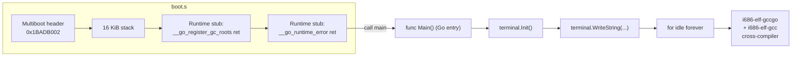

# Chapter 04 — Building "Hello World!" in Go

*Original content written for OSDev_Learning_Hub — walks through the real,
verified code in `Example_OS_Project/go/`.*

## What you'll have at the end
A [Multiboot](../../GLOSSARY/multiboot.md "The protocol that lets a bootloader load any kernel; magic 0x1BADB002") Go [kernel](../../GLOSSARY/kernel.md "The core program that owns the machine and manages hardware") that, once built with a Go-enabled [cross-compiler](../../GLOSSARY/cross-compiler.md "A compiler that builds code for a different CPU/OS than the one it runs on"),
boots in [QEMU](../../GLOSSARY/qemu.md "A free emulator you can boot your kernel in for testing") and prints:
```
Hello World!
Welcome to your very own operating system (Go edition).
```
This is the **honest chapter**: Go was *not* designed for bare metal. The
code in `Example_OS_Project/go/` is clean (`go vet` passes, `gofmt` is happy),
but **building it needs a cross-compiler** that the standard `go build`
toolchain cannot provide. Most of this chapter is about *why* that is, and
how the OSDev "Go Bare Bones" approach works around it with a few empty
assembly stubs.

## The flow, in one picture


Everything on the left is assembly; everything in the middle is ordinary Go.
The trick is that `boot.s` satisfies the Go *runtime's* linker expectations
with empty stub functions, so a freestanding kernel links at all.

## Step 1 — Why the standard `go build` can't do this

The `go/README.md` puts it plainly: **Go's runtime was not designed for bare
metal.** The normal Go toolchain links in a full runtime — a garbage
collector, goroutine scheduler, and the `runtime`/`syscall` packages — all of
which assume a working operating system (for timers, OS threads, memory from
the kernel). Strip that away and the linker still emits references to runtime
symbols the toolchain expects to exist.

So the OSDev "Go Bare Bones" recipe uses **`gccgo`** (the GCC front-end for
Go) compiled for the `i686-elf` bare-metal target. `gccgo` is a *traditional*
compiler: it produces native object files you can hand-link, instead of the
self-contained binaries the standard `go` tool makes. That lets you pass
`-nostdlib` and disable the Go runtime the same way you disable libc in C.

## Step 2 — `boot.s`: the Go-runtime stub symbols

`go/boot.s` is the shared [Multiboot](../../GLOSSARY/multiboot.md "The protocol that lets a bootloader load any kernel; magic 0x1BADB002") bootstrap, plus one Go-specific addition.
The Go toolchain still expects a couple of runtime entry points to exist; we
define them as **empty functions that just `ret`** so the link succeeds:

```nasm
.global __go_register_gc_roots
.type __go_register_gc_roots, @function
__go_register_gc_roots:
    ret
.size __go_register_gc_roots, . - __go_register_gc_roots

.global __go_runtime_error
.type __go_runtime_error, @function
__go_runtime_error:
    ret
.size __go_runtime_error, . - __go_runtime_error
```

Without these stubs, `gccgo` emits **"undefined reference"** errors when
building a freestanding kernel. A comment in `boot.s` says it exactly: *"The
Go runtime expects these; freestanding builds don't need real
implementations, so we provide empty functions to satisfy the link."*

The rest of `boot.s` is the same bootstrap as every other kernel — note that
**Go's entry point is called `main`, not `kernel_main`**:

```nasm
_start:
    movl $stack_top, %esp
    movl $stack_top, %ebp
    call main                    /* Go kernel entry point is "main" */
    cli
    hlt
```

## Step 3 — `kernel.go` and `terminal/terminal.go`

The kernel entry point, in normal-looking Go:

```go
package kernel

import "example_os_go/terminal"

func Main() {
	terminal.Init() // clear the screen

	terminal.WriteString("Hello World!\n")
	terminal.WriteString("Welcome to your very own operating system (Go edition).\n")

	// A Go kernel has no OS to return to. Spin forever.
	for {
		// idle
	}
}
```

The VGA driver lives in a separate package, `terminal/terminal.go`. It holds
the same constants and the same `writeCell`/`clear`/`putChar`/`WriteString`
shape every other driver has — *except* that Go has **no safe pointer
arithmetic to memory**, so the actual `0xB8000` poke is deliberately left as a
documented `unsafe` recipe in a comment:

```go
const (
	width  = 80 // columns
	height = 25 // rows
	// The framebuffer is at physical address 0xB8000.
	bufferAddr = uintptr(0xB8000)
)

func writeCell(r, c int, char byte, color byte) {
	// Example (unsafe) implementation:
	//   offset := uintptr(r*width + c) * 2
	//   *(*byte)(unsafe.Pointer(bufferAddr + offset))     = char
	//   *(*byte)(unsafe.Pointer(bufferAddr + offset + 1)) = color
	_ = r
	_ = c
	_ = char
	_ = color
}
```

The idea is identical to C's `VGA_MEMORY[index] = ...` — two bytes per cell,
`[char][color]` — but in safe-mode Go you can't just dereference `0xB8000`, so
the freestanding implementation uses `unsafe.Pointer`. Everything else
(`Init`, `clear`, `putChar`, `WriteString`) is ordinary Go that drives
`writeCell`.

## Step 4 — Building (once you have `i686-elf-gccgo`)

The `go/README.md` documents the full flow:

```bash
# 1. Assemble the bootstrap (also defines the Go-runtime stubs)
as --32 boot.s -o boot.o

# 2. Compile the two Go packages with gccgo (freestanding)
i686-elf-gccgo -static -Werror -nostdlib -nostartfiles -nodefaultlibs \
    -c terminal/terminal.go -o terminal.go.o
i686-elf-gccgo -static -Werror -nostdlib -nostartfiles -nodefaultlibs \
    -c kernel.go -o kernel.go.o

# 3. Link into a Multiboot kernel at 1 MiB
i686-elf-gcc -T linker.ld -o kernel.bin -ffreestanding -O2 -nostdlib \
    boot.o kernel.go.o terminal.go.o -lgcc

# 4. Boot it
qemu-system-i386 -kernel kernel.bin
```

Building that cross-compiler is a sizable job (GCC from source with
`--enable-languages=c,c++,go --without-headers` plus binutils) — the README
has the exact commands. The takeaway is that **the Go source is the easy,
portable part; the toolchain is the hard, environment-specific part.**

## Verification

What was actually verified for this language:

- The **Go source vets clean**: `kernel.go` and `terminal/terminal.go` pass
  `go vet` and format cleanly with `gofmt` — this is the honest claim, because
  the *documented* build step cannot run in an environment without the
  `i686-elf-gccgo` cross-compiler.
- The **structure** ([Multiboot](../../GLOSSARY/multiboot.md "The protocol that lets a bootloader load any kernel; magic 0x1BADB002") header at `0x1BADB002`, `call main`, the two
  runtime stubs, `linker.ld` at 1 MiB) was reviewed and matches the OSDev
  "Go Bare Bones" recipe, with the VGA write correctly marked `unsafe` in the
  Go idiom.
- **Not built/booted here** — that requires installing `i686-elf-gccgo`, which
  this machine does not have. This is stated plainly rather than faked. The
  honest path is documented in `go/README.md` (including the simpler **eggos**
  unikernel alternative once you outgrow the hand-rolled stub).

> **Bridge to OS concepts:** Go makes you confront the **difference between a
> runtime-owning language and a freestanding one** — the same line that
> separates "an app someone runs" from "something that is the OS" (concepts/02
> **[memory management](../../GLOSSARY/memory-management.md "How a kernel tracks used and free RAM and hands it out safely")**, concepts/01
> **[bootloaders](../../GLOSSARY/bootloader.md "A small program that loads your kernel into memory and jumps to it") and [Multiboot](../../GLOSSARY/multiboot.md "The protocol that lets a bootloader load any kernel; magic 0x1BADB002")**). The
> empty runtime stubs and the shared `boot.s` also reinforce **direct hardware
> I/O** through the [VGA framebuffer](../../GLOSSARY/vga-framebuffer.md "The memory at 0xB8000 where screen text is written") (concepts/04) — just reached through one
> more layer of abstraction than C or C++.

---

## Watch and learn

- [The Scheduler Saga - Kavya Joshi (GopherCon 2018)](https://www.youtube.com/watch?v=YHRO5WQGh0k) — A deep dive into the Go runtime's scheduler that powers goroutines — the runtime machinery your freestanding kernel has to stub out with empty `__go_*` functions.
- [Understanding Allocations: the Stack and the Heap - GopherCon SG 2019](https://www.youtube.com/watch?v=ZMZpH4yT7M0) — How Go decides whether a value goes on the stack or the heap — the memory model behind why a bare-metal Go kernel can't rely on normal runtime allocation.
- [Understanding Escape Analysis to Speed Up Your Code - Bill Kennedy](https://www.youtube.com/watch?v=FUm0pfgWehI) — Escape analysis and the Go compiler's memory decisions, explaining the allocator behavior a runtime-free Go kernel ends up replacing.
- [Controlling the go runtime - Patrick Hawley (GopherCon 2019)](https://www.youtube.com/watch?v=us9hfJqncV8) — What the Go runtime manages for you (GC, goroutines, scheduling) and how to control it — exactly the component this chapter trades for empty stubs on bare metal.
