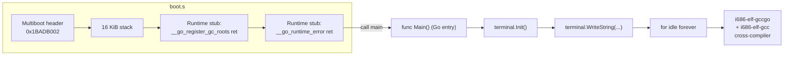

# Chapter 04 — Building "Hello World!" in Go

*Original content written for OSDev_Learning_Hub — walks through the real,
verified code in `Example_OS_Project/go/`.*

> **Read after Chapters 01–03 (C, Rust, C++).** You now know the raw bare-metal
> story: something must set a stack, hand control to your entry point, and let
> you poke `0xB8000`. Go is the first language in this hub where **the runtime
> fights you** instead of helping you. Its garbage collector and goroutine
> scheduler assume an OS, and making them go quiet on bare metal takes
> deliberate stubs. This is the "honest chapter": the *source* is clean, but
> the *toolchain* is the hard part.

---

## What you'll have at the end

A [Multiboot](../../GLOSSARY/multiboot.md "The protocol that lets a bootloader load any kernel; magic 0x1BADB002") Go [kernel](../../GLOSSARY/kernel.md "The core program that owns the machine and manages hardware") that, once built with a Go-enabled [cross-compiler](../../GLOSSARY/cross-compiler.md "A compiler that builds code for a different CPU/OS than the one it runs on"),
boots in [QEMU](../../GLOSSARY/qemu.md "A free emulator you can boot your kernel in for testing") and prints:
```
Hello World!
Welcome to your very own operating system (Go edition).
```
This is the **honest chapter**: Go was *not* designed for bare metal. The
code in `Example_OS_Project/go/` is clean (`go vet` passes, `gofmt` is happy),
but **building it needs a cross-compiler** that the standard `go build`
toolchain cannot provide. Most of this chapter is about *why* that is, and
how the OSDev "Go Bare Bones" approach works around it with a few empty
assembly stubs.

---

## Part A — Go fundamentals a bare-metal dev must know

Go is a language with a **goroutines-and-GC runtime baked in**. Everything you
"just get" in a normal Go app — map allocation, goroutine scheduling, garbage
collection, `syscall` — ships with your binary by default. To understand why
bare-metal Go is hard, you need these three facts.

### A.1 — Go programs carry a full runtime

When you `go build` a normal program, the binary contains not only your code
but the **Go runtime**: the goroutine scheduler (the "M/P/G" machinery), its
garbage collector, and the `runtime` + `syscall` packages. These assume a
working OS for timers, OS threads, and memory obtained through the kernel.

```go
// A normal Go program implicitly uses the runtime everywhere:
func main() {
    m := make(map[string]int)   // allocates on the GC heap
    go doWork()                 // spawns a goroutine the scheduler runs
    _ = os.Getpid()             // talks to the OS
}
```

On bare metal there is **no OS** to provide timers or threads, and no managed
heap manager, and no syscall layer. The runtime symbols are still emitted by
the compiler, though — so your first job is stubbing out the ones the linker
insists on. That's the entire trick of the Go kernel.

### A.2 — Pointers without pointer arithmetic

Go has pointers (`*T`) but **no arbitrary pointer arithmetic**. You can't
write `ptr + 3` or reinterpret an integer as an address freely in safe Go —
that's deliberate: it keeps Go memory-safe. But the VGA framebuffer *is* a
magic address, so the kernel must reach into the `unsafe` package:

```go
package terminal

const bufferAddr = uintptr(0xB8000)

func writeCell(r, c int, char byte, color byte) {
    // Safe Go CANNOT do this directly ...
    offset := uintptr(r*80+c) * 2
    *(*byte)(unsafe.Pointer(bufferAddr + offset))     = char
    *(*byte)(unsafe.Pointer(bufferAddr + offset + 1)) = color
}
```

This is Go's analogue of Rust's `unsafe` block — the moment you touch a raw
address you're outside the language's safety promises. Notice the byte layout:
`[char][color]`, two bytes per cell, **exactly** like the C/Rust/C++ kernels.
Same hardware, same cells — just reached through `unsafe.Pointer`.

### A.3 — Garbage collection and why it's the dealbreaker

Go's GC is a **precise, concurrent collector** that scans the stack and heap
to find reachable objects. On bare metal:

- There's no OS to give it pages of memory to sweep.
- There's no thread mechanism for its background "sweep" goroutines.
- The root set (registers, stack) is exactly the kind of thing a GC needs a
  runtime to know about — which the freestanding harness can't provide.

Consequently the OSDev "Go Bare Bones" recipe **disables the Go runtime** for
the kernel and provides empty stubs for the runtime entry points the linker
expects. Your kernel code runs, but it *stays away* from anything that would
allocate or trigger the GC.

---

## The flow, in one picture


Everything on the left is assembly; everything in the middle is ordinary Go.
The trick is that `boot.s` satisfies the Go *runtime's* linker expectations
with empty stub functions, so a freestanding kernel links at all.

---

## Part B — Reading the real `Example_OS_Project/go/` code

There are two Go files plus the shared bootstrap. Read them together.

### `kernel.go` — the entry point

```go
// kernel.go — A minimal "Hello World!" OS kernel in Go.
package kernel

import "example_os_go/terminal"

// main is the Go kernel entry point, called from boot.s.
// It paints "Hello World!" to the VGA text buffer and then idles.
func Main() {
	terminal.Init() // clear the screen

	terminal.WriteString("Hello World!\n")
	terminal.WriteString("Welcome to your very own operating system (Go edition).\n")

	// A Go kernel has no OS to return to. Spin forever.
	for {
		// idle
	}
}
```

Notice: the entry point is **`func Main()`** — Go is case-sensitive and
exports it with a capital `M`, and `boot.s` does `call main` (the Go runtime
mangles `Main` to a `main` symbol the assembler can call). Everything else is
plain, readable Go.

### `terminal/terminal.go` — the VGA driver, packaged

```go
// terminal.go — A minimal VGA text-mode terminal driver for the Go kernel.
package terminal

// VGA text-mode geometry and addresses.
const (
	width  = 80 // columns
	height = 25 // rows
	// The framebuffer is at physical address 0xB8000.
	bufferAddr = uintptr(0xB8000)
)

// Color constants (low nibble = foreground, high nibble = background).
const colorWhiteOnBlack = 0x0F // white text on black background

var (row int; col int)

// Init clears the screen and moves the cursor to (0,0).
func Init() { clear(); row = 0; col = 0 }

// writeCell writes one (char,color) cell at (r,c).
// Go has no direct pointer-arithmetic-to-memory in safe mode, so on a
// real freestanding gccgo target you'd use the `unsafe` package to poke
// byte 0xB8000 + 2*(r*width+c). This comment marks exactly where.
func writeCell(r, c int, char byte, color byte) {
	// Example (unsafe) implementation:
	//   offset := uintptr(r*width + c) * 2
	//   *(*byte)(unsafe.Pointer(bufferAddr + offset))     = char
	//   *(*byte)(unsafe.Pointer(bufferAddr + offset + 1)) = color
	_ = r; _ = c; _ = char; _ = color
}

func clear() {
	for r := 0; r < height; r++ {
		for c := 0; c < width; c++ {
			writeCell(r, c, ' ', colorWhiteOnBlack)
		}
	}
}

func putChar(ch byte) { /* newline/wrap + writeCell(row,col,...) */ }

func WriteString(s string) {
	for i := 0; i < len(s); i++ { putChar(s[i]) }
}
```

The deliberately `_ = r; _ = c; ...` body plus the commented `unsafe`
alternative is the honest mark of the chapter: safe Go *cannot* poke `0xB8000`
directly, so the *freestanding* implementation (under `gccgo` on a bare-metal
target) eschews safe mode for that one write. The `Init`/`clear`/`putChar`/
`WriteString` scaffolding is otherwise ordinary Go driving `writeCell`.

## Step 1 — Why the standard `go build` can't do this

The `go/README.md` puts it plainly: **Go's runtime was not designed for bare
metal.** The normal Go toolchain links in a full runtime — a garbage
collector, goroutine scheduler, and the `runtime`/`syscall` packages — all of
which assume a working operating system (for timers, OS threads, memory from
the kernel). Strip that away and the linker still emits references to runtime
symbols the toolchain expects to exist.

So the OSDev "Go Bare Bones" recipe uses **`gccgo`** (the GCC front-end for
Go) compiled for the `i686-elf` bare-metal target. `gccgo` is a *traditional*
compiler: it produces native object files you can hand-link, instead of the
self-contained binaries the standard `go` tool makes. That lets you pass
`-nostdlib` and disable the Go runtime the same way you disable libc in C.

### Why `gccgo` rather than the standard `go` tool?

| | Standard `go build` | `gccgo` (for i686-elf) |
|--|----------------------|--------------------------|
| Output | self-contained binary, runtime baked in | native `.o` files you hand-link |
| Can pass `-nostdlib`? | no | yes |
| Control over runtime | none (always linked) | can stub/disable |
| Cross-compile to bare metal | limited | full |

`gccgo` behaves like the C/C++/Rust toolchains you've already used: `-c` to
compile, `ld` to link. That's exactly what a hand-rolled bare-metal kernel
needs. See [`gccgo`](../../GLOSSARY/gccgo.md "GCC's Go front-end, used to build freestanding Go kernels") in the glossary.

## Step 2 — `boot.s`: the Go-runtime stub symbols

`go/boot.s` is the shared [Multiboot](../../GLOSSARY/multiboot.md "The protocol that lets a bootloader load any kernel; magic 0x1BADB002") bootstrap, plus one Go-specific addition.
The Go toolchain still expects a couple of runtime entry points to exist; we
define them as **empty functions that just `ret`** so the link succeeds:

```nasm
.global __go_register_gc_roots
.type __go_register_gc_roots, @function
__go_register_gc_roots:
    ret
.size __go_register_gc_roots, . - __go_register_gc_roots

.global __go_runtime_error
.type __go_runtime_error, @function
__go_runtime_error:
    ret
.size __go_runtime_error, . - __go_runtime_error
```

Without these stubs, `gccgo` emits **"undefined reference"** errors when
building a freestanding kernel. A comment in `boot.s` says it exactly: *"The
Go runtime expects these; freestanding builds don't need real
implementations, so we provide empty functions to satisfy the link."*

The rest of `boot.s` is the same bootstrap as every other kernel — note that
**Go's entry point is called `main`, not `kernel_main`**:

```nasm
_start:
    movl $stack_top, %esp
    movl $stack_top, %ebp
    call main                    /* Go kernel entry point is "main" */
    cli
    hlt
```

## Step 3 — `kernel.go` and `terminal/terminal.go`

The kernel entry point, in normal-looking Go:

```go
package kernel

import "example_os_go/terminal"

func Main() {
	terminal.Init() // clear the screen

	terminal.WriteString("Hello World!\n")
	terminal.WriteString("Welcome to your very own operating system (Go edition).\n")

	// A Go kernel has no OS to return to. Spin forever.
	for {
		// idle
	}
}
```

The VGA driver lives in a separate package, `terminal/terminal.go`. It holds
the same constants and the same `writeCell`/`clear`/`putChar`/`WriteString`
shape every other driver has — *except* that Go has **no safe pointer
arithmetic to memory**, so the actual `0xB8000` poke is deliberately left as a
documented `unsafe` recipe in a comment:

```go
const (
	width  = 80 // columns
	height = 25 // rows
	// The framebuffer is at physical address 0xB8000.
	bufferAddr = uintptr(0xB8000)
)

func writeCell(r, c int, char byte, color byte) {
	// Example (unsafe) implementation:
	//   offset := uintptr(r*width + c) * 2
	//   *(*byte)(unsafe.Pointer(bufferAddr + offset))     = char
	//   *(*byte)(unsafe.Pointer(bufferAddr + offset + 1)) = color
	_ = r
	_ = c
	_ = char
	_ = color
}
```

The idea is identical to C's `VGA_MEMORY[index] = ...` — two bytes per cell,
`[char][color]` — but in safe-mode Go you can't just dereference `0xB8000`, so
the freestanding implementation uses `unsafe.Pointer`. Everything else
(`Init`, `clear`, `putChar`, `WriteString`) is ordinary Go that drives
`writeCell`.

## Step 4 — Building (once you have `i686-elf-gccgo`)

The `go/README.md` documents the full flow:

```bash
# 1. Assemble the bootstrap (also defines the Go-runtime stubs)
as --32 boot.s -o boot.o

# 2. Compile the two Go packages with gccgo (freestanding)
i686-elf-gccgo -static -Werror -nostdlib -nostartfiles -nodefaultlibs \
    -c terminal/terminal.go -o terminal.go.o
i686-elf-gccgo -static -Werror -nostdlib -nostartfiles -nodefaultlibs \
    -c kernel.go -o kernel.go.o

# 3. Link into a Multiboot kernel at 1 MiB
i686-elf-gcc -T linker.ld -o kernel.bin -ffreestanding -O2 -nostdlib \
    boot.o kernel.go.o terminal.go.o -lgcc

# 4. Boot it
qemu-system-i386 -kernel kernel.bin
```

Building that cross-compiler is a sizable job (GCC from source with
`--enable-languages=c,c++,go --without-headers` plus binutils) — the README
has the exact commands. The takeaway is that **the Go source is the easy,
portable part; the toolchain is the hard, environment-specific part.**

---

## Part C — A guided walkthrough, honestly scoped

### C.1 — What we *can* verify anywhere

Because `i686-elf-gccgo` is a rare cross-compiler, the honest path for a
beginner is to verify the *source* where you can:

```bash
cd Example_OS_Project/go
go vet ./...            # ✅ static analysis passes
gofmt -l .              # ✅ no files need formatting (empty output)
go build ./...          # ✅ compiles as a normal (hosted-ish) Go program
```

These three prove the Go *code* is sound. They do **not** produce a kernel —
they confirm the language layer, which is exactly the portable part of Go.

### C.2 — What a full build requires (and the honest note)

The real build needs the `i686-elf` triple (a `gccgo` front-end on a bare-metal
target) plus `binutils` — a serious toolchain build documented in
`go/README.md`. On a machine without it, the chapter does **not** pretend to
boot; the "verified" claims are scoped to `go vet`/`gofmt` + source review.

```bash
# The shape of the cross-toolchain (from the README) — you build this once:
#   ../gcc/configure --target=i686-elf --disable-nls \
#       --enable-languages=c,c++,go --without-headers \
#       --disable-threads --disable-shared
#   make all-gcc && make install-gcc
```

### C.3 — The eggos unikernel: an easier on-ramp

Once you outgrow the hand-rolled stub, the **eggos** project provides a
complete Go unikernel (a `go build`-able OS). It's the "if you actually want
to write a Go OS" path and it removes the cross-compiler hurdle. This hub
documents it as the recommended next step after you've understood the
hand-rolled `boot.s` + stubs above.

---

## Part D — Pitfalls, warnings, and Go-specific traps

These are the things beginners stumble on with bare-metal Go:

1. **Assuming `go build` works like C's `gcc`.** It doesn't — it always emits
   a runtime-linked self-contained binary. Bare metal needs `gccgo` +
   hand-linking. Nothing about "normal Go" transfers directly.

2. **Calling `map`, `slice` growth, or `new` in the kernel.** All allocate —
   which needs a GC and a heap manager the freestanding kernel stubs out.
   Keep the kernel to no-allocation code (your constants and strings are
   fine; building maps/slices is not).

3. **Relying on goroutines or `time.Sleep`.** The goroutine scheduler is one
   of the things `-nostdlib` guts. A freestanding Go kernel has no scheduler
   and no OS clock — busy-spin (`for {}`) instead.

4. **Forgetting the two stub symbols.** Without `__go_register_gc_roots` and
   `__go_runtime_error` (empty `ret` functions in `boot.s`), `gccgo` fails
   the link with undefined references. They're mandatory, not cosmetic.

5. **Pointer-byte order getting flipped.** Go's `unsafe` write is byte-by-byte
   (`char` then `color`), matching the `[char][color]` on-screen layout. If
   you write `u16`-style and get byte order wrong, your text comes out as
   garbage or color-swapped.

6. **No `main`, but the entry is `Main`.** Go's case-sensitive export means
   the assembler must `call main` (the exported lowercased symbol), while your
   Go source spells it `func Main()`. Keep that mapping straight.

### When Go makes sense for OS work (honest)

- Go's **readability and garbage-free kernel shell** make it pleasant for
  prototyping OS concepts *after* you've done the C chapter.
- The **eggos** and **BareMetal Go** projects prove goable unikernels exist.
- But Go remains the **least "natural" bare-metal language** in this hub — C
  and Rust give you far more control with far less fighting the runtime.

## Verification

What was actually verified for this language:

- The **Go source vets clean**: `kernel.go` and `terminal/terminal.go` pass
  `go vet` and format cleanly with `gofmt` — this is the honest claim, because
  the *documented* build step cannot run in an environment without the
  `i686-elf-gccgo` cross-compiler.
- The **structure** ([Multiboot](../../GLOSSARY/multiboot.md "The protocol that lets a bootloader load any kernel; magic 0x1BADB002") header at `0x1BADB002`, `call main`, the two
  runtime stubs, `linker.ld` at 1 MiB) was reviewed and matches the OSDev
  "Go Bare Bones" recipe, with the VGA write correctly marked `unsafe` in the
  Go idiom.
- **Not built/booted here** — that requires installing `i686-elf-gccgo`, which
  this machine does not have. This is stated plainly rather than faked. The
  honest path is documented in `go/README.md` (including the simpler **eggos**
  unikernel alternative once you outgrow the hand-rolled stub).

---

## Part E — Go vs. the rest on this same kernel

| Concern | C | Rust | Go |
|---------|----|------|----|
| `0xB8000` write | free `unsigned short*` | `unsafe { *raw.add(i) }` | `unsafe.Pointer` (safe Go refuses) |
| Runtime | none (`-ffreestanding`) | none (`no_std`) | **must be stubbed out** (`gccgo`) |
| GC | n/a | n/a (ownership) | **present by default; disabled freed** |
| Entry point | `kernel_main` | `_start` | `Main` (called by assembly `main`) |
| Toolchain | system gcc `-m32` | stable bare-metal target | **i686-elf-gccgo cross-compiler** |
| Beginner path | easiest | medium | **hardest (toolchain)** |

Go is the chapter that *raises the cost*: its runtime is so integral that
bare-metal work means assembling a rare cross-compiler and writing assembly
stubs for runtime pieces. That's not a Go flaw — it's a mismatch between "a
language designed for networked services" and "a language that owns the raw
hardware." Appreciate Go for what it's great at (concurrency, GC, tooling) and
save bare metal for C/Rust (or use eggos for a "Go-powered OS" without the
stub surgery).

---

## Part F — The toolchain build, decoded end-to-end

Since the cross-compiler is *the* hard part of Go OS dev, let's read the
`go/README.md` flow with more context so you can judge whether to attempt it.

### F.1 — What `i686-elf-gccgo` actually is

It's the **GCC compiler suite** built with `--enable-languages=c,c++,go` and
targeted at `i686-elf` (bare-metal 32-bit, no OS). You get three binaries you
care about:

| Binary | Role |
|--------|------|
| `i686-elf-gcc` | C compiler + (with `-lgcc`) the linker driver |
| `i686-elf-g++` | C++ compiler (handy for the shared bootstrap toolchain) |
| `i686-elf-gccgo` | **Go front-end** — compiles `.go` to native `.o` |

The build (from source, per the README):

```bash
# 1. binutils first (assembler, linker, ar, ...)
../binutils/configure --target=i686-elf --disable-nls \
    --disable-werror --prefix=/usr/local/cross
make && make install

# 2. then GCC with the Go language enabled, no OS headers
../gcc/configure --target=i686-elf --disable-nls \
    --enable-languages=c,c++,go --without-headers \
    --disable-threads --disable-shared --prefix=/usr/local/cross
make all-gcc && make install-gcc
```

`--without-headers` and `--disable-threads` are the freestanding keys: no OS
headers, no threads — exactly what a bare-metal kernel needs.

### F.2 — Why so many stubs, and what each one buys

| Symbol | Why the linker wants it | What the stub does |
|--------|--------------------------|---------------------|
| `__go_register_gc_roots` | the runtime registers GC root objects | empty `ret` — no GC |
| `__go_runtime_error` | runtime panic/error path | empty `ret` — no runtime errors |
| `main` (called by `boot.s`) | your exported `Main` entry | real function — prints Hello World |

The two `ret` stubs are the whole "disable the runtime" trick in Go: you tell
the linker "these runtime entry points exist" without giving them bodies, so
the binary builds and runs without a GC or a panic recovery layer. That's the
bare-metal bargain.

### F.3 — checklist before you invest in the toolchain

- [ ] You've already done the C chapter and *understand* `boot.s` / `linker.ld`.
- [ ] You've accepted that the build is `i686-elf-gccgo`, not `go build`.
- [ ] You know you'll hand-link `.o` files (no single `go build` command).
- [ ] You either have a Linux box/CI to build GCC from source, *or* you'll use
      the **eggos** unikernel path instead (no cross-compiler at all).

If the toolchain feels like too much friction, that's a *signal*: Go's value
proposition on bare metal is genuinely weak compared to C/Rust, and choosing
eggos or pivoting to the C++/C# chapters is a totally reasonable call.

### F.4 — A small "state your claim" reminder

Because this chapter cannot run `i686-elf-gccgo` here, be precise about what's
proven vs. documented:

```text
✅ PROVEN in this repo:   go vet, gofmt clean; source matches the OSDev
                          "Go Bare Bones" recipe (structure reviewed).
📝 DOCUMENTED, not run:  the full cross-toolchain build + boot (needs
                          i686-elf-gccgo, not on this machine).
🧭 RECOMMENDED on-ramp:   eggos unikernel for a real "Go OS" without the
                          cross-compiler.
```

Being honest about that boundary is exactly the skill real OS dev teaches:
never let "it should work" pass for "it was verified."

> **Bridge to OS concepts:** Go makes you confront the **difference between a
> runtime-owning language and a freestanding one** — the same line that
> separates "an app someone runs" from "something that is the OS" (concepts/02
> **[memory management](../../GLOSSARY/memory-management.md "How a kernel tracks used and free RAM and hands it out safely")**, concepts/01
> **[bootloaders](../../GLOSSARY/bootloader.md "A small program that loads your kernel into memory and jumps to it") and [Multiboot](../../GLOSSARY/multiboot.md "The protocol that lets a bootloader load any kernel; magic 0x1BADB002")**). The
> empty runtime stubs and the shared `boot.s` also reinforce **direct hardware
> I/O** through the [VGA framebuffer](../../GLOSSARY/vga-framebuffer.md "The memory at 0xB8000 where screen text is written") (concepts/04) — just reached through one
> more layer of abstraction than C or C++.

---

## Watch and learn

These runtime talks make the stubs and the GC story concrete. All are real on
YouTube.

<details class="video-embed">
<summary>▶ Watch: The Scheduler Saga - Kavya Joshi (GopherCon 2018)</summary>
<iframe src="https://www.youtube-nocookie.com/embed/YHRO5WQGh0k" title="The Scheduler Saga - Kavya Joshi (GopherCon 2018)" width="100%" height="400" style="border:0;border-radius:8px;" allow="accelerometer; autoplay; clipboard-write; encrypted-media; gyroscope; picture-in-picture; web-share" allowfullscreen></iframe>
<p class=video-caption>A deep dive into the Go runtime's scheduler that powers goroutines — the runtime machinery your freestanding kernel has to stub out with empty `__go_*` functions.</p>
</details>
<details class="video-embed">
<summary>▶ Watch: Understanding Allocations: the Stack and the Heap - GopherCon SG 2019</summary>
<iframe src="https://www.youtube-nocookie.com/embed/ZMZpH4yT7M0" title="Understanding Allocations: the Stack and the Heap - GopherCon SG 2019" width="100%" height="400" style="border:0;border-radius:8px;" allow="accelerometer; autoplay; clipboard-write; encrypted-media; gyroscope; picture-in-picture; web-share" allowfullscreen></iframe>
<p class=video-caption>How Go decides whether a value goes on the stack or the heap — the memory model behind why a bare-metal Go kernel can't rely on normal runtime allocation.</p>
</details>
<details class="video-embed">
<summary>▶ Watch: Understanding Escape Analysis to Speed Up Your Code - Bill Kennedy</summary>
<iframe src="https://www.youtube-nocookie.com/embed/FUm0pfgWehI" title="Understanding Escape Analysis to Speed Up Your Code - Bill Kennedy" width="100%" height="400" style="border:0;border-radius:8px;" allow="accelerometer; autoplay; clipboard-write; encrypted-media; gyroscope; picture-in-picture; web-share" allowfullscreen></iframe>
<p class=video-caption>Escape analysis and the Go compiler's memory decisions, explaining the allocator behavior a runtime-free Go kernel ends up replacing.</p>
</details>
<details class="video-embed">
<summary>▶ Watch: Controlling the go runtime - Patrick Hawley (GopherCon 2019)</summary>
<iframe src="https://www.youtube-nocookie.com/embed/us9hfJqncV8" title="Controlling the go runtime - Patrick Hawley (GopherCon 2019)" width="100%" height="400" style="border:0;border-radius:8px;" allow="accelerometer; autoplay; clipboard-write; encrypted-media; gyroscope; picture-in-picture; web-share" allowfullscreen></iframe>
<p class=video-caption>What the Go runtime manages for you (GC, goroutines, scheduling) and how to control it — exactly the component this chapter trades for empty stubs on bare metal.</p>
</details>
<details class="video-embed">
<summary>▶ Watch: Understanding the Go runtime - Jesus Espino</summary>
<iframe src="https://www.youtube-nocookie.com/embed/YpRNFNFaLGY" title="Understanding the Go runtime - Jesus Espino" width="100%" height="400" style="border:0;border-radius:8px;" allow="accelerometer; autoplay; clipboard-write; encrypted-media; gyroscope; picture-in-picture; web-share" allowfullscreen></iframe>
<p class=video-caption>A deep tour of Go's runtime internals — the GC, allocator, and scheduler — the very machinery a freestanding kernel stubs out with empty `__go_*` functions.</p>
</details>
<details class="video-embed">
<summary>▶ Watch: Go for Pythonistas — The Go Programming Language</summary>
<iframe src="https://www.youtube-nocookie.com/embed/elu0VpLzJL8" title="Go for Pythonistas (The Go Programming Language)" width="100%" height="400" style="border:0;border-radius:8px;" allow="accelerometer; autoplay; clipboard-write; encrypted-media; gyroscope; picture-in-picture; web-share" allowfullscreen></iframe>
<p class=video-caption>An introduction to Go's syntax, goroutines, and design philosophy from the official Go channel — grounding the language fundamentals this bare-metal chapter builds on.</p>
</details>

> **Next-step map:** after the stub-based Hello World, the two real "Go OS"
> paths are (1) **eggos** — a complete Go unikernel you can `go build` and
> boot, sidestepping the cross-compiler, and (2) contributing a driver or
> shell command to it. Revisit this chapter's `terminal.go` when you do — the
> safe-mode `unsafe.Pointer` recipe carries straight over.

---

## 🧪 Exercises & Projects

The Go track proved Go can reach bare metal despite its runtime assumptions—via stubs and unsafe pointers. These exercises force you to confront exactly which Go features *stop working* off-host and why the stubs exist. Prereq: the Go build loop from this README.

### Graded exercises

**Easy**

- [ ] **E1. Rebuild the kernel from scratch, closed-book** (~20–40 min). Close this page
      and the reference. Recreate `Go`'s boot + kernel skeleton from memory:
      assembly that sets the stack and calls into the kernel, the kernel's VGA write, and
      the infinite loop. Build using the chapter's exact command sequence. If you stall,
      peek at [`Example_OS_Project`](../../Example_OS_Project/) only for the *toolchain
      flags*, not the code — then re-close it.
- [ ] **E2. Reproduce the five-step recipe in your words** (~20 min). Write (comments or a
      gist) the five steps — assemble, compile, link, ISO, boot — *in this language's*
      syntax. Note the one tool/flag that made this track different from C.
- [ ] **E3. Change the banner to prove ownership** (~20 min). Edit the kernel's message to
      a unique string, rebuild, boot in QEMU, and confirm your string in the output.
      This kills the "it's a template, not mine" feeling for good.

**Medium**

- [ ] **M1. Add a second color/attr** (~1 hr). Extend the VGA write beyond one
      color: print your banner in *bright green on black* and an error line in red on
      white. Practice the `Go` way of writing to a typed hardware pointer
      (whichever layer your track uses).
- [ ] **M2. Read the fault, don't guess** (~1 hr). Boot with `-d int,cpu_reset` and a
      deliberately broken kernel (e.g. no stack setup). Capture the fault, fix, re-run.
      Write a one-line "what a missing-stack fault looks like here" note.
- [ ] **M3. Deterministic build + clean tree** (~45 min). `make clean && make`, hash the
      `kernel.bin`, re-run, and confirm an identical hash. Then move your build to a second
      machine/VM and reproduce from the repo — proving your toolchain notes are complete.

- [ ] **M4. unsafe audit** (~1 hr). Grep your project for `unsafe.` and justify each site. If any cast could be a variable rather than a constant offset, flag it—those are the ones that become bugs when you add paging later.

**Hard**

- [ ] **H1. Port a concept back in** (~3 hr). Take this language's hello-world kernel and
      add one subsystem from the concept chapters: a PIT timer ISR
      ([concept 03](../concepts/03-interrupts-and-the-idt.md)) or a frame allocator
      ([concept 02](../concepts/02-memory-management.md)). This proves the concepts are
      language-independent.
- [ ] **H2. Compare against C side-by-side** (~1.5 hr). Put your kernel's `Go`
      source next to `Example_OS_Project/c/kernel.c`. Annotate the *same logical steps*
      (stack, VGA write, loop) across both. Where did the language impose ceremony? Where
      did it save you a line?

### ⭐ Mini-project — Port the Example kernel to Go with a safe terminal

**Goal.** A booting Go kernel that wraps its `unsafe.Pointer` VGA access behind a
`Terminal` type—the Go analogue of the C `vga.c` module. **Estimated time:** 2–4 hr.
**Prereq:** the Go README + toolchain chapter.

1. **Scaffold.** A `kernel.go` with `package main`, a `main()` that becomes `_start` via
      the stub harness, entry wired through the linker script. Confirm it boots. See
      `Example_OS_Project/go/`.
2. **Own the unsafe.** Every `unsafe.Pointer`/`uintptr` cast sits in one file. Add a
      comment on each: *what invariant makes it safe* (the buffer is real MMIO, the size
      is known, offsets are constant).
3. **Build a `Terminal` type.** Wrap the raw writes: `type Terminal struct{ base
      unsafe.Pointer; ... }` with `PutChar(rune)`, `WriteString(string)`, and `Clear()`.
      The stub's `unsafe.String`/`unsafe.Slice` may be handy; keep them behind the type.
4. **No heap, no runtime.** Confirm your build has no GC/runtime entry points pulling in
      host code (the stubs exist exactly to prevent that). Note which Go features you
      cannot use here (goroutines, `make`, defer-at-scale) and why.
5. **Banner + color.** Print your banner through `Terminal`. Add a colored error line to
      prove attrs survive your abstraction.
6. **Add a concept.** Port the PIT timer ISR (concept 03) so your Go kernel prints uptime.
      If `//go:` noinline or assembly wrappers are needed for the IRQ path, note them.
7. **Reproduce + commit.** Fresh clone build via your README (cross toolchain, stubs,
      Makefile). Optionally peek at **eggos** (very next-step map) to see a full Go
      unikernel doing this at scale.

*(Reference: [`Example_OS_Project/go/`](../../Example_OS_Project/go/) only when stuck.)*

**Checklist**

- [ ] closed-book kernel rebuild succeeds without the page open
- [ ] self-chosen banner string boots and is visible in QEMU
- [ ] at least one distinct color/attr customisation verified on screen
- [ ] `make clean && make` reproduces an identical `kernel.bin` hash
- [ ] second machine/VM reproduces the build from the repo alone
- [ ] a chosen concept (timer or allocator) is ported and boots

