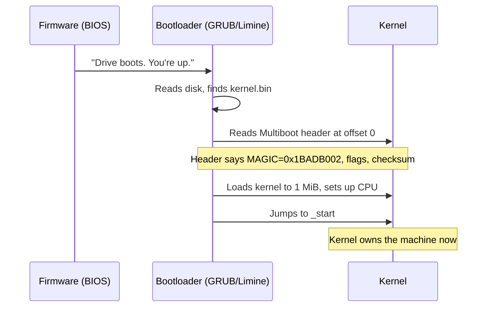
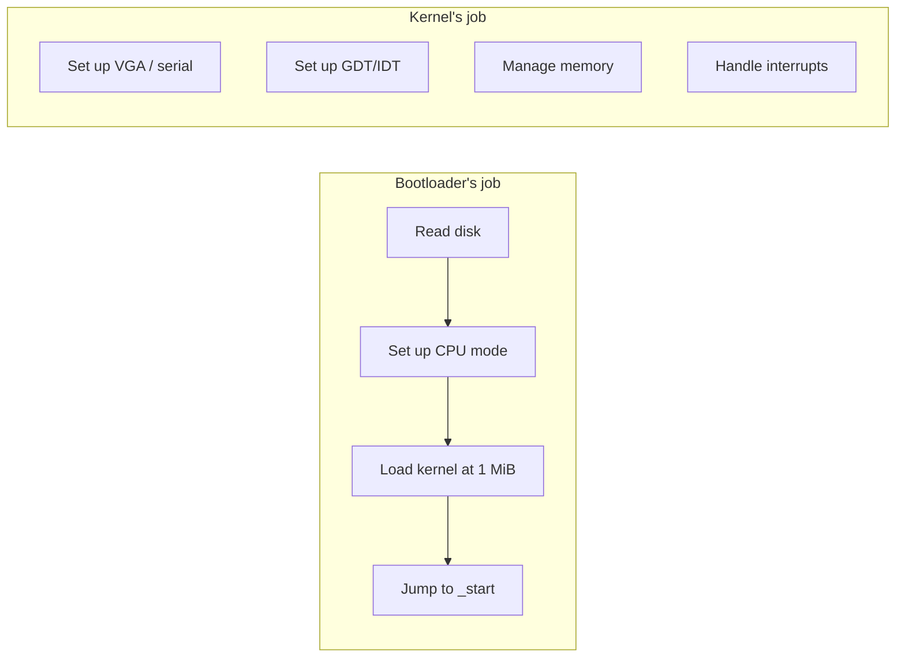

# Concept — Bootloaders & the Multiboot Protocol

*Original content written for OSDev_Learning_Hub.*

## In one sentence
A **[bootloader](../../GLOSSARY/bootloader.md "A small program that loads your kernel into memory and jumps to it")** is a tiny program that turns the raw hardware over to your kernel; the **[Multiboot protocol](../../GLOSSARY/multiboot.md "The protocol that lets a bootloader load any kernel; magic 0x1BADB002")** is the handshake that lets any standard bootloader load *any* kernel that follows the rules.



## The Multiboot header — 12 bytes that change everything

The header is a fixed 12-byte structure at the very start of the kernel image:

| Field | Value | Why |
|-------|-------|-----|
| **Magic** | `0x1BADB002` | Bootloader's secret handshake |
| **Flags** | `ALIGN \| MEMINFO` (e.g. `0x3`) | "align modules" + "give me a memory map" |
| **Checksum** | `-(magic + flags)` | Validation: magic+flags+checksum must equal 0 |

In assembly (NASM), it looks like this:

```nasm
section .multiboot
align 4
    dd 0x1BADB002    ; magic
    dd 0x03          ; flags: align + meminfo
    dd -(0x1BADB002 + 0x03)   ; checksum
```

Why does the `flags` bit for a **memory map** matter? Because when your kernel runs, it has no idea how much RAM exists. Multiboot can hand you a memory map so you can write a [memory manager](../../GLOSSARY/memory-management.md "How a kernel tracks used and free RAM and hands it out safely") (next concept).

## Why "1 MiB"?
Below 1 MiB lives the "low memory" area full of things the bootloader and [BIOS](../../GLOSSARY/bios.md "The motherboard firmware that starts the machine and finds a bootloader") use. Kernels are conventionally loaded **at or above 1 MiB** (`0x100000`) to avoid stomping on that region. Your linker script sets `ENTRY(_start)` and `. = 1M;` to match.

## Bootloader vs your kernel's job


You are **not** writing a bootloader — you're writing the kernel. That's an enormous head start. Use [GRUB](../../GLOSSARY/grub.md "The free GNU bootloader that loads Multiboot kernels") (C/C++/Go) or the Rust `bootloader` crate and focus on the interesting part: the OS itself.

## The three Multiboot generations you'll meet
| Name | Magic | Notes |
|------|-------|-------|
| **Multiboot** (v1) | `0x1BADB002` | What most Bare Bones tutorials use (32-bit) |
| **Multiboot 2** (v2) | `0xE85250D6` | Modern; what Limine and many 64-bit kernels use |
| **Rust bootloader crate** | depends | Handles it for you, no assembly needed |

> **Next:** [`02-memory-management.md`](02-memory-management.md).

## Watch and learn

<details class="video-embed">
<summary>▶ Watch: OS development 101 - How to make a bootloader part 1 - Hello World</summary>
<iframe src="https://www.youtube-nocookie.com/embed/E_n0VtGSZQY" title="OS development 101 - How to make a bootloader part 1 - Hello World" width="100%" height="400" style="border:0;border-radius:8px;" allow="accelerometer; autoplay; clipboard-write; encrypted-media; gyroscope; picture-in-picture; web-share" allowfullscreen></iframe>
<p class=video-caption>Low Level Learning builds a bootloader from scratch and boots it, covering what happens at PC startup and real mode.</p>
</details>
<details class="video-embed">
<summary>▶ Watch: OS development 101 - How to make a bootloader part 2</summary>
<iframe src="https://www.youtube-nocookie.com/embed/BQGbBCqUGCc" title="OS development 101 - How to make a bootloader part 2" width="100%" height="400" style="border:0;border-radius:8px;" allow="accelerometer; autoplay; clipboard-write; encrypted-media; gyroscope; picture-in-picture; web-share" allowfullscreen></iframe>
<p class=video-caption>The follow-up that takes the bootloader further and shows bootable code in action.</p>
</details>
<details class="video-embed">
<summary>▶ Watch: Building an OS - 7 - Finishing the bootloader, migrating to GCC</summary>
<iframe src="https://www.youtube-nocookie.com/embed/qr8d7bZLPHg" title="Building an OS - 7 - Finishing the bootloader, migrating to GCC" width="100%" height="400" style="border:0;border-radius:8px;" allow="accelerometer; autoplay; clipboard-write; encrypted-media; gyroscope; picture-in-picture; web-share" allowfullscreen></iframe>
<p class=video-caption>Nanobyte rounds out the bootloader and hands off to a compiled kernel, the same job GRUB/Multiboot loaders automate.</p>
</details>
