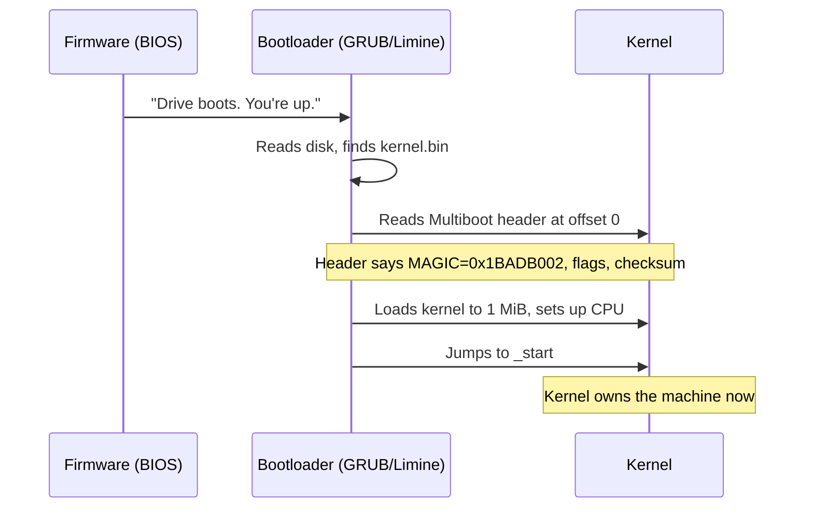
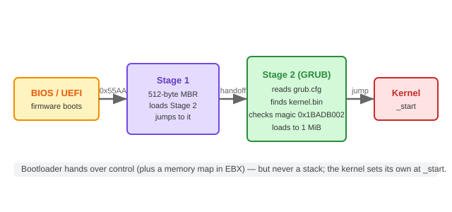
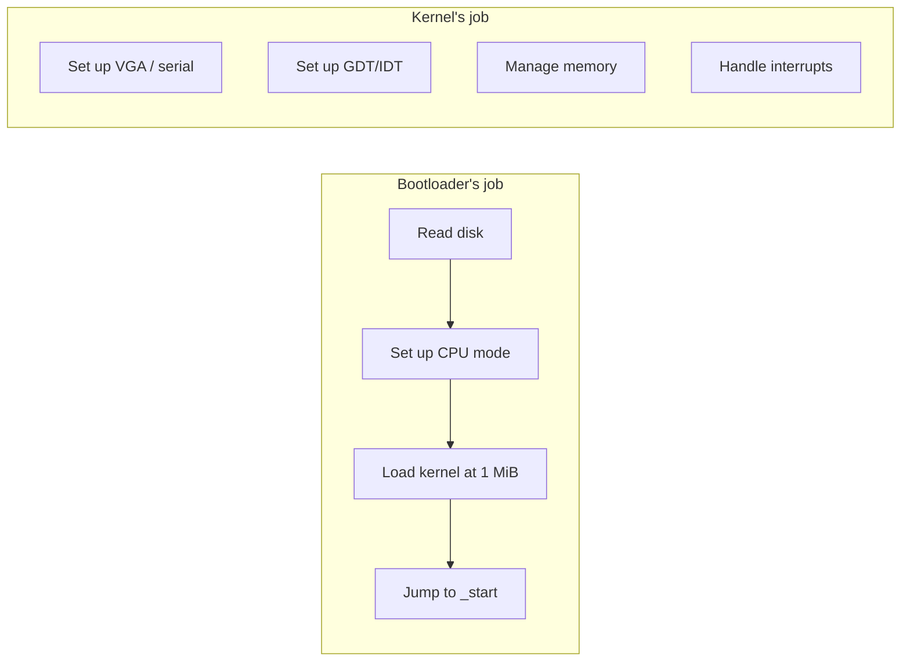
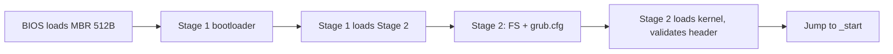

# Concept — Bootloaders & the Multiboot Protocol

*Original content written for OSDev_Learning_Hub.*

## In one sentence
A **[bootloader](../../GLOSSARY/bootloader.md "A small program that loads your kernel into memory and jumps to it")** is a tiny program that turns the raw hardware over to your kernel; the **[Multiboot protocol](../../GLOSSARY/multiboot.md "The protocol that lets a bootloader load any kernel; magic 0x1BADB002")** is the handshake that lets any standard bootloader load *any* kernel that follows the rules.



The whole handoff, as one chain of control passing from firmware to your kernel:



*The boot chain: firmware → Stage 1 (MBR) → Stage 2 (GRUB) → your kernel's `_start`.*

## The Multiboot header — 12 bytes that change everything

The header is a fixed 12-byte structure at the very start of the kernel image:

| Field | Value | Why |
|-------|-------|-----|
| **Magic** | `0x1BADB002` | Bootloader's secret handshake |
| **Flags** | `ALIGN \| MEMINFO` (e.g. `0x3`) | "align modules" + "give me a memory map" |
| **Checksum** | `-(magic + flags)` | Validation: magic+flags+checksum must equal 0 |

In assembly (NASM), it looks like this:

```nasm
section .multiboot
align 4
    dd 0x1BADB002    ; magic
    dd 0x03          ; flags: align + meminfo
    dd -(0x1BADB002 + 0x03)   ; checksum
```

Why does the `flags` bit for a **memory map** matter? Because when your kernel runs, it has no idea how much RAM exists. Multiboot can hand you a memory map so you can write a [memory manager](../../GLOSSARY/memory-management.md "How a kernel tracks used and free RAM and hands it out safely") (next concept).

## Why "1 MiB"?
Below 1 MiB lives the "low memory" area full of things the bootloader and [BIOS](../../GLOSSARY/bios.md "The motherboard firmware that starts the machine and finds a bootloader") use. Kernels are conventionally loaded **at or above 1 MiB** (`0x100000`) to avoid stomping on that region. Your linker script sets `ENTRY(_start)` and `. = 1M;` to match.

## Bootloader vs your kernel's job


You are **not** writing a bootloader — you're writing the kernel. That's an enormous head start. Use [GRUB](../../GLOSSARY/grub.md "The free GNU bootloader that loads Multiboot kernels") (C/C++/Go) or the Rust `bootloader` crate and focus on the interesting part: the OS itself.

## The three Multiboot generations you'll meet
| Name | Magic | Notes |
|------|-------|-------|
| **Multiboot** (v1) | `0x1BADB002` | What most Bare Bones tutorials use (32-bit) |
| **Multiboot 2** (v2) | `0xE85250D6` | Modern; what Limine and many 64-bit kernels use |
| **Rust bootloader crate** | depends | Handles it for you, no assembly needed |

> **Next:** [`02-memory-management.md`](02-memory-management.md).

## Watch and learn

<details class="video-embed">
<summary>▶ Watch: OS development 101 - How to make a bootloader part 1 - Hello World</summary>
<iframe src="https://www.youtube-nocookie.com/embed/E_n0VtGSZQY" title="OS development 101 - How to make a bootloader part 1 - Hello World" width="100%" height="400" style="border:0;border-radius:8px;" allow="accelerometer; autoplay; clipboard-write; encrypted-media; gyroscope; picture-in-picture; web-share" allowfullscreen></iframe>
<p class=video-caption>Low Level Learning builds a bootloader from scratch and boots it, covering what happens at PC startup and real mode.</p>
</details>
<details class="video-embed">
<summary>▶ Watch: OS development 101 - How to make a bootloader part 2</summary>
<iframe src="https://www.youtube-nocookie.com/embed/BQGbBCqUGCc" title="OS development 101 - How to make a bootloader part 2" width="100%" height="400" style="border:0;border-radius:8px;" allow="accelerometer; autoplay; clipboard-write; encrypted-media; gyroscope; picture-in-picture; web-share" allowfullscreen></iframe>
<p class=video-caption>The follow-up that takes the bootloader further and shows bootable code in action.</p>
</details>
<details class="video-embed">
<summary>▶ Watch: Building an OS - 7 - Finishing the bootloader, migrating to GCC</summary>
<iframe src="https://www.youtube-nocookie.com/embed/qr8d7bZLPHg" title="Building an OS - 7 - Finishing the bootloader, migrating to GCC" width="100%" height="400" style="border:0;border-radius:8px;" allow="accelerometer; autoplay; clipboard-write; encrypted-media; gyroscope; picture-in-picture; web-share" allowfullscreen></iframe>
<p class=video-caption>Nanobyte rounds out the bootloader and hands off to a compiled kernel, the same job GRUB/Multiboot loaders automate.</p>
</details>
<details class="video-embed">
<summary>▶ Watch: How to make an operating system from scratch (part 1)</summary>
<iframe src="https://www.youtube-nocookie.com/embed/rr-9w2gITDM" title="1 - How to make an operating system from scratch" width="100%" height="400" style="border:0;border-radius:8px;" allow="accelerometer; autoplay; clipboard-write; encrypted-media; gyroscope; picture-in-picture; web-share" allowfullscreen></iframe>
<p class=video-caption>A complete from-scratch build: assemble the multiboot entry stub, compile a C kernel, and boot it in QEMU — the exact recipe this concept describes.</p>
</details>

**More bootloader picks**
- ▶ [OS Development: Low-level Boot-Sector Programming (1/9)](https://www.youtube-nocookie.com/embed/YvZhgRO7hL4) starts one level below Multiboot, writing raw boot-sector code that GRUB would otherwise handle.
- ▶ [BIOS and UEFI As Fast As Possible](https://www.youtube-nocookie.com/embed/zIYkol851dU) grounds you in the firmware that hands control to any bootloader.

---

## Further reading

- [OSDev Wiki — Bare Bones](https://wiki.osdev.org/Bare_Bones) — the canonical first kernel tutorial; it is literally this concept in practice.
- [OSDev Wiki — Multiboot](https://wiki.osdev.org/Multiboot) — how the header you wrote is interpreted by loaders.
- [The Multiboot Specification (GNU/GRUB)](https://www.gnu.org/software/grub/manual/multiboot/multiboot.html) — the authoritative spec behind magic `0x1BADB002`.
- [OSDev Wiki — Rolling Your Own Bootloader](https://wiki.osdev.org/Rolling_Your_Own_Bootloader) — what a bootloader actually does, if you ever want to write one by hand.
- [OSDev Wiki — Bootloader](https://wiki.osdev.org/Bootloader) — bootloader theory: single vs two-stage design.
- [*Making an OS (x86)* by Daedalus Community](https://github.com/davidcallanan/os-series) — a complete boot-to-kernel series with source.
- [Nick Blundell — *Writing a Simple Operating System from Scratch* (PDF)](https://www.cs.bham.ac.uk/~exr/lectures/opsys/10_11/lectures/os-dev.pdf) — the classic free lecture notes; boots straight into this material.


---

## Going deeper: what the bootloader actually inspects

The Multiboot header is only 12 bytes, but those 12 bytes carry a surprising amount of contract. Let's crack open each field, then show how the bootloader reads them.

### The three fields, byte by byte

```nasm
section .multiboot
align 4
    dd 0x1BADB002                    ; magic
    dd 0x00000003                    ; flags (align=1 | meminfo=2)
    dd -(0x1BADB002 + 0x00000003)    ; checksum
```

**Magic `0x1BADB002`.** When the bootloader scans the first 8 KiB of the kernel image (and, per spec, within the first 8192 bytes), it looks for this exact value. It's how it distinguishes "this is a Multiboot kernel" from "this is some random binary."

**Flags.** Each bit is a request from the kernel to the bootloader:

| Bit | Value | Meaning |
|-----|-------|---------|
| bit 0 | `0x1` | **ALIGN** — "align my modules on page boundaries" |
| bit 1 | `0x2` | **MEMINFO** — "give me a memory map" (essential for a memory manager) |
| bit 2 | `0x4` | **VIDEO** — "set a video mode for me" (rarely used in text-mode starters) |

The classic `0x03` requests both ALIGN and MEMINFO. If you forget MEMINFO, the bootloader won't hand you the memory map — and your future [memory manager](../../GLOSSARY/memory-management.md "How a kernel tracks used and free RAM and hands it out safely") will have no idea how much RAM exists.

**Checksum.** The loader validates the header by computing `magic + flags + checksum` and requiring the result to be **zero** (wrapped to 32 bits). That's why the third field is literally `-(magic + flags)`. It's the loader's "did you even read the spec?" handshake.

```c
// Conceptually, the bootloader does this when it finds your header:
if ((header.magic + header.flags + header.checksum) != 0)
    reject("invalid multiboot header");
```

### Where the header must live

Per spec, the header must appear within the **first 8192 bytes** of the kernel image (and the loader typically scans the first 8 KiB of the *first loaded sector*). This is why the linker script places `.multiboot` first and why we keep emphasizing section order in the toolchain chapter: it's a spec requirement, not a style preference.

```bash
# Prove your header is in the right place
readelf -S kernel.bin        # .multiboot should be section #1, early in .text
objdump -s -j .multiboot kernel.bin   # hex-dump the 12 bytes: 02 B0 AD 1B ...
```

You should see `02 B0 AD 1B` (little-endian `0x1BADB002`) at the very start of the `.multiboot` section.

---

## What GRUB does the moment it loads your kernel

Once GRUB has found and validated the header, it performs a quiet set of setup steps before control ever reaches `_start`. Knowing these *precisely* explains what you can assume in your kernel:

1. **Places the kernel** at the address your linker script requested (`. = 1M;` for the toolchain chapter's script), loading each ELF segment to its own address.
2. **Zeroes the BSS** (so your uninitialized globals start at zero, unlike the garbage you'd otherwise get).
3. **Builds a boot information structure** describing the memory map, framebuffer, module list, and command line — and passes a pointer to it in `EBX` (and `EAX` holds a validation magic, `0x2BADB002`).
4. **Sets up flat segmentation** (a GDT covering the whole space) and moves into 32-bit protected mode.
5. **Does NOT set up a stack** for you. The Multiboot spec leaves the stack uninitialized — which is exactly why every bootstrap has `mov esp, stack_top` before the first call.

That last point is the one beginners trip on: "But GRUB set everything up!" GRUB sets up the *machine*, but a usable **stack is your job**. The Multiboot spec is explicit that the stack is undefined at entry. Memorize that and the "kernel instantly dies on the first call" mystery is solved forever.

```asm
; In your _start, BEFORE any call, you MUST set a stack:
_start:
    mov esp, stack_top   ; (1) stack or nothing works
    ; push/pop and call can now happen safely
    call kernel_main
```

### Receiving the memory map (why MEMINFO matters)

When you request MEMINFO, the bootloader hands you the memory map *through the boot information structure — not as a simple return value*. You read the memory-map table from `EBX`. In C, the structure looks like:

```c
// (simplified) fields of the Multiboot boot info struct
struct multiboot_info {
    uint32_t flags;                 // which fields below are valid
    uint32_t mem_lower;             // low memory in KiB (if flags bit 0)
    uint32_t mem_upper;             // high memory in KiB (if flags bit 0)
    // ... boot_device, cmdline, mods ...
    uint32_t mmap_length;           // bytes of the memory map table
    uint32_t mmap_addr;             // pointer to the memory map table
    // ...
};
```

Your kernel reads `mmap_addr`/`mmap_length` and walks the entries to learn which physical regions are usable. That is the literal bridge to the memory-management concept. Without the `MEMINFO` flag, those fields are meaningless.

```
+----------------+   EBX ---> { flags=..., mmap_addr=0x1000, mmap_length=128 }
| multiboot_info |   mmap_addr ---> [ entry1 | entry2 | ... ]
+----------------+
    entry: { size, addr, len, type }   type=1 means "available RAM"
```

---

## Two-stage bootloaders: why your kernel is not a boot sector

In the toolchain and chapter-00 material you saw `0x55AA` boot sectors. A single 512-byte sector is the *bottom* rung. Real bootloaders like GRUB are **two-stage**:

1. **Stage 1** fits in the 512-byte MBR. All it does is: find the second stage on disk, load it into memory (above 1 MiB), and jump to it.
2. **Stage 2** is big (GRUB's is hundreds of KiB) and does the real work: parse filesystems, read `grub.cfg`, find your kernel, validate the Multiboot header, and do the handoff.

The reason for the split is pure physics: BIOS can load only *one* 512-byte sector by default (the MBR). By the second stage, your code can call BIOS disk services (`int 0x13`) to read arbitrary sectors, so the size limit disappears.



**Why you should not write this by hand (yet).** Rolling your own bootloader is a famous teaching exercise, but it's a *detour* on the road to an OS. Using GRUB (or the Rust `bootloader` crate) lets you skip stages 1–2 and start at "load the kernel," which is what you actually care about as a kernel author. Come back and write a bootloader later, when you understand everything it does for you.

| Boot path you'll use | What it handles for you | You provide |
|----------------------|-------------------------|-------------|
| GRUB + Multiboot | MBR, stage 2, FS, protected mode, header validation | kernel + header |
| Limine + Multiboot 2 | same but for 64-bit / long mode | kernel + MB2 header |
| Rust `bootloader` crate | everything, no assembly | kernel (Rust) |
| Hand-rolled bootloader | nothing | everything (learning only) |

---

## Multiboot 1 vs Multiboot 2 — when to move up

This hub's early kernels use Multiboot v1 (`0x1BADB002`) because it's what most "bare bones" tutorials and QEMU's `-kernel` understand. Multiboot 2 (`0xE85250D6`) is the modern successor used by Limine and most 64-bit kernels. Key differences:

| Feature | Multiboot v1 | Multiboot 2 |
|---------|--------------|-------------|
| Magic | `0x1BADB002` | `0xE85250D6` |
| Architecture | header fields | **tags** (variable-length, extensible) |
| Memory map | boot info struct | tag-based |
| 64-bit / long mode | no (32-bit) | yes |
| Graphics | limited | better (framebuffer tags) |
| Typical user | GRUB, Bare Bones | Limine, modern 64-bit OSes |

The huge practical difference is the **tag system**: Multiboot 2 hands the kernel a linked list of tags (memory map, framebuffer, command line, ...), and each tag is self-describing and additive. Newer loaders understand newer tags; older ones ignore them. That extensibility is why the ecosystem moved to it.

For now, stay on v1 with GRUB/`-kernel`. When you take a kernel 64-bit (or want a framebuffer), you'll switch that one header and a few reads — the concepts are identical.

### A Multiboot 2 header for contrast

```nasm
; header.S — Multiboot 2 header (the modern form)
section .multiboot
align 8
    dd 0xE85250D6        ; magic (Multiboot 2)
    dd 0                 ; architecture (0 = i386)
    dd header_end - header_start  ; header length
    dd -(0xE85250D6 + 0 + (header_end - header_start)) ; checksum
header_start:
    ; end tag: not required, but good hygiene
    dw 0   ; type = end
    dw 0   ; flags
    dd 8   ; size
header_end:
```

Notice the same three-part idea (magic, length, checksum) but now built from tags. If a bootloader doesn't understand a tag's type, it skips it by its size — that's the extensibility Multiboot 1 lacks.

---

## Common pitfalls when your kernel won't be found or loaded

1. **"No multiboot header found."** The header isn't in the first 8192 bytes, or `.multiboot` isn't first in the linked image. Verify with `readelf -S` / `objdump`.
2. **Checksum mismatch.** You hand-wrote a flags value but forgot to update `-(magic + flags)`. The loader's "sum to zero" check fails. Recompute the third field every time you touch flags.
3. **Using the wrong magic for the loader.** GRUB's `multiboot2` command wants `0xE85250D6`; `multiboot` (v1) wants `0x1BADB002`. Mixing them yields "invalid magic."
4. **No stack at `_start`.** GRUB does not set one. The first `push`/`call` goes to address 0 → triple fault. Always `mov esp, stack_top` first.
5. **Forgetting the memory map is on `EBX`, not a function return.** You must read the boot info structure pointer from `EBX` (and verify `EAX == 0x2BADB002`) if you want the map.
6. **Trying to use a `printf`-style function provided by a bootloader.** There is none. Once you've left the bootloader, everything is yours to implement.

---

## Learning checkpoints

- [ ] **I can write the 12-byte Multiboot header** in NASM, including a correct checksum, from memory.
- [ ] **I can explain what each flag bit requests**, especially ALIGN and MEMINFO.
- [ ] **I know that GRUB does NOT set a stack** and that I must set one at `_start`.
- [ ] **I can describe what the bootloader does between loading the header and jumping to `_start`** (BSS zeroing, GDT, protected mode, boot-info in EBX).
- [ ] **I can explain why bootloaders are two-stage** and why I don't need to write one myself yet.
- [ ] **I can contrast Multiboot v1 with Multiboot 2** and name when each is appropriate.
- [ ] **I can locate my header** with `readelf`/`objdump` and confirm it's inside the first 8192 bytes.

---

## From this chapter to memory management

The single thread that ties this chapter to the next is the **memory map**. When you request MEMINFO and receive the map via `EBX`, your kernel finally knows how much RAM exists and where it's usable. That knowledge is the raw material for every memory manager you'll write — the bitmap, the buddy allocator, paging. The bootloader isn't just "starting your kernel"; it's handing you the map of the territory you're about to manage.

---

## Watch more

<details class="video-embed">
<summary>▶ Watch: Write Your Own Operating System in 1 Hour</summary>
<iframe src="https://www.youtube-nocookie.com/embed/1rnA6wpF0o4" title="Write Your Own Operating System in 1 Hour" width="100%" height="400" style="border:0;border-radius:8px;" allow="accelerometer; autoplay; clipboard-write; encrypted-media; gyroscope; picture-in-picture; web-share" allowfullscreen></iframe>
<p class=video-caption>Uses a GRUB bootloader to load a Multiboot kernel end to end — the exact handshake and two-stage boot path this concept describes, live.</p>
</details>
<details class="video-embed">
<summary>▶ Watch: OSDev Lecture Series 4: Global Descriptor Table</summary>
<iframe src="https://www.youtube-nocookie.com/embed/0nT_2aIOTq8" title="OSDev Lecture Series 4: Global Descriptor Table" width="100%" height="400" style="border:0;border-radius:8px;" allow="accelerometer; autoplay; clipboard-write; encrypted-media; gyroscope; picture-in-picture; web-share" allowfullscreen></iframe>
<p class=video-caption>Everything a bootloader sets up for you — the GDT, protected-mode segmentation, and the A20 line — explained in depth, so you understand what you're inheriting at `_start`.</p>
</details>


---

## Deeper look: GRUB's command line and how you'll interact with it

When testing on a real ISO (not QEMU's `-kernel` shortcut), you'll live in GRUB's boot menu. A few things are worth knowing:

### The GRUB command line as a debugging friend

GRUB has an interactive command line. Press `c` at the menu to get a prompt where you can type:

```
grub> ls                       # list drives/partitions
grub> ls (hd0,msdos1)/boot/    # list files
grub> multiboot2 /boot/kernel.bin  # manually load a kernel
grub> boot                     # actually boot it
```

Typing `multiboot2` (or `multiboot`) and `boot` by hand bypasses `grub.cfg` entirely — an excellent way to test a kernel when you suspect your config file is the problem. If the kernel boots from the manual prompt but not from your `menuentry`, the issue is your config, not your kernel.

### Passing a command line to your kernel

GRUB lets you append a command line that ends up in the boot info structure:

```cfg
menuentry "MyOS" {
    multiboot2 /boot/kernel.bin verbose=1
    boot
}
```

The kernel reads this from the `cmdline` field of the Multiboot boot-info struct. It's a handy (if low-tech) way to toggle debug prints without recompiling. Many hobby OSes use exactly this: `vga=YES`, `serial=on`, `debug=3`.

### Why your `grub.cfg` matters less than your header

A kernel that boots via `qemu -kernel` but fails to appear in a GRUB menu is *almost never* a config problem — it's almost always the header. GRUB's menu config only says *which file* to load and *which command* to use; without a valid Multiboot header inside that file, `boot` will say "error: invalid magic number." So when in doubt, test from the GRUB command line, and verify your header with `readelf` before touching the config.

---

## Roll your own bootloader: a minimal worked example

You don't have to, but *seeing* a minimal bootloader demystifies what GRUB does for you. Here is the absolute simplest one that works: a 512-byte real-mode boot sector that boots straight into a tiny kernel. This is the hand-rolled path the community uses to *learn* — and it maps 1:1 to what GRUB automates.

### The bootloader (`boot.asm`)

```nasm
[org 0x7C00]
    cli
    ; --- real mode: load a kernel from "disk" into memory at 0x1000 ---
    mov ax, 0x1000
    mov es, ax
    xor bx, bx          ; ES:BX = 0x1000:0x0000 = 0x10000 (64 KiB)
    mov ah, 0x02        ; BIOS "read sectors" service
    mov al, 1           ; read 1 sector
    mov ch, 0
    mov cl, 2           ; sector 2 (sector 1 is us)
    mov dh, 0
    mov dl, 0x80        ; first hard disk
    int 0x13            ; call BIOS disk service
    ; --- enter protected mode (skipping full GDT for brevity) ---
    ; ... load GDT, set CR0.PE, far jump ...
    jmp 0x08:0x10000    ; jump to the kernel we loaded
times 510-($-$$) db 0
dw 0xAA55
```

### The kernel (`kernel.asm`)

```nasm
[bits 32]
_start:
    mov esp, 0x20000    ; set a stack
    mov esi, msg        ; print by writing to 0xB8000
    mov edi, 0xB8000
    mov ah, 0x0F
.print:
    lodsb
    or al, al
    jz .done
    mov [edi], ax
    add edi, 2
    jmp .print
.done:
    hlt
    jmp .done
msg: db "Kernel!", 0
```

### Assembling and booting this pair

```bash
nasm -f bin boot.asm -o boot.bin
nasm -f bin kernel.asm -o kernel.bin
# Put boot.bin in sector 0, kernel.bin in sector 1, of one floppy image
dd if=boot.bin of=floppy.img conv=notrunc
dd if=kernel.bin of=floppy.img bs=512 seek=1 conv=notrunc
qemu-system-i386 -fda floppy.img
```

You just saw (in miniature) *everything* GRUB does in production: load a second program off disk, switch to protected mode, hand off control. The differences from GRUB are size (512 bytes vs hundreds of KiB), filesystem awareness (GRUB reads ext4/btrfs; this reads raw sectors), and robustness. Writing this once is a rite of passage; using GRUB every day is the practical choice.

### The division of labor, made visible

| Job | GRUB does it | Our mini-bootloader does it |
|-----|--------------|-----------------------------|
| Find the kernel on disk | yes (via filesystem) | yes (sector 2, assumed) |
| Load it into memory | yes | yes (`int 0x13`) |
| Enter protected mode | yes | yes (sketch) |
| Validate a handshake | Multiboot header | none (hardcoded jump) |
| Pass a memory map | yes | no |
| Scale beyond 512B | stage 2 | barely |

The takeaway: a bootloader is "load, switch mode, jump." GRUB is that plus filesystems, robustness, and the Multiboot handshake. The Rust `bootloader` crate is that, wrapped in a build-friendly package with no assembly for you to write.

---

## Multiboot modules: loading extra data with your kernel

A feature of the Multiboot protocol you'll use surprisingly early is **modules** — extra files GRUB loads into memory alongside your kernel, with the loader reporting their addresses in the boot-info struct. You might load:

- a **framebuffer / graphics file** (e.g. a font or palette),
- an **initrd** (initial RAM disk) containing drivers or files,
- configuration data you'd rather not bake into the kernel.

```cfg
menuentry "MyOS" {
    multiboot2 /boot/kernel.bin
    module2 /boot/font.psf    # load a file as a module
    boot
}
```

Your kernel then reads the module list from the boot info structure — each entry has a start address, end address, and (optionally) a name/command line:

```c
// (conceptual) walking module list from multiboot_info
struct multiboot_mod_list {
    uint32_t mod_start;
    uint32_t mod_end;
    uint32_t cmdline;   // optional
    uint32_t pad;
};
```

The module mechanism is the boot-time version of "give the kernel some files it didn't compile in." It's a classic reason to keep the `MEMINFO`/module flags straight — and a sneak peek at how real kernels load initrds before they have a filesystem driver.

---

## The three "generations" — which one is THIS kernel using?

Beginners get confused because there are genuinely *several* boothand-shakes floating through tutorials. A quick decision table so you never mix them up:

| If you see... | It's... | Loader |
|---------------|---------|--------|
| `0x1BADB002` + `dd` × 3 | Multiboot v1 header | GRUB `multiboot`, QEMU `-kernel` |
| `0xE85250D6` + tags | Multiboot 2 header | GRUB `multiboot2`, Limine |
| `boot.s` relying on a crate | Rust `bootloader` crate | its own loader |
| a `[org 0x7C00]` + `0xAA55` | raw boot sector | BIOS directly (no Multiboot) |
| a PE/COFF `.efi` | UEFI application | UEFI firmware |

This hub's five-language walkthroughs use **row 1** (C/C++/Go via GRUB), **row 3** (Rust via the crate), and a Cosmos-specific path for C#. All of them still produce a kernel that a bootloader loads and jumps to — the chapter's core idea.

---

## Common questions, answered

**Q: If GRUB does so much, is using it "cheating"?**
A: No. Real kernels (Linux, BSDs, Windows) all use bootloaders — GRUB, Limine, systemd-boot, Windows Boot Manager. Writing your own bootloader is a separate engineering feat, not a prerequisite for an OS. Use the tool; learn its job; revisit writing one later.

**Q: My header is correct but GRUB still says invalid magic. Why?**
A: Check byte order. On disk, little-endian `0x1BADB002` appears as `02 B0 AD 1B`. If your build produced big-endian or byte-swapped content, the loader won't match the constant. Also confirm you're loading with `multiboot` (v1) vs `multiboot2` (v2) to match your magic.

**Q: Does `align 4` on the header matter?**
A: Yes. The spec requires the header fields to be 32-bit aligned. If you skip `align 4`, some loaders (and your checksum math) can misread the fields. Always `align 4` before the header.

**Q: I set MEMINFO but `mmap_length` is 0. What went wrong?**
A: Either the bootloader didn't honor the flag (rare with GRUB), you parsed the boot-info struct at the wrong offset, or you forgot to read `EBX` — the pointer lives in a register, not as a declared global.

**Q: Can I boot the same kernel with `-kernel` AND from a real GRUB?**
A: Yes, if it's a proper Multiboot v1 image. `qemu -kernel` and GRUB both speak the same protocol. That's the whole point of the protocol — portability across loaders.

---

## Learning checkpoints, round two

- [ ] **I can write a minimal hand-rolled bootloader** that loads a kernel and jumps to it, and explain what GRUB automates on top.
- [ ] **I can use the GRUB command line** (`c` → `multiboot2 ...` → `boot`) to test a kernel without grub.cfg.
- [ ] **I can pass a command line string** to my kernel via GRUB and read it from the boot-info `cmdline` field.
- [ ] **I can load a module** (`module2`) and walk the module list in the boot-info struct.
- [ ] **I can identify which boot-handshake a tutorial is using** from its magic number / section layout, and pick the matchingloader command.

If you can do all of that, you genuinely own the bootloader half of the story. The other half — what the kernel does with the memory map the bootloader handed it — is exactly the next concept chapter.

---

## From this chapter to memory management (the bridge)

One sentence to carry forward: **the bootloader's `MEMINFO` handoff is the entire reason your memory manager can exist.** Without the memory map delivered via `EBX`, your kernel literally cannot know how much RAM it has or where it's safe to use. That map — `{addr, len, type}` entries where `type=1` means "available" — is the first input a frame allocator consumes. So as you open the memory-management concept next, keep this in mind: you are not designing memory management from nothing; you are *processing the map a bootloader already gave you*.


---

## A mental model: the Multiboot header as a "resume"

Think of the bootloader as a hiring manager and the Multiboot header as the kernel's *resume*:

- **Magic `0x1BADB002`** — a secret handshake that says "I'm a qualified candidate (a Multiboot-compliant kernel)." Without it, the manager won't even read further.
- **Flags** — a way for you (the kernel) to tell the manager *what you need*: an aligned placement, a memory map, a video mode. "Hire me, and please bring these supplies."
- **Checksum** — proof the resume was filled out correctly and not corrupted; the manager verifies the math before offering the job.

And the two-stage bootloader is the *headhunter*: stage 1 is the tiny first contact that walks in the door (512 bytes, limited), and stage 2 is the experienced recruiter who does the real screening (filesystems, config, validation) before handing you to the kernel. Your kernel is the candidate who finally runs the company.

If this analogy sticks, you'll never again wonder "why 12 bytes at the front?" — those 12 bytes are the resume that gets your kernel hired onto the machine.

## Quick-reference box: the whole Multiboot choreography

```
CPU boots at reset vector
   → BIOS runs POST
   → BIOS finds MBR (0x55AA) and runs Stage-1 bootloader
   → Stage 1 loads Stage 2
   → Stage 2 (GRUB) reads grub.cfg, finds /boot/kernel.bin
   → Stage 2 scans for header magic 0x1BADB002 (first 8192 bytes)
   → Stage 2 validates checksum (magic+flags+checksum == 0)
   → Stage 2 loads ELF segments to linker-addresses (1 MiB)
   → Stage 2 zeroes BSS, builds GDT, enters protected mode
   → Stage 2 writes boot-info (incl. memory map) and sets EBX
   → Stage 2 jumps to _start (you set the stack NOW!)
   → YOUR KERNEL OWNS THE MACHINE
```

Print that. Tape it above your monitor. Every chapter of the rest of this hub plugs into a different line of this choreography — memory management consumes the memory map from line 10, interrupts consume the CPU mode set by line 9, and the VGA "hello world" is the very first thing you do after line 12. Knowing exactly where you are in this sequence is what turns OS-dev from a blur of magic into a structured discipline.

## Where to go next from here

- If your goal is to *see* this chapter in action, the **"Hello World of OSes"** recipe chapter in this same concepts folder builds the header + bootstrap by hand.
- The **memory-management** concept (next) is where the memory map you've now earned actually gets used.
- If you want to *go deeper* on the bootloader itself, the Further-reading list below (GRUB manual, OSDev's Rolling Your Own Bootloader) is the canonical trail.

You now know what a bootloader is, what it does for you, and — critically — what it *doesn't* (set your stack). That last distinction is the difference between a kernel that boots and a kernel that silently dies at the first `call`. Carry it forward.


---

## Practice problems (work them in your head, then check)

1. **You compile a kernel, and QEMU's `-kernel` boots it, but GRUB on an ISO says "invalid magic number."** Name the most likely difference between the two paths.
   *Answer: QEMU's `-kernel` loader is lenient about some layout details; GRUB strictly requires the header within the first 8192 bytes / a valid checksum. Re-check section order and the checksum formula.*

2. **You add the `VIDEO` flag bit to your header (`0x03` → `0x07`) and recompile but do not change anything else.** Why is that a bug?
   *Answer: the flags value changed, so the checksum `-(magic + flags)` is now wrong and GRUB rejects the header. Every flags edit requires recomputing the checksum.*

3. **Your kernel triple-faults at the very first `call` in `_start`.** The bootloader clearly ran (the QEMU window opened). What did you forget?
   *Answer: a stack. GRUB doesn't set one; you must `mov esp, stack_top` before any push/call.*

4. **You set `MEMINFO` but your kernel reads `mmap_length == 0`.** Where is the pointer you should have read instead of hardcoding the map location?
   *Answer: `EBX` holds the address of the boot-info struct at entry; the map table address/length live inside that struct, not at a fixed address you chose.*

5. **You see `0xE85250D6` at the start of someone's kernel and type GRUB's `multiboot` command**; it fails. Why?
   *Answer: that's a Multiboot 2 magic — you need the `multiboot2` command. The two handshakes are not interchangeable.*

These five questions compress the entire chapter into the traps you'll actually hit. If you can answer all five, you have earned the bootloader concept.

## A note on the Rust `bootloader` crate (no-assembly path)

If you follow the Rust walkthrough in this hub, you'll notice you never write `boot.s` or a linker script by hand. The `bootloader` crate bundles both: it builds a real (Limine-backed) bootloader *and* a linker script, and integrates with `cargo`. What it does *not* do is change the underlying story:

- The crate still produces a kernel the bootloader loads,
- it still sets up the CPU mode and jumps to your `_start`,
- and it still gives you a memory map and a boot-info structure to consume.

So the "no assembly" path isn't magic — it's GRUB/Limine and a linker script, wrapped and shipped as a crate. The concepts in this chapter (and the choreography box above) apply verbatim; only the *where the code lives* differs. That's the same story you'll hear in every language walkthrough: the ideas are language-agnostic; the plumbing is not.

Understanding this is the difference between copy-pasting a Rust kernel that happens to work and actually *knowing* why it works. Now that you understand the bootloader half, the "no-assembly" convenience won't hide anything from you.

---

## Bootloaders in one breath

A bootloader is the tiny program between "the machine turned on" and "your OS runs." It finds your kernel on disk, validates the 12-byte Multiboot handshake, loads it at 1 MiB, prepares the CPU mode, and jumps to `_start` — handing you a memory map but *not* (crucially) a stack. You are not writing a bootloader; you're writing the kernel, and a standard loader like GRUB does the heavy lifting for you.

That sentence is the whole chapter. Every page before and after it in this hub is one elaboration on one of its clauses.

---

## 🧪 Exercises & Projects

These exercises assume you have the toolchain from chapter 00 and a kernel skeleton
(the `Example_OS_Project` boot recipe). A *build + boot-in-QEMU cycle* is your feedback
loop: `make run` should compile, boot, and show your kernel banner. Time estimates are
for a focused learner at a terminal.

### Graded exercises

**Easy**

- [ ] **E1. Decode the magic constants by hand** (~20 min). Multiboot mandates the magic
      number `0x1BADB002`, flags `0x00000003`, and a checksum that makes the 12-byte
      header sum to zero. Take the three `dd`-declared dwords from `boot.s`, sum them,
      and confirm they total `0` modulo 32 bits. Write the arithmetic in a comment next
      to the header so a future-you remembers *why* the checksum is there.
- [ ] **E2. Point at your own `_start`** (~30 min). In your linker script the entry symbol
      is wired to `_start`, and GRUB jumps there. Add a `section .multiboot` and a
      `.text` section to a scratch kernel if you haven't, then run
      `readelf -h kernel.bin` and confirm the **entry point address** equals the virtual
      address you set in the linker script. Note: the address is the *last* thing you
      check — the `-h` value is only meaningful once the sections are laid out.
- [ ] **E3. `file` and `readelf` forensics** (~30 min). Suspect a non-bootable ISO.
      Run `file kernel.bin`, `readelf -S kernel.bin`, and `objdump -h` and identify:
      which section is `.multiboot`, whether it is the *first* allocatable section, and
      what ELF class your binary declares (32 vs 64). Write one sentence per tool about
      what each *uniquely* tells you that the others can't.

**Medium**

- [ ] **M1. Three loader flags, three failures** (~1 hr). Boot your kernel three ways and
      record each symptom: (`a`) `qemu-system-i386 -kernel kernel.bin` with the
      `.multiboot` section accidentally moved *after* `.text`; (`b`) a genuine copy of the
      header but with a deliberately wrong checksum (`dd` a `+1`); (`c`) building without
      `-ffreestanding` so the toolchain pulls in host startup code. For each, capture the
      QEMU error (often "Could not read multiboot header") and fix it. Then *restore*
      each bug and boot with `-d int,cpu_reset` to read the underlying fault.
- [ ] **M2. Locations, locations** (~1 hr). GRUB loads your kernel at 1 MiB. Change your
      linker script to load at `0x100000` only for the `.text`, then re-run and confirm
      `readelf -l`'s program headers carry the same base. Next, explain in two sentences
      why the *physical* 1 MiB place and the *virtual* address resolved by the MMU are
      identical here (no paging yet) but will diverge once you add paging.
- [ ] **M3. The manual boot you skip** (~1.5 hr). The Multiboot spec is a *spec* — you can
      boot a multiboot kernel without GRUB using a hand-rolled loader that copies your
      sectors to 1 MiB and jumps. Implement a *toy* loader that: locates the magic
      header in the binary, `memcpy`'s the kernel, sets a minimal stack, and jumps to
      `_start`. Boot with `qemu-system-i386 -fda loader.img`. This is the single best way
      to prove you understand what GRUB (and [bootloaders-and-multiboot](01-bootloaders-and-multiboot.md))
      actually automate.

**Hard**

- [ ] **H1. Boot a 64-bit kernel via the spec** (~2 hr). Change your entry to 64-bit long
      mode: set the multiboot flag for protected mode, then in assembly enable PAE,
      load a page table, set `EFER.LME`, and `lgdt`/`ljmp` into 64-bit code. You'll
      discover the spec does *not* hand you long mode — you build it. Reference the
      `0000000000` boot path in [01-how-a-computer-boots](../00-introduction/01-how-a-computer-boots.md)
      for the CPU-mode sequence.
- [ ] **H2. The hand-rolled ISO-builder** (~2 hr). Produce a bootable ISO *without*
      `grub-mkrescue`: write an El Torito boot catalog, copy `stage2_eltorito`, and
      point the boot record at it. Then `xorriso -as mkisofs` the tree and boot it.
      Compare your ISO's bytes with a `grub-mkrescue` one via `hexdump` on the boot
      record — the difference is exactly the loader machinery the spec abstracts.

### ⭐ Mini-project — Concise boot banner with ELF header dump

**Goal.** A robust `_start` that prints a boot banner via a raw VGA write and dumps the
first few fields of your own ELF header from the loaded binary, *proving* GRUB loaded
what you linked.

**Estimated time:** 1–2 hr for a focused learner. **Prereq:** the five-step recipe.

1. **Protect the machine state.** `cli` and clear interrupts (no IDT yet, so a stray
   interrupt = triple fault). Set the stack pointer from your linker symbol.
2. **Print a banner.** Write two `"Kernel loaded OK"`-style lines straight to
   `0xB8000` (a write-only ring buffer of `{char, attr}` cells). Confirm each
   character lands in cells `0x000B8000 + 2*index`.
3. **Locate your own header.** Add a global symbol `header_start` in `.multiboot`.
   Cast it to a pointer and read back the four dwords. Print them as hex via a tiny
   `print_hex` helper.
4. **Assert the handshake.** In C, check the magic is `0x1BADB002` and the sum is `0`.
   On mismatch, enter an infinite `for(;;)` with a distinct screen color so the failure
   is visible (this is your first real "handshake vs. environment" bug detector).
5. **Wire a Makefile.** `make run` must: assemble `boot.s`, compile `kernel.c`, link
   with the correct entry + 1 MiB base, build an ISO, and boot QEMU. `make debug`
   attaches GDB and breaks at `_start`.
6. **Prove it.** Screenshot the QEMU window: banner + header hex. Then `make clean`,
   re-run, and confirm the banner is byte-identical — deterministic builds mean your
   toolchain is stable.
7. **Stretch (Medium-Hard).** Print the *memory map* the bootloader hands you: `%esp+4`
   into an `mmap` and walk the `count` entries, printing each region's base/length/type
   in hex. That is the data your bitmap allocator in [concept 02](02-memory-management.md)
   will consume next.

**Checklist**

- [ ] `cli` + stack setup run before any C code
- [ ] banner visible on the first boot
- [ ] `header_start` symbol reads back the correct 4 dwords
- [ ] checksum assertion trips (visibly) on a corrupted header
- [ ] `make run` and `make debug` both work from a clean tree
- [ ] memory-map walk prints if you took the stretch

