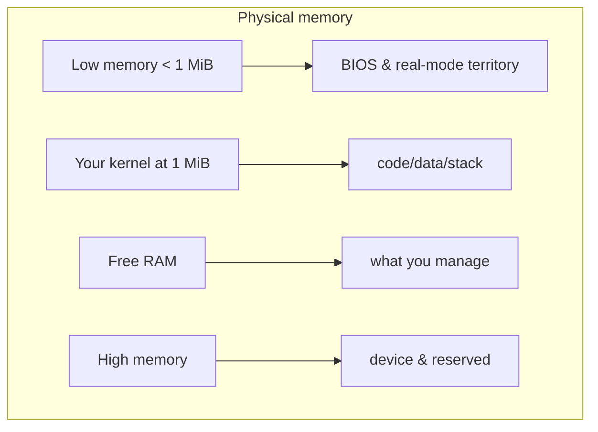

# Concept — Memory Management

*Original content written for OSDev_Learning_Hub.*

## In one sentence
A [kernel](../../GLOSSARY/kernel.md "The core program that owns the machine and manages hardware") must keep track of **what memory exists, what's used, and what's free**, and hand it out safely — because unlike a normal program, there's no OS underneath to do it.

## The mental model



Your very first kernel can ignore [memory management](../../GLOSSARY/memory-management.md "How a kernel tracks used and free RAM and hands it out safely") (it just writes to screen and halts). But the *moment* you want variables, stacks, or `malloc`, you must build a memory manager. The os01 book and the Phil Opp Rust series both spend serious chapters here for exactly this reason.

## The frame allocator — the simplest memory manager

Real memory is divided into **physical pages** (usually 4 KiB each). A *[frame allocator](../../GLOSSARY/frame-allocator.md "The simplest manager that tracks which 4 KiB physical pages are free")* tracks which pages are free:

```c
// A super-simplified bitmap allocator (concept only)
uint8_t bitmap[ /* total_memory / 4096 / 8 */ ];

void* allocate_frame(void) {
    for (size_t i = 0; i < bitmap_size; i++) {
        if ((bitmap[i / 8] & (1 << (i % 8))) == 0) {  // page i is free
            bitmap[i / 8] |= (1 << (i % 8));           // mark used
            return (void*)(i * 4096);                  // return its address
        }
    }
    return NULL; // out of memory
}
```

One bit per 4 KiB page. That's the whole idea behind a **buddy allocator** and every frame allocator you'll ever read about.

## Paging — the address translator

Modern CPUs use [paging](../../GLOSSARY/paging.md "Translates virtual addresses to physical RAM via page tables"): the CPU translates every *virtual address* your kernel's pointers use into a *physical address* of real RAM, using [page tables](../../GLOSSARY/paging.md "Translates virtual addresses to physical RAM via page tables").


Why it matters:
- **Isolation:** each process thinks it owns the whole address space.
- **Protection:** mark pages read-only / no-execute to stop bugs and attacks.
- **Paging as plumbing:** map your kernel at a "high-half" virtual address while it lives low in physical RAM.

The language doesn't matter here — you'll write the same page-table code in C, C++, or Rust. (Go and C# kernels tend to lean heavily on their runtime's existing memory model, which is part of why bare-metal Go/C# is harder.)

## A quick memory-model comparison across our languages
| Language | Memory model | Bare-metal state |
|----------|--------------|------------------|
| C / C++ | Raw pointers, manual `malloc` replacement | Full control — you write the allocator |
| Rust | Ownership + raw pointers via `unsafe` | Also full control; borrow checker protects you |
| Go | GC runtime (goroutines, heap) | Runtime needs many stubs on bare metal |
| C# | GC runtime (managed heap) | Needs a whole framework (Cosmos) to bootstrap |

> **Next:** [`03-interrupts-and-the-idt.md`](03-interrupts-and-the-idt.md).

## Watch and learn

- [How Computer Memory Works](https://www.youtube.com/watch?v=XETZoRYdtkw) — Computerphile explains how logic gates build the memory circuits that make up your machine's RAM.
- [The Call Stack and Stack Overflows (example in C)](https://www.youtube.com/watch?v=jVzSBkbfdiw) — Jacob Sorber shows how the stack, locals, and heap are laid out in a C program's memory.
- [Stack vs Heap Memory in C++](https://www.youtube.com/watch?v=wJ1L2nSIV1s) — The Cherno breaks down the two memory regions you manage by hand when writing C++.
- [WHY IS THE HEAP SO SLOW?](https://www.youtube.com/watch?v=ioJkA7Mw2-U) — Core Dumped explains how an operating system allocates dynamic memory and why it costs a system call.
