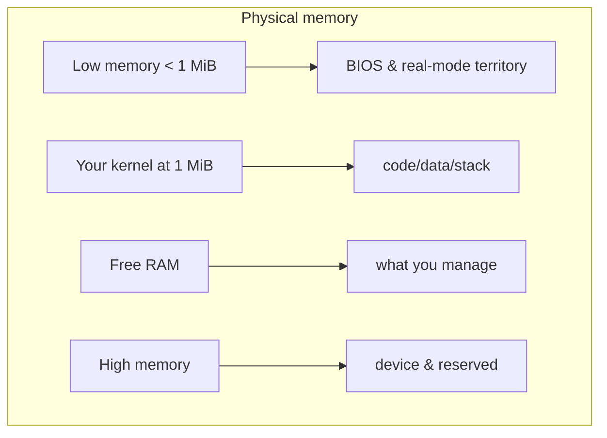
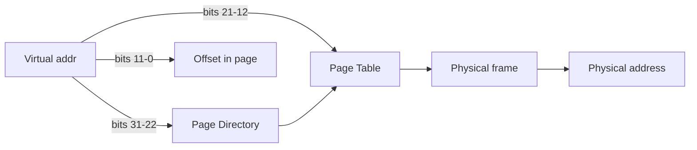
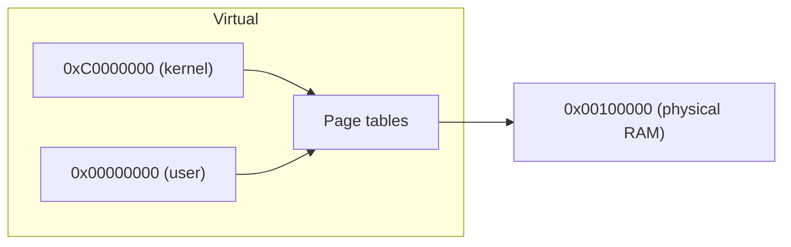

# Concept — Memory Management

*Original content written for OSDev_Learning_Hub.*

## In one sentence
A [kernel](../../GLOSSARY/kernel.md "The core program that owns the machine and manages hardware") must keep track of **what memory exists, what's used, and what's free**, and hand it out safely — because unlike a normal program, there's no OS underneath to do it.

## The mental model



Your very first kernel can ignore [memory management](../../GLOSSARY/memory-management.md "How a kernel tracks used and free RAM and hands it out safely") (it just writes to screen and halts). But the *moment* you want variables, stacks, or `malloc`, you must build a memory manager. The os01 book and the Phil Opp Rust series both spend serious chapters here for exactly this reason.

## The frame allocator — the simplest memory manager

Real memory is divided into **physical pages** (usually 4 KiB each). A *[frame allocator](../../GLOSSARY/frame-allocator.md "The simplest manager that tracks which 4 KiB physical pages are free")* tracks which pages are free:

```c
// A super-simplified bitmap allocator (concept only)
uint8_t bitmap[ /* total_memory / 4096 / 8 */ ];

void* allocate_frame(void) {
    for (size_t i = 0; i < bitmap_size; i++) {
        if ((bitmap[i / 8] & (1 << (i % 8))) == 0) {  // page i is free
            bitmap[i / 8] |= (1 << (i % 8));           // mark used
            return (void*)(i * 4096);                  // return its address
        }
    }
    return NULL; // out of memory
}
```

One bit per 4 KiB page. That's the whole idea behind a **buddy allocator** and every frame allocator you'll ever read about.

## Paging — the address translator

Modern CPUs use [paging](../../GLOSSARY/paging.md "Translates virtual addresses to physical RAM via page tables"): the CPU translates every *virtual address* your kernel's pointers use into a *physical address* of real RAM, using [page tables](../../GLOSSARY/paging.md "Translates virtual addresses to physical RAM via page tables").


Why it matters:
- **Isolation:** each process thinks it owns the whole address space.
- **Protection:** mark pages read-only / no-execute to stop bugs and attacks.
- **Paging as plumbing:** map your kernel at a "high-half" virtual address while it lives low in physical RAM.

The language doesn't matter here — you'll write the same page-table code in C, C++, or Rust. (Go and C# kernels tend to lean heavily on their runtime's existing memory model, which is part of why bare-metal Go/C# is harder.)

## A quick memory-model comparison across our languages
| Language | Memory model | Bare-metal state |
|----------|--------------|------------------|
| C / C++ | Raw pointers, manual `malloc` replacement | Full control — you write the allocator |
| Rust | Ownership + raw pointers via `unsafe` | Also full control; borrow checker protects you |
| Go | GC runtime (goroutines, heap) | Runtime needs many stubs on bare metal |
| C# | GC runtime (managed heap) | Needs a whole framework (Cosmos) to bootstrap |

> **Next:** [`03-interrupts-and-the-idt.md`](03-interrupts-and-the-idt.md).

## Watch and learn

<details class="video-embed">
<summary>▶ Watch: How Computer Memory Works</summary>
<iframe src="https://www.youtube-nocookie.com/embed/XETZoRYdtkw" title="How Computer Memory Works" width="100%" height="400" style="border:0;border-radius:8px;" allow="accelerometer; autoplay; clipboard-write; encrypted-media; gyroscope; picture-in-picture; web-share" allowfullscreen></iframe>
<p class=video-caption>Computerphile explains how logic gates build the memory circuits that make up your machine's RAM.</p>
</details>
<details class="video-embed">
<summary>▶ Watch: The Call Stack and Stack Overflows (example in C)</summary>
<iframe src="https://www.youtube-nocookie.com/embed/jVzSBkbfdiw" title="The Call Stack and Stack Overflows (example in C)" width="100%" height="400" style="border:0;border-radius:8px;" allow="accelerometer; autoplay; clipboard-write; encrypted-media; gyroscope; picture-in-picture; web-share" allowfullscreen></iframe>
<p class=video-caption>Jacob Sorber shows how the stack, locals, and heap are laid out in a C program's memory.</p>
</details>
<details class="video-embed">
<summary>▶ Watch: Stack vs Heap Memory in C++</summary>
<iframe src="https://www.youtube-nocookie.com/embed/wJ1L2nSIV1s" title="Stack vs Heap Memory in C++" width="100%" height="400" style="border:0;border-radius:8px;" allow="accelerometer; autoplay; clipboard-write; encrypted-media; gyroscope; picture-in-picture; web-share" allowfullscreen></iframe>
<p class=video-caption>The Cherno breaks down the two memory regions you manage by hand when writing C++.</p>
</details>
<details class="video-embed">
<summary>▶ Watch: WHY IS THE HEAP SO SLOW?</summary>
<iframe src="https://www.youtube-nocookie.com/embed/ioJkA7Mw2-U" title="WHY IS THE HEAP SO SLOW?" width="100%" height="400" style="border:0;border-radius:8px;" allow="accelerometer; autoplay; clipboard-write; encrypted-media; gyroscope; picture-in-picture; web-share" allowfullscreen></iframe>
<p class=video-caption>Core Dumped explains how an operating system allocates dynamic memory and why it costs a system call.</p>
</details>
<details class="video-embed">
<summary>▶ Watch: What's Virtual Memory? - Computerphile</summary>
<iframe src="https://www.youtube-nocookie.com/embed/5lFnKYCZT5o" title="What's Virtual Memory? - Computerphile" width="100%" height="400" style="border:0;border-radius:8px;" allow="accelerometer; autoplay; clipboard-write; encrypted-media; gyroscope; picture-in-picture; web-share" allowfullscreen></iframe>
<p class=video-caption>Dr Steve Bagley explains virtual memory, page tables, and how the MMU translates addresses — the exact "paging" ideas your kernel will implement.</p>
</details>
<details class="video-embed">
<summary>▶ Watch: Memory Mapping - Computerphile</summary>
<iframe src="https://www.youtube-nocookie.com/embed/di5WodGWTiY" title="Memory Mapping - Computerphile" width="100%" height="400" style="border:0;border-radius:8px;" allow="accelerometer; autoplay; clipboard-write; encrypted-media; gyroscope; picture-in-picture; web-share" allowfullscreen></iframe>
<p class=video-caption>A friendly, robot-and-"bouncer" analogy for how pages give each program its own view of memory — the reason paging exists.</p>
</details>

---

## Further reading

- [OSDev Wiki — Memory Management](https://wiki.osdev.org/Memory_Management) — the whole topic map: frames, paging, heap, and more.
- [OSDev Wiki — Paging](https://wiki.osdev.org/Paging) — how virtual addresses become physical via page tables.
- [OSDev Wiki — Setting Up Paging](https://wiki.osdev.org/Setting_Up_Paging) — the concrete page-table code for when you're ready to write it.
- [OSDev Wiki — Page Frame Allocation](https://wiki.osdev.org/Page_Frame_Allocation) — the bitmap/buddy allocators behind the "one bit per page" idea here.
- [OSDev Wiki — Detecting Memory (x86)](https://wiki.osdev.org/Detecting_Memory_(x86)) — where your kernel learns how much RAM actually exists (the Multiboot memory map).
- [Writing an OS in Rust — Paging Introduction](https://os.phil-opp.com/paging-introduction/) — a clear walkthrough of a real page-table setup with code.

---

## A note on the heap (light add-on)

The `malloc`-style heap your normal programs take for granted is actually built *on top of* paging plus a frame allocator. A kernel's heap is just a region of virtual pages that the kernel's own allocator hands out in small chunks. So the roadmap is: **frame allocator → paging → heap**. Don't try to skip ahead to `malloc` until the first two work — almost every OS-dev gotcha lives in that gap.


---

## Deep dive: the frame allocator, step by step

The frame allocator is the *first* and *simplest* memory manager you'll write, and it's the foundation for everything else. Let's go beyond the concept sketch and build it for real.

### Why physical pages exist

The CPU (and its Memory Management Unit / MMU) works with memory in fixed-size chunks called **pages** or **frames**. On x86 the classic size is **4 KiB** (4096 bytes). Hardware alignment, caching, and paging all assume page-sized granularity. So a kernel hands out memory in whole frames, never byte-by-byte — at least at the physical level.

Frame allocation is "the simplest manager that tracks which 4 KiB physical pages are free": exactly the one-bit-per-page idea from the top of the chapter.

### A complete bitmap frame allocator in C

```c
// frame.c — a real, working bitmap frame allocator (simplified)
#define PAGE_SIZE       4096
#define FRAME_COUNT     (total_memory / PAGE_SIZE)   // e.g. 1 MiB / 4 KiB
#define BITMAP_WORDS    (FRAME_COUNT / 8)

static uint8_t bitmap[BITMAP_WORDS];

static inline void set_frame(size_t i)  { bitmap[i/8] |=  (1 << (i%8)); }
static inline void clear_frame(size_t i){ bitmap[i/8] &= ~(1 << (i%8)); }
static inline int  test_frame(size_t i) { return bitmap[i/8] & (1 << (i%8)); }
```

Working with a bitmap is just bit-twiddling: every frame index `i` maps to bit `i%8` of byte `i/8`. The three helpers — set, clear, test — are the entire vocabulary of a bitmap allocator.

```c
uint32_t alloc_frame(void) {
    for (size_t i = 0; i < FRAME_COUNT; i++) {
        if (!test_frame(i)) {        // first free frame
            set_frame(i);            // mark it used
            return (uint32_t)i * PAGE_SIZE;   // physical address
        }
    }
    return 0;                        // out of memory
}

void free_frame(uint32_t addr) {
    clear_frame(addr / PAGE_SIZE);   // mark it free again
}
```

**Why this works and what it costs:** `alloc_frame` scans from frame 0 upward and returns the first free one. It's O(n) in the worst case and suffers from "first-fit" fragmentation, but it's *correct, simple, and debuggable* — the perfect starting allocator. Real kernels replace this with a **buddy allocator** (which splits/coalesces power-of-two-sized blocks to reduce fragmentation) or a free-list of pre-linked frames (fast removal without scanning).

### The free-list variant (what real kernels often do)

Instead of scanning a bitmap, keep a singly-linked list of free frames *inside* the free frames themselves (a free frame stores the pointer to the next free frame — its contents are unused, so this is safe):

```c
typedef struct frame { struct frame* next; } frame_t;
static frame_t* free_list = NULL;

void init_free_list(void) {
    // walk the memory map, push every usable frame onto the list
    for (each usable region r in memory_map)
        for (addr = r.start; addr < r.end; addr += PAGE_SIZE)
            push(&free_list, (frame_t*)addr);
}

void* alloc_frame(void) {
    frame_t* f = free_list;      // O(1) — pop the head
    if (!f) return NULL;
    free_list = f->next;
    return (void*)f;
}
```

This is O(1) allocation (no scanning) — the reason real kernels prefer it or a buddy allocator. The trade-off: it doesn't prefer low addresses, and you must carefully seed it from the *correct* memory map regions (not reserved ones).

### Seeding from the Multiboot memory map

Both allocators need to know *which* frames exist. That's precisely the memory map from the bootloader. You walk it and mark usable regions' frames as free, and everything else as used:

```c
void frame_init(void) {
    // zero the whole bitmap: assume everything is USED first
    memset(bitmap, 0xFF, sizeof(bitmap));
    // then free only the frames the memory map says are usable
    for (each mmap entry e) {
        if (e.type == 1) {              // type 1 = available RAM
            for (addr = e.addr; addr < e.addr+e.len; addr += PAGE_SIZE)
                clear_frame(addr / PAGE_SIZE);
        }
    }
}
```

The "assume everything used, then free the usable regions" order is deliberate: it's far safer to start from "nothing free" and unlock known-good frames than to assume everything is free and accidentally hand out the kernel's own code or the VGA buffer.

### A pitfall that bites almost everyone: the kernel owns frames too

Your kernel is *itself* a set of frames. If your allocator treats the memory where the kernel's code/data lives as "free," it will hand out frames the running kernel is actively executing from — instant corruption. You must **reserve the kernel's own frames** before freeing anything. For a kernel linked at 1 MiB with a known size, that means clearing frames *above* the kernel's end only. Many beginner kernels crash exactly here (see the "pitfalls" section further down).

---

## Deep dive: paging — from virtual address to physical RAM

Paging is the mechanic of translating *virtual* addresses (the ones your kernel's pointers use) into *physical* addresses (real RAM), through multi-level **page tables**.

### The 32-bit page walk

On 32-bit x86 with 4 KiB pages, a virtual address is split into three parts:

```
31            22  21        12  11           0
+---------------+------------+---------------+
|   Page Dir    | Page Table |   Offset      |
|   index (10)  | index (10) |  (12 bits)    |
+---------------+------------+---------------+
```

1. Bits 31–22 index into the **page directory** (top-level table).
2. Bits 21–12 index into the **page table** (second-level table).
3. Bits 11–0 are the **offset within the 4 KiB page**.

Each *page directory entry (PDE)* points to a page table; each *page table entry (PTE)* points to a physical 4 KiB frame. The CPU's `CR3` register holds the physical address of the current page directory.



This two-level structure is why paging scales: you don't need a page table for addresses you never use (a 4 GiB space with 4KiB pages *would* need 1M entries in a flat table, but the two-level layout lets you only allocate the page tables you actually touch).

### Why paging matters (the three reasons)

1. **Isolation.** Each process can have its own page tables, so it sees its own private address space and can't touch another process's memory — every process thinks it owns all 4 GiB.
2. **Protection.** Each PTE carries permission bits: *present*, *read/write*, *user/supervisor*, and (with PAE/64-bit) *no-execute (NX)*. You can make kernel pages supervisor-only, mark data read-only, and stop the stack from being executed.
3. **Plumbing / higher-half kernels.** You can map a *virtual* address (say `0xC0000000`) to a *physical* frame (say `0x100000`), letting your kernel be *linked* high while it physically lives low. This is the "higher-half" trick modern kernels use.

### A minimal identity-map (do this first)

The simplest correct paging setup is **identity mapping**: every virtual address maps to the same physical address. You enable it early, confirm the machine still runs, then refine. Here's the shape in assembly + C (32-bit):

```c
// page.c — create one page directory and one page table, identity-mapped
#define PDE_INDEX(va) ((va) >> 22)
#define PTE_INDEX(va) (((va) >> 12) & 0x3FF)

uint32_t page_directory[1024] __attribute__((aligned(4096)));
uint32_t page_table[1024]     __attribute__((aligned(4096)));

void init_paging(void) {
    // 1. identity-map the first 4 MiB: 1024 PTEs covering frames 0..1023
    for (int i = 0; i < 1024; i++)
        page_table[i] = (i * 4096) | 0x3;   // frame addr | present | writable
    // 2. point PDE[0] at the page table (covers virtual 0..4 MiB)
    page_directory[0] = ((uint32_t)page_table) | 0x3;
    // 3. zero the rest of the page directory
    for (int i = 1; i < 1024; i++)
        page_directory[i] = 0;
    // 4. tell the CPU where the page directory is (assembly)
    __asm__ volatile("mov %0, %%cr3" : : "r"(page_directory));
    __asm__ volatile("mov %cr0, %eax; or $0x80000000, %eax; mov %eax, %cr0");
}
```

After `init_paging` runs, the CPU is paging. Every access to `0x00000000`–`0x003FFFFF` hits physical `0x00000000`–`0x003FFFFF`. The machine keeps running only because the currently-executing kernel is *inside* that first 4 MiB (your kernel at 1 MiB is in range). **If you enable paging without mapping the code you're currently executing, the CPU immediately faults on the very next instruction.**

### A real pitfall: the "page fault the instant you enable paging" bug

The single most common paging bug is enabling paging without identity-mapping (or appropriately mapping) the *current instruction pointer*. When paging switches on, the CPU starts translating every address through the page tables — including the address of the *next* instruction it's about to fetch. If that instruction's virtual address has no valid PTE, you get an instant page fault (#PF) and the kernel dies. The fix is exactly the "map the first 4 MiB (or wherever `_start` is)" step above.

---

## The higher-half / high-hal kernel idea

Real operating systems don't map their kernel at virtual `0x00100000` where it physically lives. They **map** their kernel at a high *virtual* address (e.g. `0xC0000000` on 32-bit, or `0xFFFF800000000000` on 64-bit) while it *physically* sits low. The page tables translate the high virtual to the low physical.



The benefits: the kernel gets a large, contiguous-looking virtual region no matter where its physical pages scatter, user processes get their own low address spaces, and the kernel is "out of the way" (mapped high) so user code can't collide with it. This is why you'll see high-half addresses like `0xC0100000` in serious kernels — it's the paging-enabled version of "place the kernel somewhere safe," the same instinct as the 1 MiB convention before paging existed.

Implementing a higher-half kernel is a *real* milestone (the os01 book and Phil Opp both spend chapters on it), but you don't need it for a hello-world. What you *should* internalize now is the direction: **frame allocator → paging (identity first) → higher-half → heap.** Each builds on the last.

---

## The heap: malloc, finally

When your normal programs call `malloc`, an OS underneath them manages the free chunks. For your kernel, *you* are that OS. A kernel heap ("kmalloc" in kernel-speak) is a slab of virtual memory the kernel's own allocator hands out in small chunks, **built on top of** paging + a frame allocator:

1. **Frame allocator** provides physical pages (4 KiB granularity).
2. **Paging** lets you map those pages into virtual space (so the heap region is continuous and protected).
3. **Heap allocator** (like a user-space `malloc` implementation) splits those pages into arbitrary-size chunks for `kmalloc`/`kfree`.

```c
// the heap is just a region of virtual pages + an allocator
void* kmalloc(size_t size) {
    // 1. round up, carve a chunk from your free list
    // 2. if you run out of chunks, alloc_frame() + map it via paging
    // 3. return the chunk
}
```

The famous "WHY IS THE HEAP SO SLOW" insight applies to *user* heaps that bounce through context switches; a *kernel* heap avoids those, but the fragmentation/allocation-strategy questions are identical. And the single biggest OS-dev gotcha — as the chapter warned — lives in the gap between "I have pages" and "I have a malloc." Don't skip paging to get to the heap.

---

## A memory-model recap across our languages

| Language | Physical/paging control | Bare-metal state |
|----------|------------------------|------------------|
| C / C++ | raw pointers, manual `kmalloc` replacement | full control — you write the allocator |
| Rust | unsafe raw pointers, `alloc` behind a custom `GlobalAlloc` | full control; borrow checker helps at the safe-code level |
| Go | runtime owns the heap (GC, goroutine stacks) | needs many runtime stubs on bare metal |
| C# | CLR/GC owns the managed heap | needs Cosmos framework to provide the runtime |

The reason Go and C# are *harder* bare-metal isn't the language syntax — it's that their runtimes insist on owning memory in complex ways. C/Rust let you own every byte. This is why the C and Rust paths give you the deepest memory-management education and why most OS-dev content (including this hub's core examples) is C-first.

---

## Common pitfalls in memory management

1. **Not reserving the kernel's own frames.** The allocator hands out the page where `_start` still lives → the kernel corrupts itself. Always mark the kernel's range as used before freeing.
2. **Enabling paging without mapping the current instruction.** Instant page fault when paging turns on. Identity-map (or map) the executing code's range first.
3. **Forgetting the low 1 MiB is special.** Even with a "free everything" map, you must keep the VGA buffer (`0xB8000`), the IVT, and BIOS data reserved — you printed there all along.
4. **Using a heap-like allocator before paging works.** The chapter's "frame → paging → heap" order is not optional. Skipping to `kmalloc` first is where almost every gotcha lives.
5. **Not `volatile`-annotating the VGA buffer / mmio.** The compiler may optimize away or reorder writes to memory that can change (the VGA text RAM). Mark device-mapped memory `volatile`.
6. **Overflowing the 20-bit frame addressing.** On 32-bit non-PAE systems, frames address at most 4 GiB; ensure your frame fields are wide enough (`uint32_t` at minimum).

---

## Learning checkpoints

- [ ] **I can write a bitmap frame allocator** (set/clear/test helpers + alloc/free) from memory.
- [ ] **I can explain why free-list allocation is O(1)** and when you'd prefer it over a bitmap.
- [ ] **I can seed an allocator from the Multiboot memory map**, reserving the kernel's own frames and leaving usable ones free.
- [ ] **I can split a 32-bit virtual address** into page-directory index, page-table index, and offset.
- [ ] **I can explain why enabling paging can instantly fault** your currently-executing kernel, and the fix.
- [ ] **I can name the three benefits of paging** (isolation, protection, plumbing/higher-half).
- [ ] **I understand the order** frame allocator → paging → heap, and why not to skip ahead.
- [ ] **I can contrast how each of the five languages** in this hub handles bare-metal memory.

If those are comfortable, you genuinely understand memory management at the level this hub needs — and you're ready for the next concept, interrupts & the IDT, where paged/protected memory starts to matter for protecting the kernel from bad handlers.

---

## Watch more

<details class="video-embed">
<summary>▶ Watch: How CPU Memory & Caches Work - Computerphile</summary>
<iframe src="https://www.youtube-nocookie.com/embed/SAk-6gVkio0" title="How CPU Memory & Caches Work - Computerphile" width="100%" height="400" style="border:0;border-radius:8px;" allow="accelerometer; autoplay; clipboard-write; encrypted-media; gyroscope; picture-in-picture; web-share" allowfullscreen></iframe>
<p class=video-caption>Matt Godbolt on the real hierarchy (registers → caches → RAM) that sits underneath every address your frame allocator hands out.</p>
</details>
<details class="video-embed">
<summary>▶ Watch: Virtual Memory Explained (including Paging)</summary>
<iframe src="https://www.youtube-nocookie.com/embed/fGP6VHxqkIM" title="Virtual Memory Explained (including Paging)" width="100%" height="400" style="border:0;border-radius:8px;" allow="accelerometer; autoplay; clipboard-write; encrypted-media; gyroscope; picture-in-picture; web-share" allowfullscreen></iframe>
<p class=video-caption>A clear, visual explanation of virtual memory and paging — the exact translation machinery your page tables implement.</p>
</details>
<details class="video-embed">
<summary>▶ Watch: MultiLevel Page Tables: How Virtual Memory is Optimized</summary>
<iframe src="https://www.youtube-nocookie.com/embed/zNPVmTGt7Ds" title="MultiLevel Page Tables: How Virtual Memory is Optimized" width="100%" height="400" style="border:0;border-radius:8px;" allow="accelerometer; autoplay; clipboard-write; encrypted-media; gyroscope; picture-in-picture; web-share" allowfullscreen></iframe>
<p class=video-caption>An animation of the multi-level page-table structure — the two-level walk this chapter diagrams, brought to life.</p>
</details>


---

## A worked walkthrough: enabling paging in a real-looking kernel

Let's assemble a complete, self-contained sequence that takes a kernel from "no paging" to "identity paging on," with the assembly and C pieces shown together, because the ordering is what beginners get wrong.

### Step 1 — reserve the tables, and the kernel's own frames

Before you enable paging, you must have: (a) a page directory and at least one page table, and (b) those tables themselves placed in memory you won't overwrite. Beginners often allocate the tables at an address that collides with the kernel or the VGA buffer. The safe move is to reserve dedicated aligned static buffers (as in the source above) — alignment to a 4096-byte boundary is *mandatory* because the CPU expects page-table addresses to be page-aligned.

```c
// Freed after init? No — these must persist as long as paging runs.
uint32_t boot_page_directory[1024] __attribute__((aligned(4096)));
uint32_t boot_page_table[1024]     __attribute__((aligned(4096)));
```

If your tables are not 4096-aligned, the CPU misreads the table-pointer bits (the low 12 bits are flags, not address), and paging behaves erratically or faults. Alignment is non-negotiable.

### Step 2 — build the identity map for the code you're executing

You don't need to map the *whole* 4 GiB to boot into paging. You need to map enough to keep executing without faulting. The simplest correct setup maps the first 4 MiB (one page table covering 1024 × 4 KiB frames). Since a Multiboot kernel at 1 MiB is inside that range, and the VGA buffer at `0xB8000` is too, mapping the low 4 MiB is the standard first move.

```c
#define PAGE_PRESENT 0x1
#define PAGE_WRITE   0x2

void map_identity_first_4mb(void) {
    for (uint32_t i = 0; i < 1024; i++)
        boot_page_table[i] = (i * 4096) | (PAGE_PRESENT | PAGE_WRITE);
    boot_page_directory[0] = ((uint32_t)boot_page_table) | (PAGE_PRESENT | PAGE_WRITE);
    for (uint32_t i = 1; i < 1024; i++)
        boot_page_directory[i] = 0;   // all other 4 MiB regions: not present
}
```

Accessing an address whose PDE/PTE has the present bit clear triggers a **page fault (#PF, interrupt 14)**. For now that's exactly what you want — it makes an unimplemented mapping loud and visible rather than silently corrupting.

### Step 3 — load CR3 and turn on the paging bit

```asm
; enable_paging.asm — invoked from C after the tables are built
global enable_paging
enable_paging:
    mov eax, [esp + 4]    ; argument: physical address of page directory
    mov cr3, eax          ; load the page directory base
    mov eax, cr0
    or  eax, 0x80000000   ; set the PG (paging) bit
    mov cr0, eax          ; paging is now ON
    ret
```

```c
void init_paging(void) {
    map_identity_first_4mb();
    enable_paging((uint32_t)boot_page_directory);
    // from this line forward, ALL addresses go through the page tables
}
```

### Step 4 — what to test

After paging is on, try to read the VGA buffer (mapped) and a deliberately-unmapped address. The mapped read works; the unmapped read should raise a page fault (visible with `-d int` in QEMU, or via an IDT once you have interrupts). That single observation — "mapped works, unmapped faults" — proves you now control address translation. You own the MMU.

```c
volatile unsigned short* vga = (unsigned short*)0xB8000;
vga[0] = 0x0F41;                 // works: 0xB8000 is mapped
int* bad = (int*)0x50000000;     // NOT mapped → page fault if touched
// (reading *bad would #PF)
```

### Step 5 — the natural next milestone: map anything anywhere

Once identity paging works, generalize: write a `map_page(virtual, physical, flags)` that allocates a page table on demand and sets a PTE. That single function is the gateway to higher-half kernels, protecting page tables, and per-process address spaces. It's the difference between "paging is on" and "paging is *useful*." The Phil Opp series (link in Further reading) takes you through exactly this generalization in Rust.

---

## The address-space map of a "typical" hobby kernel

To make the abstract tables concrete, here's an actual simple address-space layout (32-bit, higher-half) that many hobby OSes use. Notice how *decision* it is:

```
0xFFFFFFFF ┌──────────────────────┐
           │ VGA text buffer 0xB8000  (mapped) │
           │ Kernel mappings at 0xC0000000+   │  ← kernel is linked HIGH
0xC0000000 ├──────────────────────┤
           │ user space (per-process)         │
0x00000000 └──────────────────────┘
physical 0x00100000 (kernel actually lives here)
```

In this map:
- The kernel is **linked** (its linker script sets `.`) at `0xC0000000` (virtual), but **physically loaded** at `0x100000`.
- Page tables bridge virtual `0xC0000000` → physical `0x100000`.
- User processes get the low half; the kernel the high half; switching a process means swapping the page directory (CR3) — the foundation of multitasking (which the *interrupts* chapter sets the stage for).

You don't need this for a hello world, but recognizing the *pattern* — "kernel high, user low, bridged by page tables" — means you'll never be lost when you encounter a high-half tutorial.

---

## Memory-mapped I/O (MMIO) and the `volatile` keyword

Much of a kernel's hardware control is **memory-mapped I/O**: the hardware exposes registers at specific memory addresses, and you talk to the device by reading/writing those addresses. The VGA text buffer at `0xB8000` is the simplest example.

The classic bug: the compiler *optimizes away* your writes to such memory because it doesn't believe the memory can change or be observed.

```c
// BUG: compiler may optimize these away or reorder them
unsigned short* vga = (unsigned short*)0xB8000;
vga[0] = 0x0F48;
vga[1] = 0x0F65;

// FIX: volatile tells the compiler "this memory changes by itself; don't
// reorder or elide reads/writes to it"
volatile unsigned short* vga = (volatile unsigned short*)0xB8000;
```

`volatile` does two things for device memory: it prevents the compiler from caching a read across the whole program (because a device can change the value between reads) and it prevents eliminating or reordering writes (because a write to a device register has side effects even if the value is never read back). **Any pointer to device/MMIO memory should be `volatile`.** This is a memory-management-adjacent lesson that will save you hours of "why is my kernel ignoring my writes."

---

## Fragmentation: the enemy your allocator fights

Allocation strategies exist to tame **fragmentation** — wasted, unusable chunks of free memory split by allocations:

- **Internal fragmentation**: you requested 100 bytes; the allocator gave you a 128-byte chunk; 28 bytes are wasted *inside* the chunk.
- **External fragmentation**: free frames are scattered so no *contiguous* block large enough exists, even though total free memory is plenty.

For a **frame allocator**, fragmentation is mostly external and handled by granularity (whole 4 KiB frames). For a **heap allocator**, both kinds bite. Common strategies:

| Strategy | Idea | Trade-off |
|----------|------|-----------|
| First-fit | give the first chunk big enough | simple, some fragmentation |
| Best-fit | give the closest-size chunk | less waste, slower search |
| Buddy | split power-of-two blocks, coalesce on free | great at external-fragmentation, easy coalesce (O(1) via buddy pairs) |
| Slab | keep fixed-size caches for common object sizes | avoids fragmentation for hot object types |

The **buddy allocator** (which the concept sketch at the chapter's top mentioned) is worth calling out: it keeps free blocks in power-of-two sizes. To allocate, split a larger block in half until it fits; to free, if a block's "buddy" (partner) is also free, merge them back. Because merging is just "is my buddy free?", it's fast and keeps external fragmentation low — which is why Linux uses it. Once your bitmap allocator works, implementing `split`/`coalesce` is a clean, satisfying next step.

---

## FAQ — the questions that actually come up here

**Q: I zero the bitmap as "all free" and my kernel instantly corrupts. What happened?**
A: You handed out the kernel's own running code. Always reserve your own frames first (clear only frames above the kernel's end and per the memory map). Starting "all used, then free the usable regions" is the safe order.

**Q: Do I even need paging for a hello-world kernel?**
A: No. A hello world can live entirely without paging. You need paging the moment you want protection, per-process isolation, a higher-half kernel, or virtual memory that lets programs exceed physical RAM. The chapter's order (frame → paging → heap) reflects when each becomes *necessary*, not merely useful.

**Q: Why 4 KiB pages? Could I use bigger ones?**
A: 4 KiB is the classic x86 granularity and what most educational allocators use. x86 also supports 2 MiB and 1 GiB "large pages." Bigger pages mean fewer TLB entries to cover the same memory (faster) but coarser granularity (more waste). Beginners start at 4 KiB.

**Q: What's the difference between a frame and a page?**
A: Terminology: a **frame** is physical memory ("this 4 KiB block of RAM"), a **page** is a unit of *virtual* address space. Paging maps pages (virtual) to frames (physical). People blur the words constantly; knowing the distinction keeps the mental model clear.

**Q: When should I map the VGA buffer through paging?**
A: Once paging is on, *every* access goes through page tables — including `0xB8000`. If you only identity-map the low 4 MiB (as in the walkthrough), the VGA buffer stays mapped and your print code keeps working. If you later switch to a higher-half table that *doesn't* map `0xB8000`, your prints will silently vanish — a subtle "my kernel stopped printing" bug that traces directly to paging.

---

## Learning checkpoints, round two

- [ ] **I can build a working identity-page setup** (tables, CR3 load, PG bit) and explain the "map what you're executing" rule.
- [ ] **I can write `map_page(virtual, physical, flags)`** that allocates a page table on demand.
- [ ] **I can explain how enabling paging maps the VGA buffer** and why a higher-half table can break prints.
- [ ] **I can describe a higher-half layout** (kernel high virtual ↔ low physical) and why it's useful.
- [ ] **I know why `volatile` is required on the VGA buffer** and on MMIO generally.
- [ ] **I can explain internal vs external fragmentation** and how a buddy allocator reduces the external kind.
- [ ] **I can answer** whether paging is needed for a hello world (no) and when it becomes necessary.

Tick those and you've gone from "memory management is scary" to "I can build a memory manager." That's a genuine milestone — most of the second half of a real OS (processes, isolation, virtual memory) leans on exactly these ideas.

---

## From this chapter to interrupts

There's a subtle but important link between paging and the next concept: **paging's protection bits are only meaningful if interrupts are handled correctly.** When a page fault (interrupt 14) fires, your kernel must have a handler installed (via the IDT) or the fault becomes a triple fault and the machine resets. So your guarded, per-page memory model and your interrupt infrastructure are partners: paging produces faults for protection, and the IDT is how you respond to them. That partnership is exactly what the interrupts & IDT concept builds next.


---

## One mental model that helps

Think of physical memory as a wall of 4 KiB bricks, and your kernel as the architect. Your **frame allocator** is the inventory clerk: it tracks which bricks are free and hands them out. **Paging** is the addressing system: it lets you hang numbers on the bricks so every room (process) thinks it has the whole wall, while silently sharing the real bricks behind the scenes. And the **heap** is the furniture assembler: it takes whatever bricks paging hands it and carves them into tables and chairs of whatever size you need.

The order matters because each level *depends* on the one below: you can't number rooms before you know which bricks are free, and you can't assemble furniture before you have a place to put it. That dependency chain — **frame → paging → heap** — is the skeleton of every memory manager you'll ever read about, in any OS, in any language.

And the deepest lesson of this chapter is also the simplest: **as a kernel, you are the only one keeping track.** No OS underneath you is going to notice you handed out the page your own code runs on. The discipline of "know where everything is, and reserve it before you free it" is the entire job wearing a different hat.

## The memory-management quick reference

| Layer | Unit | What tracks it | What you'd implement |
|-------|------|----------------|----------------------|
| Physical frames | 4 KiB frames | frame allocator | bitmap, free-list, or buddy |
| Virtual pages | 4 KiB pages | page tables | `map_page`, identity map, higher-half |
| Heap | arbitrary bytes | heap allocator | `kmalloc`/`kfree` on a region of mapped pages |

Build in that exact order, reserving the kernel's own frames and the low 1 MiB legacy region (including the VGA buffer at `0xB8000`) from the very first allocator you write, and you'll sidestep the majority of beginner memory-management bugs before you even meet them.

Now that you can manage memory, the natural partner concept is **interrupts & the IDT** — because the protection paging provides is only as good as your ability to *respond* to the faults it raises.


---

## Practice problems to lock it in

1. **Your bitmap allocator hands out the frame at `0x100000` — the address your kernel was loaded at. What went wrong, and what's the fix?**
   *Answer: you freed the kernel's own frames. Seed the allocator per the memory map *plus* mark everything below/around your kernel (and the low 1 MiB region) as used before freeing other frames.*

2. **You enable paging and the CPU page-faults on the very next instruction.** Which address almost certainly wasn't mapped?
   *Answer: the current instruction pointer's virtual address. Identity-map (or map) the code you're executing before turning the PG bit on.*

3. **You built a higher-half page table and your kernel stopped printing, though it ran fine before.** Where did the text go?
   *Answer: `0xB8000` isn't mapped in the new table. The VGA buffer must be mapped through paging for prints to survive — a classic "silent" regression.*

4. **QEMU shows `#PF` (interrupt 14) with a specific address in the error output.** Is that a bug, or could it be expected behavior?
   *Answer: could be either. A fault on an intentionally-unmapped address is fine; a fault on a mapped-but-mistakenly-cleared page is a bug. Check whether the address should have been present.*

5. **`kmalloc` works on the emulator but your compiler "elides" your kernel writes to the screen.** What keyword did you forget?
   *Answer: `volatile` on the MMIO/VGA pointer. Without it, the compiler may reorder or drop writes to device memory.*

If you can reason through all five, the memory-management concept isn't just read — it's *yours*. Move on to interrupts & the IDT when you're ready; page protection will start to make much more sense with both halves in view.

---

## 🧪 Exercises & Projects

Build a mental model of ownership first: the kernel *owns* every physical frame in the
map the bootloader hands it, and an allocator's only job is to decide who gets which
frame and get it back. All exercises here run against the Example_OS_Project kernel with
the 1 MiB+ load base from [bootloaders-and-multiboot](01-bootloaders-and-multiboot.md).
Time estimates assume a working build cycle.

### Graded exercises

**Easy**

- [ ] **E1. The ownership ledger** (~20 min). Draw (on paper or in a comment) the memory
      layout of your kernel at boot: the 1 MiB load base, your `.text`/`.data`/`.bss`,
      the stack *below/above* BSS, and the VGA buffer at `0xB8000`. Label each region
      "mine" (kernel), "device" (MMIO), or "reserved" (firmware). This one drawing turns
      every later "where is my address?" panic into a lookup.
- [ ] **E2. `volatile` or it didn't happen** (~30 min). Take your VGA write and `kmalloc`
      and annotate, with comments, *why* each pointer is `volatile`. Then build **with
      `-O2`** and an **`-O0`** build and disassemble the loop with `objdump -d`; identify
      one place the optimizer removed or reordered a store that `volatile` preserved.
- [ ] **E3. Count your own bytes** (~20 min). Add two symbols in your linker script,
      `_kernel_start` and `_kernel_end`, wrap `.text`/`.data`/`.bss`, and print
      `_kernel_end - _kernel_start` at boot in hex. This is the size your future
      **frame allocator must treat as in-use** from frame 0 onward.

**Medium**

- [ ] **M1. A bitmap frame allocator, base version** (~2 hr). This is the star exercise —
      and a stripped version of the mini-project below. Build a physical allocator:
      1) fix a `MEMORY_END` (say 16 MiB of emulated RAM), 2) reserve every frame whose
      byte range overlaps `_kernel_start.._kernel_end` plus the VGA buffer plus the
      0x0–0x9FFFF low region, 3) `alloc_frame()` scans the bitmap for a free frame and
      returns its base address, 4) `free_frame()` clears the bit. Test by allocating 8
      frames, freeing the middle two, and proving the next two allocations reuse them.
- [ ] **M2. Fragmentation lab** (~1 hr). Implement a 32-byte fixed-size `kmalloc` slab by
      carving a big `static` array into a free-list, then allocate/free in a pattern that
      leaves 50% free but fragmented. Show, with printed pointers, why a single power-of-2
      *buddy* allocator fixes the "no contiguous run" case. You do not need paging for
      this — physical contiguity is the whole point.
- [ ] **M3. MMIO is not RAM** (~1 hr). Pick one MMIO device (the VGA text buffer or the
      PIC at `0x20/0x21`). Write through a **non-`volatile`** pointer once and observe
      the behavior under `-O2`; then correct it. Explain, in your notes, the difference
      between "the compiler reordered a pure store" and "the device ignored a write
      because the CPU posted it to a write-combining buffer."

**Hard**

- [ ] **H1. Guard-page paging** (~3 hr). Enable paging (`CR0.PG=1`), build a single page
      table mapping the kernel identity + a scratch region, and set the **NX bit** (or
      just the R/W bit) on one page so a deliberate kernel write to it faults. Catch the
      fault with a page-fault handler (built in [concept 03](03-interrupts-and-the-idt.md))
      and print CR2. This is the moment "physical vs. virtual" stops being a slogan.
- [ ] **H2. Heap from frames** (~3 hr). Take M1's frame allocator and build a linked-list
      heap on top: `init_heap()` grabs frames and builds a free chunk list, `kmalloc`
      does first-fit split, `kfree` coalesces neighbors. Prove no double-free and that a
      `kmalloc(64)` + free of a bigger chunk doesn't leak the tail. Compare the RSS-free
      behavior of your 1 MiB kernel vs. this one in QEMU's `info` monitor.

### ⭐ Mini-project — Bitmap frame allocator with an allocation log

**Goal.** A working, tested **bitmap frame allocator** integrated into the Example kernel,
able to hand out, reclaim, and *report* physical frames. This is the allocator every later
OS (paging, heaps, processes) builds on, so test it like you'll depend on it.

**Estimated time:** 2–4 hr. **Prereq:** E3 (kernel size symbols) and the boot memory map.

1. **Fix the region model.** Ask the bootloader for the memory map (`%esp+4` from
   [concept 01](01-bootloaders-and-multiboot.md)) or, failing that, hard-code a
   `MEMORY_END` constant. Decide frame size (commonly 4 KiB) and count frames.
2. **Allocate the bitmap** (`bitmap_bytes = frame_count / 8`), placed at a free address
   you choose above the kernel, and mark it reserved.
3. **Mark in-use on boot.** Walk the memory map and set bits for: kernel
   `_kernel_start.._kernel_end`, the VGA buffer, the bitmap itself, and any "reserved"
   type regions. Comment each reservation.
4. **Implement `alloc_frame` / `free_frame`.** Provide `__builtin_ctz`/`ffs` scans so a
   free frame is found in ~O(bits) worst case but usually O(1). Return the frame's
   physical base; return `0` (or a sentinel) when exhausted.
5. **Test harness in-kernel.** Allocate 8 frames, print each base; free #2 and #6; alloc
   2 more and assert they reuse exactly those two. Print a "PASS: reuse works" line,
   else "FAIL" and halt.
6. **Add a log.** Keep a small ring of last-N allocations (type, base, size). Add a
   `frame_dump()` that prints free count + holes. Boot with `-d int` to catch a bad
   address early.
7. **Stretch (Medium-Hard).** Wire M1's buddy allocator on top and reuse the same test
   pattern to prove an 8 KiB alloc comes back as two contiguous 4 KiB buddies.

**Checklist**

- [ ] bitmap sized and placed at a safe address, itself reserved
- [ ] kernel, VGA, reserved regions all marked in-use at boot
- [ ] `alloc_frame` returns distinct, free, aligned bases
- [ ] `free_frame` + re-alloc reuses the exact freed frames (printed proof)
- [ ] exhaustion path returns a controlled value, not a wild dereference
- [ ] allocation log prints free count across alloc/free cycles

