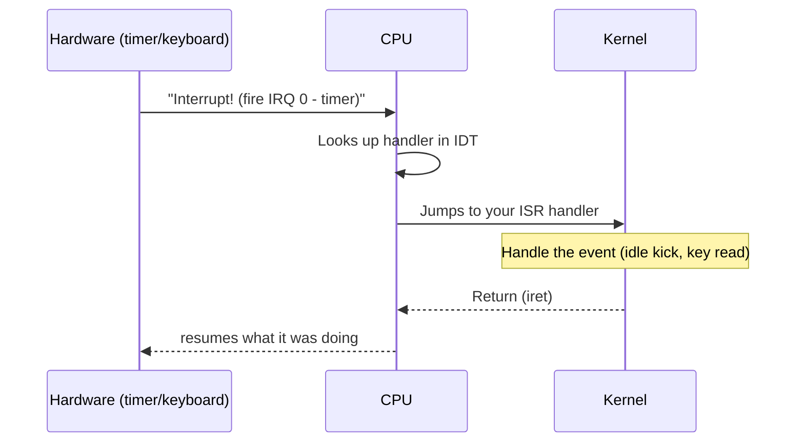

# Concept — Interrupts & the IDT

*Original content written for OSDev_Learning_Hub.*

## In one sentence
**[Interrupts](../../GLOSSARY/interrupt.md "A hardware signal that makes the CPU run a registered handler")** are the hardware's way of yelling "something happened!" at the CPU, and the **Interrupt Descriptor Table ([IDT](../../GLOSSARY/idt.md "The kernel's table of where each interrupt handler lives"))** is the kernel's phonebook for where to jump in response.

## The big idea

Your kernel can't just poll the keyboard forever. Instead, the hardware *interrupts* it: the CPU halts whatever it's doing, jumps to a handler you registered, runs it, and returns.



## The pieces you set up

1. **The IDT** — an array of descriptors telling the CPU where each handler lives.
2. **An [ISR](../../GLOSSARY/isr.md "The handler function run for a specific interrupt number") handler** — that does the actual work for a given interrupt number.
3. **The [PIC / APIC](../../GLOSSARY/pic-apic.md "Chips that route hardware interrupts (timer, keyboard) to the CPU")** — the chip that routes hardware interrupts to the CPU.
4. **`sti` / `cli`** — enable/disable interrupts.

Writing this by hand in assembly + C/Rust is a milestone (the Phil Opp series and os01 both dedicate chapters to it). But *understanding* it is what matters for a beginner.

## Why it matters for your Hello World
Your very first kernel can skip interrupts entirely (just print and halt). But you'll need them the moment you want a **timer tick** or a **keyboard**.

```rust
// Rust: registering a timer interrupt (from the Phil Opp series, summarized)
lazy_static! {
    static ref IDT: InterruptDescriptorTable = {
        let mut idt = InterruptDescriptorTable::new();
        idt[InterruptIndex::Timer.as_usize()].set_handler_fn(timer_interrupt_handler);
        idt
    };
}

extern "x86-interrupt" fn timer_interrupt_handler(_: InterruptStackFrame) {
    // a hardware timer just fired — a whole scheduling system starts here
}
```

```c
// C: the CPU loads the IDT with the lidt instruction
struct idt_ptr { uint16_t limit; uint32_t base; } __attribute__((packed));
struct idt_ptr idtp;
// ... fill 256 idt_entry_t entries ...
__asm__ volatile("lidt (%0)" : : "r"(&idtp));
__asm__ volatile("sti");   // enable interrupts
```

## The 256 slots
| Range | Who owns it | Example |
|-------|-------------|---------|
| 0–31 | **CPU exceptions** | #PF page fault (14), #GP general protection (13) |
| 32–47 | **Hardware IRQs** (after PIC remap) | timer (32), keyboard (33) |
| 48–255 | Software / your custom | [syscalls](../../GLOSSARY/syscall.md "The way user programs ask the kernel for services"), custom events |

> **Next:** [`04-vga-text-mode.md`](04-vga-text-mode.md).

## Watch and learn

<details class="video-embed">
<summary>▶ Watch: CPU Interrupts</summary>
<iframe src="https://www.youtube-nocookie.com/embed/tGMSARJk7cA" title="CPU Interrupts" width="100%" height="400" style="border:0;border-radius:8px;" allow="accelerometer; autoplay; clipboard-write; encrypted-media; gyroscope; picture-in-picture; web-share" allowfullscreen></iframe>
<p class=video-caption>Computerphile uses a robot analogy to explain how the CPU handles interrupts from devices like the keyboard.</p>
</details>
<details class="video-embed">
<summary>▶ Watch: Building an OS - 8 - Interrupts, IDT, GDT</summary>
<iframe src="https://www.youtube-nocookie.com/embed/5LbXClJhxcs" title="Building an OS - 8 - Interrupts, IDT, GDT" width="100%" height="400" style="border:0;border-radius:8px;" allow="accelerometer; autoplay; clipboard-write; encrypted-media; gyroscope; picture-in-picture; web-share" allowfullscreen></iframe>
<p class=video-caption>Nanobyte sets up the kernel GDT and introduces interrupts while building the IDT.</p>
</details>
<details class="video-embed">
<summary>▶ Watch: Building an OS - 10 - Hardware interrupts, PIC</summary>
<iframe src="https://www.youtube-nocookie.com/embed/FD48Lx7Rnx0" title="Building an OS - 10 - Hardware interrupts, PIC" width="100%" height="400" style="border:0;border-radius:8px;" allow="accelerometer; autoplay; clipboard-write; encrypted-media; gyroscope; picture-in-picture; web-share" allowfullscreen></iframe>
<p class=video-caption>Nanobyte implements a driver for the 8259 PIC and handles real hardware interrupts.</p>
</details>
<details class="video-embed">
<summary>▶ Watch: Write your own Operating System 5: Interrupts</summary>
<iframe src="https://www.youtube-nocookie.com/embed/AgeX-U4dKSs" title="Write your own Operating System 5: Interrupts" width="100%" height="400" style="border:0;border-radius:8px;" allow="accelerometer; autoplay; clipboard-write; encrypted-media; gyroscope; picture-in-picture; web-share" allowfullscreen></iframe>
<p class=video-caption>Builds an IDT, registers keyboard and timer handlers, and programs the PIC remap — a complete, tiny implementation of everything on this page.</p>
</details>

**More interrupt picks**
- ▶ [CPU Interrupts (Computerphile)](https://www.youtube-nocookie.com/embed/tGMSARJk7cA) — the simple "robot stops everything to answer the door" intuition for how the CPU switches context.

---

## Further reading

- [OSDev Wiki — Interrupts](https://wiki.osdev.org/Interrupts) — the overview of CPU exceptions vs hardware IRQs vs software interrupts.
- [OSDev Wiki — Interrupt Descriptor Table](https://wiki.osdev.org/Interrupt_Descriptor_Table) — the exact structure of the table and every entry.
- [OSDev Wiki — Interrupts Tutorial](https://wiki.osdev.org/Interrupts_tutorial) — a step-by-step "set up an IDT and enable interrupts" guide.
- [OSDev Wiki — PIC](https://wiki.osdev.org/PIC) — the chip that routes hardware interrupts to the CPU.
- [OSDev Wiki — 8259 PIC](https://wiki.osdev.org/8259_PIC) — technical detail on the legacy interrupt controller and its remap.
- [Writing an OS in Rust — CPU Exceptions](https://os.phil-opp.com/cpu-exceptions/) — how a modern kernel registers handlers for the 256 IDT slots (Rust).

---

## A tip for when you implement it

The bug that trips up most first-time IDT builders: **the PIC must be remapped** (offset 0-7 → 32-39) before you enable interrupts, or the first hardware interrupt collides with a CPU exception vector. The `sti` instruction enables interrupts globally, but no interrupts arrive until you've also told the PIC which vectors to use. Watch for that in both the Nanobyte and os-series implementations above.


---

## Deep dive: the IDT entry — what one slot actually contains

The [IDT](../../GLOSSARY/idt.md "The kernel's table of where each interrupt handler lives") is an array of 256 entries. Each entry is 8 bytes (in 32-bit protected mode) and tells the CPU where that interrupt's handler lives. Understanding a single entry busts the "table of pointers" myth — it's richer than that.

```c
// idt.h — one 32-bit IDT entry (8 bytes, packed)
struct idt_entry {
    uint16_t base_low;    // low 16 bits of the handler address
    uint16_t selector;    // GDT code segment selector (e.g. 0x08)
    uint8_t  zero;        // must be 0
    uint8_t  flags;       // type + privilege + present (see below)
    uint16_t base_high;   // high 16 bits of the handler address
} __attribute__((packed));

struct idt_ptr {
    uint16_t limit;       // size-1
    uint32_t base;        // address of the IDT array
} __attribute__((packed));
```

The fields:
- **base** (split into low/high): the 32-bit address of the handler function.
- **selector**: which GDT segment the handler runs in (for flat kernels, almost always the `0x08` code selector).
- **flags**: the interesting one. `flags = (present<<7) | (DPL<<5) | (gate_type)`. A typical usable value is `0x8E` = present + 32-bit interrupt gate. The **DPL (descriptor privilege level)** controls whether user code can trigger it — settings 0 means kernel-only, 3 means user code may `int` into it (how some syscalls work).

### The two gate types

Interrupt gates and trap gates differ in one subtle way: an **interrupt gate** clears the IF (interrupts-enabled) flag on entry, so nested interrupts aren't serviced inside the handler (unless you re-enable), while a **trap gate** does *not*. For handlers that must never be interrupted, use `0x8E` (interrupt gate); for syscalls/exceptions where you want nesting back, sometimes `0x8F` (trap gate). This one-bit difference explains a surprising amount of real-world interrupt behavior.

### Loading the table: `lidt`

The CPU doesn't know where your IDT lives until you tell it with the `lidt` instruction, which loads the 6-byte `idt_ptr` (limit + base) into the IDTR register:

```c
struct idt_ptr idtp;
idtp.limit = sizeof(idt) - 1;   // 256 entries × 8 bytes - 1
idtp.base  = (uint32_t)&idt;
__asm__ volatile("lidt (%0)" : : "r"(&idtp));
__asm__ volatile("sti");        // enable interrupts globally
```

Without `lidt`, any interrupt (even `int` instructions) faults with a **#GP (general protection fault, 13)** because there's no valid gate. And without `sti`, interrupts stay disabled no matter how many are pending.

---

## The handler mechanics: from IRQ to C function, step by step

When a hardware interrupt fires, this is the chain the CPU executes:

1. The device raises an interrupt request line into the **PIC/APIC**.
2. The PIC maps it to an interrupt vector (e.g. timer → vector 32 after remap).
3. The CPU looks up that vector in the IDT.
4. The CPU **pushes some state onto the stack** and jumps to the handler's address.
5. Your **assembly stub** saves the registers, calls a C handler, and cleans up.
6. Your handler does the work.
7. You send an **EOI (end of interrupt)** to the PIC.
8. The **`iret`** (interrupt return) restores state and resumes the interrupted code.

The subtle, famous part is **steps 4 and 5**: the CPU does *not* save all registers for you. On most architectures it saves EFLAGS, CS, and EIP (and an error code for some exceptions) but the *general-purpose registers* are yours to save in the assembly stub. That's why real ISR code looks like this:

```nasm
; A minimal ISR stub: save everything, call C, restore
isr_common_stub:
    pusha                    ; save all general-purpose regs (EAX..EDI)
    ; (optionally save segment regs, and the data/extra segments)
    call isr_handler         ; go to C
    popa                     ; restore all general-purpose regs
    add esp, 8               ; pop the (fake) args / error code
    iret                     ; interrupt return
```

If you forget `pusha`/`popa`, your handler tramples the registers of whatever your kernel was doing — subtle corruption that only shows up later. The `iretd`/`iret` *must* be the instruction that returns (not a plain `ret`), because the CPU pushed EFLAGS/CS/EIP expecting that exact matching return.

### Why there are 256 fixed stubs

Because each IDT slot can point to a different address, and the CPU pushes an *error code* for some exceptions (page fault, double fault) but not others (timer, keyboard), OSes typically generate **256 generic stubs** that each push a dummy error code (so the stack layout is uniform) plus the vector number, then all jump to one common handler. That's how a single C `isr_handler(vector_number, ...)` can know *which* interrupt fired:

```nasm
; The pattern: each of 256 stubs pushes its number, then the common one
isr0:  push 0  ; vector number
       jmp isr_common_stub
isr1:  push 1
       jmp isr_common_stub
; ... and so on, typically generated by a macro ...
```

This is why the Phil Opp series and os01 both present ISR setup as "define one handler + 256 stubs." The uniform stack layout (dummy error code + vector number) is what makes the C side simple.

---

## Exceptions vs IRQs vs software interrupts — the honest map

It's easy to conflate the three families that share the IDT. Here's the crisp distinction:

| Family | Vectors | Who raises it | Example |
|--------|---------|---------------|---------|
| **CPU exceptions** | 0–31 (fixed) | The CPU itself, synchronously | #PF page fault (14), #GP (13), #DE divide-by-zero (0) |
| **Hardware IRQs** | 32–47 (after remap) | The PIC/APIC from devices, asynchronously | timer (0→32), keyboard (1→33) |
| **Software interrupts** | any | `int` instruction in code | `int 0x80` syscall conventions |

- **Exceptions are synchronous**: they happen *because of the instruction currently executing* (a forbidden access, a divide by zero). The CPU knows exactly where.
- **IRQs are asynchronous**: they can arrive at any instruction boundary, because a device wants attention now (a key was pressed, a timer ticked). This is where preemption starts.
- **Software interrupts** are deliberate `int` calls — how old-style syscalls asked the kernel for services when `syscall`/`sysenter` weren't available.

Understanding the three families tells you *who* your handler must be robust against: IRQ handlers must assume they interrupted *anything* (so they must preserve every register), while exception handlers must decide whether to recover or panic.

---

## The PIC: why we remap, and how

Before your kernel can service hardware interrupts, the **8259 PIC** (or its modern APIC cousin) must be told *which vectors* to use. By default the PIC maps IRQ0–IRQ7 to CPU vectors 0–7 — but 0–7 are *CPU exceptions* (divide-by-zero, #GP, ...). If you enable interrupts without remapping, a timer tick would fire vector 0 and the CPU would treat it as "divide by zero." Total chaos.

The fix is to **remap** the PIC so IRQ0–IRQ7 → vectors 32–39, and IRQ8–IRQ15 → 40–47. Programmatically, you send Initialization Command Words (ICW) to the PIC's ports (`0x20`/`0xA0` for master/slave):

```c
// pic.c — remap the 8259 PIC (both the master and the slave)
#define PIC1_COMMAND 0x20
#define PIC1_DATA    0x21
#define PIC2_COMMAND 0xA0
#define PIC2_DATA    0xA1

void pic_remap(int offset1, int offset2) {
    unsigned char a1 = inb(PIC1_DATA), a2 = inb(PIC2_DATA); // save masks
    outb(PIC1_COMMAND, 0x11); io_wait();   // start init (ICW1)
    outb(PIC2_COMMAND, 0x11); io_wait();
    outb(PIC1_DATA, offset1);    io_wait(); // ICW2: base vector for master
    outb(PIC2_DATA, offset2);    io_wait(); // ICW2: base vector for slave
    outb(PIC1_DATA, 4);          io_wait(); // ICW3: master has slave on IRQ2
    outb(PIC2_DATA, 2);          io_wait();
    outb(PIC1_DATA, 0x01);       io_wait(); // ICW4: 8086 mode
    outb(PIC2_DATA, 0x01);       io_wait();
    outb(PIC1_DATA, a1); outb(PIC2_DATA, a2); // restore masks
}
// after remap: IRQ0 (timer) -> vector 32, IRQ1 (keyboard) -> vector 33
```

This is the "PIC remap before enabling interrupts" the chapter warned about. If you skip it, the first hardware interrupt collides with a CPU exception vector — exactly the bug the tip at the bottom of this chapter flags.

### Sending the End-Of-Interrupt (EOI)

After your IRQ handler runs, you *must* tell the PIC the interrupt is done, or it won't deliver the next one of that priority:

```c
#define PIC1_COMMAND 0x20
static inline void pic_eoi(unsigned int irq) {
    if (irq >= 8) outb(PIC2_COMMAND, 0x20);  // if slave, ACK it too
    outb(PIC1_COMMAND, 0x20);                // ACK the master
}
```

Forgetting the EOI is a classic "my timer fires once, then never again" bug — the PIC thinks you're still busy. Always ACK at the end of a hardware IRQ handler.

---

## The PIT timer: your first real clock

The **PIT (Programmable Interval Timer)** is the classic way to get a periodic interrupt — the heartbeat of scheduling. You program it to fire a certain number of times per second, then enjoy a timer IRQ. Setting it to ~100 Hz is a typical starter rate (you get 100 timer interrupts per second).

```c
#define PIT_COMMAND 0x43
#define PIT_CHANNEL0 0x40

void pit_set_frequency(int hz) {
    int divisor = 1193182 / hz;   // the PIT's base clock
    outb(PIT_COMMAND, 0x36);       // channel 0, lobyte/hibyte, square wave
    outb(PIT_CHANNEL0, divisor & 0xFF);         // low byte
    outb(PIT_CHANNEL0, (divisor >> 8) & 0xFF);  // high byte
}

// In your IRQ0 (timer) handler, after remapping:
void timer_handler(void) {
    static unsigned int ticks = 0;
    ticks++;
    pic_eoi(0);            // ACK — don't forget!
}
```

The timer interrupt is where **scheduling** begins: eventually, the handler decides "the current process has used its slice, switch to another." A simple "count ticks, print a clock" is the first satisfying use; a context-switching scheduler is the advanced follow-on. Every multitasking OS stands on this one IRQ.

---

## The keyboard: your first input via IRQ1

Once interrupts work, the keyboard is a short step: the keyboard controller (PS/2) fires IRQ1 when a key is pressed. You read one **scancode** from port `0x60`, translate it (scancode set 1 → ASCII), and either store it in a ring buffer or act immediately.

```c
#define KBD_PORT 0x60
#define KBD_IRQ  1

unsigned char kbd_read_scancode(void) {
    return inb(KBD_PORT);
}

void keyboard_handler(void) {
    unsigned char scancode = kbd_read_scancode();
    // bit 7 set == key released (ignored for simple drivers)
    if (!(scancode & 0x80)) {
        kbd_buffer_add(scancode);   // push into a queue for later
    }
    pic_eoi(KBD_IRQ);
}
```

The subtlety: scancodes are *not* ASCII. `0x1E` means "a" only in *scancode set 1* with no Shift. A real driver keeps a translation table and tracks modifier keys (Shift/Ctrl/Alt). For beginners, the milestone is "press a key → handler runs → you see the scancode." From there, a ring buffer and a translation table turn it into a keyboard.

---

## Common pitfalls when you implement interrupts

1. **Enabling interrupts before installing the IDT.** `sti` with no `lidt` → any interrupt faults as #GP and you likely triple-fault (reset). Order: build IDT → `lidt` → remap PIC → `sti`.
2. **Remapping the PIC wrong / not at all.** Hardware IRQ collides with a CPU exception vector (vector 0-7). Always remap IRQ0–7 → 32–39 before `sti`.
3. **Missing the EOI.** The PIC stops delivering that IRQ priority; your timer fires once. Always ACK in hardware IRQ handlers.
4. **Forgetting `pusha`/`popa` in the stub.** The handler corrupts the interrupted code's registers. Save everything you touch.
5. **Returning with `ret` instead of `iret`.** The CPU pushed EFLAGS/CS/EIP; only `iret` pops them correctly. Using `ret` unbalances the stack and faults on return.
6. **Stack overflow in the handler.** Interrupts run on the *current* kernel stack. If your kernel's main stack is tiny or you nest deeply in a handler, you overflow into garbage. Real kernels eventually use a dedicated "interrupt stack."
7. **Declaring handler functions at the wrong address.** An IDT gate points at the handler's *address*. If the linker placed the stub somewhere you didn't expect (wrong `base`), jumping there faults. Check `base_low`/`base_high` against `objdump`.

These seven account for nearly every "I set up interrupts and my OS resets" report in the beginner world. Work through them in order and you'll usually find your bug in minutes.

---

## Learning checkpoints

- [ ] **I can describe the 8-byte IDT entry** (base, selector, flags) and what the flags byte means (present + gate type + DPL).
- [ ] **I can explain the difference** between interrupt gates and trap gates, and between exceptions, IRQs, and software interrupts.
- [ ] **I know the order of operations** (IDT → `lidt` → PIC remap → `sti`) and what each step requires.
- [ ] **I can write an ISR assembly stub** that saves registers, calls C, ACKs the PIC, and `iret`s.
- [ ] **I can remap the 8259 PIC** and say why it's mandatory.
- [ ] **I can program the PIT** for a periodic timer and count ticks in a handler.
- [ ] **I can read a scancode** from the keyboard port and explain why it isn't ASCII yet.
- [ ] **I can name at least five** of the seven pitfalls above from memory.

If those are ticked, you understand interrupts well enough to build scheduling, syscalls, and device drivers — which is exactly the machinery every "real" OS is made of. The next concept (VGA text mode) is a pleasant breather: it needs none of this complexity, just a memory-mapped screen.


---

## The GDT — the quiet prerequisite interrupts lean on

Many beginners are surprised that interrupt handlers mention a **GDT selector** (`0x08`). Interrupts didn't create the GDT; it's usually set up with protected mode (often by the bootloader, or by your bootstrap). But the IDT's `selector` field refers to it, so worth a short detour.

The **GDT (Global Descriptor Table)** defines memory segments in protected mode: code, data, etc. A *flat* kernel uses two segments covering the whole 4 GiB: a code segment and a data segment. Their selectors (offsets into the GDT) are what the IDT's `selector` field must match.

```c
// gdt.h — a flat, minimal GDT (two segments + a null entry)
struct gdt_entry {
    uint16_t limit_low;
    uint16_t base_low;
    uint8_t  base_mid;
    uint8_t  access;
    uint8_t  flags_limit_high;
    uint8_t  base_high;
} __attribute__((packed));

// selectors: 0x08 = code (1st real entry at byte 8), 0x10 = data
```

For IDT purposes, all you need to know: **the handler runs in the code segment named by `selector`**, and for a flat kernel that's the `0x08` code selector (whose base is 0 and limit is 4 GiB). If you hand the IDT a selector pointing at a data segment (or a GDT that isn't loaded), jumping to the handler faults with #GP.

```asm
; Load the GDT before anything that needs segments / the IDT selector
lgdt [gdt_ptr]
; reload code segment via a far jump
jmp 0x08:reload_segments
reload_segments:
    mov ax, 0x10          ; data selector
    mov ds, ax
    mov es, ax
    mov fs, ax
    mov gs, ax
    mov ss, ax
```

The Nanobyte "Interrupts, IDT, GDT" video in the Watch section walks exactly this dance — set the GDT first, then build the IDT on top of it. Treat the GDT as the foundation and the IDT as the building that sits on it.

---

## A complete IDT setup, end to end (so you see every piece together)

Let's assemble all the fragments above into one coherent setup routine. This is the shape every real IDT implementation takes; only the syntax differs across C/Rust.

```c
// idt.c — full setup: entries, lidt, and the PIC remap + sti
struct idt_entry idt[256];
struct idt_ptr   idtp;

extern void isr0(void);   // ... isr255: declared from your generated stubs
// (in practice you declare all 256: isr0..isr255)

void idt_set_gate(int n, uint32_t base, uint16_t sel, uint8_t flags) {
    idt[n].base_low  = base & 0xFFFF;
    idt[n].selector  = sel;
    idt[n].zero      = 0;
    idt[n].flags     = flags;
    idt[n].base_high = (base >> 16) & 0xFFFF;
}

void idt_init(void) {
    // 1. point every slot at its stub, with a 32-bit interrupt gate
    for (int i = 0; i < 256; i++) {
        // selector 0x08 (code), flags 0x8E = present + 32-bit int gate
        idt_set_gate(i, (uint32_t)stub_table[i], 0x08, 0x8E);
    }
    // 2. load the IDTR
    idtp.limit = sizeof(idt) - 1;
    idtp.base  = (uint32_t)&idt;
    __asm__ volatile("lidt (%0)" : : "r"(&idtp));
    // 3. remap the PIC so IRQ0-15 -> vectors 32-47
    pic_remap(0x20, 0x28);
    // 4. unmask the timer and keyboard IRQs, then enable interrupts
    outb(PIC1_DATA, 0xFC);       // unmask IRQ0 (bit0) and IRQ1 (bit1)
    __asm__ volatile("sti");
}
```

Reading this top to bottom is the entire interrupts concept in code: build the phonebook (IDT), tell the CPU where it is (`lidt`), make hardware interrupts land somewhere safe (PIC remap), open the door (`sti`). If you can explain each of those four lines to someone, you understand interrupts.

---

## Exceptions that deserve special handlers

While most exceptions are fatal (panic the kernel), a few are meant to be *handled* for real features:

| Vector | Name | Typical use |
|--------|------|-------------|
| 14 | **#PF page fault** | demand paging — map the page on demand and resume the instruction |
| 13 | **#GP general protection** | catch violations; can indicate an unmapped IDT/GDT selector or a protection error |
| 8 | **#DF double fault** | a fatal error while handling another fault; often means "your handler faulted" |
| 0 | **#DE divide-error** | usually fatal in a kernel |
| 6 | **#UD invalid opcode** | the CPU hit bytes it can't decode — often a bad jump or a miscompiled instruction |

**Demand paging** (via #PF) is the classic "interrupts make real features possible" story: instead of loading all of a program's memory up front, you mark its pages "not present." The first access to each page raises #PF; your handler maps the frame, marks the page present, and `iret`s — and the *same instruction reruns* successfully. That single mechanism is how virtual memory and on-demand loading actually work. It ties interrupts directly back to the memory-management chapter.

**Double faults** deserve a warning: when an exception handler itself faults, the CPU raises #PF, then a double fault (8), and if *that* handler also faults, a **triple fault** = hard reset (your earlier boot-chapter nemesis). A robust kernel gives #DF a special handler that prints *something* before halting, so you get a clue instead of a silent reset.

### Printing a meaningful exception message

A well-behaved (non-graphical) exception handler prints the exception name and stops:

```c
const char* exception_names[32] = {
    "Divide Error", "Debug", "NMI", "Breakpoint", "Overflow",
    "BOUND Range", "Invalid Opcode", "Device Not Available",
    "Double Fault", "Coprocessor Overrun", "Invalid TSS",
    "Segment Not Present", "Stack-Segment Fault", "General Protection",
    "Page Fault", "Reserved", ... };
// ...
void isr_handler(int vector) {
    if (vector < 32) {
        term_write("EXCEPTION: ");
        term_write(exception_names[vector]);
        // maybe dump registers, then panic/halt
    }
}
```

That single `isr_handler` is the difference between "my OS silently resets" and "my OS tells me it hit a General Protection Fault at segment/offset X." Beginners underestimate how much this improves debugging. Install a default handler for ALL 256 vectors that writes the vector number — even a "boring" panic message beats a silent reboot.

---

## Interrupt nesting, preemption, and the road to multitasking

Here's the transition from "I handle interrupts" to "interrupts run my whole OS":

1. **Level 0: count ticks.** IRQ0 handler increments a counter. You've got a clock.
2. **Level 1: preemption takes shape.** Because the timer IRQ can interrupt *any* instruction, your kernel can — at a tick — decide to switch tasks. That's **preemption**: tasks don't have to cooperate; the hardware (via your handler) does it.
3. **Level 2: context switch.** To switch tasks, the timer handler saves the current task's registers + stack pointer, loads another task's saved state, and `iret`s *into* the new task. The interrupted task resumes later as if nothing happened.
4. **Level 3: scheduling policy.** Once you can switch, you decide *when* — round-robin (each task gets a fixed slice), priorities, etc.


The timer interrupt's `pusha`/`popa` from earlier becomes the *foundation of the context switch*: a task's "saved state" IS the registers and stack pointer you'd save/restore at each tick. This is why the interrupts chapter underpins scheduling — you literally cannot multitask without reliable interrupts, and the timer is the heartbeat that makes it possible. The "Multitasking" video in the Watch section shows a complete, tiny implementation of exactly this.

### Why `sti`/`cli` and data races matter here

Once interrupts can fire mid-instruction, shared data between "regular code" and "interrupt handler" becomes a race. The classic first symptom is the tick counter or key ring buffer getting corrupted. The blunt-but-beginners'-standard fix is `cli` (disable interrupts) around critical sections, then `sti`:

```c
// a "critical section": interrupts off while we touch shared state
__asm__ volatile("cli");
/* ... modify the shared counter / buffer ... */
__asm__ volatile("sti");
```

`cli`/`sti` are crude (real kernels use lock-free structures and sophisticated synchronization), but they're the *correct first tool* to avoid the "my counter randomly jumps" bug, and they teach the concept that will later become spinlocks and lock-free queues. Understanding *why* you disable interrupts around shared state is more important than any specific trick.

---

## Software interrupts & syscalls (the handshake in the other direction)

Hardware interrupts are devices → kernel. **Software interrupts** (`int`) are *user code* → kernel, and are how older systems implemented **syscalls**. A user program triggers a specific vector; the kernel's handler inspects a "request number" (passed in a register) and performs the service:

```c
// in the kernel's syscall handler (e.g. vector 0x80 on Linux-style systems)
void syscall_handler(void) {
    int call = eax;         // the syscall number
    switch (call) {
        case 1:  sys_write(...);  break;
        case 2:  sys_exit(...);   break;
        /* ... */
    }
}

// called from the user side with an int instruction
// (user code): int 0x80
```

For the IDT, two things matter about syscalls:
1. The gate's **DPL must be 3** (user-accessible), or a user-mode `int` into it raises #GP.
2. The handler must trust *nothing* from user mode (no raw kernel addresses, no unchecked lengths).

Modern CPUs replaced `int`-based syscalls with faster `syscall`/`sysenter` instructions, but the IDT's software-interrupt path is how the mechanism works conceptually — and many hobby OSes still use an `int` gate for simplicity. When you see `int 0x80` in old docs, this is what it means.

---

## APIC vs PIC — the modern successor (and why you'll meet both)

Everything above uses the **8259 PIC**, which is perfect for a 32-bit starter kernel and for QEMU emulation. But modern real hardware (and long mode) uses the **APIC** (Advanced Programmable Interrupt Controller), which is more capable and required on 64-bit. Differences that matter:

| Property | 8259 PIC | APIC (xAPIC) |
|----------|----------|--------------|
| Max interrupts | 15 external lines (2 × 8 minus cascading) | 224+ (per CPU) |
| Sends IPIs (inter-processor interrupt)? | no | yes (essential for multicore) |
| Timer | separate PIT | built-in local APIC timer |
| Needed for | classic 32-bit, QEMU | modern / long mode / multicore |
| Programming | ports `0x20`/`0xA0` | memory-mapped registers + `MSR`s |

The good news: the *concepts* (remeap vectors, EOI, handle the IRQ) are identical. The Rust `bootloader` crate and modern UEFI paths bring you up on APIC, whereas this chapter's C examples use the PIC because it's the simplest place to learn. Get the PIC right first; the APIC is the same circus with newer clowns.

---

## Common pitfalls, round two (the truly nasty ones)

1. **Not clearing the interrupt flag before `hlt`.** If you `hlt` with IF cleared, the CPU literally stops forever waiting for an interrupt that can't arrive — a frozen machine. Ensure `sti` ran before `hlt`.
2. **Every IRQ mapping to vector 0–7.** You forgot the PIC remap. First timer tick = "divide by zero" exception = chaos. Remap first.
3. **The keyboard IRQ works but never returns.** Forgot the EOI on the slave PIC for IRQ8–15, or the master. A stuck IRQ line can wedge the whole PIC.
4. **Struct packing.** The IDT entry and pointer *must* be `__attribute__((packed))`; if the compiler inserts padding, `lidt` reads garbage and the IDTR base/limit are wrong. Use packed structs and re-check with a debugger.
5. **Stub/vector number mismatch.** The stub pushes vector 4 but the handler expects the vector that fired — or the IDT slot points at the wrong stub. Generated stubs with a macro reduce this class of bug to zero.

If your interrupts "almost work but do something weird," run through these five. The packed-struct one in particular has humbled many a first-time OS author.

---

## Learning checkpoints, round two

- [ ] **I can write a complete `idt_init()`** (gates → `lidt` → PIC remap → `sti`) from memory.
- [ ] **I can explain the GDT's role** in why the IDT has a `selector` field, and what `0x08` means.
- [ ] **I can implement demand paging with a #PF handler** (conceptually): map-on-fault, iret, instruction reruns.
- [ ] **I can describe how the timer IRQ enables preemptive multitasking**, from counter to context switch.
- [ ] **I know why `cli`/`sti` wrap shared-state sections** and the race they prevent.
- [ ] **I can explain what DPL=3 means for a syscall gate** and why a user-space `int` into a kernel-only gate faults.
- [ ] **I can contrast the 8259 PIC and the APIC** and state which is needed for modern/64-bit kernels.

Tick all seven and you've covered interrupts from the silicon up. Memory management gave you protection; interrupts give you *responsiveness* — together, they're the difference between a program and an operating system. The next concept (VGA text mode) is where you get to *see* all this effort produce characters on a screen.

---

## Watch more

<details class="video-embed">
<summary>▶ Watch: Write your own OS 15: Multitasking</summary>
<iframe src="https://www.youtube-nocookie.com/embed/VxZnBkMQ258" title="Write your own OS 15: Multitasking" width="100%" height="400" style="border:0;border-radius:8px;" allow="accelerometer; autoplay; clipboard-write; encrypted-media; gyroscope; picture-in-picture; web-share" allowfullscreen></iframe>
<p class=video-caption>Builds a complete multitasking implementation on top of the timer interrupt — the exact "IRQ → save → switch → iret" machinery this chapter explains, run end to end.</p>
</details>
<details class="video-embed">
<summary>▶ Watch: OSDev Lecture Series 4: Global Descriptor Table</summary>
<iframe src="https://www.youtube-nocookie.com/embed/0nT_2aIOTq8" title="OSDev Lecture Series 4: Global Descriptor Table" width="100%" height="400" style="border:0;border-radius:8px;" allow="accelerometer; autoplay; clipboard-write; encrypted-media; gyroscope; picture-in-picture; web-share" allowfullscreen></iframe>
<p class=video-caption>The GDT — the table your IDT's `selector` field references — explained in depth, including the A20 line and how segmentation and interrupts fit together.</p>
</details>


---

## One mental model that helps

Think of interrupts as **doorbells** and the IDT as your **staff directory**:

- The **IDT** is a 256-slot roster telling every buzzing doorbell where its specialist sits (vector 14 → the page-fault repair tech, vector 32 → the timer attendant, vector 33 → the keyboard reader).
- **`lidt`** hangs the roster on the wall so the CPU knows where to look.
- **`sti`/`cli`** are the "open for business"/"staff lunch, don't ring" sign.
- The **PIC** is the central switchboard, and **remapping** is renumbering the doorbell wires so a timer buzz doesn't reach the "divide-by-zero" desk.
- **EOI** is flipping the switchboard back so the next call can come through.
- Your **ISR stub** is the assistant who answers the phone, records who rang, hands the note to the right specialist, and politely closes the line (`iret`) without disturbing anything else in the office.

Without the directory, every doorbell causes chaos (the phone rings at the "divide-by-zero" desk). With it, chaos becomes *routine, orchestrated responsiveness* — which is exactly what turns a frozen program into an operating system that juggles a clock, a keyboard, and (soon) whole tasks at once.

## The interrupt quick-reference

| Step | Instruction / act | Why it matters |
|------|-------------------|----------------|
| Build the IDT | fill 256 × 8-byte gates | the phonebook |
| Load the IDTR | `lidt` | tell the CPU where the phonebook is |
| Remap the PIC | `pic_remap(0x20, 0x28)` | move IRQs out of exception vectors 0–15 |
| Enable interrupts | `sti` | open the line for business |
| In each HW handler | `pic_eoi(...)` | tell the switchboard the call is done |
| Return from handler | `iret` | restore state, resume the interrupted code |
| Protect shared state | `cli` / `sti` | stop races between code and its handlers |

Memorize this one-sheet and the interrupts concept is yours. Next stop: **VGA text mode** — where all this careful preparation finally paints readable characters onto the screen.

---

## 🧪 Exercises & Projects

The IDT is the phonebook that turns hardware+software *events* into your code. The
moment you boot with `sti` on and a handler missing, you get a triple fault — so these
exercises teach you to install the table *before* you open the interrupt line. Prereq:
the `lidt`/`pic_remap`/`iret` one-sheet from this chapter. Time estimates assume a
working build.

### Graded exercises

**Easy**

- [ ] **E1. The blank phonebook** (~30 min). Set up an empty IDT (all handles = `istrap=0,
      present=0`), `lidt` it, and then consciously take an **Interrupt 0 (divide-by-zero)**:
      run `x /q 0` … no — do `int3` or execute `div` by zero. Confirm the CPU double-faults
      (vector 8) because the divide handler is missing, then doubles again into a triple
      fault. Note the *two-step* escalation in a comment: one missing entry, two faults.
- [ ] **E2. `lidt` from assembly** (~30 min). Write an inline-asm helper that loads the IDTR
      from an `idtr` struct you define in C, matching the 48-bit `{limit(2), base(4)}`
      layout. Verify with a debugger that the IDTR contains your table's base after boot.
      This closes the C↔asm seam the rest of the chapter assumes.
- [ ] **E3. IRQ number → vector mapping** (~20 min). Write a table mapping every PIC
      IRQ (0–15) to its vector after the standard `pic_remap(0x20, 0x28)` (i.e.
      IRQ0→32, IRQ1→33, …). Commit it to memory-ish: it's why your PIT handler vector is
      `0x20`, not `0`.

**Medium**

- [ ] **M1. Install a PIT timer ISR (the classic)** (~1.5 hr). This is the star exercise —
      and the mini-project below. Replace Interrupt 0's no-op with a counter handler:
      1) install the handler in the IDT (gate `type=0xE`, `present=1`), 2) remap the
      PIC so IRQ0→`0x20`, 3) program the PIT channel 0 to ~100 Hz, 4) in the ISR call
      `pic_eoi(0)`, increment a `volatile uint32_t ticks`, and 5) `sti` and loop forever,
      periodically printing `ticks`. If the counter never advances, your EOI, your
      masking, or your `sti` is wrong — bisect each.
- [ ] **M2. The keyboard, read-only** (~2 hr). Hook IRQ1 (vector `0x21`), and in the handler
      read the scancode port `0x60`, echo its hex, and EOI you haven't mis-masked it. Turn
      the top 4 bits into a "key up/down" indicator. This is your first real *device*, and
      it exercises the same IRQ→gate→EOI path as M1 with a different data source.
- [ ] **M3. Software syscall by the numbers** (~1 hr). Use the `int 0x80`-style vector
      (replace gate 0). Have the kernel install a handler for vector `0x80` that reads a
      service number from `eax` and returns a value in `eax`. From the same kernel, call
      it and print the return. Now *explain* the difference vs. `syscall`/`sysret`
      instructions (the modern AMD/Intel fast path) in two sentences.

**Hard**

- [ ] **H1. Reentrancy without the crash** (~3 hr). Make your PIT handler reentrant-safe:
      protect any shared `ticks++` plus a data structure you mutate. Try *without* `cli`
      and demonstrate the lost-update bug under a tight loop, then fix with
      `cli`/`sti` or a lock. This is where "why `cli` matters" stops being a lecture.
- [ ] **H2. A tiny scheduler** (~4 hr). Give the PIT ISR a round-robin job: a small task
      array of 2–3 kernel "threads" (each just a context: stack + return-address), and a
      timer-tick handoff that saves the running context on its stack and `iret`'s into the
      next. Print `task A/B/C` on each switch. This is your first (cheating, software-only)
      scheduler — the seed of process management.

### ⭐ Mini-project — Timer ISR + live uptime counter

**Goal.** A PIT-driven **uptime counter** (`HH:MM:SS`) rendered to the VGA screen, proven
live by watching it tick in QEMU. This is the foundation of any timer-driven OS (scheduling,
delay loops, watchdogs) and exercises the full IRQ→IDT→ISR→EOI chain.

**Estimated time:** 1.5–3 hr. **Prereq:** a working IDT and the VGA writer.

1. **Create the IDT.** Define a `gate` struct (offset low/high, selector, zero, type/
   present byte, ignored). Fill entry `0x20` to point at your PIT ISR with `type=0xE`
   (32-bit interrupt gate), present, and `DPL=0`.
2. **Build the IDTR + `lidt`.** Assemble `{limit, base}` and load it in asm before
   enabling anything.
3. **Remap the PIC.** `pic_remap(0x20, 0x28)` — `icw1` at `0x20`, `icw2`/`icw3`/`icw4`
   at `0x21`, the same for the slave `0xA0/0xA1`, then unmask only IRQ0.
4. **Program the PIT.** Channel 0, mode 3 (rate generator), divisor = 1193182 / 100 for
   ~100 Hz; `outb` the low then high byte of the divisor.
5. **Write the ISR.** Increment `ticks`; on release call `pic_eoi(0)` — the PIT's EOI is
   a master-only, so `outb(0x20, 0x20)` suffices. Do **not** `sti` inside the ISR (the
   `iret` restores flags).
6. **Render uptime.** In the main loop, if `ticks` changed, recompute and print
   `MM:SS`. Rendering *only on change* avoids wasting the screen.
7. **Prove + stretch.** Watch it cross a minute boundary. **Stretch (Medium):** add M2's
   keyboard as IRQ1 and print "key: HEX". Now two devices share the same one-sheet path.

**Checklist**

- [ ] gate `0x20` installed, present, type 0xE
- [ ] `lidt` loaded IDTR before `sti`
- [ ] PIC remapped; only IRQ0 unmasked
- [ ] PIT divisor gives a visibly sane tick rate
- [ ] ISR calls `pic_eoi(0)` and `ticks` advances
- [ ] uptime renders and crosses at least one minute in QEMU

