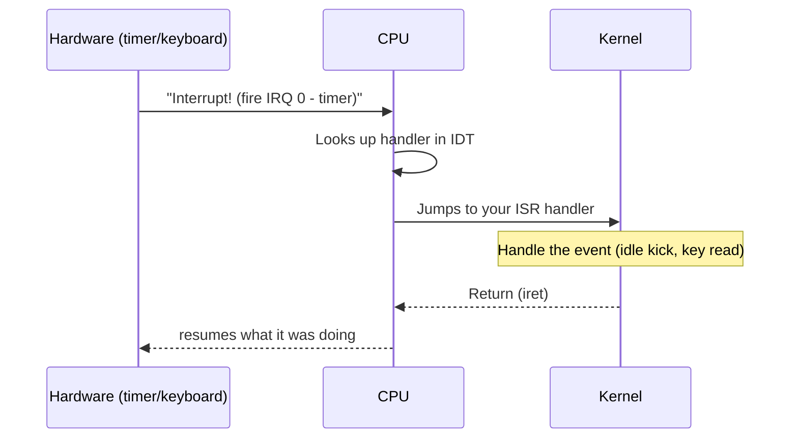

# Concept — Interrupts & the IDT

*Original content written for OSDev_Learning_Hub.*

## In one sentence
**[Interrupts](../../GLOSSARY/interrupt.md "A hardware signal that makes the CPU run a registered handler")** are the hardware's way of yelling "something happened!" at the CPU, and the **Interrupt Descriptor Table ([IDT](../../GLOSSARY/idt.md "The kernel's table of where each interrupt handler lives"))** is the kernel's phonebook for where to jump in response.

## The big idea

Your kernel can't just poll the keyboard forever. Instead, the hardware *interrupts* it: the CPU halts whatever it's doing, jumps to a handler you registered, runs it, and returns.



## The pieces you set up

1. **The IDT** — an array of descriptors telling the CPU where each handler lives.
2. **An [ISR](../../GLOSSARY/isr.md "The handler function run for a specific interrupt number") handler** — that does the actual work for a given interrupt number.
3. **The [PIC / APIC](../../GLOSSARY/pic-apic.md "Chips that route hardware interrupts (timer, keyboard) to the CPU")** — the chip that routes hardware interrupts to the CPU.
4. **`sti` / `cli`** — enable/disable interrupts.

Writing this by hand in assembly + C/Rust is a milestone (the Phil Opp series and os01 both dedicate chapters to it). But *understanding* it is what matters for a beginner.

## Why it matters for your Hello World
Your very first kernel can skip interrupts entirely (just print and halt). But you'll need them the moment you want a **timer tick** or a **keyboard**.

```rust
// Rust: registering a timer interrupt (from the Phil Opp series, summarized)
lazy_static! {
    static ref IDT: InterruptDescriptorTable = {
        let mut idt = InterruptDescriptorTable::new();
        idt[InterruptIndex::Timer.as_usize()].set_handler_fn(timer_interrupt_handler);
        idt
    };
}

extern "x86-interrupt" fn timer_interrupt_handler(_: InterruptStackFrame) {
    // a hardware timer just fired — a whole scheduling system starts here
}
```

```c
// C: the CPU loads the IDT with the lidt instruction
struct idt_ptr { uint16_t limit; uint32_t base; } __attribute__((packed));
struct idt_ptr idtp;
// ... fill 256 idt_entry_t entries ...
__asm__ volatile("lidt (%0)" : : "r"(&idtp));
__asm__ volatile("sti");   // enable interrupts
```

## The 256 slots
| Range | Who owns it | Example |
|-------|-------------|---------|
| 0–31 | **CPU exceptions** | #PF page fault (14), #GP general protection (13) |
| 32–47 | **Hardware IRQs** (after PIC remap) | timer (32), keyboard (33) |
| 48–255 | Software / your custom | [syscalls](../../GLOSSARY/syscall.md "The way user programs ask the kernel for services"), custom events |

> **Next:** [`04-vga-text-mode.md`](04-vga-text-mode.md).

## Watch and learn

- [CPU Interrupts](https://www.youtube.com/watch?v=tGMSARJk7cA) — Computerphile uses a robot analogy to explain how the CPU handles interrupts from devices like the keyboard.
- [Building an OS - 8 - Interrupts, IDT, GDT](https://www.youtube.com/watch?v=5LbXClJhxcs) — Nanobyte sets up the kernel GDT and introduces interrupts while building the IDT.
- [Building an OS - 10 - Hardware interrupts, PIC](https://www.youtube.com/watch?v=FD48Lx7Rnx0) — Nanobyte implements a driver for the 8259 PIC and handles real hardware interrupts.
