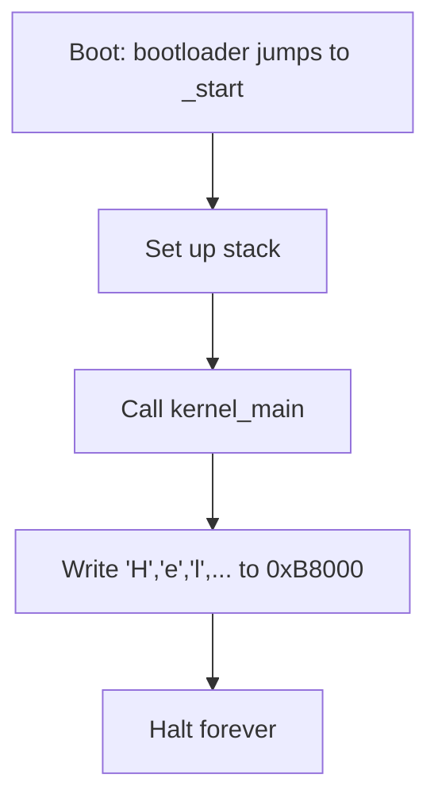

# Concept — VGA Text Mode & Your First "Hello World"

*Original content written for OSDev_Learning_Hub.*

## In one sentence
Before you have a hard drive, a keyboard, or a framebuffer driver, you can already put text on the screen by writing directly to a fixed block of memory: **`0xB8000`**.

## What VGA text mode is

In [text mode](../../GLOSSARY/vga-text-mode.md "The 80x25 character display mode a minimal kernel writes to"), the screen is a grid of **80 columns × 25 rows** = 2000 cells. Each cell is **2 bytes**:

```
┌────────────┬────────────┐
│ char (low) │ color(high)│
│  'A' (0x41)│  0x0F      │
└────────────┴────────────┘
```

So writing the string `"Hello World!"` means writing 12 such 2-byte cells starting at `0xB8000`:

```c
unsigned short* vga = (unsigned short*)0xB8000;

vga[0] = 0x0F48;   // 'H'
vga[1] = 0x0F65;   // 'e'
vga[2] = 0x0F6C;   // 'l'
vga[3] = 0x0F6C;   // 'l'
vga[4] = 0x0F6F;   // 'o'
vga[5] = 0x0F20;   // ' '
vga[6] = 0x0F57;   // 'W'
vga[7] = 0x0F6F;   // 'o'
vga[8] = 0x0F72;   // 'r'
vga[9] = 0x0F6C;   // 'l'
vga[10] = 0x0F64;  // 'd'
vga[11] = 0x0F21;  // '!'
```

The color byte `0x0F` = foreground `0xF` (white) + background `0x0` (black). Lower 4 bits = foreground, upper 4 bits = background.

```
color byte:
 bits 7 6 5 4   = background
 bits 3 2 1 0   = foreground
```

## The universal "Hello World" driver

Here's the same 20-line [VGA terminal driver](../../GLOSSARY/vga-text-mode.md "The 80x25 character display mode a minimal kernel writes to") in C. **Every** language version in this hub builds the same logic — only the syntax differs:

```c
#define VGA_WIDTH  80
#define VGA_HEIGHT 25
#define VGA_MEMORY ((unsigned short*)0xB8000)

static int row = 0;
static int col = 0;

void term_putchar(char c) {
    if (c == '\n') { row++; col = 0; return; }   // newline
    if (c == '\r') { col = 0; return; }          // carriage return
    VGA_MEMORY[row * VGA_WIDTH + col] = (0x0F << 8) | (unsigned char)c;
    col++;
    if (col >= VGA_WIDTH) { col = 0; row++; }    // wrap
    if (row >= VGA_HEIGHT) { row = 0; }          // scroll (naive)
}

void term_write(const char* s) { while (*s) term_putchar(*s++); }

void kernel_main(void) {
    term_write("Hello World!");
    // halt forever — the kernel never returns
    for (;;) ;
}
```

## The complete beginner flow (any language)


## What QEMU shows you
![Screenshot]: Add a screenshot here — a black [QEMU](../../GLOSSARY/qemu.md "A free emulator you can boot your kernel in for testing") window with white text reading "Hello World!".

That's it. That is literally all a "Hello World" OS does — but it's the *proof* that your entire toolchain works and you own the machine.

> **Next:** [`05-the-hello-world-of-oses.md`](05-the-hello-world-of-oses.md) — the one kernel you'll build in all five languages.

## Watch and learn

<details class="video-embed">
<summary>▶ Watch: How VGA Works</summary>
<iframe src="https://www.youtube-nocookie.com/embed/5exFKr-JJtg" title="How VGA Works" width="100%" height="400" style="border:0;border-radius:8px;" allow="accelerometer; autoplay; clipboard-write; encrypted-media; gyroscope; picture-in-picture; web-share" allowfullscreen></iframe>
<p class=video-caption>Tech Tangents explains VGA signals and hardware, the display standard your text-mode hello world drives.</p>
</details>
<details class="video-embed">
<summary>▶ Watch: Building an OS - 1 - Hello world</summary>
<iframe src="https://www.youtube-nocookie.com/embed/9t-SPTC7Tczc" title="Building an OS - 1 - Hello world" width="100%" height="400" style="border:0;border-radius:8px;" allow="accelerometer; autoplay; clipboard-write; encrypted-media; gyroscope; picture-in-picture; web-share" allowfullscreen></iframe>
<p class=video-caption>Nanobyte writes a hello-world program in assembly and boots it from a floppy, the classic first step.</p>
</details>
<details class="video-embed">
<summary>▶ Watch: Building an OS - 5 - How to implement printf</summary>
<iframe src="https://www.youtube-nocookie.com/embed/dG8PV6xqm4s" title="Building an OS - 5 - How to implement printf" width="100%" height="400" style="border:0;border-radius:8px;" allow="accelerometer; autoplay; clipboard-write; encrypted-media; gyroscope; picture-in-picture; web-share" allowfullscreen></iframe>
<p class=video-caption>Nanobyte builds a `printf` that writes formatted text to the screen, a gateway to real VGA text output.</p>
</details>
<details class="video-embed">
<summary>▶ Watch: How to make an operating system from scratch (part 1)</summary>
<iframe src="https://www.youtube-nocookie.com/embed/rr-9w2gITDM" title="1 - How to make an operating system from scratch" width="100%" height="400" style="border:0;border-radius:8px;" allow="accelerometer; autoplay; clipboard-write; encrypted-media; gyroscope; picture-in-picture; web-share" allowfullscreen></iframe>
<p class=video-caption>Writes colored characters straight to memory and boots them — the same "Hello World" flow, with a colored-character twist that shows off the VGA color byte.</p>
</details>

**More VGA picks**
- ▶ [How VGA Works (Tech Tangents)](https://www.youtube-nocookie.com/embed/5exFKr-JJtg) — already above; revisit it once you want to go past text mode into graphics/pixel modes.

---

## Further reading

- [OSDev Wiki — VGA Hardware](https://wiki.osdev.org/VGA_Hardware) — the full hardware behind `0xB8000`, ports, and modes.
- [OSDev Wiki — Text Mode Cursor](https://wiki.osdev.org/Text_Mode_Cursor) — how to move and show the blinking cursor in text mode.
- [OSDev Wiki — Printing To Screen](https://wiki.osdev.org/Printing_To_Screen) — a short, concrete walkthrough of writing to VGA text memory.
- [Writing an OS in Rust — VGA Text Mode](https://os.phil-opp.com/vga-text-mode/) — a clean, buffer-typed implementation of the identical driver in a different language.
- [OSDev Wiki — Bare Bones](https://wiki.osdev.org/Bare_Bones) — the minimal kernel whose only visible output is this VGA "Hello World".

---

## A quick note on the color byte

The `0x0F` in `vga[0] = 0x0F48` packs two things: background (upper nibble, `0`) and foreground (lower nibble, `F` for bright white). Mix in the blink bit (bit 7) and you have 16 foreground × 8 background × 2 blink combinations — more than enough to make your first OS look alive. Try `0x1F` for blue-on-white or `0x2A` for green-on-light-green and watch the screen change.
