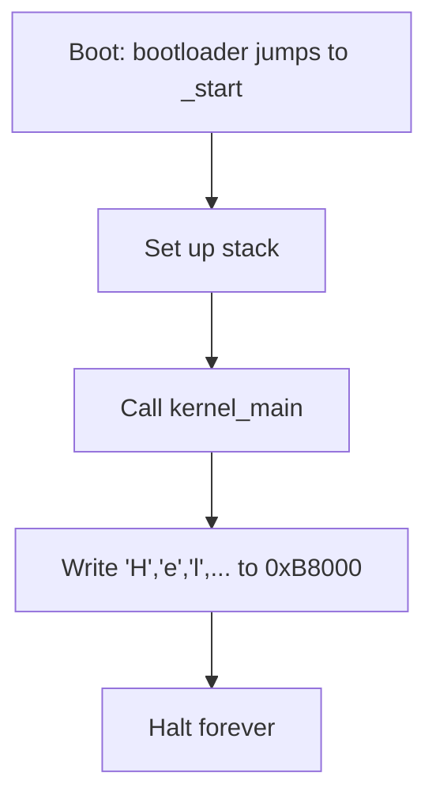
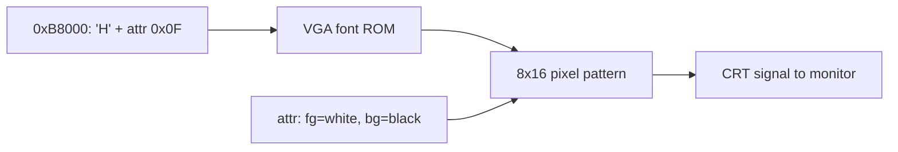
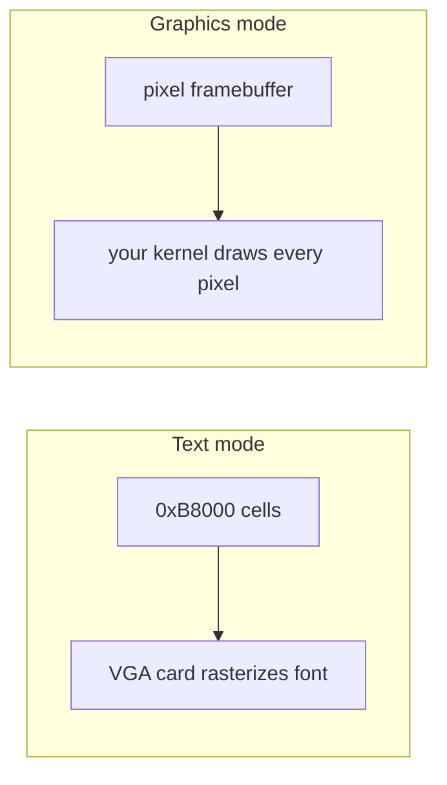

# Concept — VGA Text Mode & Your First "Hello World"

*Original content written for OSDev_Learning_Hub.*

## In one sentence
Before you have a hard drive, a keyboard, or a framebuffer driver, you can already put text on the screen by writing directly to a fixed block of memory: **`0xB8000`**.

## What VGA text mode is

In [text mode](../../GLOSSARY/vga-text-mode.md "The 80x25 character display mode a minimal kernel writes to"), the screen is a grid of **80 columns × 25 rows** = 2000 cells. Each cell is **2 bytes**:

```
┌────────────┬────────────┐
│ char (low) │ color(high)│
│  'A' (0x41)│  0x0F      │
└────────────┴────────────┘
```

So writing the string `"Hello World!"` means writing 12 such 2-byte cells starting at `0xB8000`:

```c
unsigned short* vga = (unsigned short*)0xB8000;

vga[0] = 0x0F48;   // 'H'
vga[1] = 0x0F65;   // 'e'
vga[2] = 0x0F6C;   // 'l'
vga[3] = 0x0F6C;   // 'l'
vga[4] = 0x0F6F;   // 'o'
vga[5] = 0x0F20;   // ' '
vga[6] = 0x0F57;   // 'W'
vga[7] = 0x0F6F;   // 'o'
vga[8] = 0x0F72;   // 'r'
vga[9] = 0x0F6C;   // 'l'
vga[10] = 0x0F64;  // 'd'
vga[11] = 0x0F21;  // '!'
```

The color byte `0x0F` = foreground `0xF` (white) + background `0x0` (black). Lower 4 bits = foreground, upper 4 bits = background.

```
color byte:
 bits 7 6 5 4   = background
 bits 3 2 1 0   = foreground
```

## The universal "Hello World" driver

Here's the same 20-line [VGA terminal driver](../../GLOSSARY/vga-text-mode.md "The 80x25 character display mode a minimal kernel writes to") in C. **Every** language version in this hub builds the same logic — only the syntax differs:

```c
#define VGA_WIDTH  80
#define VGA_HEIGHT 25
#define VGA_MEMORY ((unsigned short*)0xB8000)

static int row = 0;
static int col = 0;

void term_putchar(char c) {
    if (c == '\n') { row++; col = 0; return; }   // newline
    if (c == '\r') { col = 0; return; }          // carriage return
    VGA_MEMORY[row * VGA_WIDTH + col] = (0x0F << 8) | (unsigned char)c;
    col++;
    if (col >= VGA_WIDTH) { col = 0; row++; }    // wrap
    if (row >= VGA_HEIGHT) { row = 0; }          // scroll (naive)
}

void term_write(const char* s) { while (*s) term_putchar(*s++); }

void kernel_main(void) {
    term_write("Hello World!");
    // halt forever — the kernel never returns
    for (;;) ;
}
```

## The complete beginner flow (any language)


## What QEMU shows you
![Screenshot]: Add a screenshot here — a black [QEMU](../../GLOSSARY/qemu.md "A free emulator you can boot your kernel in for testing") window with white text reading "Hello World!".

That's it. That is literally all a "Hello World" OS does — but it's the *proof* that your entire toolchain works and you own the machine.

> **Next:** [`05-the-hello-world-of-oses.md`](05-the-hello-world-of-oses.md) — the one kernel you'll build in all five languages.

## Watch and learn

<details class="video-embed">
<summary>▶ Watch: How VGA Works</summary>
<iframe src="https://www.youtube-nocookie.com/embed/5exFKr-JJtg" title="How VGA Works" width="100%" height="400" style="border:0;border-radius:8px;" allow="accelerometer; autoplay; clipboard-write; encrypted-media; gyroscope; picture-in-picture; web-share" allowfullscreen></iframe>
<p class=video-caption>Tech Tangents explains VGA signals and hardware, the display standard your text-mode hello world drives.</p>
</details>
<details class="video-embed">
<summary>▶ Watch: Building an OS - 1 - Hello world</summary>
<iframe src="https://www.youtube-nocookie.com/embed/9t-SPTC7Tczc" title="Building an OS - 1 - Hello world" width="100%" height="400" style="border:0;border-radius:8px;" allow="accelerometer; autoplay; clipboard-write; encrypted-media; gyroscope; picture-in-picture; web-share" allowfullscreen></iframe>
<p class=video-caption>Nanobyte writes a hello-world program in assembly and boots it from a floppy, the classic first step.</p>
</details>
<details class="video-embed">
<summary>▶ Watch: Building an OS - 5 - How to implement printf</summary>
<iframe src="https://www.youtube-nocookie.com/embed/dG8PV6xqm4s" title="Building an OS - 5 - How to implement printf" width="100%" height="400" style="border:0;border-radius:8px;" allow="accelerometer; autoplay; clipboard-write; encrypted-media; gyroscope; picture-in-picture; web-share" allowfullscreen></iframe>
<p class=video-caption>Nanobyte builds a `printf` that writes formatted text to the screen, a gateway to real VGA text output.</p>
</details>
<details class="video-embed">
<summary>▶ Watch: How to make an operating system from scratch (part 1)</summary>
<iframe src="https://www.youtube-nocookie.com/embed/rr-9w2gITDM" title="1 - How to make an operating system from scratch" width="100%" height="400" style="border:0;border-radius:8px;" allow="accelerometer; autoplay; clipboard-write; encrypted-media; gyroscope; picture-in-picture; web-share" allowfullscreen></iframe>
<p class=video-caption>Writes colored characters straight to memory and boots them — the same "Hello World" flow, with a colored-character twist that shows off the VGA color byte.</p>
</details>

**More VGA picks**
- ▶ [How VGA Works (Tech Tangents)](https://www.youtube-nocookie.com/embed/5exFKr-JJtg) — already above; revisit it once you want to go past text mode into graphics/pixel modes.

---

## Further reading

- [OSDev Wiki — VGA Hardware](https://wiki.osdev.org/VGA_Hardware) — the full hardware behind `0xB8000`, ports, and modes.
- [OSDev Wiki — Text Mode Cursor](https://wiki.osdev.org/Text_Mode_Cursor) — how to move and show the blinking cursor in text mode.
- [OSDev Wiki — Printing To Screen](https://wiki.osdev.org/Printing_To_Screen) — a short, concrete walkthrough of writing to VGA text memory.
- [Writing an OS in Rust — VGA Text Mode](https://os.phil-opp.com/vga-text-mode/) — a clean, buffer-typed implementation of the identical driver in a different language.
- [OSDev Wiki — Bare Bones](https://wiki.osdev.org/Bare_Bones) — the minimal kernel whose only visible output is this VGA "Hello World".

---

## A quick note on the color byte

The `0x0F` in `vga[0] = 0x0F48` packs two things: background (upper nibble, `0`) and foreground (lower nibble, `F` for bright white). Mix in the blink bit (bit 7) and you have 16 foreground × 8 background × 2 blink combinations — more than enough to make your first OS look alive. Try `0x1F` for blue-on-white or `0x2A` for green-on-light-green and watch the screen change.


---

## Deep dive: what each cell actually stores

A text-mode screen is a 2-byte-per-cell grid at `0xB8000`. We met the format at the top of the chapter; let's make it fully precise, because getting these two bytes right is the entire VGA driver.

```
Memory:   0xB8000   0xB8001   0xB8002   0xB8003   ...
          ┌─────────┬─────────┬─────────┬─────────┐
Cell:     │  'H'    │  0x0F   │  'e'    │  0x0F   │
          │ char    │ attr    │ char    │ attr    │
          └─────────┴─────────┴─────────┴─────────┘
```

- **Low byte (even offset):** the character's code point. In text mode this tracks ASCII (and, for the top 128 codes, depends on the VGA font / code page). `'H'` = `0x48`.
- **High byte (odd offset):** the **attribute** byte. Its lower nibble is the *foreground* color; its upper nibble is the *background*.

Why eschew a "string of characters in memory"? Because every character carries its own color — you could color each letter differently if you wanted. That's why the pervasive pattern is a single 16-bit value per cell: `(attribute << 8) | character`.

```c
// the universal cell encoding
#define COLOR 0x0F                    // white on black
vga[i] = (COLOR << 8) | 'A';          // char in low byte, color in high
```

Because x86 is little-endian, writing the 16-bit value `0x0F41` to memory puts `0x41` ('A') at the low address and `0x0F` at the high one — exactly the char/attr layout above. This is why `vga[0] = 0x0F48` prints an 'H' in white-on-black.

### Why the buffer is `(unsigned short*)` and not `(unsigned char*)`

If you treat `0xB8000` as an array of bytes, you must write char and attribute as two separate byte stores. If you treat it as `unsigned short*`, you write both at once — fewer memory accesses, and the natural 16-bit cell benefits from aligned stores. Both work; the `short*` form is what most hobby kernels use.

```c
volatile unsigned short* vga = (volatile unsigned short*)0xB8000;
```

The **`volatile`** is not optional here. The VGA hardware updates/modifies its own memory (and the screen hardware reads it continuously). `volatile` stops the compiler from assuming the memory "never changes" and thereby optimizing away or reordering your writes — a rule you met in the memory chapter and which is doubly important for device memory.

---

## The cursor — the thing beginners forget

If you write text carelessly, the *hardware cursor* (that blinking block) stays wherever the BIOS put it, and your text appears without moving the cursor. It's cosmetic in QEMU but confusing. Moving the cursor means writing to the VGA's I/O ports via the **CRTC (CRT Controller)**: port `0x3D4` selects the register, `0x3D5` writes it.

```c
// cursor.c — position the hardware cursor using CRTC registers
#define VGA_CRT_ADDR 0x3D4
#define VGA_CRT_DATA 0x3D5

void move_cursor(int row, int col) {
    uint16_t pos = row * 80 + col;      // linear cell index
    outb(VGA_CRT_ADDR, 14);             // register 14 = cursor location (high byte)
    outb(VGA_CRT_DATA, (pos >> 8) & 0xFF);
    outb(VGA_CRT_ADDR, 15);             // register 15 = cursor location (low byte)
    outb(VGA_CRT_DATA, pos & 0xFF);
}
```

Pattern recognition: select a register (port A), write its value (port B). This "select then data" idiom appears everywhere in VGA/device programming. Moving the cursor keeps the blinking block in sync with where your terminal thinks it is.

---

## Scrollback: making the screen actually usable

The toolchain chapter's terminal just wrapped to row 0 and overwrote. A slightly better driver **scrolls** — moves every line up one, clearing the bottom line. The naive but correct way: copy row `n+1` into row `n`, then blank the last row.

```c
void scroll(void) {
    // shift every line up by one
    for (int row = 1; row < VGA_HEIGHT; row++)
        for (int col = 0; col < VGA_WIDTH; col++)
            VGA_MEMORY[(row-1)*VGA_WIDTH+col] = VGA_MEMORY[row*VGA_WIDTH+col];
    // clear the last line
    for (int col = 0; col < VGA_WIDTH; col++)
        VGA_MEMORY[(VGA_HEIGHT-1)*VGA_WIDTH+col] = (0x0F << 8) | ' ';
}
```

Now instead of wrapping-around-with-overwrite, new lines push old ones up. The display looks like a real terminal. This is the textbook next step after the naive wrap in the toolchain chapter's driver.

### Full backspace, tab, and \r\n handling

A marginally complete terminal handles more than `\n` and `\r`. Here's an expanded `term_putchar`:

```c
void term_putchar(char c) {
    switch (c) {
        case '\n': row++; col = 0; break;
        case '\r': col = 0; break;
        case '\b': if (col > 0) col--; break;      // backspace
        case '\t': col = (col + 8) & ~7; break;     // tab to 8-col boundary
        default:
            put_cell(row, col, (0x0F << 8) | (unsigned char)c);
            col++;
    }
    if (col >= VGA_WIDTH) { col = 0; row++; }       // wrap
    if (row >= VGA_HEIGHT) { scroll(); row = VGA_HEIGHT - 1; } // scroll
    move_cursor(row, col);
}
```

Notice the important bit: on reaching the bottom, instead of resetting to row 0 (like the naive driver), the *proper* driver **scrolls** and stays on the last row. That single change is what makes the screen behave like a terminal instead of a flip-book.

---

## The color palette — the 16 official colors

The attribute byte's lower nibble can hold 16 foreground colors; the upper nibble 8 background colors (plus a blink bit). Here's the canonical palette and how to build an attribute byte:

| # | Color | # | Color |
|---|-------|---|-------|
| 0 | Black | 8 | Dark gray |
| 1 | Blue | 9 | Light blue |
| 2 | Green | 10 | Light green |
| 3 | Cyan | 11 | Light cyan |
| 4 | Red | 12 | Light red |
| 5 | Magenta | 13 | Light magenta |
| 6 | Brown | 14 | Yellow |
| 7 | Light gray | 15 | White |

```c
// attribute byte: 7 6 5 4 | 3 2 1 0  = background | foreground
#define ATTR(fg, bg) (((bg) << 4) | (fg))
#define WHITE_ON_BLACK ATTR(15, 0)
#define RED_ON_BLACK   ATTR(4, 0)
#define BLACK_ON_WHITE ATTR(0, 7)
```

The toolchain chapter's "Try `0x1F` for blue-on-white or `0x2A` for green-on-light-green" — now you can see exactly why: `0x1F` = background 1 (blue), foreground 15 (white); `0x2A` = background 2 (green), foreground 10 (light green). Building colors from `(bg<<4)|fg` rather than memorizing hex eliminates guesswork.

---

## A complete, real VGA terminal driver

Putting it all together — colors, cursor, scroll, wrap — here's the driver that every language walkthrough in this hub ends up reimplementing (think of it as the ground-truth version):

```c
// terminal.c — the complete text-mode terminal
#define VGA_WIDTH  80
#define VGA_HEIGHT 25
#define VGA_MEMORY ((volatile unsigned short*)0xB8000)
#define ATTR(fg,bg) (((bg)<<4)|(fg))

static int row = 0, col = 0;
static unsigned char term_color = ATTR(15, 0);   // white on black

static inline void put_cell(int r, int c, unsigned short v) {
    VGA_MEMORY[r*VGA_WIDTH + c] = v;
}

void term_set_color(unsigned char c) { term_color = c; }

void term_clear(void) {
    for (int i = 0; i < VGA_WIDTH*VGA_HEIGHT; i++)
        VGA_MEMORY[i] = (term_color << 8) | ' ';
    row = col = 0;
}

void scroll(void) {
    for (int r = 1; r < VGA_HEIGHT; r++)
        for (int c = 0; c < VGA_WIDTH; c++)
            put_cell(r-1, c, VGA_MEMORY[r*VGA_WIDTH + c]);
    for (int c = 0; c < VGA_WIDTH; c++)
        put_cell(VGA_HEIGHT-1, c, (term_color << 8) | ' ');
}

void term_putchar(char c) {
    switch (c) {
        case '\n': row++; col = 0; break;
        case '\r': col = 0; break;
        case '\b': if (col > 0) col--; break;
        default:
            put_cell(row, col, (term_color << 8) | (unsigned char)c);
            col++;
    }
    if (col >= VGA_WIDTH) { col = 0; row++; }
    if (row >= VGA_HEIGHT) { scroll(); row = VGA_HEIGHT - 1; }
    move_cursor(row, col);
}

void term_write(const char* s) { while (*s) term_putchar(*s++); }
```

This is the driver a real kernel uses (minus port I/O niceties). If you understand every line — why `term_color << 8`, why `scroll()` keeps the bottom row, why `volatile` — then VGA text mode is thoroughly yours.

### A fancier variant: printf

From `term_write`, the natural milestone is a tiny `printf` that formats integers and hex — useful for printing exception messages, register dumps, and tick counters:

```c
void term_printf(const char* fmt, ...) {
    // a mini formatter handling %d and %x is the classic exercise
    // (produces "ticks: 1234" on screen — proof interrupts + VGA cooperate)
}
```

Being able to print `0xDEADBEEF` from your interrupt handlers is a *huge* debugging lever. It's also why many beginner kernels implement printf early: it's the cheapest way to see what's going on inside the machine.

---

## Common pitfalls when writing to the screen

1. **Printing garbage / random characters.** Usually `.rodata` wasn't placed by the linker script (your string literal never made it into the image). Re-check the linker script — the toolchain chapter's pitfall #3.
2. **Writing to `0xB8000` but nothing appears.** Either you're in a mode where the VGA buffer isn't mapped (paging not mapping it — memory chapter pitfall), or you forgot `volatile` and the compiler elided the writes.
3. **Off-by-one on the 2-byte cells.** Treating the buffer as `char*` and writing "H", "e", "l"... without interleaving attribute bytes fills every char cell with your text and every attr cell with its neighbor's char — resulting in a garbled mess. Use `short*` or write both bytes.
4. **Not handling scroll and staying on row 0.** Resetting to row 0 on overflow overwrites your top line and looks broken. Call `scroll()`.
5. **Multiplying row/col wrong.** `VGA_MEMORY[row*80+col]` requires `row*VGA_WIDTH + col`, not `row + col`. A typo here scatters your text across the screen at diagonal spacing.
6. **Forgetting the cursor.** Text writes without moving the blinking cursor confuse debugging later. Update the cursor in `term_putchar`.
7. **No `\n` translation in a kernel.** A kernel doesn't auto-convert `\n` to `\r\n` like a hosted libc would. If you want to return to column 0, you must also handle `\r`.

---

## Learning checkpoints

- [ ] **I can explain the 2-byte cell layout** (char low, attribute high) and write 'H' in white-on-black to `0xB8000`.
- [ ] **I can build any color with `(bg<<4)|fg`** and name the 16 palette entries.
- [ ] **I can move the hardware cursor** through CRTC ports `0x3D4`/`0x3D5`.
- [ ] **I can implement scroll** so the screen behaves like a terminal instead of wrapping over itself.
- [ ] **I can write a complete `term_putchar`** handling `\n`, `\r`, `\b`, `\t`, wrap, and scroll.
- [ ] **I can explain why `volatile` matters** for `0xB8000` and why `.rodata` in the linker script is needed for strings.
- [ ] **I can sketch a mini `printf`** that prints `%d` and `%x` to the screen.

If you can tick those, VGA text mode is no longer a mystery — it's a tool. And the ultimate payoff is the next chapter: the "Hello World of OSes" recipe, where every piece you've learned (boot, toolchain, headers, and now the screen) comes together as a kernel that boots and shows text.

---

## Watch more

<details class="video-embed">
<summary>▶ Watch: Write Your Own Operating System in 1 Hour</summary>
<iframe src="https://www.youtube-nocookie.com/embed/1rnA6wpF0o4" title="Write Your Own Operating System in 1 Hour" width="100%" height="400" style="border:0;border-radius:8px;" allow="accelerometer; autoplay; clipboard-write; encrypted-media; gyroscope; picture-in-picture; web-share" allowfullscreen></iframe>
<p class=video-caption>Writes colored characters straight to VGA memory and boots them — a live version of the exact "Hello World" driver this concept builds.</p>
</details>
<details class="video-embed">
<summary>▶ Watch: OS development 101 - How to make a bootloader part 1 - Hello World</summary>
<iframe src="https://www.youtube-nocookie.com/embed/E_n0VtGSZQY" title="OS development 101 - How to make a bootloader part 1 - Hello World" width="100%" height="400" style="border:0;border-radius:8px;" allow="accelerometer; autoplay; clipboard-write; encrypted-media; gyroscope; picture-in-picture; web-share" allowfullscreen></iframe>
<p class=video-caption>From boot-sector coding to visible output — a complete hello-world path that lands on the screen, reinforcing how text gets there before any drivers exist.</p>
</details>
<details class="video-embed">
<summary>▶ Watch: How CPU Memory & Caches Work - Computerphile</summary>
<iframe src="https://www.youtube-nocookie.com/embed/SAk-6gVkio0" title="How CPU Memory & Caches Work - Computerphile" width="100%" height="400" style="border:0;border-radius:8px;" allow="accelerometer; autoplay; clipboard-write; encrypted-media; gyroscope; picture-in-picture; web-share" allowfullscreen></iframe>
<p class=video-caption>Every write to `0xB8000` is a memory access through the CPU's cache hierarchy — ground truth for why MMIO needs `volatile` and why alignment matters.</p>
</details>


---

## Deep dive: how a character actually becomes a pixel

When you write `'H'` to `0xB8000`, you're not telling the monitor to draw an H. You're writing into the VGA card's **text-mode framebuffer**, and the VGA hardware itself — every screen refresh, 60+ times a second — scans that memory, looks up each character cell in a **font** stored on the card, and converts it into pixels. The full chain:

```
0xB8000 cell ('H', 0x0F)
   → VGA reads the char code 0x48
   → looks up 0x48 in the character ROM (the font bitmap)
   → gets an 8x16 (or 8x8) pattern of on/off bits
   → colors on-bits with foreground, off-bits with background (from attr)
   → feeds 2000 cells × (char pixels) every refresh to the CRT signal
```

This is why text mode is so snappy: the *hardware* does the font rasterization. You write a byte; the card does the work. It also explains why the top 128 codes depend on the card's font/code page — the hardware is mapping your byte through *its* font, not a font in your kernel.



Understanding this demystifies two things you'll meet later:
1. **Why a kernel can print text with zero "driver" code** — the VGA card is the driver; you just own the framebuffer.
2. **Why text mode is limited to 256 codes** — the font maps one byte. For full color/fonts you move to *graphics* modes (VBE/framebuffer), where *your kernel* must do the font rasterization — much harder, which is why the hub starts with text mode.

## VGA ports: beyond the framebuffer

`0xB8000` is memory-mapped, but the VGA card also exposes **I/O ports** for control. The three you'll actually touch early:

| Port | Purpose |
|------|---------|
| `0x3D4` / `0x3D5` | CRTC register select / data — cursor position (you used these) |
| `0x3C0` / `0x3C1` | attribute controller / palette select — text colors' hardware palette |
| `0x3CE` / `0x3CF` | graphics controller (mostly for graphics modes) |

You don't need most of these for text mode (the BIOS/GRUB set it up). The cursor pair is the one you'll write to. But knowing the ports exist explains a pattern: **"select register on one port, read/write its value on another"** shows up across the whole ISA/PCI world, not just VGA. One device file per concept later, the same idiom reappears in keyboard and timer drivers.

## Framebuffers: text mode vs linear graphics

Everything above is **text mode** (or "character mode"). The phrase **framebuffer** can mean two things, and beginners conflate them:

- **Text framebuffer**: `0xB8000`, cells of (char, attr). Hardware rasterizes. Easy.
- **Linear/Pixel framebuffer**: a region where each *pixel* has a color value (e.g. 32 bits per pixel, RGB). *Your kernel* must draw shapes and fonts itself. Harder, but that's how you get 1024×768 or 4K.



The **Multiboot 2 / Limine / UEFI** path (from the bootloaders chapter) can hand you a linear framebuffer at a fixed address — that's how modern hobby OSes do graphics. It's a later milestone; the VGA text mode in this chapter is the warm-up that teaches you "the screen is just memory you own."

## Writing the whole screen: clear, fill, and the blink bit

A few small utilities every VGA driver ends up with:

```c
// clear the entire 80x25 screen to one color
void term_clear(void) {
    for (int i = 0; i < 80*25; i++)
        VGA_MEMORY[i] = (0x0F << 8) | ' ';
}

// fill a region with a repeated character/color (e.g. a red border)
void term_fill_char(int r0, int c0, int r1, int c1, unsigned short v) {
    for (int r = r0; r <= r1; r++)
        for (int c = c0; c <= c1; c++)
            VGA_MEMORY[r*80 + c] = v;
}
```

The **blink bit** (bit 7 of the attribute byte's background nibble) makes the background blink: `0x87` = blinking white-on-black. It's easy to forget the blink bit exists; if your background colors seem to "flash," you set bit 7. Most drivers leave it off.

## A worked mini-project: a colorful clock on the VGA screen

To see *everything* in this chapter (and reward the last two chapters' interrupts) in one screenful, here's a small kernel that prints a ticking clock using the timer interrupt from the interrupts concept — proof that interrupts + VGA cooperate:

```c
// clock.c — the terminal + timer + interrupts working together
static unsigned int ticks = 0;

void timer_handler(void) {
    ticks++;
    pic_eoi(0);                     // ACK the timer
    // every 18 ticks (~1s at 18Hz) or per your PIT rate, refresh the clock
    if (ticks % 18 == 0) {
        unsigned int secs = ticks / 18;
        char buf[16];
        term_printf(buf, "UPS: %u seconds", secs);   // your mini printf
    }
}
```

Boot it in QEMU and you'll see a live counter climbing — entirely driven by the timer IRQ, printed through VGA. That one screen is the payoff of the memory, interrupts, and VGA concepts working as one. It's also, quietly, the world's simplest proof that you're building something that *runs*, not just something that *compiles*.

## Common pitfalls, round two

1. **The leading/trailing attribute bug.** `(attr << 8) | char` vs `(char << 8) | attr` swapped gives you garbage that sometimes *looks* characters but is color-smeared. Test with a solid block first.
2. **Treating `0xB8000` as `char*` and not interleaving attrs.** Each cell needs both bytes; a naive char loop prints overlapping mess. Use the `short*` form or write both bytes explicitly.
3. **Not clearing before a "fresh" screen.** Old text lingers below your new output. `term_clear()` first for predictable output.
4. **Assuming `\n` returns to column 0.** Kernels don't translate `\n` → `\r\n`; handle `\r` yourself or your columns drift right across output.
5. **Writing non-ASCII bytes.** Codes > 0x7F render as whatever the card's font says (often box-drawing or region-specific). If you print raw control bytes (0x00–0x1F), you get junk. Filter or translate them.
6. **The blink bit surprise.** Bit 7 of the attr's background nibble toggles blink. Setting a "bright background" by accident turns it into flashing.
7. **Paging removes `0xB8000`.** After you enable paging (memory chapter), if your page tables don't map the VGA buffer, your prints vanish *even though the code is right*. Map `0xB8000` in your tables.

These seven — combined with the first pitfall set — cover the real-world VGA text bugs this chapter's readers actually hit.

## Learning checkpoints, round two

- [ ] **I can explain how a character becomes a pixel** through the VGA font ROM, and why text mode needs no font code in my kernel.
- [ ] **I can move the cursor, clear, and fill** the screen using the ports and the framebuffer.
- [ ] **I can contrast text mode with a linear/pixel framebuffer** and say which your kernel rasterizes.
- [ ] **I can build a `term_clear` and a `term_fill_char`** from scratch.
- [ ] **I can combine interrupts + VGA** to print a live counter (mini-project above).
- [ ] **I know why paging can silently hide the VGA buffer** and the fix.

Tick all six and text mode is genuinely behind you. The next (and final concept) chapter — "The Hello World of OSes Recipe" — is where you assemble *this* VGA output, the *boot* story, the *toolchain*, and the Multiboot *header* into the single kernel used across all five language walkthroughs.

## One mental model that helps

Think of the VGA text buffer as **a piece of paper taped to the wall** — and the wall is the whole computer. When you write to `0xB8000`, you're scribbling on that paper, and the "monitor" is just a camera pointing at it. There's no paint program, no printer driver, no ink — it's literally shared memory between you and the display hardware. The screen isn't something you "send output to"; it's a fixed slab of RAM that the monitor is continuously reading. That's the whole insight, and it never stops being true in OS development: **the screen, the keyboard, the timer — they're all just memory and ports you own.**

And the beautiful part: because it's just memory, "printing to the screen" is a `volatile` pointer store, not an API call. That fundamental shift — from "call `printf`" to "write to an address" — is the single biggest mindset change between app programming and kernel programming, and it's complete the moment that first 'H' appears.


---

## Practice problems to lock it in

1. **You write `vga[0] = 0x0F48` and see a colored block, not an 'H'.** Which byte is where, and what did you swap?
   *Answer: the high byte is the attribute. `0x0F48` → attribute `0x0F`, char `0x48`. If you wrote `0x480F`, the "char" would be 0x0F (a control code → block) and the attr 0x48 (nonzero → visible box). The encodorder is `(attr << 8) | char`.*

2. **Your strings print as garbage, but individual `vga[i] = ...` looks fine.** What did the linker script forget?
   *Answer: `.rodata`. String literals live there; without it in the script, they never make it into the image. Add `.rodata : { *(.rodata) }` and re-verify with `readelf`.*

3. **After enabling paging, your kernel stops printing even though you didn't touch the VGA code.** What's the cause, and the fix?
   *Answer: your new page tables don't map the VGA buffer at `0xB8000`. Map it (via a `map_page` / identity map) so the framebuffer stays reachable.*

4. **Your "terminal" overwrites the top line when it fills up.** Which two behaviors did you fail to separate?
   *Answer: wrap (goto next row) vs scroll (shift lines up). A proper driver scrolls on `row >= 25` and stays on the bottom row, instead of resetting to row 0.*

5. **A character prints but without moving the blinking cursor.** What did you skip?
   *Answer: updating the CRTC cursor position through ports `0x3D4`/`0x3D5`. Text writes don't move the hardware cursor automatically.*

6. **You set background `0x07` (gray) and it renders as flashing text.** Which extra bit did you set?
   *Answer: bit 7 of the attribute byte — the blink bit. `0x87` adds blink on top of gray-on-black. Reduce the background nibble to `0x07` (not `0x87`).*

Being able to answer all six on sight means VGA text mode is not just "something you did" — it's something you *understand*. With that understanding, you're fully prepared for the culminating concept: the "Hello World of OSes" recipe, where every chapter's lesson assembles into one bootable kernel.

## The VGA text-mode quick reference

| Thing | Value / form | Use |
|-------|--------------|-----|
| Buffer address | `0xB8000` | the 80×25 framebuffer |
| Cell size | 2 bytes | char (low) + attribute (high) |
| Cell encoding | `(attr << 8) | char` | write both at once |
| Attribute | `(bg << 4) | fg` | 16 fg, 8 bg, 1 blink |
| Cursor select | port `0x3D4` | choose CRTC register |
| Cursor data | port `0x3D5` | set its value |
| `volatile` | required on the pointer | stop the compiler eliding/reordering MMIO |
| Scroll fix | shift rows up, blank last | terminal behavior, not wrap-overwrite |

Keep this one-sheet beside you. Every language walkthrough in this hub implements these exact primitives — only the syntax differs. Master them once, and you'll recognize the identical logic in C, Rust, C++, Go, and C# kernels without missing a beat.


---

## Going further: 8 display pages and the extended room

One detail from the OSDev "Printing To Screen" page worth noting: a color text card has **32 KiB** of text memory, but 80×25×2 bytes is only 4000 bytes per screen. That leaves room for **8 display pages** — you can render off-screen page 3, then switch the active page to it, for instant, flicker-free redraws:

```
0xB8000  -- page 0 (the visible one)
0xB9FA0  -- page 1 (8000 bytes in, roughly)
0xBBF40  -- page 2
...
```

Most beginners never need multiple pages (QEMU defaults and hobby kernels use page 0). But knowing the buffer is 32 KiB and pages exist demystifies why the hardware allocates *that* much RAM for a fixed 2000-cell grid — and it's a fun optional enhancement: draw a menu off-screen, flip it in with one CRTC register write.

## Sustained output: why you'll add a real `printf` soon

The mini-`printf` is a rite of passage for a second reason beyond debugging: once you have interrupts, memory, and a screen all running, you *need* a way to see what's happening inside. The cheapest, most powerful tool is a formatter that can print integers, hex addresses, and register dumps. Here's the core of a `%d`/`%x` formatter in ~15 lines:

```c
// fmt.c — integer printing, the heart of a kernel printf
void itoa(unsigned int value, char* buf, int base) {
    char* p = buf;
    static const char digits[] = "0123456789ABCDEF";
    unsigned int v = value;
    do { *p++ = digits[v % base]; v /= base; } while (v);
    // reverse in place
    char* s = buf; char* e = p - 1;
    while (s < e) { char t = *s; *s = *e; *e = t; s++; e--; }
    *p = 0;
}
// usage: itoa(0xDEADBEEF, buf, 16) → "DEADBEEF"
```

`itoa` in base 16 is the single most useful debugging function a kernel owner has. Print the value of CR3, a fault address, a page fault error code — sudden, *visible* insight. If you implement just one extra function in this chapter's driver, make it this one.

## When to leave text mode for a framebuffer

You don't have to, but the moment you hit either of these, it's time to learn graphics/framebuffer:

1. **You want more than 256 characters** (a real font, Unicode, GUI text).
2. **You want actual pixels** (images, a window manager, a game).

Both require a **linear framebuffer** and your own font rasterizer — a meaningful jump in complexity, which is why the hub keeps text mode as the on-ramp. The concepts you've already learned (the screen is memory you own; drivers just manage addresses/ports; `volatile` rules MMIO) transfer directly. `0xB8000` becomes `0xFD000000`-style framebuffer base handed to you by Multiboot 2 / Limine / UEFI, and a "font" is just a table of pixel patterns you draw per character. Same mindset, bigger canvas.

## A note on debugging with the screen in OS-dev

Because a bare kernel has no printf-at-the-OS, the **screen itself is your debug output**. Two habits make that dramatically less painful:

- **Always have a working `term_putchar`/`term_write` "first."** The very first thing your kernel prints should be a boot banner ("Kernel loaded OK"). If that appears, your toolchain + boot + VGA all work, and every later bug is upstream of printing.
- **Print liberally, then delete.** Sprinkle `term_write("dbg: here\n")` markers at obvious milestones. When output stops at "dbg: before page table," you've bisected the bug. Then remove the markers once fixed.

This "print as a debugger" discipline is the beginner's superpower before they learn to drive QEMU+GDB. Combine both — print banners *and* attach a debugger — and you're invincible.

## Where this concept leaves you

You now have one working abstract idea per major subsystem: the boot chain (chapter 00), the tools (chapter 02), the bootloader handshake (concept 01), memory (concept 02), interrupts (concept 03), and the screen (this concept). Each is a *"the X is just memory/ports/registers you own"* realization — and VGA text mode is the friendliest proof of that principle. All that's left is to see them compose into a single bootable "Hello World" kernel — which is precisely what the final concept chapter delivers, in every one of the hub's five languages.

---

## 🧪 Exercises & Projects

VGA text mode is the friendliest proof that "hardware is just memory you own": one
`0xB8000` write paints a character, and a `static volatile` pointer + a couple of
structures give you a screen. Everything here builds on the 2-byte `{char, attr}` cell.
Prereq: the VGA quick-reference (base, cells, attributes, cursor ports). Time estimates
assume a working build cycle.

### Graded exercises

**Easy**

- [ ] **E1. Paint every attribute** (~30 min). Write a single character at every one of the
      64 possible attribute bytes (background nibble × foreground nibble) down the left
      edge. You'll *see* blink vs. bright, and the 16-color palette, at a glance. Note
      which foreground bit is the "bright" bit.
- [ ] **E2. The 2000-cell map** (~20 min). Draw (in comments or on paper) a 25-row ×
      80-col grid and annotate: which heap of `2 * 80 * 25` bytes each cell sits at,
      and how `term_putchar(row, col)` computes `0xB8000 + (row*80 + col)*2`. Write the
      formula once, never again.
- [ ] **E3. Clear-screen without a memset** (~30 min). Fill row-major with `{' ', attr}`
      two bytes at a time using a `u16` loop, and compare with a byte-wise loop in
      `objdump` — confirm the compiler emits wider stores. (Then use `volatile`.)

**Medium**

- [ ] **M1. `printf`-lite with formatting** (~1.5 hr). Extend `term_write`/`term_putchar`
      into a `kprintf(format, ...)` supporting `%c`, `%s`, `%x`, `%d`. Write your own
      integer/hex printer (`do { buf[n--] = hex[val & 0xF]; val >>= 4; } while (val);`).
      This is the *sustained-output* milestone this chapter promises and the foundation of
      every debug message from here on.
- [ ] **M2. Scrolling + cursor** (~1.5 hr). When the cursor passes row 24, shift every row
      up one (`memmove` the 80*2 keystrokes per row) and blank the last line. Move the
      hardware cursor with the two `0x3D4/0x3D5` port writes (index then value). Now a long
      kernel log stays on screen.
- [ ] **M3. Two display pages** (~1 hr). VGA text mode reserves up to 8 pages; switch
      between page 0 and page 1 by writing the page number to the start-address registers
      (`CRTC` index `0xC`/`0xD`). Render different text on each page and flip— proof the
      buffer is *larger* than one screen and you control the window into it.

**Hard**

- [ ] **H1. A mini terminal emulator** (~3 hr). On top of M1/M2, add: a one-line input
      buffer reading the keyboard scancodes from [concept 03](03-interrupts-and-the-idt.md)
      IRQ1, a blinking caret, and a raw echo. Type, backspace, and enter without any OS —
      that's a shell's skeleton.
- [ ] **H2. Leave text mode: a 320×200 VGA framebuffer** (~3 hr). Use VGA mode `0x13` or the
      BIOS/VBE framebuffer to set a 256-color planar or linear buffer, set the palette via
      `outb` to the DAC, and draw a filled rectangle + a bouncing box with a per-frame
      timer. The file `tools/` scripts (`read_vga_text.py`) hint at how to inspect output.
      This is the bridge toward the chapter's "when to leave text mode" discussion.

### ⭐ Mini-project — A scrolling, multi-line kernel log & status bar

**Goal.** Transform the raw VGA buffer into a small **curses-like kernel UI**: a scrolling
log region, a fixed status bar line, and an uptime readout fed by a timer — all driven by
your own buffer-management code, no libraries.

**Estimated time:** 2–4 hr. **Prereq:** M1's `kprintf` and concept 03's timer ISR.

1. **Own the double buffer.** Maintain a `u16[80*25]` in RAM plus the raw `0xB8000`
   write. Every render flushes the buffer → screen. This lets you scroll and edit
   *before* painting — the classic text-driver pattern.
2. **Log region.** Reserve rows 0–23 for log lines. `log_printf` appends via your
   `kprintf`, scrolling rows up when full (reuse M2's `memmove`).
3. **Status bar.** Keep row 24 (attr inverted background) for live info: version, mode,
   and `uptime` re-rendered only when it changes.
4. **Timer feed.** Have the PIT ISR write `ticks`; the render loop reads it `volatile`-ly
   and refreshes the status bar each second.
5. **Test the scroll.** Log 30+ lines and watch older ones fall off the top. Log an
   error line in bright red attribute to confirm attr handling in the scroll path.
6. **Refactor into a module.** A `vga.h` with `init_vga`, `term_putchar`,
   `vga_scroll`, `vga_draw_status`. Your kernel's `main` becomes ~10 lines.
7. **Stretch (Hard):** add M3's second page; store *both* pages and add a key (from the
   keyboard) that flips between them — a poor-man's history view.

**Checklist**

- [ ] double buffer in RAM flushes correctly to `0xB8000`
- [ ] log scrolls and drops oldest lines
- [ ] status bar stays fixed on row 24 with inverted attr
- [ ] uptime ticks per-second inside the status bar
- [ ] error line renders in a distinct attribute
- [ ] kernel `main` is thin — logic lives in `vga.*`

