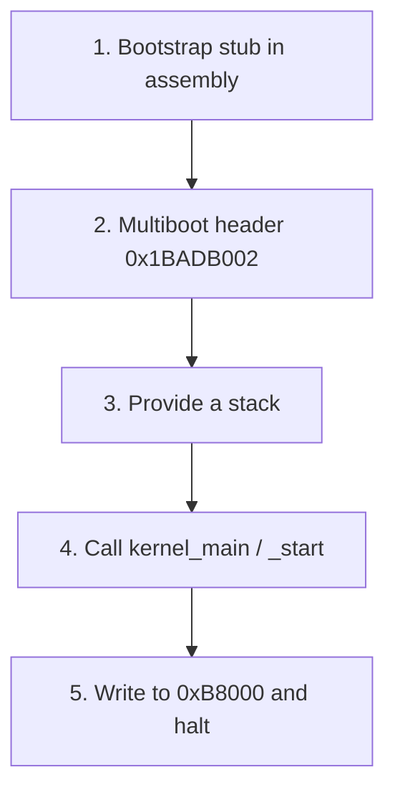

# Concept — The "Hello World of OSes" Recipe

*Original content written for OSDev_Learning_Hub.*

Every beginner OS in every language follows the **same five steps**. If you understand these, you can read any "bare bones" tutorial in any language and immediately know where you are.

## The recipe



| Step | Language-indep. concept | Language file |
|------|-------------------------|---------------|
| 1 | [Entry point](../../GLOSSARY/entry-point.md "The symbol (usually _start) the bootloader jumps to") + CPU setup | `boot.s` (assembler) |
| 2 | Multiboot magic `0x1BADB002` | `boot.s` (in `.multiboot` section) |
| 3 | A 16 KiB stack so calls work | `boot.s` |
| 4 | The C/rust/go/etc. entry | `kernel.c` / `main.rs` / `kernel.go` |
| 5 | Write "Hello World!" to `0xB8000` | the kernel source |

## Why every language needs the same boot.s

The CPU boots into a primitive state: **no stack, [real mode](../../GLOSSARY/real-mode.md "The 16-bit CPU mode x86 starts in, with no memory protection"), nothing set up**. That setup *must* be done in [assembly](../../GLOSSARY/assembler.md "Turns assembly language into machine-code object files"), because your high-level language's compiler has no idea a stack doesn't exist yet. So even the Rust tutorial uses a tiny bit of assembly (or the `bootloader` crate which bundles it).

Here's the universal bootstrap that powers the C, C++ and Go kernels in `Example_OS_Project`:

```nasm
; boot.s — the universal Multiboot bootstrap
section .multiboot
align 4
    dd 0x1BADB002          ; magic   (0x1BADB002)
    dd 0x03                ; flags   (ALIGN | MEMINFO)
    dd -(0x1BADB002 + 0x03); checksum

section .bss
align 16
stack_bottom:
    resb 16384             ; 16 KiB stack
stack_top:

section .text
global _start
_start:
    mov esp, stack_top     ; (1) give the CPU a stack
    mov ebp, stack_top     ; (2) frame pointer, for sanity
    extern kernel_main
    call kernel_main       ; (3) jump to the high-level kernel
    cli
    hlt                    ; (4) halt forever — kernel never returns
.loop:
    jmp .loop
```

> `dd` in NASM emits a 4-byte value. The three `dd`s ARE the Multiboot header.

## The same recipe, five languages

| Language | Your "kernel_main" | How it prints | Skip-able if... |
|----------|--------------------|---------------|-----------------|
| **C** | `void kernel_main(void)` | writes to `0xB8000` | — (the reference) |
| **C++** | `extern "C" void kernel_main()` | same, via `0xB8000` | you know C++ basics |
| **Rust** | `pub extern "C" fn _start()` | `0xB8000` via `unsafe` | you know Rust basics |
| **Go** | `func Main()` | via `terminal.go` | you know Go basics |
| **C#** | `Kernel.Run()` (Cosmos) | `Console.Write` | you know C# basics |

The **point**: OS concepts are language-agnostic. Switch languages and you switch *syntax* and *build flags* — not the ideas.

## The one true test
Whatever language you choose, your final command looks like this:

```bash
make run-c        # or run-cpp, run-rust, run-go
```

and [QEMU](../../GLOSSARY/qemu.md "A free emulator you can boot your kernel in for testing") pops up a black window with:

```
Hello World!
```

![Screenshot]: Add a QEMU screenshot showing "Hello World!" in white-on-black.

If that works, **you have written an operating system.** Everything from here — paging, interrupts, scheduling, filesystems — is adding features to an OS that already boots.

> **Now go build it:** the five language walkthroughs in `01-c/` → `05-csharp/`, with real code in [`Example_OS_Project/`](../../Example_OS_Project/).

## Watch and learn

<details class="video-embed">
<summary>▶ Watch: OS development 101 - How to make a bootloader part 1 - Hello World</summary>
<iframe src="https://www.youtube-nocookie.com/embed/E_n0VtGSZQY" title="OS development 101 - How to make a bootloader part 1 - Hello World" width="100%" height="400" style="border:0;border-radius:8px;" allow="accelerometer; autoplay; clipboard-write; encrypted-media; gyroscope; picture-in-picture; web-share" allowfullscreen></iframe>
<p class=video-caption>Low Level Learning walks the whole recipe: bootable code that prints "Hello World" and boots.</p>
</details>
<details class="video-embed">
<summary>▶ Watch: OS development 101 - How to make a bootloader part 2</summary>
<iframe src="https://www.youtube-nocookie.com/embed/BQGbBCqUGCc" title="OS development 101 - How to make a bootloader part 2" width="100%" height="400" style="border:0;border-radius:8px;" allow="accelerometer; autoplay; clipboard-write; encrypted-media; gyroscope; picture-in-picture; web-share" allowfullscreen></iframe>
<p class=video-caption>The next step in the same series, moving from a static boot sector toward a real loadable kernel.</p>
</details>
<details class="video-embed">
<summary>▶ Watch: Building an OS - 1 - Hello world</summary>
<iframe src="https://www.youtube-nocookie.com/embed/9t-SPTC7Tczc" title="Building an OS - 1 - Hello world" width="100%" height="400" style="border:0;border-radius:8px;" allow="accelerometer; autoplay; clipboard-write; encrypted-media; gyroscope; picture-in-picture; web-share" allowfullscreen></iframe>
<p class=video-caption>Nanobyte's complete from-scratch hello-world OS: assemble, boot it from a floppy, see it run.</p>
</details>
<details class="video-embed">
<summary>▶ Watch: Making an OS (x86) Chapter 1 - CPU, Assembly, Booting</summary>
<iframe src="https://www.youtube-nocookie.com/embed/MwPjvJ9ulSc" title="Making an OS (x86) Chapter 1 - CPU, Assembly, Booting" width="100%" height="400" style="border:0;border-radius:8px;" allow="accelerometer; autoplay; clipboard-write; encrypted-media; gyroscope; picture-in-picture; web-share" allowfullscreen></iframe>
<p class=video-caption>Daedalus Community's first chapter: CPU basics, the assembly bootstrap stub, and booting — mirroring steps 1-5 of this recipe exactly.</p>
</details>

**More picks for the recipe**
- The five language walkthroughs elsewhere in this hub *are* this chapter applied; any "bare bones" tutorial in any language follows the same five steps above.

---

## Further reading

- [OSDev Wiki — Bare Bones](https://wiki.osdev.org/Bare_Bones) — the reference implementation of this exact five-step recipe in C + NASM.
- [OSDev Wiki — Expanded Main Page](https://wiki.osdev.org/Expanded_Main_Page) — the hub of all OS-dev wiki resources, for whatever you tackle next.
- [Writing an OS in Rust — A Minimal Rust Kernel](https://os.phil-opp.com/minimal-rust-kernel/) — the same five steps, done in Rust.
- [*Making an OS (x86)* by Daedalus Community (os-series)](https://github.com/davidcallanan/os-series) — a full build-your-own-OS playlist with source code.
- [Nick Blundell — *Writing a Simple Operating System from Scratch* (PDF)](https://www.cs.bham.ac.uk/~exr/lectures/opsys/10_11/lectures/os-dev.pdf) — free lecture notes that walk exactly this recipe from the real mode boot sector up.

---

## Why it's the same in every language (a reminder)

The five steps here are the *why* behind the "language-agnostic" claim. C, C++, Rust, Go, and C# all still need: an assembly bootstrap, a Multiboot header, a stack, a call into your kernel, and a write to `0xB8000`. The only real difference is *where* the assembly lives — a hand-written `boot.s` in C/C++/Go, a bundled `bootloader` crate in Rust, or a managed boot path in Cosmos. Learn the five steps once and you can read any of them.


---

## Deep dive: each of the five steps, worked out in full

The recipe claims "every beginner OS in every language follows the same five steps." Let's prove it by walking each step with the full code, so when you read *any* bare-bones tutorial you can literally point at which step you're on.

### Step 1 — the bootstrap stub (assembly)

The CPU boots to a state no C/Go/Rust compiler understands. So the stub — regardless of language — does the CPU setup in assembly:

```nasm
; boot.s — Step 1 (+ the header from Step 2, + the stack from Step 3)
section .multiboot
align 4
    dd 0x1BADB002          ; STEP 2: magic (Multiboot handshake)
    dd 0x03                ;         flags: ALIGN | MEMINFO
    dd -(0x1BADB002 + 0x03);         checksum (must sum to 0)

section .bss
align 16
stack_bottom:
    resb 16384             ; STEP 3: a 16 KiB stack
stack_top:

section .text
global _start
_start:
    mov esp, stack_top     ; STEP 3: give the CPU a stack before any call
    extern kernel_main
    call kernel_main       ; STEP 4: call the high-level kernel
    cli
    hlt                    ; STEP 5 (fallback): halt
.loop: jmp .loop
```

Three of the five steps visibly live in this one file. The only genuinely *assembly-only* parts — emitting the exact header bytes and establishing a stack — are why every language, even Rust, has this stub (or a crate that bundles it).

### Step 2 — the Multiboot header, in a sentence

Three 4-byte fields (`dd` words): magic `0x1BADB002`, flags `0x03` (request an aligned load + a memory map), checksum `-(magic+flags)`. The bootloader scans for it in the first 8192 bytes, validates the checksum, and that's the handshake. Step 2 is *entirely* those three lines.

```bash
# Verify it landed where the loader looks:
readelf -S kernel.bin    # .multiboot must be the FIRST section
objdump -s -j .multiboot kernel.bin   # first bytes: 02 B0 AD 1B ...
```

### Step 3 — a stack, and why it's step 3 (not 1)

The stack is where `call` pushes return addresses and where locals live. Before `_start`, the stack pointer is undefined (the bootloader doesn't set it). The very first `call` — into `kernel_main` — needs a valid `esp`. That's why `mov esp, stack_top` comes *before* `call kernel_main`. Get the order wrong and the first call writes to address 0 (or garbage) and the kernel dies.

```nasm
_start:
    mov esp, stack_top   ; MUST come before any call/push
    call kernel_main     ; safe only after the line above
```

Size matters less than existence: 16 KiB is plenty for a hello-world kernel; it's the *pointer being valid* that matters.

### Step 4 — the high-level entry (kernel_main / _start / Main / Kernel.Run)

Step 4 is where the toolchain chapter's `-ffreestanding` spirit lands: your `kernel_main` runs with no OS, no libc, no `printf`. It does *only* what you write. For five languages, "Step 4" looks like:

| Language | The entry | What it does at the top |
|----------|-----------|-------------------------|
| C | `void kernel_main(void)` | writes `0xB8000` directly |
| C++ | `extern "C" void kernel_main()` | same, via `0xB8000` |
| Rust | `pub extern "C" fn _start()` | `0xB8000` via `unsafe` |
| Go | `func Main()` | via a `terminal.go` helper |
| C# | `Kernel.Run()` (Cosmos) | `Console.Write` |

The syntax differs; the *job* — "the language entry point that runs bare" — is identical. And note how several use `extern "C"` / a non-mangled name: because the assembly stub calls the symbol by a fixed name (`kernel_main`), the high-level function must export exactly that (or you get an "undefined reference" in Step 4-to-5).

### Step 5 — write to 0xB8000 and halt

```c
// kernel.c — Step 5 in C
void kernel_main(void) {
    volatile unsigned short* vga = (volatile unsigned short*)0xB8000;
    const char* msg = "Hello World!";
    for (int i = 0; msg[i]; i++)
        vga[i] = (0x0F << 8) | msg[i];   // white-on-black
    for (;;) __asm__("hlt");              // never return
}
```

Two non-negotiables:
1. **`volatile`** on the VGA pointer (compiler must not reorder/elide MMIO writes) — memory + VGA chapters both stressed this.
2. **`hlt` forever.** A kernel never returns; without the endless loop, the CPU runs off the end of your program.

The step name is a lie of convenience: "write to 0xB8000" is really "print via whatever output your kernel has" — but for the dumbest possible kernel, that's the VGA text buffer, and it's the proof you own the machine.

---

## The linker script and build — steps 1–4's invisible coordinator

Steps 1–4 don't compose by themselves; the **linker script** makes them one image, and the **build commands** turn source into something QEMU can boot.

```ld
/* linker.ld — coordinates Steps 1–4 */
ENTRY(_start)            /* Step 1's symbol = the bootloader's target */
SECTIONS {
    . = 1M;              /* load the kernel at 1 MiB */
    .text : { *(.multiboot) *(.text) }   /* Step 2's header FIRST */
    .rodata : { *(.rodata) }             /* strings live here */
    .data  : { *(.data) }
    .bss   : { *(COMMON) *(.bss) }       /* Step 3's 16 KiB stack */
}
```

```bash
# The five-step kernel, built (see the toolchain chapter for each flag)
nasm -f elf32 boot.s -o boot.o                # Steps 1, 2, 3 in assembly
gcc -ffreestanding -nostdlib -m32 -c kernel.c -o kernel.o   # Steps 4, 5 in C
ld -T linker.ld -m elf_i386 -o kernel.bin boot.o kernel.o   # glue it
qemu-system-i386 -kernel kernel.bin          # boot and see "Hello World!"
```

Every line maps to a step: `boot.o` carries Steps 1–3, `kernel.o` carries Steps 4–5, `ld` merges them honoring Section order, and QEMU proves the handoff.

### Debugging the five steps when something breaks

The beauty of the recipe is that failures localize to a step:

| Symptom | Likely step(s) | Fix to try |
|---------|----------------|------------|
| QEMU window flashes and dies | Step 3 (no stack) | `mov esp, stack_top` before `call`; re-run with `-d int` |
| GRUB says "invalid magic" | Step 2 (header) | `.multiboot` first; checksum `-(magic+flags)` |
| Boots but shows garbage | Step 5 (print) | `.rodata` in linker script; `volatile`; correct `(attr<<8)|char` |
| Boots, does nothing | Step 4 (entry) | name matches `kernel_main`; `-ffreestanding`; check `readelf -h` entry |
| "undefined reference" at link | Step 4↔1 | `extern kernel_main` matches the C symbol exactly |

Spot a symptom, jump to that step, fix it, re-boot. That table is the practical heart of this chapter — it turns "my OS doesn't work" into "Step 2 is wrong."

---

## The recipe in each of the five languages (a closer look)

The chapter's table gave you the one-liners. Here's a bit more of the *shape* each language walkthrough takes (each has its own full file in `01-c/` → `05-csharp/`):

**C / C++ — the reference.** Hand-written `boot.s` + `kernel.c`/`kernel.cpp`, GCC with `-ffreestanding`. The C++ one additionally strips RTTI/exceptions (`-fno-rtti -fno-exceptions`) because a bare kernel has no unwinder, and usually marks the entry `extern "C"` to avoid name mangling.

**Rust — no assembly by you.** `#![no_std] #![no_main]`, a `_start` linked via the `bootloader` crate which bundles `boot.s` + a linker script. The `0xB8000` write happens in an `unsafe` block. Same five steps, but Steps 1–2 arrive via the crate.

**Go — gccgo.** `-nostdlib` plus a small assembly stub that calls `Main()`. Go's runtime demands more setup, so the `run-go` path shows the minimal dance; the five steps are still visibly present under the Go syntax.

**C# — Cosmos.** The framework provides its own boot path and runtime; `Kernel.Run()` + `Console.Write`. Cosmos *is* the "assembly stub + header + runtime," so Steps 1–3 are hidden inside the framework — but the concepts the chapters taught are exactly what Cosmos abstracts away.

**The invariant:** every one boots to a bare entry point that prints and halts. Language changes syntax and build flags, never the five-step skeleton.

---

## The one true test, done right

The chapter's "one true test" (`make run-c`) is the moment of truth. But to *believe* it really is a raw, ownership-of-the-machine kernel — not something your host OS is secretly running — verify two things:

```bash
# 1. It's a bootable raw image, not a host binary
file kernel.bin            # should be ELF 32-bit LSB, not "Linux" / "Windows"
readelf -h kernel.bin      # entry point should be ~0x00100000+, ELF type EXEC

# 2. It runs with no OS underneath (QEMU is a bare machine)
qemu-system-i386 -kernel kernel.bin -no-reboot
```

When QEMU shows `Hello World!` and a `file`/`readelf` confirms a freestanding ELF, you have *actually* written an operating system — as in, a program the bootloader loads at 1 MiB and runs on raw hardware, with no Linux/Windows underneath (QEMU emulates a blank PC). That's the milestone, and it's no smaller for being famously small.

---

## Where the five steps take you next

"Hello World!" is the *end of the beginning*, not the beginning of the end. With Steps 1–5 proven, every later chapter is "add a feature to an OS that already boots":

| Next feature | Which step you extend |
|--------------|----------------------|
| Scroll + colors + cursor | Step 5 (the VGA driver) |
| Keyboard / timer | Step 4+ (interrupt handler) |
| Paging + frame allocator | Step 4 (kernel init) |
| Higher-half kernel | Step 4 + linker script (`. = 0xC0000000`) |
| Multitasking | Step 4 (timer IRQ context switch) |
| Syscalls / user mode | Step 4 (IDT gates, DPL 3) |

Nothing you learn from here on re-does Steps 1–3; the boot, the assembly stub, the header, and the stack are settled. You spend the rest of your OS-dev life extending Step 4 (the kernel) and Step 5 (what it outputs). That's the recipe's real gift: a clean, permanent foundation.

---

## Common pitfalls in the five-step recipe

1. **Mixing up `_start` and `kernel_main`.** `_start` is the asm entry; `kernel_main` is the C entry it calls. They're different symbols and must be `global`/`extern` correctly or the link fails.
2. **Setting the stack *after* the first `call`.** `call kernel_main` immediately pushes; if `esp` is undefined, that push corrupts memory. `mov esp` first, always.
3. **Calling it `main` instead of `kernel_main`.** No OS calls `main`; that's a hosted-program convention. Your stub calls your symbol.
4. **Halting with `hlt` but forgetting the `cli` before it.** If interrupts are on and you have no IDT, the first interrupt (timer) faults immediately. `cli` before `hlt` in a kernel with no IDT.
5. **Building on a 64-bit host without `-m32`.** Object files silently come out 64-bit; the linker (or GRUB) rejects them or the kernel won't boot. Force 32-bit (or use a proper cross-compiler).
6. **Skipping a real `volatile`.** The compiler optimizes away your "output" and the screen stays blank. `volatile` is not optional on `0xB8000`.
7. **Expecting it to "just work" on real hardware.** QEMU is a forgiving emulator. Real BIOS/UEFI + GRUB can be stricter (alignment, exact header position, settings). The recipe works on hardware, but QEMU-first is the sane dev loop.

---

## Learning checkpoints

- [ ] **I can recite the five steps** from memory, in order, and say which file each lives in.
- [ ] **I can point at the code** (boot.s, kernel.c, linker.ld) that performs each step.
- [ ] **I can build and boot the C version** of the recipe with the four commands, and see "Hello World!" in QEMU.
- [ ] **I can diagnose a failure** to the right step using the symptom table above (flash-and-die → stack; invalid magic → header; garbage → print; nothing → entry).
- [ ] **I can identify which step a Rust/Go/C# walkthrough** is on, even without reading its language syntax.
- [ ] **I can verify** with `file`/`readelf` that my kernel is a real freestanding image, not a host executable.
- [ ] **I can list what each later feature** (paging, interrupts, scheduling) extends in the five-step skeleton.

If you can do all of that — especially diagnose failures to the right step — you have truly internalized the recipe. It's the Rosetta Stone of OS-dev tutorials: with it, you can read *any* bare-bones guide in *any* language and know exactly where you are.

---

## Watch more

<details class="video-embed">
<summary>▶ Watch: Write Your Own Operating System in 1 Hour</summary>
<iframe src="https://www.youtube-nocookie.com/embed/1rnA6wpF0o4" title="Write Your Own Operating System in 1 Hour" width="100%" height="400" style="border:0;border-radius:8px;" allow="accelerometer; autoplay; clipboard-write; encrypted-media; gyroscope; picture-in-picture; web-share" allowfullscreen></iframe>
<p class=video-caption>Completes the entire recipe live: assembly bootstrap, Multiboot header, stack, C kernel entry, and a write to the screen — all four tools, one boot.</p>
</details>
<details class="video-embed">
<summary>▶ Watch: Write your own OS 15: Multitasking</summary>
<iframe src="https://www.youtube-nocookie.com/embed/VxZnBkMQ258" title="Write your own OS 15: Multitasking" width="100%" height="400" style="border:0;border-radius:8px;" allow="accelerometer; autoplay; clipboard-write; encrypted-media; gyroscope; picture-in-picture; web-share" allowfullscreen></iframe>
<p class=video-caption>A taste of where the five-step foundation leads: once your OS boots, the timer interrupt (concept 03) turns it into a multitasking machine. This is the "what's next" after hello world.</p>
</details>


---

## The recipe, annotated line by line

If you want the single most valuable artifact from this chapter, it's this: the complete C hello-world kernel with *every* line explained. Read it top to bottom — it's the entire five-step recipe in ~40 lines, and it's the kernel every later chapter extends.

```nasm
; ================= boot.s =================
section .multiboot          ; STEP 2: put the handshake in its own section
align 4                     ; spec requires 32-bit alignment
    dd 0x1BADB002           ; magic — "I'm a Multiboot kernel"
    dd 0x03                 ; flags — ALIGN(1) + MEMINFO(2) = memory map
    dd -(0x1BADB002 + 0x03) ; checksum — sums with above to 0

section .bss                ; STEP 3: the stack
align 16
stack_bottom:
    resb 16384              ; 16 KiB, zero-filled by the bootloader
stack_top:

section .text
global _start               ; STEP 1 entry — the bootloader jumps here
_start:
    mov esp, stack_top      ; STEP 3: valid stack BEFORE any call
    extern kernel_main      ; STEP 4: the C entry, kept un-mangled
    call kernel_main
    cli                     ; no IDT yet → disable interrupts
    hlt
.loop: jmp .loop            ; STEP 5 fallback: never return
```

```c
// ================= kernel.c =================
void kernel_main(void) {              // STEP 4: the bare C entry
    volatile unsigned short* vga =    // STEP 5: pointer to the screen
        (volatile unsigned short*)0xB8000;
    const char* msg = "Hello World!";
    for (int i = 0; msg[i]; i++)
        vga[i] = (0x0F << 8) | msg[i]; // char low, attr high (white-on-black)
    for (;;) __asm__("hlt");          // STEP 5: never return
}
```

```ld
/* ================= linker.ld ================= */
ENTRY(_start)                          /* STEP 1 symbol = boot target */
SECTIONS {
    . = 1M;                            /* load at 1 MiB */
    .text : { *(.multiboot) *(.text) } /* STEP 2 header FIRST */
    .rodata : { *(.rodata) }           /* string literals */
    .data  : { *(.data) }
    .bss   : { *(COMMON) *(.bss) }     /* STEP 3 stack + zeroed globals */
}
```

```bash
# ================= build & run =================
nasm -f elf32 boot.s -o boot.o
gcc -ffreestanding -nostdlib -fno-builtin -m32 -c kernel.c -o kernel.o
ld -T linker.ld -m elf_i386 -o kernel.bin boot.o kernel.o
qemu-system-i386 -kernel kernel.bin
```

That's it. That IS the "Hello World of OSes" — five steps, three files, four commands, one black QEMU window with `Hello World!` in white. Everything else in OS-dev is building on this exact skeleton.

## The same five steps, but with a slow-motion diagonal

A helpful way to "see" the recipe across files is a diagonal: each *source line* is a *step*, and the step number climbs as control moves from assembly to C.

```
boot.s line  → STEP 1  (entry point _start)
boot.s line  → STEP 2  (Multiboot header)
boot.s line  → STEP 3  (stack reserve + mov esp)
call         → STEP 4  (kernel_main / language entry)
kernel.c     → STEP 5  (0xB8000 + hlt)
```

Trace control with your finger through that: the CPU enters at `_start` (1), the header lets the loader find the file (2), a stack is established before the call (3), the call crosses into the language entry (4), and the language entry owns the screen and halts (5). If you can narrate that diagonal without looking, the recipe is not memorized — it's *understood*.

## Why "Hello World!" is the perfect first kernel (and not a hand-rolled bootloader)

There's a persistent beginner temptation to write a raw boot sector (like the toolchain chapter's 30-line example) instead of using GRUB/Multiboot. The recipe's strong stance: **use a real bootloader.** Three reasons the hello-world-via-GRUB is the right first kernel:

1. **The interesting part is the kernel, not the boot.** A hand-rolled boot sector teaches real-mode disk I/O (boring, machine-specific); the recipe teaches the OS's actual structure (the five steps) that you'll keep forever.
2. **Portability.** A Multiboot kernel boots under GRUB, QEMU's `-kernel`, Limine, and real hardware. A raw boot sector boots only one specific disk layout.
3. **Forward compatibility.** Every later feature (memory, interrupts, multitasking) assumes you have a loaded, protected-mode kernel. The recipe delivers that; a bare boot sector doesn't.

You *can* write a bootloader as a separate learning project (and it's rewarding) — but it's a fork in the road, not the highway. The recipe keeps you on the highway to the actual OS.

## Anatomy of the output: what "Hello World!" proves

When QEMU shows `Hello World!`, that one screenful implicitly proves ~six separate things all worked:

1. **POST** ran (QEMU's firmware emulation).
2. **BIOS found a bootable device** and ran the bootloader.
3. **GRUB/QEMU validated your Multiboot header** (magic + checksum).
4. **The bootloader loaded your ELF** at the linker-script address (1 MiB) and entered protected mode.
5. **Your `_start` stack + call into C worked** (Steps 3–4).
6. **Your VGA driver wrote the screen** (Step 5) — the toolchain, memory, and VGA chapters, all together.

Any ONE of those failing means no "Hello World!". So the tiny output is really a full-stack integration test — the single most meaningful byte pattern a beginner will ever see. Keep that in mind when it finally appears: you didn't print text, you booted an OS.

## From five steps to five languages: the mental model

The chapter's table ("The same recipe, five languages") is easy to skim. The *reason* it's true deserves a paragraph:

**OS concepts are language-agnostic because they're about the hardware, not the compiler.** The CPU doesn't care whether `kernel_main` was written in C, Rust, Go, or emitted by Cosmos — it only cares that some code sets a stack, enters a mode, and owns memory. So "the recipe" is a description of *the machine's requirements*, not of any programming language. When you switch languages, you keep the five steps and re-express them in new syntax and new build flags; the steps themselves don't change because the hardware didn't change.

That's why, if you understand Steps 1–5 once, you can read a Rust bare-metal kernel, a Go `gccgo` kernel, or a Cosmos C# project and immediately recognize *where you are* — even in a language you barely know. The recipe is the Rosetta Stone; the languages are just dialects.

---

## Practice problems to lock it in

1. **You see "Hello World!" on the QEMU `-kernel` path, but a GRUB ISO says "invalid magic."** Which step failed, and what's the most likely cause?
   *Answer: Step 2 (the header). The ISO path uses real GRUB which strictly checks the header position/checksum; re-verify `.multiboot` is first and the checksum formula.*

2. **Your kernel flips the window and instantly resets.** Which step is almost certainly wrong?
   *Answer: Step 3 — no valid stack before the first `call`. Add `mov esp, stack_top` first and re-run with `-d int` to confirm.*

3. **It boots but prints garbage instead of text.** Which step, and which two fixes?
   *Answer: Step 5 (print). Fix `.rodata` in the linker script and/or add `volatile` to the VGA pointer (and check the `(attr<<8)|char` order).*

4. **The linker errors "undefined reference to kernel_main."** What's wrong and where?
   *Answer: Step 4↔1 — the asm stub's `extern kernel_main` doesn't match your C function's symbol (typo, or C++ name mangling without `extern "C"`).*

5. **The helloworld kernel "runs" but the screen is blank and the CPU seems stuck.** What's likely, and the one-line fix?
   *Answer: `hlt` with a `cli` missing (no IDT → any interrupt faults). Or the compiler elided non-`volatile` writes. Fix: `volatile` on the VGA pointer, and `cli` before `hlt`.*

If you can diagnose all five to the correct step, you've earned the recipe. Move on to the language walkthroughs (`01-c/` → `05-csharp/`) and build your own — you now know exactly what each one is doing under the syntax.

---

## One mental model that helps

Think of the hello-world kernel as **a house with exactly five rooms, and the bootloader is your real-estate agent.** The agent verifies your papers (the Multiboot header — Step 2), walks you in (jumps to `_start` — Step 1), makes sure you have a foundation to stand on (the stack — Step 3), introduces you to the manager (calls `kernel_main` — Step 4), and then leaves — at which point *you* run the utilities (write to `0xB8000`, then sit tight with the lights on — Step 5). The agent (bootloader) handles everything up to the front door; from the doorway inward, it's all yours.

And the deeper lesson the recipe bakes in: **the agent never cleans up after you.** No OS, no runtime, no `main`-return-to-safety. The moment `kernel_main` runs, you are the landlord, the plumber, the electrician, and the security guard. "Hello World!" is you turning on the first light — proof the house is yours and habitable. Everything after is just furnishing the rooms.

## The hello-world quick reference

| Step | What it does | Where it lives | Key line |
|------|--------------|----------------|----------|
| 1 | Entry point & CPU setup | `boot.s` | `_start:` |
| 2 | Multiboot header | `boot.s` `.multiboot` | `dd 0x1BADB002` |
| 3 | Stack | `boot.s` `.bss` + `_start` | `mov esp, stack_top` |
| 4 | Language entry | `kernel.c` / `main.rs` / ... | `void kernel_main(void)` |
| 5 | Print + halt | the kernel source | `vga[i]=(0x0F<<8)|msg[i]` + `hlt` |

Internalize that table and the five-step recipe is permanently yours — the Rosetta Stone that lets you read any OS-dev tutorial in any language. **Now go build it**: the five language walkthroughs in `01-c/` → `05-csharp/` are this exact recipe applied, with real code waiting in [`Example_OS_Project/`](../../Example_OS_Project/).


---

## Automating the recipe: Makefile and a bootable ISO

Typing four commands is fine for the first kernel; by the second, you'll want one command. Here's the Makefile that wraps the recipe, plus the ISO step for when you want a *real* boot loader on a *real* disk.

```makefile
# Makefile — the five steps automated
ASM = nasm
CC  = gcc
LD  = ld

CFLAGS  = -ffreestanding -nostdlib -fno-builtin -m32 -g
LDFLAGS = -T linker.ld -m elf_i386

kernel.bin: boot.o kernel.o
	$(LD) $(LDFLAGS) -o $@ $^

boot.o: boot.s
	$(ASM) -f elf32 $< -o $@

kernel.o: kernel.c
	$(CC) $(CFLAGS) -c $< -o $@

run: kernel.bin
	qemu-system-i386 -kernel $<

iso: kernel.bin
	mkdir -p iso/boot/grub
	cp kernel.bin iso/boot/kernel.bin
	@echo 'menuentry "MyOS" { multiboot2 /boot/kernel.bin; boot; }' > iso/boot/grub/grub.cfg
	grub-mkrescue -o myos.iso iso

clean:
	rm -f *.o kernel.bin myos.iso
	rm -rf iso

.PHONY: run iso clean
```

```bash
make        # build kernel.bin
make run    # boot in QEMU (-kernel shortcut)
make iso    # build a bootable CD image with real GRUB
qemu-system-i386 -cdrom myos.iso   # boot the ISO
```

Now the recipe's "one true test" is literally `make run`, and the ISO path shows Steps 1–2 working under a *real* GRUB rather than QEMU's friendly built-in loader. This is also exactly the shape of the `run-c` / `run-cpp` / `run-rust` / `run-go` targets the hub's language walkthroughs provide.

## QEMU vs real hardware: when the recipe bites

QEMU's `-kernel` loader is forgiving; real BIOS/UEFI + GRUB is not. Three differences that turn a QEMU-success into a hardware-fail, and how to dodge them:

1. **Header positioning/alignment.** QEMU is lenient about exactly where the header sits; GRUB follows the spec strictly (first 8192 bytes, 32-bit aligned). Always keep `.multiboot` first and `align 4`.
2. **The memory map / A20 state.** Real firmware's memory map differs subtly; a kernel that "just works" in QEMU can triple-fault on a laptop. Re-run with a strict GRUB ISO (`make iso` + `-cdrom`) to smoke-test closer-to-real conditions before touching hardware.
3. **Emulated devices.** QEMU's VGA/timer/keyboard are simplified. A driver that's "right enough" for QEMU may need real device timing on hardware. Don't let that scare you — get it running in QEMU first, then worry about hardware as a *later* validation, not the first one.

The practical rule: **QEMU-first forever, hardware occasionally.** The recipe's kernel almost always boots on real hardware too, but testing in QEMU keeps the loop fast and safe while you learn.

## After "Hello World!": the classic next milestones

Once the recipe works, the community's standard "next steps" (each maps to a concept chapter) are:

| Milestone | Builds on | You learn |
|-----------|-----------|-----------|
| Clean VGA driver (scroll, colors, cursor) | Step 5 | vga-text-mode |
| Serial/COM output (optional, very helpful) | Step 5 | real device I/O, debugging |
| GDT + IDT + first exceptions | Step 4 init | interrupts-and-the-idt |
| Keyboard + timer via IRQs | Step 4 init | interrupts (PIC, PIT) |
| Frame allocator + paging | Step 4 init | memory-management |
| A "kmalloc" heap | above | memory (heap) |
| Multitasking (context switch) | timer IRQ | the "what's next" capability |
| Basic shell / command loop | keyboard | a usable feature set |

Notice Step 4 ("the kernel's init") is where almost all of this plugs in — which is why the recipe says "everything from here is adding features to an OS that already boots." The foundation (Steps 1–3, 5) is done; the growth is all in how rich you make Step 4 and Step 5.

## Learning checkpoints, round two

- [ ] **I can write the whole recipe** (boot.s + kernel.c + linker.ld + the four commands) from memory, with each step's code correct.
- [ ] **I can wrap it in a Makefile** with `run` and `iso` targets, and boot via both QEMU `-kernel` and a real GRUB ISO.
- [ ] **I can diagnose any of the five steps** from its failure signature (flash-die / invalid magic / garbage / nothing / link error).
- [ ] **I can name the invariant** that makes the recipe language-agnostic (it describes hardware requirements, not a language).
- [ ] **I can list the next milestones** and which concept chapter each extends.

Tick all five and you've truly absorbed the "Hello World of OSes" recipe. You have every foundation element this hub teaches — boot, toolchain, headers, memory, interrupts, and the screen — now assembled into one bootable, working kernel. The language walkthroughs ahead are simply this recipe, re-voiced five ways. **Go write yours.**

---

## Why the recipe is the hub's keystone

Every chapter of this hub was secretly building toward this one small kernel:

- **Chapter 00** (boot) explained *why* `_start` and 1 MiB matter.
- **Chapter 02** (toolchain) explained *how* the four commands turn source into a bootable image.
- **Concept 01** (bootloaders) explained *what* the Multiboot header negotiates.
- **Concept 02** (memory) explained *why* the kernel owns its own RAM — and why a stack is Step 3.
- **Concept 03** (interrupts) explained *what* `cli`/`hlt` are doing in Step 5 (protecting a bare kernel with no IDT).
- **Concept 04** (VGA) explained *how* Step 5's write to `0xB8000` actually draws text.

The recipe is the keystone that locks all six arches together: a single ~40-line kernel that makes the whole hub's curriculum *visible at once*. When you run `make run` and read `Hello World!`, you are looking at the sum of everything this hub teaches, compressed into one flashing line. That's not an exaggeration — it's the point of the entire beginning of OS development.

**Now go build it:** the five language walkthroughs in `01-c/` → `05-csharp/`, with real code in [`Example_OS_Project/`](../../Example_OS_Project/), are this exact five-step recipe applied — pick your favorite language and watch the same five steps run in new syntax.

---

## 🧪 Exercises & Projects

This is the capstone "recipe" chapter: assemble → compile → link → ISO → QEMU, with a
VGA write at the end. Every exercise here perturbs exactly one step of the recipe and
asks you to observe that step's failure mode — which is how the recipe stops being magic.
Prereq: chapters 00 + the four concepts. Time estimates assume a working five-step loop.

### Graded exercises

**Easy**

- [ ] **E1. Recite the five steps** (~15 min). Close the page and re-derive, from memory:
      (1) assemble `boot.s` → `boot.o`, (2) compile `kernel.c` → `kernel.o`, (3) link with
      entry = `_start`, base = 1 MiB → `kernel.bin`, (4) make an ISO around the multiboot
      kernel, (5) boot QEMU and read `Hello World!`. Write them with the *why* next to each.
- [ ] **E2. Change the message** (~20 min). Edit the string in `kernel.c` to a custom
      message and re-run the full `make run`. Confirm you saw *yours*. This unblocks you
      from "it's a template" to "it's my kernel."
- [ ] **E3. The black-screen drill** (~30 min). Deliberately comment out the stack setup in
      `boot.s` and boot. Record the exact symptom (usually nothing, or a reboot loop when
      `for(;;)` runs on a zero stack). Re-enable it. Now you know what "not enough stack"
      *looks* like.

**Medium**

- [ ] **M1. Deterministic build check** (~45 min). `make clean && make`, capture
      `sha1sum kernel.bin`, re-run, and confirm the hash is identical — proving
      reproduction. Then add a `#define BANNER` used both in the banner and the ISO label,
      and check the label changed. Determinism + parameterization is how real OS repos work.
- [ ] **M2. Break at `_start` in GDB** (~1 hr). Boot with `qemu-system-i386 -s -S`, attach
      GDB, `break *0x100000` (your linked base), and step through the asm as far as your
      patience allows. Read `x/16bx 0x100000` and confirm the first bytes are your code's
      opcodes. This is the debugger discipline the whole hub recommends.
- [ ] **M3. Move to real boot media** (~1.5 hr). Build a bootable USB from your ISO with
      `dd`/Rufus and boot it on a VM (VirtualBox/UTM), not bare metal first. Note the
      differences: firmware → bootloader path, and what `-kernel` vs ISO boot changes.
      Save writing to real hardware until you have a debugger hypothesis ready.

**Hard**

- [ ] **H1. The five-step recipe in another linker** (~2 hr). Recreate the exact link step
      (entry, base, `.multiboot` first) using a different link path — a GNU ld script you
      write from scratch (no `linker.ld` template) or LLD if your host has it. Confirm the
      resulting `kernel.bin` still boots. You now understand linking, not just run `ld`.
- [ ] **H2. Add a concept back in** (~3 hr). Take the bare recipe and add *one* subsystem
      back on top: install the IDT + timer from [concept 03](03-interrupts-and-the-idt.md)
      so your hello-world kernel prints uptime after `Hello World!`. This is the exact
      "bridge" the chapter promises between the recipe and the concepts.

### ⭐ Mini-project — Five-language "Hello World" matrix

**Goal.** Produce the *same* five-step "Hello World" recipe in at least **two** of the
hub's languages (C plus one of Rust/C++/Go/C#), tracking the tiny differences in each step
— a matrix you can hand to a teammate or future-you. The reference implementations live in
[`Example_OS_Project/`](../../Example_OS_Project/) (one folder per language).

**Estimated time:** 2–4 hr for the first port, ~1 hr each extra. **Prereq:** the C recipe from this chapter.

1. **Pick your languages.** Start with C (chapter's default) + your favorite of the four
      tracks. Open the matching `Example_OS_Project/{c,r,cpp,go,csharp}` folder as your
      skeleton.
2. **Fill the matrix.** A markdown table, one row per step, one column per language:
      **assemble**, **compile**, **link**, **ISO**, **boot**. Note the *tool* and the
      *one flag that differs* (e.g. Rust needs a `no_std`/`#[no_mangle]` or bare-metal
      target; Go needs stub stubs + its cross toolchain; C# needs Cosmos or a single-file
      build).
3. **Build each in its own dir.** Copy `boot.s` + `linker.ld` per language; only the
      kernel source and compile/link commands differ. Keep each build hermetic.
4. **Checker script.** Add a `tools/` helper that builds each and asserts the ISO exists
      and boots (`boot-test.sh` is a starting point). CI-ify if you like: `make languages`
      builds all.
5. **Diff the kernels.** Put the C and your-port kernels side by side and annotate the
      same logical steps (set stack, clear `bss` if any, VGA write, infinite loop) — the
      language differs, the concepts don't.
6. **Ship it.** Commit the matrix table + per-language build notes. Next learner (or you,
      in six months) should reproduce on a fresh machine from the matrix alone.

**Checklist**

- [ ] matrix table filled for ≥2 languages, one row per recipe step
- [ ] each language builds its own ISO successfully
- [ ] each boots to its own `Hello World!` variant in QEMU
- [ ] `make languages` (or your checker script) builds all from clean
- [ ] per-language kernel source annotated to match the C recipe
- [ ] reproduction tested on a clean checkout

