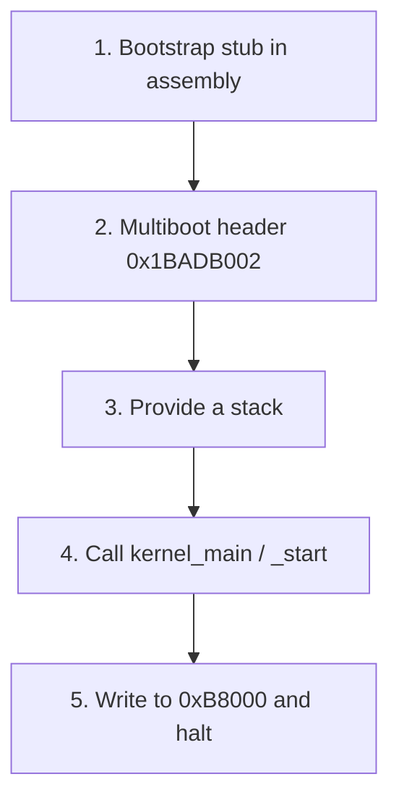

# Concept — The "Hello World of OSes" Recipe

*Original content written for OSDev_Learning_Hub.*

Every beginner OS in every language follows the **same five steps**. If you understand these, you can read any "bare bones" tutorial in any language and immediately know where you are.

## The recipe



| Step | Language-indep. concept | Language file |
|------|-------------------------|---------------|
| 1 | [Entry point](../../GLOSSARY/entry-point.md "The symbol (usually _start) the bootloader jumps to") + CPU setup | `boot.s` (assembler) |
| 2 | Multiboot magic `0x1BADB002` | `boot.s` (in `.multiboot` section) |
| 3 | A 16 KiB stack so calls work | `boot.s` |
| 4 | The C/rust/go/etc. entry | `kernel.c` / `main.rs` / `kernel.go` |
| 5 | Write "Hello World!" to `0xB8000` | the kernel source |

## Why every language needs the same boot.s

The CPU boots into a primitive state: **no stack, [real mode](../../GLOSSARY/real-mode.md "The 16-bit CPU mode x86 starts in, with no memory protection"), nothing set up**. That setup *must* be done in [assembly](../../GLOSSARY/assembler.md "Turns assembly language into machine-code object files"), because your high-level language's compiler has no idea a stack doesn't exist yet. So even the Rust tutorial uses a tiny bit of assembly (or the `bootloader` crate which bundles it).

Here's the universal bootstrap that powers the C, C++ and Go kernels in `Example_OS_Project`:

```nasm
; boot.s — the universal Multiboot bootstrap
section .multiboot
align 4
    dd 0x1BADB002          ; magic   (0x1BADB002)
    dd 0x03                ; flags   (ALIGN | MEMINFO)
    dd -(0x1BADB002 + 0x03); checksum

section .bss
align 16
stack_bottom:
    resb 16384             ; 16 KiB stack
stack_top:

section .text
global _start
_start:
    mov esp, stack_top     ; (1) give the CPU a stack
    mov ebp, stack_top     ; (2) frame pointer, for sanity
    extern kernel_main
    call kernel_main       ; (3) jump to the high-level kernel
    cli
    hlt                    ; (4) halt forever — kernel never returns
.loop:
    jmp .loop
```

> `dd` in NASM emits a 4-byte value. The three `dd`s ARE the Multiboot header.

## The same recipe, five languages

| Language | Your "kernel_main" | How it prints | Skip-able if... |
|----------|--------------------|---------------|-----------------|
| **C** | `void kernel_main(void)` | writes to `0xB8000` | — (the reference) |
| **C++** | `extern "C" void kernel_main()` | same, via `0xB8000` | you know C++ basics |
| **Rust** | `pub extern "C" fn _start()` | `0xB8000` via `unsafe` | you know Rust basics |
| **Go** | `func Main()` | via `terminal.go` | you know Go basics |
| **C#** | `Kernel.Run()` (Cosmos) | `Console.Write` | you know C# basics |

The **point**: OS concepts are language-agnostic. Switch languages and you switch *syntax* and *build flags* — not the ideas.

## The one true test
Whatever language you choose, your final command looks like this:

```bash
make run-c        # or run-cpp, run-rust, run-go
```

and [QEMU](../../GLOSSARY/qemu.md "A free emulator you can boot your kernel in for testing") pops up a black window with:

```
Hello World!
```

![Screenshot]: Add a QEMU screenshot showing "Hello World!" in white-on-black.

If that works, **you have written an operating system.** Everything from here — paging, interrupts, scheduling, filesystems — is adding features to an OS that already boots.

> **Now go build it:** the five language walkthroughs in `01-c/` → `05-csharp/`, with real code in [`Example_OS_Project/`](../../Example_OS_Project/).

## Watch and learn

<details class="video-embed">
<summary>▶ Watch: OS development 101 - How to make a bootloader part 1 - Hello World</summary>
<iframe src="https://www.youtube-nocookie.com/embed/E_n0VtGSZQY" title="OS development 101 - How to make a bootloader part 1 - Hello World" width="100%" height="400" style="border:0;border-radius:8px;" allow="accelerometer; autoplay; clipboard-write; encrypted-media; gyroscope; picture-in-picture; web-share" allowfullscreen></iframe>
<p class=video-caption>Low Level Learning walks the whole recipe: bootable code that prints "Hello World" and boots.</p>
</details>
<details class="video-embed">
<summary>▶ Watch: OS development 101 - How to make a bootloader part 2</summary>
<iframe src="https://www.youtube-nocookie.com/embed/BQGbBCqUGCc" title="OS development 101 - How to make a bootloader part 2" width="100%" height="400" style="border:0;border-radius:8px;" allow="accelerometer; autoplay; clipboard-write; encrypted-media; gyroscope; picture-in-picture; web-share" allowfullscreen></iframe>
<p class=video-caption>The next step in the same series, moving from a static boot sector toward a real loadable kernel.</p>
</details>
<details class="video-embed">
<summary>▶ Watch: Building an OS - 1 - Hello world</summary>
<iframe src="https://www.youtube-nocookie.com/embed/9t-SPTC7Tczc" title="Building an OS - 1 - Hello world" width="100%" height="400" style="border:0;border-radius:8px;" allow="accelerometer; autoplay; clipboard-write; encrypted-media; gyroscope; picture-in-picture; web-share" allowfullscreen></iframe>
<p class=video-caption>Nanobyte's complete from-scratch hello-world OS: assemble, boot it from a floppy, see it run.</p>
</details>
<details class="video-embed">
<summary>▶ Watch: Making an OS (x86) Chapter 1 - CPU, Assembly, Booting</summary>
<iframe src="https://www.youtube-nocookie.com/embed/MwPjvJ9ulSc" title="Making an OS (x86) Chapter 1 - CPU, Assembly, Booting" width="100%" height="400" style="border:0;border-radius:8px;" allow="accelerometer; autoplay; clipboard-write; encrypted-media; gyroscope; picture-in-picture; web-share" allowfullscreen></iframe>
<p class=video-caption>Daedalus Community's first chapter: CPU basics, the assembly bootstrap stub, and booting — mirroring steps 1-5 of this recipe exactly.</p>
</details>

**More picks for the recipe**
- The five language walkthroughs elsewhere in this hub *are* this chapter applied; any "bare bones" tutorial in any language follows the same five steps above.

---

## Further reading

- [OSDev Wiki — Bare Bones](https://wiki.osdev.org/Bare_Bones) — the reference implementation of this exact five-step recipe in C + NASM.
- [OSDev Wiki — Expanded Main Page](https://wiki.osdev.org/Expanded_Main_Page) — the hub of all OS-dev wiki resources, for whatever you tackle next.
- [Writing an OS in Rust — A Minimal Rust Kernel](https://os.phil-opp.com/minimal-rust-kernel/) — the same five steps, done in Rust.
- [*Making an OS (x86)* by Daedalus Community (os-series)](https://github.com/davidcallanan/os-series) — a full build-your-own-OS playlist with source code.
- [Nick Blundell — *Writing a Simple Operating System from Scratch* (PDF)](https://www.cs.bham.ac.uk/~exr/lectures/opsys/10_11/lectures/os-dev.pdf) — free lecture notes that walk exactly this recipe from the real mode boot sector up.

---

## Why it's the same in every language (a reminder)

The five steps here are the *why* behind the "language-agnostic" claim. C, C++, Rust, Go, and C# all still need: an assembly bootstrap, a Multiboot header, a stack, a call into your kernel, and a write to `0xB8000`. The only real difference is *where* the assembly lives — a hand-written `boot.s` in C/C++/Go, a bundled `bootloader` crate in Rust, or a managed boot path in Cosmos. Learn the five steps once and you can read any of them.
